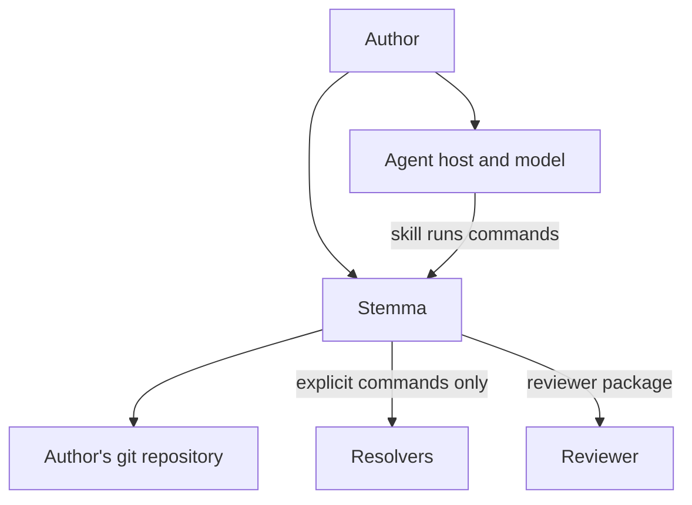
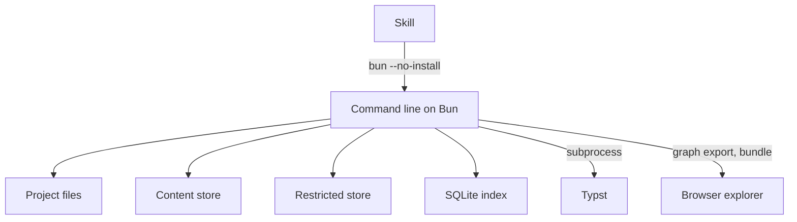
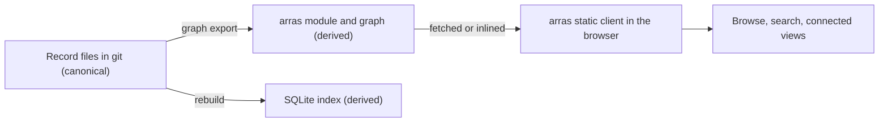
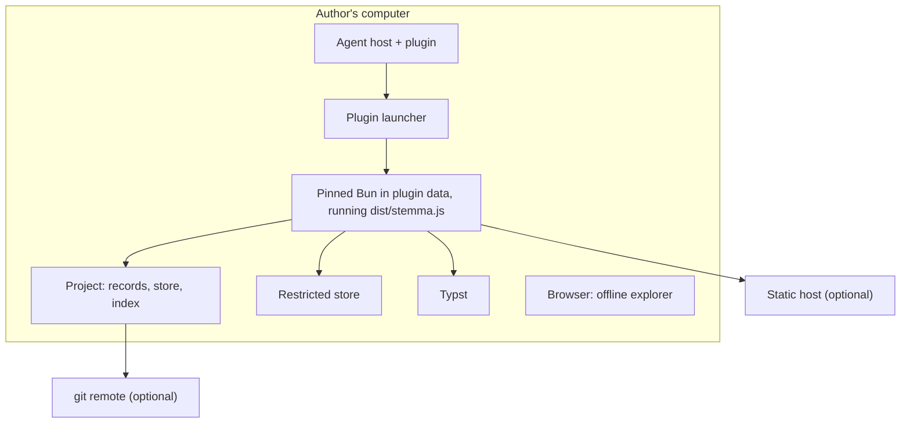
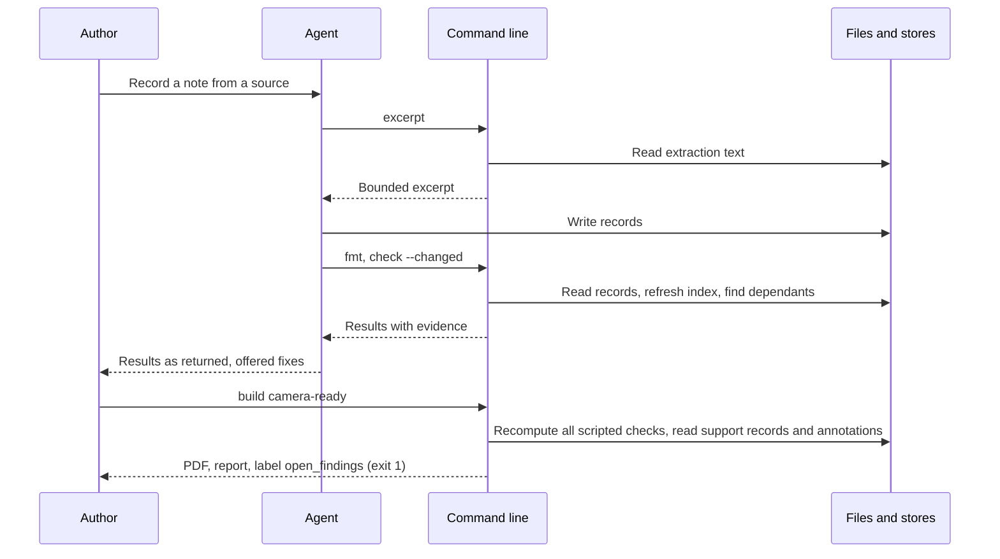

---
ddx:
  id: stemma.architecture
  type: architecture
  activity: design
  authoring:
    home: repo
  depends_on:
    - stemma.prd
    - stemma.concerns
    - stemma.adr-001
    - stemma.adr-002
    - stemma.adr-003
    - stemma.adr-004
    - stemma.adr-005
    - stemma.adr-006
    - stemma.adr-007
    - stemma.adr-008
    - stemma.adr-009
---

# Architecture

## Scope

Stemma runs on the author's computer: a plugin skill that an agent host loads, a
command line on Bun, a project directory of record files, and, from M3 (the
third delivery step), a browser explorer. There is no Stemma server, account, or
database of record. The drivers are the PRD's M1 pilot (checks and takeover),
M2 (new project to typeset PDF), and M3 (explorer and maps). Basic PDF
typesetting is part of the M1 pilot: a watermarked draft or an unwatermarked basic
PDF, each with its report. No finding stops a build (ADR-003). A full graph engine and ChatGPT support are
P1 and delay neither the pilot nor the first Claude release. Windows is native:
no required feature needs a Linux subsystem or Docker.

Outside the boundary: the agent host and its model, git, resolver services, and
the author's publisher. HELIX (the document method used to design Stemma) is not
a runtime part (ADR-001).

A first part exists as code: parts of `records`, `core`, `workspace`, and `cli`,
tested on one macOS system. The rest is design. Versions named are those used in
feasibility and development tests there; Linux, Windows, and desktop apps are
untested.

## Level 1: System Context

| Element | Type | Purpose | Protocol |
|---------|------|---------|----------|
| Author | User | Decides, reviews when they choose, annotates findings, runs builds | Chat, terminal, browser |
| Reviewer or editor | User | Reads the reviewer package | Files, browser |
| Agent host (Claude first; ChatGPT and Codex P1) | External | Loads the skill, runs commands, calls its model | Plugin and skill formats, process execution |
| Stemma | System | Evidence graph, checks, takeover, typesetting, exploration | Command line and files |
| git repository | External | History and exchange of record files | git |
| Bibliographic resolvers (optional) | External | DOI (Digital Object Identifier) and metadata lookups | HTTPS, only from explicit commands |
| arras | External family library | Browser graph application | npm package, bundled at build |



## Level 2: Container Diagram

| Container | Technology | Responsibilities | Communication |
|-----------|------------|------------------|---------------|
| Skill | Markdown in the plugin | Routes modes; states agent obligations | Runs the command line (CONTRACT-004) |
| Command line | TypeScript, one bundle on Bun 1.4.5 | Records, intake, extraction, checks, builds, exports | JSON on standard output, files (CONTRACT-002) |
| Project files | Canonical JSON, marked-up Markdown, and text in the author's repository | The evidence graph, manuscript copy, and settings; source of truth | Filesystem (CONTRACT-001, 006) |
| Content store | Separate private directory, files named by SHA-256, backed up by the author | Held copies, extracted text, original files | Filesystem |
| Restricted store | Local directory outside the project | Exact restricted coordinates | Filesystem |
| Derived index | SQLite through `bun:sqlite` | Disposable query index; later replaced behind one port by the graph engine, also on SQLite | In process |
| Typst compiler | Typst 0.15.1, native program | Lays out the book | Subprocess, generated files |
| Explorer | React and `@documentdrivendx/arras-ui` 0.8.1, Tailwind alongside arras styles, TypeScript bundle | Reads a graph export in the browser; later maps, pages, live preview | Static files (CONTRACT-005) |

citeproc-js 2.4.63 (a Citation Style Language processor) runs inside the command
line and, for preview, the explorer. Fonts and Typst packages are vendored or
pinned by digest.



### The graph in the repository and in the browser

The knowledge graph lives in the author's repository as canonical record files
(ADR-002). The browser never reads or writes them directly. `graph export`
projects them into an arras module and graph file, filtered for an audience. In
the page, arras's static client holds both in memory and answers every read, so
no server application runs. A static file host can serve the page, or Stemma
builds one offline HTML file with the data inlined. The export is derived
(ADR-006). It is never committed: a fresh clone rebuilds it with
`graph export --audience author --page` before browsing (CONTRACT-005 C). A page
cannot see edits made after it loads, so the reliable update
is a new export or build and a reload. After an edit the agent rebuilds the
offline preview and the author reloads it; the page then compiles Typst in the
browser from the rebuilt text (CONTRACT-005 D). A larger connected-graph view goes to arras before the explorer uses
it (ADR-008).



## Module Boundaries

**Source Applicability**: source; TypeScript command line, libraries, and browser bundle

Paths below are Bun workspace packages.

| Module | Responsibility / Owned Types | Public API | Allowed Dependencies | Forbidden Dependencies |
|--------|------------------------------|------------|----------------------|------------------------|
| `packages/records` | Record types generated from the UMF schema, canonical form, digests, validation, link rules, the `search-fold` function | CONTRACT-001 types and pure functions | A pinned validation helper if the generated validator needs one | Every other package; filesystem, network, process, SQLite; Bun-only APIs |
| `packages/manuscript` | CONTRACT-006 reader, document model, sentence and quotation rules, span edits | CONTRACT-006 types and pure functions | `records`, one pinned parsing library if chosen | `core` and adapters; filesystem, network, process; Bun-only APIs |
| `packages/core` | Checks, explained findings, the checked-clean label, report redaction (CONTRACT-002 E1), excerpt and annotation rules, change closure, use cases; owns all ports | CONTRACT-002 types, use-case functions, port interfaces | `records`, `manuscript` | All adapter packages and `cli`; filesystem, network, process, SQLite |
| `packages/workspace` | Adapters for record files, content and restricted stores, project settings, locking, git facts, resolvers | Port implementations | `records`, `core` | Other adapters, `cli` |
| `packages/extract` | Text, page maps, source metadata from held copies; recognition later | `TextExtractor` implementations | `records`, `core`, one pinned library per format | Other adapters, network |
| `packages/intake` | Word reader; CSL-JSON, BibLaTeX, RIS codecs; loss reports | CONTRACT-003 operations through ports | `records`, `manuscript`, `core`, pinned parsing libraries | Other adapters, network, process |
| `packages/cite` | CSL-JSON projection, citeproc-js, citation Typst output | `CitationFormatter` | `records`, `manuscript`, `core`, citeproc-js | Other adapters; Bun-only APIs |
| `packages/publish` | Markdown-to-Typst conversion, build orchestration, Typst process, reviewer package, which applies `core` redaction and runs the package scan | `Typesetter`, `Packager` | `records`, `manuscript`, `core`; `cite` and `graph` only through core ports | Direct citeproc-js import |
| `packages/graph` | `GraphStore` implementations (disposable index now, engine later), arras export | CONTRACT-005 | `records`, `core`, `bun:sqlite` in its index code | Other adapters; writing record files |
| `packages/cli` | Argument parsing, environment, output, composition root | CONTRACT-002 commands | All packages above | `explorer` |
| `packages/explorer` | Browser application and host page | Built bundle | Browser-safe exports of `records`, `core` operations, `manuscript`, `cite`, and the pure Typst conversion in `publish/convert`; graph export types, React, arras UI | `workspace`, `extract`, `intake`, the rest of `publish`, `cli`; any Bun or Node API |
| `skills/stemma` | Skill and mode instructions | CONTRACT-004 | The command line only | Importing or editing package code |

**Integration Owners**: filesystem, git, resolvers -> `workspace`; PDF, scan, and web formats -> `extract`; Word and legacy libraries -> `intake`; citeproc-js -> `cite`; Typst -> `publish`; SQLite and arras export -> `graph`; arras UI and browser Typst -> `explorer`; agent host -> `skills/stemma` and plugin manifests. Native shapes are translated in the owning package and do not appear in `core` ports.
**Construction Policy**: only `packages/cli` constructs adapters and passes them to core use cases; the explorer entrypoint composes its own browser clients; tests substitute in-memory adapters.
**Boundary Check**: `bun run check:boundaries`, a script that fails on a forbidden or cyclic import and on a deep import past a package's exports. It is part of the one local check command and release-tag runs, with no required hook or CI job (ADR-007). The script and its allowed and forbidden test cases precede feature code.

### Command line first

Every function is a `core` operation with a command (FR-49, CONTRACT-002 B). A
user interface, the explorer included, is added for ease of use: it calls the
same operations, or shows values those operations computed into an export, and
holds no business logic of its own. An interface function is built after its
command. Until the explorer exists, nothing shows that `core` and `records` run
in a browser; `records` uses a runtime hashing library that would need
replacing there.

### Ports

| Port | Why it is a port |
|---|---|
| `RecordRepository`, `BlobStore`, `RestrictedStore` | Tests run without a filesystem; stores live outside the project |
| `GraphStore` | The engine replaces the disposable index (ADR-006) |
| `TextExtractor` | The PDF library may be replaced, and the recognition engine is undecided |
| `ManuscriptRepository` | Reads and splices the Stemma copy (CONTRACT-006) without core touching files |
| `CitationFormatter`, `Typesetter` | The citeproc-js license review and Typst process sit behind them |
| `Resolver`, `Clock`, `Environment` | Network and time stay out of deterministic results |
| `CandidateSearch` | Research search services are unchosen; adapters live in `workspace` |

Signatures are defined in code under `core`; those shared across tools are in
the contracts.

### Code layout

```text
.claude-plugin/          plugin and marketplace manifests
skills/stemma/           SKILL.md, modes/, prompts/support/
templates/               files copied into a new project
dist/stemma.js           bundled command line, built from packages/; not committed, shipped in tagged release trees
packages/{records,manuscript,core,workspace,extract,intake,cite,publish,graph,cli,explorer}/
fixtures/                synthetic or openly licensed test material, seeded errors
scripts/                 check, boundary, bundle, install-test scripts in TypeScript
docs/stemma/             HELIX documents
```

The record schema lives with CONTRACT-001; a build step generates `records`
types and validators from it and the arras module in `graph`. Following
`typescript-bun`, code uses strict compiler settings, `bun:test`, Biome, a
committed `bun.lock`, and one environment module in `cli`. Complexity and
file-size ceilings follow `code-shape-ceilings`. Tests use no private or
copyrighted source.

## Deployment

| Component | Infrastructure | Instances | Scaling | Backup / Recovery |
|-----------|----------------|-----------|---------|-------------------|
| Skill and command line | Plugin installed from the marketplace into the host's plugin cache; pinned Bun set up by the plugin in its data directory | One per host profile | Not applicable | Reinstall the same version |
| Project files | Author's disk and chosen git remote | One working copy per machine | Bounded by record count; measured only to 25,000 synthetic records | git history |
| Content store | Private directory outside git | One per machine | Bounded by disk | Author's backup; digests verify a restore |
| Restricted store | Per-user directory outside the project | One per machine | Not applicable | Author's separate protected backup; Stemma copies it nowhere |
| Derived index | `.stemma/` | One per working copy | Rebuilt | None needed |
| Typst | Pinned program the plugin sets up in its data directory (not built) | One | Not applicable | Set up again |
| Explorer | Offline HTML file, or a static file host the author chooses | Per export | Graph size; chapter scope | Regenerate |



Distribution: Stemma is first and foremost a Claude plugin, and installing it
is the only installation a person does. The bundle is not committed to the
repository. The marketplace entry installs a tagged release tree (manifests,
skill, launcher, unminified bundle) from a separate distribution repository. On
first use the launcher sets up the pinned Bun in the plugin's data directory from
a digest-verified download (ADR-004); Typst, when built, arrives the same way.
`--no-install` stops Bun from fetching packages while running. Claude desktop's
local Code tab is the only v1 full-function promise; on Linux the command line,
checks, and builds are targeted with no desktop-app integration promised; the
Claude command-line tool is a test harness only. SD-010 records what has been
observed.
Tests run locally, and on the three systems only for release tags, as advisory
results (ADR-007).

## Data Flow

Work, then a camera-ready build with open findings:



Failure handling: a missing blob or resolver result makes the dependent result
`unverifiable`, which the report explains. No finding stops a command or a
build. Only a tool failure, such as a manuscript that cannot be parsed or a
compile error, stops output, and a crash is never a pass. Takeover writes
atomically and never changes the originals.

## Quality Attributes

The PRD sets no timing targets. Numbers marked (a) are design assumptions to
measure.

| Attribute | Target | Strategy | Verification |
|-----------|--------|----------|--------------|
| Availability | No hosted dependency: check, build, and export make 0 network requests | Local stores; network only in named commands | Run the seeded project with network denied |
| Determinism | 0 byte differences in report bodies across two runs with equal inputs and tools; same results on three systems (unproven) | CONTRACT-001 and 002 canonical forms; no clock, locale, or directory order in results | Repeat-run test; release-tag matrix |
| Check coverage | Each CONTRACT-002 check fails its seeded error, passes clean input, or states why it cannot check | One seeded set per check | Seeded suite |
| Performance (a, unverified) | Full rebuild of 25,000 records in 5 s or less; `check --changed` after one edit in 5 s or less; 10,000-node explorer load in 5 s or less | Disposable SQLite index, dependency closure, chapter scope | Timed runs on a stated laptop. One synthetic test rebuilt 25,000 records in about 1.1 s without checks |
| Security | 0 executions of input content; every codec limit enforced; no known high-severity dependency advisory or secret at release without a stated decision | CONTRACT-003 limits, pinned lockfile, source text treated as data | Hostile fixtures; audit and secret scan before release |
| Privacy and rights | 0 seeded structured restricted values in tracked files and reviewer outputs; 0 seeded stored-source strings in reviewer graph and report | Outside store, allow list, report redaction, scans. Stray coordinates only warn | Seeded-leak tests on structured values; seeded prose coordinate is warned. Prose, paraphrase, and place names can disclose |
| Accessibility | WCAG (Web Content Accessibility Guidelines) 2.2 AA; 0 axe-core violations on the core flow; text alternatives for page images and maps | arras components, lists beside views | Playwright flow against the built bundle, plus manual review |
| Disaster Recovery | RPO (recovery point): last commit for records, last author backup for both stores. RTO (recovery time): 15 minutes or less after files are restored (a) | Everything else is derived | Rebuild on a clean machine and compare dump and report |

Known assurance limit: the command line governs only its own behaviour. An agent
or person with file access can edit verdicts, review marks, and annotations, and
can read whole store files rather than excerpts. Sources are not gated from
hosted models: a project is for material that may be sent to its model.
Running everything on a local model is an unsupported experiment, so no check,
format, or command depends on a particular model.

## Decisions and Tradeoffs

| Decision | Status | Rationale | Follow-up |
|----------|--------|-----------|-----------|
| ADR-001 to ADR-009 | As each ADR states | Separate repository; plain records; reporting without blocking; Bun; Typst and citeproc-js; arras-compatible engine; local-first tests; arras graph view; Markdown manuscript copy | Their stated assumptions |
| Architecture style: hexagonal, ports and adapters (HELIX `hexagonal-architecture`) | Decided by the product owner; fills the `architecture-style` slot | One core is driven by the command line and tests and drives parts that are undecided or will change: the index, extraction, recognition, manuscript form, and citation formatting. `classic-layered` would let checks depend on files and SQLite directly; onion and clean styles add layers no requirement needs. Core rules (`records`, `manuscript`, `core`) are independent of applications, databases, and file tools | Boundary check |
| Checks are pure over ports | Proposed | Repeatable tests and one result path for agent, build, and terminal | none |
| Ship the unminified command-line bundle in a separate distribution repository, tagged by version | Decided by the product owner (distribution repository allowed if needed); mechanism chosen in SD-010 | No built file in the Stemma repository. Trade-off: a second publishing surface; unobserved in Claude desktop | Install check before the pilot |
| Pin Bun 1.4.5 first | Assumption | It is the version tested | Confirm at first release |
| Generated browser graph is rebuilt, never committed | Decided by the product owner | Record files are the one official copy | Fresh-clone test |
| First engine scope: arras static-profile reads, TypeScript on SQLite, no writes | Decided by the product owner | Bounds the engine; writes and wider server compatibility come later | CONTRACT-005 I |
| arras static client as the explorer's data layer | Proposed, within ADR-006 and ADR-008 | Browser reads with no server application | Size, offline, and policy proofs |
| No runtime UMF dependency | Proposed | The WebAssembly build is about 46 MB, took about 0.9 s per validation, and accepted broken definitions; UMF is used at development time | Generator for validators |

## Downstream Solution Designs

Solution design numbers follow feature numbers.

| Design | Subject | Depends on | Step and unproven input |
|---|---|---|---|
| SD-010 | Runtime, bundle, command line, plugin, install tests | CONTRACT-002, 004; ADR-004, 007 | M1, first. Marketplace install that sets itself up in Claude desktop, on three systems |
| SD-011 | Records, validators, disposable index, change closure; later the export and the read-only engine | CONTRACT-001, 005; Data Design; SD-010 | M1, first. Engine scope is CONTRACT-005 I |
| SD-001 | Standing rules (M1), then setup and registers | SD-011; record-shape additions to CONTRACT-001 | M1, M2 |
| SD-002 | Admission, stores, extraction, page maps, rights | SD-011 | M1. PDF text library; recognition on pilot scans |
| SD-003 | Bibliography, keys, locators, legacy codecs | SD-002; CONTRACT-003 | M1. Real library files |
| SD-005 | Notes, claims, review states, constructs | SD-002, SD-003 | M1; construct register M2 |
| SD-007 | Check engine, quotation and sentence profiles, support flow, annotations, explained findings, label, report redaction | SD-002, 003, 005; CONTRACT-002, 006 | M1. Harmless-difference list on pilot sources; real publisher PDFs; separate-context support run; labelled verdict set |
| SD-015 | Word intake, Stemma copy, reference list, optional batch review, resolution rounds | SD-003, 005, 007; CONTRACT-003 F, 006 | M1. Files saved by real tools |
| SD-004 | Research and admission | SD-002, SD-003 | M2 |
| SD-014 | Voice and style profiles | SD-001 | M2 |
| SD-008 | Markdown reader and Typst conversion, citation formatting, build: basic PDF (6 x 9 in, 5.5 x 8.5 in, A5), then full features and images | CONTRACT-006, SD-007 | Basic M1, full M2. citeproc-js license review; style examples approved against the manual; Typst distribution. v1 is left-to-right with right-to-left quotations; right-to-left main text is experimental |
| SD-006 | Outline and drafting | SD-001, 005, 014; CONTRACT-006 | M2 |
| SD-009 | Audit, disclosure, reviewer package and comment import | SD-007, 008; package part on SD-012 | M2; package M3 |
| SD-012 | Explorer, linked pages, live preview, reviewer comment capture (comment behavior is FEAT-009, import SD-009) | SD-008, 011; CONTRACT-005 | M3. Browser Typst test first; rebuild-and-reload flow; arras view contribution; saving a file from a local page |
| SD-013 | Argument and geographic maps | SD-005, 011, 012 | M3 |

CONTRACT-006 is shared by takeover, checks, build, and preview. Its reader is
on the pilot path and is untested.

## Risks

| Risk | Effect on this architecture |
|---|---|
| Browser Typst compilation is untried and may be blocked | Previews may need another host page, or fall back to prebuilt pages, which would not meet FR-65 |
| citeproc-js is licensed CPAL (Common Public Attribution License) or AGPL (GNU Affero General Public License) | May change how `cite` ships or what formats citations |
| A host blocks script execution or the setup download | No checks there; the host cannot be claimed |
| Real PDFs, scans, and Word files differ from synthetic fixtures | Extraction and intake designs may change |
| Graph size exceeds arras's claimed 1,024 nodes | Scoped exports and measured claims |
| The preview changes only after the agent rebuilds and the author reloads | An open page can show earlier text, so it shows its data identity |
| Claude desktop does not install from the distribution repository | The plugin cannot be installed there |
| Nothing stops publication with open findings | A book or package can disclose a site or protected text, carry unusable or unpermitted images, or hold unsupported or unreviewed claims |
| Basic typesetting joins the pilot | The citeproc-js license, Typst distribution, and the markup reader sit on the pilot path |
| The defined Markdown features cannot carry a real chapter, or sentence and quotation reading is unstable | Takeover output, annotations, and quotation results would need a markup change |
| A site is marked restricted after being shown or committed | It may remain in history, exports, or model input |
