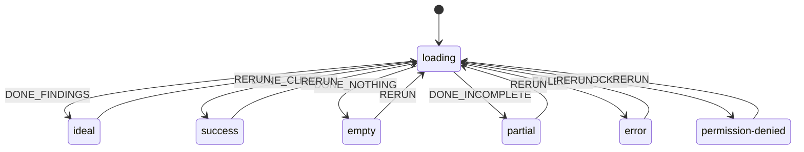

---
ddx:
  id: UF-007-01-check-results
  type: wireframe
  activity: design
  authoring:
    home: repo
  depends_on:
    - UF-007
    - US-031
    - US-033
    - stemma.design-system
---

# UF-007-01-check-results: Check Results Turn

**User flow**: [[UF-007]] view `check results turn` | **Stories**: [[US-026]], [[US-027]], [[US-031]], [[US-032]], [[US-033]]

## Scope and Fidelity

- **View**: Report one check run and support findings so the author can choose what to do.
- **Modality**: chat
- **Fidelity**: mid
- **Size classes**: not applicable: chat; the host sets the width
- **Pattern**: DESIGN.md chat turn rules and status words

## Layouts

### Turn

```text
[Run line]        Checked: changed records and dependants. 14 results.
[Summary]         2 fail, 1 could not check, 11 pass. 3 open. Work continues.
[Finding]         fail  quote.present  chapter 3, "<cited sentence>"
                  [What]      what differs, in plain words
                  [Evidence]  match: near. Quoted text (data), source ID, pages
                  [Why]       why it matters to a reader
                  [Fixes]     correct the quotation / repoint / replace / remove
[Grouped]         <one cause>: <n> places
[Support]         Model judgment (not verification): partly_supported
                  <model, date, claim, quoted passage, problem, fixes>
                  Missing or stale records, unlinked citations: <items>
[Unreviewed]      <n> items not yet reviewed (counted apart; not findings)
[Annotations]     Applying: <n>. Ended: <finding and what changed>
[Advice]          Advice (not a finding): <only if any>
[Not shown]       <n> more results
[Choices]         Fix <finding> / run support check / annotate / build / show more
```

### Annotations

| Element | Kind | Annotation | Size classes | Links |
|---|---|---|---|---|
| Run line | feedback | Scope and whether the run completed | all | US-027-AC1 |
| Summary | content | Counts by outcome and open count from the report | all | US-026-AC1 |
| Finding | content | Check ID, outcome, reason code and location as returned; the agent's own opinion never replaces them | all | US-031-AC4 |
| Evidence and why | content | Report evidence, quoted as data. A line-end hyphen join is stated when used | all | US-031-AC1, CONTRACT-002 D |
| Fixes | control | Only the offered fix codes, in plain words. The author names one; the agent changes nothing else | all | UF-007 Apply chosen fix |
| Grouped | content | Findings with one cause are shown once with every place; no finding appears without an explanation | all | US-026-AC6 |
| Support | content | Reported during work. Cached resolver results show their date | all | US-031-AC2, US-033-AC1 |
| Unreviewed | content | A separate count from the report. Unreviewed items are not open findings and do not change the label | all | US-026-AC1 |
| Annotations | content | An annotated result keeps its outcome word | all | US-028-AC3 |
| Choices: support | control | Starts support judgments in a separate context | all | UF-007 Run support check |
| Choices: annotate | control | For a named finding; optional, and the agent does not suggest it as the first fix | all | UF-007 Ask to annotate |
| Choices: build | control | Asks which mode | all | UF-007 Build from results |
| Choices: show more | control | Next group | all | UF-007 Show more results |
| Choices: rounds | control | Offered in a taken-over project | all | UF-007 Open reference rounds |
| Choices: stop | control | The author may reply with anything else; findings stay open | all | UF-007 Finish checking |

## States and Events

### States

| State | Applies | Entered when | Person sees | Available actions | Announcement | Exit |
|---|---|---|---|---|---|---|
| ideal | yes | A run completed with findings | The turn above | Fix, support, annotate, build, more, stop | Run line first; politeness is set by the host | RERUN |
| empty | yes | Nothing in scope | "Nothing was in scope. This is not a pass." | Ask for another scope, stop | First line of the turn (host-controlled) | RERUN |
| loading | yes | A command starts | "Running <command> on <scope>" | Interrupt | That line (host-controlled) | DONE_FINDINGS, DONE_CLEAR, DONE_NOTHING, DONE_INCOMPLETE, FAILED, BLOCKED |
| partial | yes | A check threw or cannot check some items | Completed results, then each `unverifiable` with its reason. After exit 70, no result is read as a pass | Rerun, report defect, stop | "Run incomplete" first line (host-controlled) | RERUN |
| error | yes | Exit 3, 4 or unreadable output | "Nothing was checked", cause, fix | Fix and rerun, stop | "Nothing was checked" first line (host-controlled) | RERUN |
| offline | no: checks need no network; resolver-based results show a dated cache or `unverifiable` |  |  |  |  |  |
| slow | no: no timing threshold is set, and the host shows that a command is running |  |  |  |  |  |
| permission-denied | yes | The host blocks scripts | "Checks are unavailable in this session. Nothing was checked." | Move to a supported session | That sentence (host-controlled) | RERUN |
| success | yes | Nothing open in scope | Counts and annotated results. Never "verified" | Build, run support, stop | Run line first (host-controlled) | RERUN |

### Statechart



### Events

| Event | From | Guard | To | Effect |
|---|---|---|---|---|
| DONE_FINDINGS | loading | open findings | ideal | Results reported as returned |
| DONE_CLEAR | loading | nothing open | success | Counts reported |
| DONE_NOTHING | loading | empty scope | empty | Reason reported |
| DONE_INCOMPLETE | loading | check_error | partial | Completed and unverifiable items listed |
| FAILED | loading | exit 3, 4 or unreadable | error | No result reported |
| BLOCKED | loading | host refuses scripts | permission-denied | No substitute check |
| RERUN | ideal | after a fix, support run or request | loading | Command runs again |
| RERUN | partial | author request | loading | Command runs again |
| RERUN | error | cause fixed | loading | Command runs again |
| RERUN | empty | new scope | loading | Command runs again |
| RERUN | success | change or request | loading | Command runs again |
| RERUN | permission-denied | session allows scripts | loading | Command runs |

## Accessibility

- **Focus order**: reading order of the turn; choices last.
- **Accessible names**: each choice names the check and location, not "option 1" alone.
- **Headings and landmarks**: short text headings in the order shown; the host owns landmarks. Evidence is not placed only in wide tables.
- **Target size and input**: typed replies; no pointer-only action.

## Open Questions

- How many results one turn shows before grouping: skill design owner.
- Whether each host runs the post-change check reliably is unverified; agent behaviour needs recorded manual runs.
