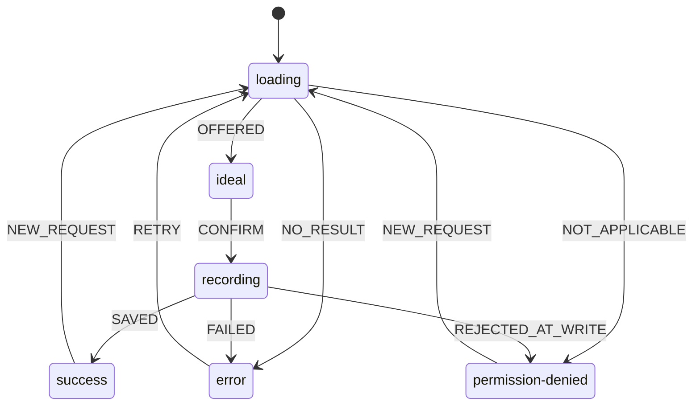

---
ddx:
  id: UF-007-02-annotation
  type: wireframe
  activity: design
  authoring:
    home: repo
  depends_on:
    - UF-007
    - US-028
    - stemma.design-system
---

# UF-007-02-annotation: Annotation Turn

**User flow**: [[UF-007]] view `annotation turn` | **Stories**: [[US-028]]

## Scope and Fidelity

- **View**: Show exactly what an annotation would cover, and record it only on the author's instruction. The turn is optional and never appears as a condition of continuing.
- **Modality**: chat
- **Fidelity**: mid
- **Size classes**: not applicable: chat; the host sets the width
- **Pattern**: Optional record turn

## Layouts

### Turn: offered

```text
[Status]       Nothing recorded yet.
[Finding]      <outcome>  <check ID>  <location>: what is wrong and why it matters
[Binding]      Sentence: "<exact sentence>"  Source: <ID and title>
               or  Item: <record ID, current content shown>
[Comparison]   (near match only) Cited text: "..."  Stored text: "..."  (data)
[Effect]       Explain, or dismiss. The result stays <outcome>; a dismissed
               finding is no longer open; reports and the disclosure list it;
               it ends if the bound sentence, source or item changes.
[Limit]        A dated record of what you said. It is not forgery-proof.
[Record]       To record it, name the finding, explain or dismiss, and a reason.
[Leave]        Say no, ask for a fix, or carry on with anything else.
```

### Turn: cannot be dismissed

```text
[Reason]       This finding stays open: <reason>
[Way forward]  <fix that closes it>; an explanation can still be saved
```

### Annotations

| Element | Kind | Annotation | Size classes | Links |
|---|---|---|---|---|
| Status | feedback | First line, so a read-out starts with the fact that nothing changed | all | US-028-AC2 |
| Binding | content | Taken from the current result, never typed by the author or agent; identical sentences are told apart by location | all | US-028-AC1, US-028-AC7 |
| Comparison | content | Both texts in full, saved with a near-match annotation | all | CONTRACT-002 F |
| Limit | content | Always shown | all | US-028-AC6 |
| Record | control | Needs finding, effect and reason from the author. An unclear reply records nothing | all | UF-007 Save annotation |
| Leave | control | Writes nothing and stops nothing | all | UF-007 Leave without annotating |
| Reason | feedback | A missing stored copy, unreadable record or uncommitted change, in plain words | all | US-028-AC9 |
| Way forward | control | Returns to the finding and its fixes | all | UF-007 Leave without annotating |

## States and Events

### States

| State | Applies | Entered when | Person sees | Available actions | Announcement | Exit |
|---|---|---|---|---|---|---|
| ideal | yes | The finding is current | The first layout | Record, leave | "Nothing recorded yet" (host-controlled) | CONFIRM |
| empty | no: the turn opens only for a named finding |  |  |  |  |  |
| loading | yes | The author asks to annotate | "Reading the current result" | Interrupt | That line (host-controlled) | OFFERED, NOT_APPLICABLE, NO_RESULT |
| partial | no: one record is written or none |  |  |  |  |  |
| error | yes | The finding no longer exists or the write fails | "No annotation recorded" and cause; the reason is repeated back so it is not lost | Rerun checks, leave | That sentence (host-controlled) | RETRY |
| offline | no: no network is used |  |  |  |  |  |
| slow | no: a local single-record write has no stated threshold |  |  |  |  |  |
| permission-denied | yes | A dismissal that does not apply | The cannot-be-dismissed layout | Explain or return to findings | "This finding stays open" (host-controlled) | NEW_REQUEST |
| success | yes | Saved and rechecked | Record ID, date, reason, and the result with its annotation | Continue | "Annotation recorded; result unchanged" (host-controlled) | NEW_REQUEST |
| recording | yes | The author names finding and reason | "Recording the annotation" | Interrupt | That line (host-controlled) | SAVED, FAILED, REJECTED_AT_WRITE |

### Statechart



### Events

| Event | From | Guard | To | Effect |
|---|---|---|---|---|
| OFFERED | loading | finding current | ideal | Binding taken from the current result |
| NOT_APPLICABLE | loading | dismissal does not apply | permission-denied | Reason shown; nothing written |
| NO_RESULT | loading | finding gone or unreadable | error | Nothing written |
| CONFIRM | ideal | finding and reason named | recording | annotate, then check |
| SAVED | recording | recheck ran | success | Reports the record |
| FAILED | recording | any failure | error | Nothing reported as saved |
| REJECTED_AT_WRITE | recording | exit 5 | permission-denied | Nothing written |
| RETRY | error | author asks | loading | Binding re-read |
| NEW_REQUEST | success | another finding | loading | New binding read |
| NEW_REQUEST | permission-denied | another finding | loading | New binding read |

## Accessibility

- **Focus order**: status, finding, binding, comparison, effect, limit, then the reply.
- **Accessible names**: the two compared texts are labelled "Cited text" and "Stored text"; differences are also described in words.
- **Headings and landmarks**: the host owns them; each part has a text label.
- **Target size and input**: typed reply only.

## Open Questions

- Which source changes (stored file, bibliography record or both) end an annotation is open in FEAT-007: product owner. The turn states the binding the report carries.
- Risk: the command cannot establish who ran it or what they read.
