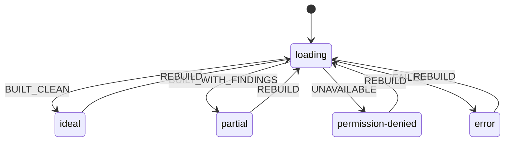

---
ddx:
  id: UF-007-03-build-result
  type: wireframe
  activity: design
  authoring:
    home: repo
  depends_on:
    - UF-007
    - US-026
    - US-107
    - stemma.design-system
---

# UF-007-03-build-result: Build Result Turn

**User flow**: [[UF-007]] view `build result turn` | **Stories**: [[US-026]], [[US-027]], [[US-033]]

## Scope and Fidelity

- **View**: Say what was built, its label, what is open and what it can disclose. Every build completes unless a tool fails.
- **Modality**: chat
- **Fidelity**: mid
- **Size classes**: not applicable: chat; the host sets the width
- **Pattern**: DESIGN.md chat turn rules

## Layouts

### Turn: built

```text
[Verdict]      Built: <path>. <draft, watermarked | camera-ready (M1: basic PDF,
               not print-ready) | reviewer package>
[Label]        Checked clean, or Open findings: <n> (<could not check>)
[Unreviewed]   <n> items not yet reviewed; counted apart from the label
[Warnings]     Can disclose a restricted site or protected material
[Open]         By chapter and cause: what is wrong, the evidence, why it
               matters, what to do
[Basis]        Support records checked for presence and currency; model
               verdicts not rerun. Annotations applied: <n>
[Record]       Commit, uncommitted changes yes or no, report digest
[Choices]      Look at a finding / build again / stop
```

### Turn: tool failure

```text
[Verdict]      No output: <tool or file> failed. This is a tool failure.
[Cause]        File, line or tool, and how to fix it
[Choices]      Fix and build again / stop
```

### Annotations

| Element | Kind | Annotation | Size classes | Links |
|---|---|---|---|---|
| Verdict | feedback | Output kind and path, or the tool failure. An older PDF is never presented as this build's output | all | US-026-AC5, US-107-AC4 |
| Label | content | Directly under the verdict; an output with open findings is never called checked clean. The label reflects check results only. Camera-ready pages carry no mark; the turn and report state the status | all | US-026-AC3, US-026-AC4 |
| Unreviewed | content | Count from the report; it does not change the label | all | US-026-AC1 |
| Open | content | Every open finding, grouped and explained; counts match the report | all | US-026-AC6, US-033-AC2 |
| Warnings | content | A coordinate finding, a scan that could not run, or protected text that cannot be removed states that the output can disclose it | all | US-067-AC3, US-067-AC7 |
| Basis | content | Never says claims are verified | all | US-033-AC5 |
| Choices: look | control | Opens one finding | all | UF-007 Look at a finding |
| Choices: build again | control | Runs a build in the named mode | all | UF-007 Build again |
| Choices: stop | control | Ends the task | all | UF-007 Finish build |

## States and Events

### States

| State | Applies | Entered when | Person sees | Available actions | Announcement | Exit |
|---|---|---|---|---|---|---|
| ideal | yes | Output built with nothing open | The built layout labelled checked clean | Build again, stop | "Built, checked clean" and path (host-controlled) | REBUILD |
| empty | no: a project with no manuscript is reported as a tool failure |  |  |  |  |  |
| loading | yes | Build starts | "Building <mode>; rerunning all checks" | Interrupt | That line (host-controlled) | BUILT_CLEAN, BUILT_WITH_FINDINGS, UNAVAILABLE, FAILED |
| partial | yes | Output built with open findings | Built layout with label and findings | Look, build again, stop | "Built with open findings" (host-controlled) | REBUILD |
| error | yes | Manuscript syntax error, compile error, missing Typst or font, busy, internal error | The tool-failure layout | Fix and build again, stop | "No output, tool failure" (host-controlled) | REBUILD |
| offline | no: builds use no network |  |  |  |  |  |
| slow | no: no timing target exists |  |  |  |  |  |
| permission-denied | yes | The host blocks scripts | "Builds are unavailable in this session" | Move to a supported session, stop | "Builds unavailable" (host-controlled) | REBUILD |
| success | no: ideal and partial are the built results |  |  |  |  |  |

### Statechart



### Events

| Event | From | Guard | To | Effect |
|---|---|---|---|---|
| BUILT_CLEAN | loading | output written, nothing open | ideal | Path and basis reported |
| BUILT_WITH_FINDINGS | loading | output written, findings open | partial | Label and warnings first |
| UNAVAILABLE | loading | no script access | permission-denied | No substitute result |
| FAILED | loading | environment or syntax failure | error | No file presented |
| REBUILD | ideal | author asks | loading | Full rerun |
| REBUILD | partial | author asks | loading | Full rerun |
| REBUILD | error | cause fixed | loading | Full rerun |
| REBUILD | permission-denied | author asks | loading | Full rerun |

## Accessibility

- **Focus order**: verdict, warnings, lists, choices.
- **Accessible names**: each choice names its mode or finding.
- **Headings and landmarks**: text labels; the host owns structure.
- **Target size and input**: typed replies. The PDF's own accessibility is not claimed unless verified (CONTRACT-006 G).

## Open Questions

- Risk: nothing stops publication, so an output can disclose a site, carry unpermitted or unusable images, or hold unsupported or unreviewed claims. A checked-clean book can still hold unreviewed AI items; the report counts them.
- Risk: an altered verdict or annotation goes undetected (ADR-003).
