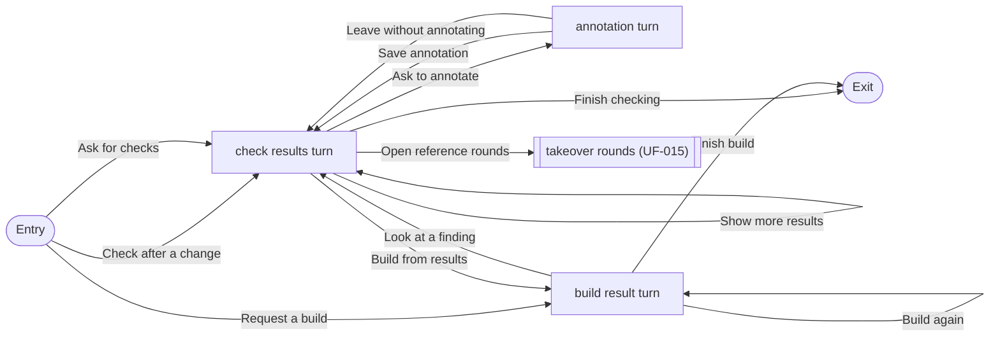

---
ddx:
  id: UF-007
  type: user-flow
  activity: design
  authoring:
    home: repo
  depends_on:
    - FEAT-007
    - US-026
    - US-027
    - US-028
    - US-031
    - US-032
    - US-033
    - US-034
    - stemma.design-system
    - CONTRACT-002
    - CONTRACT-004
---

# UF-007: Check Feedback and Annotations User Flow

**Feature**: [[FEAT-007]] | **Solution design**: [[SD-007]] | **Journey maps**: none | **Interface system**: [[stemma.design-system]]

## Scope

- **Covers**: agent turns that report and explain checks and support judgments, apply the author's fix, record an annotation, and report a build (M1). M2 camera-ready output uses the same turns.
- **Entry points**: the agent changed records; the author asks for checks or a build; a link from takeover ([[UF-015]]).
- **Exits**: back to the author's work; takeover rounds (UF-015) for failing references.
- **Size classes**: not applicable (chat).
- **Out of scope**: takeover rounds (UF-015); reviewer packaging screens; what the commands do (CONTRACT-002).
- **Limits**: no turn stops work or asks for approval before continuing. No commit hook or required CI exists, so edits outside the agent are seen at the next check or build. The turn rules are instructions to the agent; Stemma does not enforce them against an agent with file access (CONTRACT-004 C).

## Views

| View | Kind | Purpose | Stories | Wireframe |
|---|---|---|---|---|
| check results turn | turn | Understand what was checked, what is open, why it matters and what to do | US-026, US-027, US-031, US-032, US-033, US-034 | [[UF-007-01-check-results]] |
| annotation turn | turn | Explain or dismiss one named finding, when the author wants to | US-028 | [[UF-007-02-annotation]] |
| build result turn | turn | Learn what was built, its label, what is open and what it can disclose | US-026, US-027, US-033 | [[UF-007-03-build-result]] |
| takeover rounds (UF-015) | external | Work through failing references | US-102 | none |

## Flow Diagram

## Transitions

| Action | From | Control | Guard | To | Feedback | Changed region |
|---|---|---|---|---|---|---|
| Check after a change | Entry | none (agent obligation) | the agent wrote records or manuscript text | check results turn | Says that `check --changed` is running, then the results for changed records and dependants | new turn |
| Ask for checks | Entry | author's message | none | check results turn | Says which scope is running, then results | new turn |
| Request a build | Entry | author's message naming the mode | none | build result turn | Says the build is running, then the output and label | new turn |
| Apply chosen fix | check results turn | author names a finding and a fix | the choice is unambiguous | check results turn | What changed, then the rerun result as returned. Undo is a further author request, rechecked the same way | new turn |
| Run support check | check results turn | author's message, or agent offer accepted | a separate context is available | check results turn | Progress per claim; each saved verdict as a model judgment with its quoted passage | new turn |
| Show more results | check results turn | author asks for the next group | results remain unshown | check results turn | Next group and the number still unshown | new turn |
| Ask to annotate | check results turn | author asks to explain or dismiss a named finding | none | annotation turn | The finding, what an annotation would bind, and whether it can be dismissed. Nothing is written yet | new turn |
| Save annotation | annotation turn | author's instruction naming the finding, effect and reason | none | check results turn | Annotation saved; the rerun shows the outcome unchanged and its annotation | new turn |
| Leave without annotating | annotation turn | author declines, asks something else or asks for a fix | none | check results turn | "No annotation was recorded"; the finding stays open | new turn |
| Build from results | check results turn | author asks for a build | none | build result turn | Says the build is running, then the output, its label and what is open | new turn |
| Look at a finding | build result turn | author names a finding | none | check results turn | That finding with evidence, why it matters and offered fixes | new turn |
| Build again | build result turn | author asks again | none | build result turn | New result from a full rerun | new turn |
| Open reference rounds | check results turn | author accepts the offer | taken-over project with failing references | takeover rounds (UF-015) | The first open item | new turn |
| Finish checking | check results turn | author moves on at any time | none | Exit | Open findings stay in the report; work continues | none |
| Finish build | build result turn | author moves on | none | Exit | The output path and label, or the tool failure | none |

## Alternate Paths

| Path | Trigger | Transitions | Recovery |
|---|---|---|---|
| Error | Runtime or Bun version wrong, project unreadable, internal error | Check after a change → Finish checking | The turn says nothing was checked, names the cause and fix, and reports no result (exit 3, 4 or 70) |
| Error | A fix cannot be applied because the file changed (`stale_input`) | Apply chosen fix | Nothing was written; the agent rereads and asks again |
| Error | No separate context, or the verdict is rejected (`stale_input`, quote not in passage) | Run support check | No support record is saved; the claim stays missing or stale; the author may start a new session |
| Cancel | The author gives no choice or an unclear reply | Ask to annotate → Leave without annotating | Nothing is recorded; work continues |
| Cancel | The author interrupts a run | Ask for checks → Ask for checks | No result is claimed; run again |
| Empty | Nothing in scope | Ask for checks | "Nothing was in scope"; never reported as a pass |
| Permission denied | The host blocks script execution | Request a build → Finish build | Checks and builds are stated as unavailable; use a supported session |
| Not applicable | The author asks to dismiss a missing source file, an unreadable record or uncommitted changes | Ask to annotate → Save annotation | An explanation can be saved; the turn says why the finding stays open and what would close it |
| Ends | The bound sentence, source or item changes | Check after a change | The earlier annotation is listed as ended and the finding is open again |

## Story Traceability

| Journey | Task | Stories / ACs | Path |
|---|---|---|---|
| fix a failure | Resolve it with the agent | US-027-AC1, US-031-AC1, US-031-AC3, US-031-AC4 | Check after a change → Apply chosen fix → Finish checking |
| judge claim support | Get a separate judgment | US-031-AC2, US-032-AC1, US-032-AC2, US-033-AC1, US-034-AC1 | Ask for checks → Run support check → Finish checking |
| annotate a finding | Explain or dismiss one finding with a reason | US-028-AC1, US-028-AC2, US-028-AC7, US-028-AC9 | Ask for checks → Ask to annotate → Save annotation → Finish checking |
| annotation ends | Learn a bound text changed | US-028-AC3, US-028-AC4, US-028-AC8 | Check after a change → Finish checking |
| build with findings | Build and read what is open | US-026-AC2, US-026-AC3, US-027-AC3, US-033-AC2, US-033-AC3, US-033-AC4 | Request a build → Look at a finding → Apply chosen fix → Build from results → Finish build |

## Dead Ends

- None.
