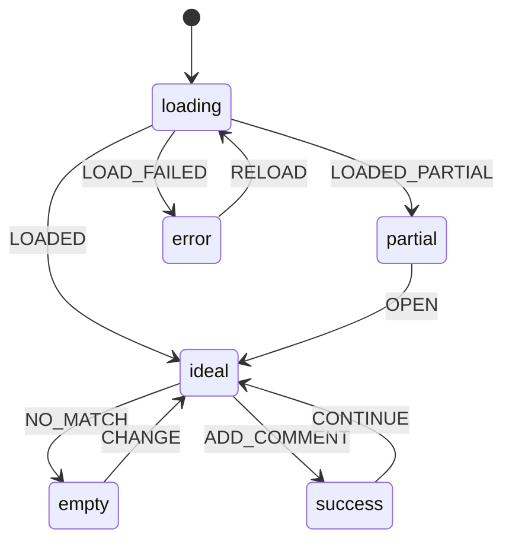

---
ddx:
  id: UF-012-01-record-browser
  type: wireframe
  activity: design
  authoring:
    home: repo
  depends_on:
    - UF-012
    - US-090
    - US-104
    - stemma.design-system
---

# UF-012-01-record-browser: Record Browser

**User flow**: [[UF-012]] view `record browser` | **Stories**: [[US-090]], [[US-094]], [[US-104]]

## Scope and Fidelity

- **View**: Find a record, read it with its states and follow its links.
- **Modality**: screen
- **Fidelity**: mid
- **Size classes**: compact, expanded
- **Pattern**: arras Graph Browser search and node page, with Stemma regions beside it (composition unverified)

## Layouts

### Expanded

```text
[Top bar: project | audience | data ID | nav]
[Search] [Type filter]
[Results]             | [Record heading: kind, ID]
                      | [Status labels]
                      | [Fields]  [Quoted text]
                      | [Links out]  [Links in]
                      | [Used in sentences] [Show in graph]
                      | [Reviewer comment box | Imported comments]
```

### Compact

```text
[Top bar: title | data ID | Menu]
[Search] [Type filter]
[Results] or [Record page, with "Back to results"]
```

### Annotations

| Element | Kind | Annotation | Size classes | Links |
|---|---|---|---|---|
| Top bar nav | control | Destinations per DESIGN.md | all | UF-012 Open graph; UF-012 Open pages; UF-012 Open maps; UF-012 Open comments |
| Search | control | Matches without diacritics through the exported folded text. States that arras takes only the first 50 matches per type, in ID order, so results can be incomplete | all | UF-012 Search records |
| Type filter | control | Narrows search | all | UF-012 Search records |
| Results | control | Each result opens its record | all | UF-012 Follow record link |
| Status labels | content | Unreviewed, unverified, missing, stale, annotated; a support record is "Model judgment" with model and date, never verification. States come from export data; any state the export lacks is "not shown here", not clear | all | US-090-AC4, US-090-AC5 |
| Quoted text | content | Text only. In a reviewer export, withheld text shows a "Removed for this audience" notice | all | US-094-AC4 |
| Links out and in | control | Both directions; paged when over 100, with the total | all | UF-012 Follow record link |
| Used in sentences | control | Lists linked sentences | all | UF-012 Show where used |
| Show in graph | control | Opens the graph around this record | all | UF-012 Open graph |
| Reviewer comment box | control | Claims only, reviewer audience: plain text, optional self-asserted name, "Add comment". Says comments stay only in this page until saved | all | UF-012 Add comment |
| Imported comments | content | Author audience: comment text as data, reviewer name as typed, "made on earlier text" when the claim changed | all | US-104-AC3 |

## States and Events

### States

| State | Applies | Entered when | Person sees | Available actions | Announcement | Exit |
|---|---|---|---|---|---|---|
| ideal | yes | Data loaded | The layout | Search, follow, navigate | Focus on the view or record heading | NO_MATCH, ADD_COMMENT |
| empty | yes | No match, or no records of a kind | "Nothing matched" or why empty | Change search, navigate | "No records match" (polite) | CHANGE |
| loading | yes | Page opens | "Loading project data" | Close | "Loading project data" (polite) | LOADED, LOADED_PARTIAL, LOAD_FAILED |
| partial | yes | Export omits types or fields, or the audience withholds text | Omission counts and withheld notices | Same as ideal | "Some content is not in this export" (polite) | OPEN |
| error | yes | Data rejected | Failing file or record; "Rebuild the export" | Reload | "Project data could not be loaded" (assertive) | RELOAD |
| offline | no: the page needs no network and sends no request |  |  |  |  |  |
| slow | no: loading text stays; no timing threshold is set |  |  |  |  |  |
| permission-denied | no: filtering happens before export; withheld content is the partial state |  |  |  |  |  |
| success | yes | A comment was added | "Added. Not saved to a file yet" and count | Continue, open comments | "Comment added, not saved" (polite) | CONTINUE |

### Statechart



### Events

| Event | From | Guard | To | Effect |
|---|---|---|---|---|
| LOADED | loading | complete export | ideal | Heading focused |
| LOADED_PARTIAL | loading | omissions | partial | Notice shown |
| LOAD_FAILED | loading | rejected data | error | No partial graph |
| RELOAD | error | file rebuilt | loading | Page reloads |
| NO_MATCH | ideal | search finds none | empty | Query kept |
| CHANGE | empty | new search or navigation | ideal | Results or record shown |
| OPEN | partial | navigation or search | ideal | Notices stay on affected records |
| ADD_COMMENT | ideal | reviewer, non-empty | success | Held in page memory |
| CONTINUE | success | navigation | ideal | Focus moves to new heading |

## Accessibility

- **Focus order**: skip link, top bar, search, results, record heading, status, fields, links, actions, comments.
- **Accessible names**: "Search records"; link names include kind and title; "Add comment on claim <ID>".
- **Headings and landmarks**: `h1` per view or record; `search`, `nav`, `main` landmarks.
- **Target size and input**: 24 px targets; keyboard throughout. arras's own widgets are unchecked for Stemma.

## Open Questions

- Whether comment and status regions can be composed beside arras without an arras extension: SD-012 owner.
- Which statuses the export carries, since `check` results are not records: SD-012 and contract owners.
