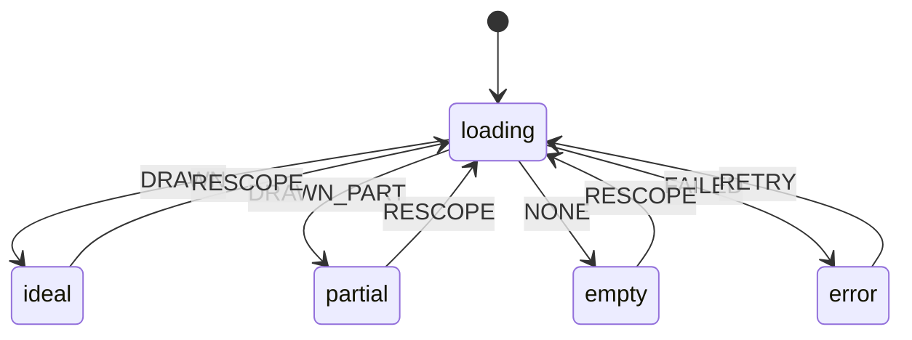

---
ddx:
  id: UF-012-02-connected-graph
  type: wireframe
  activity: design
  authoring:
    home: repo
  depends_on:
    - UF-012
    - US-091
    - stemma.design-system
---

# UF-012-02-connected-graph: Connected Graph

**User flow**: [[UF-012]] view `connected graph` | **Stories**: [[US-091]]

## Scope and Fidelity

- **View**: Show a scoped connected set larger than arras draws today, with an equal text list.
- **Modality**: screen
- **Fidelity**: mid
- **Size classes**: compact, expanded
- **Pattern**: View contributed to arras (ADR-008); Stemma keeps no private fork

## Layouts

### Expanded

```text
[Top bar]
[Scope] [Types] [Zoom - + Fit]        [Counts and omissions]
[Tabs: Drawing | List]
[Drawing]                             | [Selected item details] [Open record]
```

### Compact

```text
[Top bar]
[Scope] [Types]   [Counts and omissions]
[Tabs: List | Drawing]   (List first)
[List or Drawing]  [Selected item details]
```

### Annotations

| Element | Kind | Annotation | Size classes | Links |
|---|---|---|---|---|
| Scope and types | control | Narrow by chapter, record neighbourhood or kind, as the arras view allows | all | UF-012 Change graph scope |
| Zoom and fit | control | Buttons; no drag needed | all | UF-012 Change graph scope |
| Counts and omissions | feedback | Drawn and total nodes and links, and why any are left out | all | US-091-AC4 |
| Drawing and list tabs | control | The list holds every drawn node and its links with relation text; omitted content is reachable by narrowing | all | US-091-AC5 |
| Node or row | control | Selects and shows details | all | US-091-AC3 |
| Open record | control | Opens the selected record | all | UF-012 Open record from graph |

## States and Events

### States

| State | Applies | Entered when | Person sees | Available actions | Announcement | Exit |
|---|---|---|---|---|---|---|
| ideal | yes | Scope drawn | Drawing or list | Scope, select, open | Focus on the heading | RESCOPE |
| empty | yes | Scope has no records | "Nothing in this scope" | Change scope | "Nothing in this scope" (polite) | RESCOPE |
| loading | yes | Opening or scope change | "Drawing graph" | Change scope, leave | "Drawing graph" (polite) | DRAWN, DRAWN_PART, NONE, FAILED |
| partial | yes | Only part is drawn | Omission notice | Narrow, select, open | "Showing <n> of <m> nodes" (polite) | RESCOPE |
| error | yes | Layout or read fails | Cause; list offered if readable | Retry, leave | "Graph could not be drawn" (assertive) | RETRY |
| offline | no: no network is used |  |  |  |  |  |
| slow | no: no tested size or time limit; progress text stays |  |  |  |  |  |
| permission-denied | no: audience filtering happens before export |  |  |  |  |  |
| success | no: this view only reads |  |  |  |  |  |

### Statechart



### Events

| Event | From | Guard | To | Effect |
|---|---|---|---|---|
| DRAWN | loading | all in scope drawn | ideal | Counts updated |
| DRAWN_PART | loading | limit reached | partial | Omissions stated |
| NONE | loading | empty scope | empty | Said |
| FAILED | loading | failure | error | Nothing presented as complete |
| RESCOPE | ideal | control used | loading | Redraw |
| RESCOPE | partial | narrower scope | loading | Redraw |
| RESCOPE | empty | other scope | loading | Redraw |
| RETRY | error | author asks | loading | Redraw |

## Accessibility

- **Focus order**: controls, tabs, drawing or list, details.
- **Accessible names**: "Zoom in", "Zoom out", "Fit graph"; nodes named by kind and title.
- **Headings and landmarks**: `h1` "Graph"; details is a named region.
- **Target size and input**: list rows are the equivalent for small nodes.

## Open Questions

- Required graph size is open in FEAT-012: product owner. Interaction here is a request to arras, which may accept a different design; until arras ships the view, the destination says it is not available.
