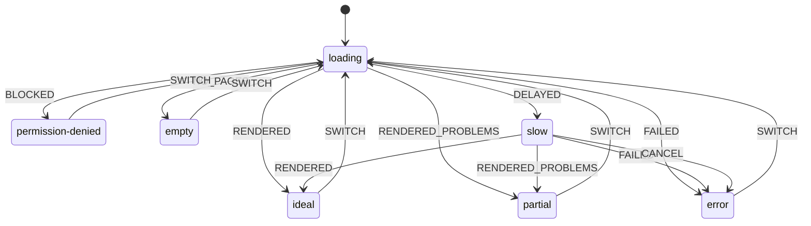

---
ddx:
  id: UF-012-03-page-reader
  type: wireframe
  activity: design
  authoring:
    home: repo
  depends_on:
    - UF-012
    - US-092
    - US-093
    - stemma.design-system
    - CONTRACT-006
---

# UF-012-03-page-reader: Page Reader

**User flow**: [[UF-012]] view `page reader` | **Stories**: [[US-092]], [[US-093]]

## Scope and Fidelity

- **View**: Read typeset pages, tell built pages from previews, and pick a linked sentence.
- **Modality**: screen
- **Fidelity**: mid
- **Size classes**: compact, expanded
- **Pattern**: Document reader with a text equivalent

## Layouts

### Expanded

```text
[Top bar]
[Chapter] [Tabs: Built | Preview]  [Page < n of m >] [Zoom - +]
[Banner: PREVIEW, not a build output | Match with print: cannot tell]
[Tabs: Page image | Reading text]
[Page with sentence controls]          | [Sentence trail panel]
[Compile problems and unsupported items]
```

### Compact

```text
[Top bar]
[Chapter] [Built | Preview] [< n >]
[Banner]
[Reading text | Page image]   (text first)
[Sentence trail below]
```

### Annotations

| Element | Kind | Annotation | Size classes | Links |
|---|---|---|---|---|
| Chapter, page and zoom controls | control | Move through pages and resize them | all | UF-012 Move through pages |
| Built or preview tabs | control | Built pages come from a native build, if the export includes them (undesigned). Preview pages are compiled here | all | UF-012 Switch page kind |
| Banner | feedback | Page kind, data ID, watermark if a draft, and comparison with print: matches, differs, or cannot tell. "Cannot tell" is the default; a different compiler version is said to be possibly different. "Matches" needs a basis SD-012 has not defined | all | US-093-AC3, US-093-AC4, US-093-AC5 |
| Page or reading text | control | Reading text gives the shown pages' sentences, notes, headings, quotations and figure descriptions in order, as real text. A figure with no description says so. If its page breaks may differ, it says so | all | US-092-AC5 |
| Linked sentence | control | Selectable in both forms; split parts lead to the same claims. Marked as "has claim link", which says nothing about support | all | UF-012 Select sentence |
| Unlinked sentence | content | Not a control and carries no support wording; reading text can show "no linked claim" | all | US-092-AC4 |
| Problems | feedback | Compile errors, missing glyphs, substituted fonts, unformatted citations, unsupported items, broken links | all | US-093-AC6 |
| Edit hint | content | "To change text, ask your agent, then reload." Author audience only | all | none |
| Records link | control | Leaves pages | all | UF-012 Return to records |
| Edit request | control | Happens in chat; no edit control exists | all | UF-012 Ask for an edit |

## States and Events

### States

| State | Applies | Entered when | Person sees | Available actions | Announcement | Exit |
|---|---|---|---|---|---|---|
| ideal | yes | Pages shown with links | Pages, banner | Read, switch, select | Focus on the heading, which names page kind | SWITCH |
| empty | yes | No pages or manuscript data in this export | Why, and how to rebuild | Return to records | "No pages in this export" (polite) | SWITCH |
| loading | yes | Opening, reload or preview compile | "Compiling preview"; no older pages | Records, switch kind | "Compiling preview" (polite) | RENDERED, RENDERED_PROBLEMS, NO_PAGES, FAILED, BLOCKED, DELAYED |
| partial | yes | Some content or links failed | Pages with problem list | Same as ideal | "Pages shown with <n> problems" (polite) | SWITCH |
| error | yes | Compile or load fails | Cause; reading text of source data if available, labelled not typeset | Switch kind, reload, records | "Preview failed; no current pages" (assertive) | SWITCH |
| offline | no: everything is in the file and nothing is requested |  |  |  |  |  |
| slow | yes | Compile is still running after a noticeable delay (no threshold set) | Elapsed time and "still compiling" | Cancel, records | "Still compiling" (polite) | RENDERED, RENDERED_PROBLEMS, FAILED, CANCEL |
| permission-denied | yes | The browser or page policy blocks the compiler | "This browser blocked the preview compiler" | Switch to built pages, records | "Preview blocked" (assertive) | SWITCH |
| success | no: showing rebuilt pages is the ideal state |  |  |  |  |  |

### Statechart



### Events

| Event | From | Guard | To | Effect |
|---|---|---|---|---|
| RENDERED | loading | complete | ideal | Banner set |
| RENDERED_PROBLEMS | loading | problems | partial | Problems listed |
| NO_PAGES | loading | none in export | empty | Said |
| FAILED | loading | compile error | error | Older pages removed |
| BLOCKED | loading | policy block | permission-denied | Said |
| DELAYED | loading | still running | slow | Progress kept |
| RENDERED | slow | complete | ideal | Banner set |
| RENDERED_PROBLEMS | slow | problems | partial | Problems listed |
| FAILED | slow | compile error | error | Nothing stale shown |
| CANCEL | slow | user cancels | error | "Cancelled; no preview" |
| SWITCH | ideal | tab, chapter or reload | loading | Compile or load |
| SWITCH | partial | tab, chapter or reload | loading | Compile or load |
| SWITCH | error | retry or other kind | loading | Compile or load |
| SWITCH | empty | file rebuilt and reloaded | loading | Load |
| SWITCH | permission-denied | built pages chosen | loading | Load |

## Accessibility

- **Focus order**: controls, banner, tabs, sentences in reading order, problems, trail.
- **Accessible names**: "Previous page", "Next page"; each sentence control is named by its own text plus "has claim link". The page image's alternative names the page and points to Reading text.
- **Headings and landmarks**: `h1` names chapter and page kind. Reading text keeps book headings below it and sets `lang` and `dir` from the markup.
- **Target size and input**: page overlays can be smaller than 24 px; reading text is the equivalent. Right-to-left and non-Latin display are unverified.

## Open Questions

- Browser Typst compilation is untried and may be blocked or lag the pinned version. Prebuilt pages alone would not meet FR-65.
- How the page learns that preview matches print, and whether built pages ship in an export: SD-012 owner.
- Typst page graphics carry no selectable text, so the reading text is the accessible route; its fidelity to page order is unverified.
