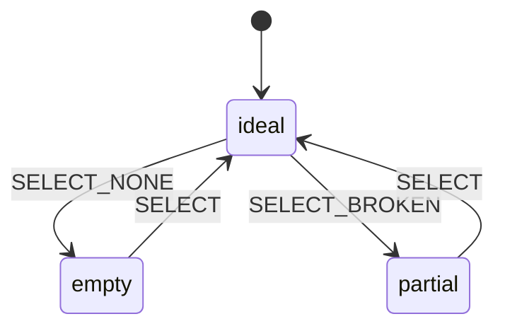

---
ddx:
  id: UF-012-04-sentence-trail
  type: wireframe
  activity: design
  authoring:
    home: repo
  depends_on:
    - UF-012
    - US-092
    - stemma.design-system
---

# UF-012-04-sentence-trail: Sentence Trail Panel

**User flow**: [[UF-012]] view `sentence trail` | **Stories**: [[US-092]]

## Scope and Fidelity

- **View**: Show a sentence's claims and their evidence, or the sentences that use a claim or passage.
- **Modality**: screen
- **Fidelity**: mid
- **Size classes**: compact, expanded
- **Pattern**: Non-modal side panel

## Layouts

### Expanded

```text
| [Heading: Sentence]            [Back to page] |
| [Sentence text, chapter, page]                |
| [Claim 1: text, review state]                   |
|   [Support: model judgment, state]            |
|   [Evidence: note > passage > source]         |
| [Claim 2 ...]                                 |
| or [Used in sentences: rows]                  |
```

### Compact

```text
[Same content, full width below the page]
[Back to page]
```

### Annotations

| Element | Kind | Annotation | Size classes | Links |
|---|---|---|---|---|
| Back to page | control | Closes and returns focus; Escape does the same | all | UF-012 Close trail |
| Claim | control | Every linked claim, none chosen for the user | all | UF-012 Open evidence record |
| Support | content | Each passage's saved model judgment, or missing or stale. Never a success color | all | US-090-AC5 |
| Evidence chain | control | Note, passage with locator, source; each opens its record. Contradicting and qualifying stances are shown with supporting ones | all | UF-012 Open evidence record |
| Sentence rows | control | Chapter, page and sentence text | all | UF-012 Go to sentence |

## States and Events

### States

| State | Applies | Entered when | Person sees | Available actions | Announcement | Exit |
|---|---|---|---|---|---|---|
| ideal | yes | Links resolve | Claims or sentences | Open, go to, close | Focus on the panel heading | SELECT_NONE, SELECT_BROKEN |
| empty | yes | Record is used in no sentence, or a claim has no evidence | Which is missing | Close | "No linked sentences" or "No evidence recorded" (polite) | SELECT |
| loading | no: data is already in the page |  |  |  |  |  |
| partial | yes | A link target is missing or withheld | Broken or withheld items named | Open others, close | "Some links cannot be shown" (polite) | SELECT |
| error | no: failures to load are shown by the hosting view; a broken link is partial |  |  |  |  |  |
| offline | no: no network |  |  |  |  |  |
| slow | no: in-memory reads |  |  |  |  |  |
| permission-denied | no: withheld evidence is partial |  |  |  |  |  |
| success | no: this panel only reads |  |  |  |  |  |

### Statechart



### Events

| Event | From | Guard | To | Effect |
|---|---|---|---|---|
| SELECT_NONE | ideal | new selection has nothing | empty | Panel updates |
| SELECT_BROKEN | ideal | missing or withheld | partial | Panel updates |
| SELECT | empty | another item | ideal | Panel updates |
| SELECT | partial | another item | ideal | Panel updates |

## Accessibility

- **Focus order**: heading, back, claims, evidence in chain order.
- **Accessible names**: links include kind and title, for example "Passage, page 41".
- **Headings and landmarks**: named complementary region; claims are subheadings.
- **Target size and input**: 24 px targets; Escape closes.

## Open Questions

- None beyond UF-012's.
