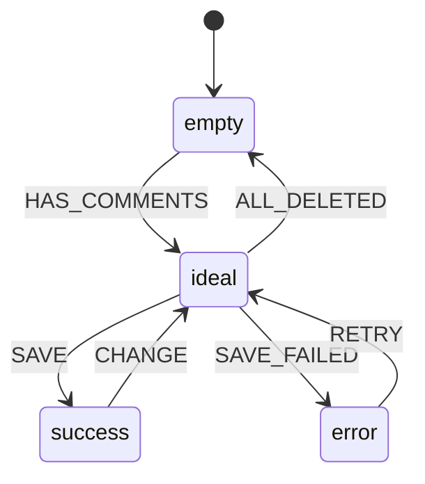

---
ddx:
  id: UF-012-05-comment-file
  type: wireframe
  activity: design
  authoring:
    home: repo
  depends_on:
    - UF-012
    - US-104
    - stemma.design-system
    - CONTRACT-005
---

# UF-012-05-comment-file: Comment File Panel

**User flow**: [[UF-012]] view `comment file` | **Stories**: [[US-104]]

## Scope and Fidelity

- **View**: Let a reviewer check comments and save them to one file.
- **Modality**: screen
- **Fidelity**: mid
- **Size classes**: compact, expanded
- **Pattern**: Editable list with one primary action

## Layouts

### Expanded

```text
[Top bar: reviewer | n comments not saved]
[Warning: comments live only in this page until saved. Reloading or closing can lose them.]
[Your name (optional)]
[Claim | Comment | Edit | Delete]
[Save comment file]   [Save status]
```

### Compact

```text
[Warning]
[Name]
[One card per comment: claim, text, Edit, Delete]
[Save comment file]
```

### Annotations

| Element | Kind | Annotation | Size classes | Links |
|---|---|---|---|---|
| Warning | feedback | Always shown. A leave-page prompt is a backup that may not appear. Nothing relies on browser storage | all | US-104-AC2 |
| Name | control | Optional, shown as self-asserted; saved with the file | all | UF-012 Save comment file |
| Edit and delete | control | Delete offers Undo | all | UF-012 Change comment |
| Claim | control | Opens the claim | all | UF-012 Show commented claim |
| Save comment file | control | Downloads one file with all comments, bound to this export and each claim's shown text; nothing is sent | all | UF-012 Save comment file |
| Save status | feedback | "Save requested. Check that the file exists, then send it yourself." The page cannot confirm the write | all | US-104-AC2 |
| Send | content | The reviewer sends the file by their own means | all | UF-012 Send comment file |
| Records link | control | Leaves the list | all | UF-012 Close comment list |

## States and Events

### States

| State | Applies | Entered when | Person sees | Available actions | Announcement | Exit |
|---|---|---|---|---|---|---|
| ideal | yes | Unsaved comments exist | List and save | Edit, delete, save, leave | Focus on the heading; unsaved count | ALL_DELETED, SAVE, SAVE_FAILED |
| empty | yes | No comments | How to add one; Save disabled with reason | Open records | "No comments yet" (polite) | HAS_COMMENTS |
| loading | no: comments are in page memory |  |  |  |  |  |
| partial | no: one file holds all comments or none |  |  |  |  |  |
| error | yes | Save cannot start, a limit is exceeded, or the browser blocks the download | Reason, comments kept, and the file text to select and copy (proposal) | Retry, copy, leave | "File not saved" (assertive) | RETRY |
| offline | no: saving needs no network |  |  |  |  |  |
| slow | no: small local file |  |  |  |  |  |
| permission-denied | no: a blocked download is the error state |  |  |  |  |  |
| success | yes | Save requested | Save status; "changed since last save" after any edit | Continue, leave | "Save requested; check the file" (polite) | CHANGE |

### Statechart



### Events

| Event | From | Guard | To | Effect |
|---|---|---|---|---|
| HAS_COMMENTS | empty | comment added | ideal | List shown |
| ALL_DELETED | ideal | none left | empty | Undo offered |
| SAVE | ideal | at least one | success | Download requested |
| SAVE_FAILED | ideal | blocked or over limit | error | Comments kept |
| RETRY | error | user acts | ideal | List kept |
| CHANGE | success | add, edit or delete | ideal | Marked unsaved |

## Accessibility

- **Focus order**: warning, name, rows, save, status.
- **Accessible names**: "Edit comment on claim <ID>", "Delete comment on claim <ID>".
- **Headings and landmarks**: `h1` "Your comments"; list or table with headers.
- **Target size and input**: labelled fields; 24 px targets; after delete, focus moves to Undo.

## Open Questions

- Saving from a page opened locally is untested. The copy fallback must reproduce the canonical file form, which is unverified: SD-012 owner.
- Import limits on size, count and length are not yet set; the page should enforce the same ones: SD-012 owner.
