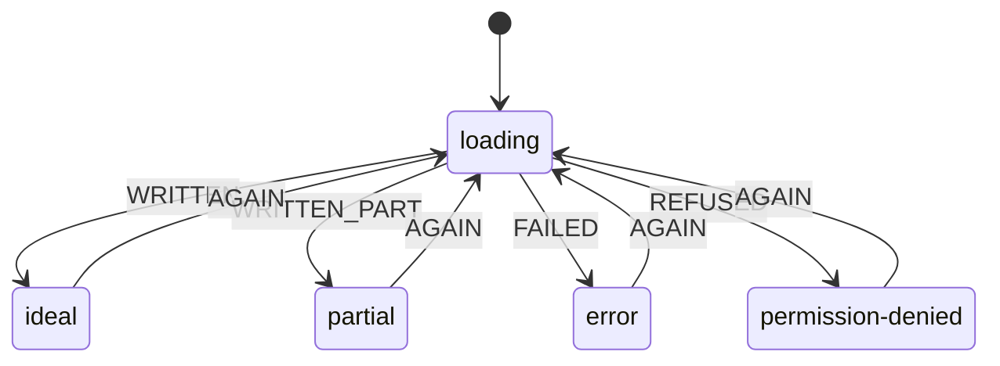

---
ddx:
  id: UF-012-06-rebuild-turn
  type: wireframe
  activity: design
  authoring:
    home: repo
  depends_on:
    - UF-012
    - US-093
    - US-094
    - stemma.design-system
    - CONTRACT-005
---

# UF-012-06-rebuild-turn: Rebuild Turn

**User flow**: [[UF-012]] view `rebuild turn` | **Stories**: [[US-093]], [[US-094]]

## Scope and Fidelity

- **View**: Rebuild the offline explorer and say plainly whether to open or reload it.
- **Modality**: chat
- **Fidelity**: mid
- **Size classes**: not applicable: chat; the host sets the width
- **Pattern**: DESIGN.md chat turn rules

## Layouts

### Turn

```text
[Verdict]    Rebuilt | Rebuild failed
[Checks]     (after an edit) check --changed results
[File]       <path>   Data ID <id>   Built <time>   Audience <name>
[Action]     Open it, or reload the page you have open. It will not update itself.
[Warnings]   Omitted records or links, large graph, possible site disclosure
[Choices]    Make another change / stop
```

### Annotations

| Element | Kind | Annotation | Size classes | Links |
|---|---|---|---|---|
| Verdict | feedback | First line. On failure: "The file on disk still holds earlier data" | all | US-093-AC7 |
| File | content | Path, data ID and the rebuild time, so the author can compare with the top bar | all | US-094-AC6 |
| Action | control | Open on first build, reload after an edit. The agent cannot reload it | all | UF-012 Reload rebuilt page; UF-012 Open explorer file |
| Warnings | content | From the export; the file contains passage text in the author audience | all | CONTRACT-005 E |
| Choices: stop | control | Ends the task | all | UF-012 Stop after rebuild |

## States and Events

### States

| State | Applies | Entered when | Person sees | Available actions | Announcement | Exit |
|---|---|---|---|---|---|---|
| ideal | yes | Export and preview data written | The turn | Open or reload, change, stop | "Rebuilt; reload the page" (host-controlled) | AGAIN |
| empty | no: an export of a new project is still written and reported with zero counts |  |  |  |  |  |
| loading | yes | Rebuild starts | "Rebuilding the offline explorer" | Interrupt | That line (host-controlled) | WRITTEN, WRITTEN_PART, FAILED, REFUSED |
| partial | yes | Written with omissions or warnings, or preview data missing | Which part is missing or at risk | Open, fix, stop | "Rebuilt with warnings" (host-controlled) | AGAIN |
| error | yes | Invalid records, manuscript error or export failure | Cause and the earlier-data warning | Fix and rebuild, stop | "Rebuild failed" (host-controlled) | AGAIN |
| offline | no: export needs no network |  |  |  |  |  |
| slow | no: no timing target |  |  |  |  |  |
| permission-denied | yes | Host blocks scripts or the output path is refused | "Nothing was rebuilt" | Fix and rebuild, stop | That sentence (host-controlled) | AGAIN |
| success | no: ideal is the completed state |  |  |  |  |  |

### Statechart



### Events

| Event | From | Guard | To | Effect |
|---|---|---|---|---|
| WRITTEN | loading | complete | ideal | Path reported |
| WRITTEN_PART | loading | omissions or warnings | partial | Listed |
| FAILED | loading | export error | error | No claim of an update |
| REFUSED | loading | blocked or refused | permission-denied | Nothing rebuilt |
| AGAIN | ideal | another change | loading | Rebuild |
| AGAIN | partial | after a fix | loading | Rebuild |
| AGAIN | error | after a fix | loading | Rebuild |
| AGAIN | permission-denied | after a fix | loading | Rebuild |

## Accessibility

- **Focus order**: verdict, results, file, action, warnings, choices.
- **Accessible names**: the path and data ID are labelled.
- **Headings and landmarks**: the host owns them.
- **Target size and input**: typed replies.

## Open Questions

- CONTRACT-005 forbids a time in export files but requires the page to show when its data was built. Until the contract resolves this, only the data ID is certain to appear in both turn and page.
- Which command produces page and preview data is not yet defined: SD-012 and contract owners.
