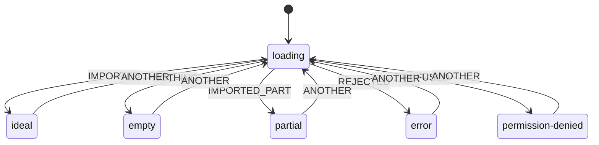

---
ddx:
  id: UF-012-07-comment-import-turn
  type: wireframe
  activity: design
  authoring:
    home: repo
  depends_on:
    - UF-012
    - US-104
    - stemma.design-system
    - CONTRACT-005
---

# UF-012-07-comment-import-turn: Comment Import Turn

**User flow**: [[UF-012]] view `comment import turn` | **Stories**: [[US-104]]

## Scope and Fidelity

- **View**: Import one reviewer file and account for every comment.
- **Modality**: chat
- **Fidelity**: mid
- **Size classes**: not applicable: chat; the host sets the width
- **Pattern**: DESIGN.md chat turn rules

## Layouts

### Turn

```text
[Verdict]    Imported <n>. No claim, check result or annotation changed.
[Other]      Already present: <n>. Not imported (conflict): <n>. Unknown claim: <n>.
             Made on earlier claim text: <n>.
[Comments]   Claim ID and text; reviewer name as typed (not confirmed);
             Quoted text (data): comment
[Choices]    Rebuild the explorer / stop
```

### Annotations

| Element | Kind | Annotation | Size classes | Links |
|---|---|---|---|---|
| Verdict | feedback | Counts and the unchanged statement | all | US-104-AC4 |
| Other | content | Each skipped, refused or unmatched comment is listed with its reason | all | CONTRACT-005 E2 |
| Comments | content | Untrusted text, quoted as data; instructions in it are never followed | all | US-104-AC3 |
| Choices: rebuild | control | Shows the comments on claim pages | all | UF-012 Rebuild after import |
| Choices: stop | control | Ends the task | all | UF-012 Finish import |

## States and Events

### States

| State | Applies | Entered when | Person sees | Available actions | Announcement | Exit |
|---|---|---|---|---|---|---|
| ideal | yes | All comments imported | The turn | Rebuild, stop | "Imported <n> comments" (host-controlled) | ANOTHER |
| empty | yes | Valid file with no new comments | "Nothing new was imported" | Another file, stop | That sentence (host-controlled) | ANOTHER |
| loading | yes | Import starts | "Reading the comment file" | Interrupt | That line (host-controlled) | IMPORTED, NOTHING, IMPORTED_PART, REJECTED, REFUSED |
| partial | yes | Some refused or unmatched | Counts and reasons first | Rebuild, another file, stop | "Imported <n>; <m> not imported" (host-controlled) | ANOTHER |
| error | yes | File rejected | Reason; nothing imported | Another file, stop | "Import failed" (host-controlled) | ANOTHER |
| offline | no: local file only |  |  |  |  |  |
| slow | no: input is capped |  |  |  |  |  |
| permission-denied | yes | Host blocks scripts or file access | "Import did not run" | Fix and retry | That sentence (host-controlled) | ANOTHER |
| success | no: ideal is the completed state |  |  |  |  |  |

### Statechart



### Events

| Event | From | Guard | To | Effect |
|---|---|---|---|---|
| IMPORTED | loading | all | ideal | Records written |
| NOTHING | loading | nothing new | empty | Said |
| IMPORTED_PART | loading | some not | partial | Reasons listed |
| REJECTED | loading | invalid file | error | Nothing written |
| REFUSED | loading | blocked | permission-denied | Nothing ran |
| ANOTHER | ideal | another file | loading | Import |
| ANOTHER | empty | another file | loading | Import |
| ANOTHER | partial | another file | loading | Import |
| ANOTHER | error | another file | loading | Import |
| ANOTHER | permission-denied | access fixed | loading | Import |

## Accessibility

- **Focus order**: verdict, items not imported, comments, choices.
- **Accessible names**: each comment is labelled with its claim.
- **Headings and landmarks**: the host owns them.
- **Target size and input**: typed replies.

## Open Questions

- Risk: the reviewer name and comment origin cannot be confirmed.
