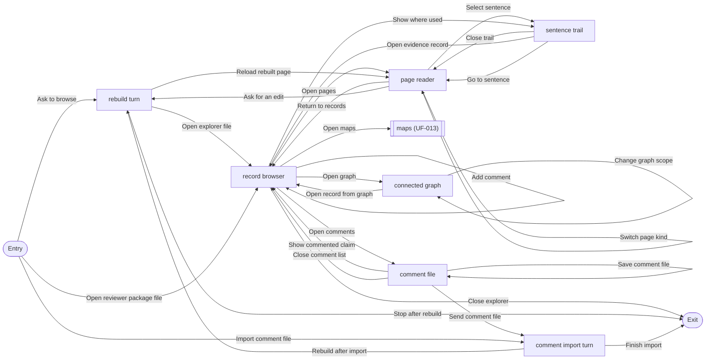

---
ddx:
  id: UF-012
  type: user-flow
  activity: design
  authoring:
    home: repo
  depends_on:
    - FEAT-012
    - FEAT-009
    - US-090
    - US-091
    - US-092
    - US-093
    - US-094
    - US-104
    - stemma.design-system
    - CONTRACT-004
    - CONTRACT-005
    - CONTRACT-006
---

# UF-012: Offline Explorer User Flow

**Feature**: [[FEAT-012]] | **Solution design**: [[SD-012]] | **Journey maps**: none | **Interface system**: [[stemma.design-system]]

## Scope

- **Covers** (M3): record search and pages, the connected graph, typeset pages with sentence links and live preview, rebuild and reload, and reviewer comments (FR-79, FEAT-009), which live in this explorer.
- **Entry points**: asking the agent to browse; opening an export or reviewer package file; the author asking to import a comment file.
- **Exits**: closing the page; maps ([[UF-013]]).
- **Navigation**: top-bar links reach each destination from any view. The tables list only the paths the journeys use.
- **Size classes**: compact, expanded. Compact puts panels below content.
- **Data**: the page holds the data of one export. It has no backend, writes no record, sends no request, and does not update while open. Record and source text is shown as text and never run.
- **Out of scope**: editing records; reviewer package assembly; map content (UF-013); hosting.
- **Disclosure**: anyone given an export sees everything in it. The author export may hold passage text.
- **Unverified**: browser Typst compilation (untried); the larger graph view (not yet in arras); composing Stemma views and comment controls with arras; saving a file from a local page; every browser and system beyond synthetic headless tests.

## Views

| View | Kind | Purpose | Stories | Wireframe |
|---|---|---|---|---|
| rebuild turn | turn | Rebuild the offline explorer and tell the author what to open or reload | US-093, US-094 | [[UF-012-06-rebuild-turn]] |
| record browser | screen | Find a record, read it and follow its links; a reviewer comments on claims | US-090, US-094, US-104 | [[UF-012-01-record-browser]] |
| connected graph | screen | See how a scoped set of records connects | US-091 | [[UF-012-02-connected-graph]] |
| page reader | screen | Read built or preview pages and pick a sentence | US-092, US-093 | [[UF-012-03-page-reader]] |
| sentence trail | panel | Go between a sentence, its claims and their evidence | US-092 | [[UF-012-04-sentence-trail]] |
| comment file | panel | Review unsaved comments and save them to one file | US-104 | [[UF-012-05-comment-file]] |
| comment import turn | turn | Import a reviewer's file and report what happened to each comment | US-104 | [[UF-012-07-comment-import-turn]] |
| maps (UF-013) | external | Argument and geographic maps | US-095, US-096 | none |

## Flow Diagram

## Transitions

| Action | From | Control | Guard | To | Feedback | Changed region |
|---|---|---|---|---|---|---|
| Ask to browse | Entry | author's message | none | rebuild turn | Says that `graph export` is running; then the file path and data ID | new turn |
| Open explorer file | rebuild turn | author opens the named file | export succeeded | record browser | Loading text, then audience and data ID in the top bar | full view |
| Open reviewer package file | Entry | reviewer opens the file | none | record browser | Loading text; audience `reviewer`; what is withheld | full view |
| Search records | record browser | search box | none | record browser | Result count, or no match; limits of search stated | results region |
| Follow record link | record browser | record link | target in export | record browser | New record page; heading focused | main region |
| Open graph | record browser | "Graph" link or "Show in graph" | view available from arras | connected graph | Drawing progress, counts and omissions | full view |
| Change graph scope | connected graph | scope and type controls | none | connected graph | New counts and omissions | drawing and list |
| Open record from graph | connected graph | node or list row | none | record browser | Record page | full view |
| Open pages | record browser | "Pages" link | pages in export | page reader | Loading or compile progress; page kind banner | full view |
| Return to records | page reader | "Records" link | none | record browser | Last record or search | full view |
| Move through pages | page reader | chapter, page and zoom controls | none | page reader | New page; position stated | page region |
| Switch page kind | page reader | "Built" or "Preview" tab | that kind is available | page reader | Compile progress and comparison status | page region |
| Select sentence | page reader | sentence in page or reading text | sentence has a claim link | sentence trail | Panel with its claims; sentence marked selected | side panel |
| Close trail | sentence trail | "Back to page" or Escape | none | page reader | Focus returns to the sentence | side panel |
| Open evidence record | sentence trail | claim, note, passage or source link | in export | record browser | Record page with "Back to sentence" | full view |
| Show where used | record browser | "Used in sentences" | record has linked sentences | sentence trail | List of sentences | side panel |
| Go to sentence | sentence trail | sentence row | pages in export | page reader | Page shown, sentence focused | full view |
| Ask for an edit | page reader | author's chat message; the page does not edit | author has the agent | rebuild turn | Agent edits, checks, rebuilds, then says reload | new turn |
| Reload rebuilt page | rebuild turn | author reloads the browser | rebuild succeeded | page reader | New data ID; preview compiles the rebuilt text | full view |
| Add comment | record browser | "Add comment" on a claim | reviewer audience | record browser | "Added, not yet saved to a file"; unsaved count | claim region |
| Open comments | record browser | "Comments" link | reviewer audience | comment file | List and unsaved count | full view |
| Change comment | comment file | "Edit" or "Delete" | none | comment file | List updates; delete offers Undo while the page is open | list |
| Show commented claim | comment file | claim link | none | record browser | Claim page | full view |
| Save comment file | comment file | "Save comment file" | at least one comment | comment file | "Save requested: check that the file exists" | status line |
| Send comment file | comment file | reviewer sends it by their own means | author receives it | comment import turn | Nothing is sent by Stemma | outside the page |
| Import comment file | Entry | author's message naming the file | none | comment import turn | Counts and each outcome | new turn |
| Rebuild after import | comment import turn | author accepts the offer | comments imported | rebuild turn | Export progress | new turn |
| Open maps | record browser | "Argument map" or "Places" link | none | maps (UF-013) | Map loading | full view |
| Close explorer | record browser | close the tab | none | Exit | Warns of unsaved comments where the browser allows | none |
| Close comment list | comment file | "Records" link | none | record browser | Unsaved count stays in the top bar | full view |
| Stop after rebuild | rebuild turn | author moves on | none | Exit | The path, or that the rebuild failed | none |
| Finish import | comment import turn | author moves on | none | Exit | Counts; no claim changed | none |

## Alternate Paths

| Path | Trigger | Transitions | Recovery |
|---|---|---|---|
| Error | Data fails to load | Open explorer file | The page names the failing file or record and shows no partial graph; rebuild |
| Error | Rebuild fails | Ask for an edit → Stop after rebuild | The agent says the file on disk still holds earlier data and is not current |
| Error | Preview compile fails or the browser blocks it | Switch page kind | Says so; shows no earlier pages as current; records and reading text stay available |
| Error | Saving does not work from a local page | Save comment file | Comments stay in the page; the page offers the file text to copy (a proposal, unverified) |
| Error | Import file is oversized, malformed or conflicting | Import comment file → Finish import | Reasons per file or comment; nothing but review comments is ever written |
| Cancel | The reviewer deletes or abandons a comment | Open comments → Change comment → Close comment list | Delete can be undone while the page is open |
| Cancel | Closing or reloading with unsaved comments | Close explorer | Comments can be lost; the page says so all the time, because a leave warning may not appear |
| Empty | No search match; no claim link; no pages; no comments | Search records → Open pages → Return to records | Each says what is empty and why |
| Permission denied | Source text withheld from a reviewer | Open reviewer package file → Follow record link | Shows `withheld` or "Removed for this audience"; the reviewer cannot rerun checks |
| Permission denied | The host blocks script execution | Ask to browse → Stop after rebuild | The agent says nothing was rebuilt |
| Stale | Records changed after the page loaded | Ask for an edit → Reload rebuilt page | The page cannot detect this; it always shows its data ID |

## Story Traceability

| Journey | Task | Stories / ACs | Path |
|---|---|---|---|
| browse evidence | Find and follow records | US-090-AC1, US-090-AC2, US-090-AC4, US-094-AC2 | Ask to browse → Open explorer file → Search records → Follow record link |
| see connections | Use the larger graph | US-091-AC1, US-091-AC3, US-091-AC4, US-091-AC5 | Open graph → Change graph scope → Open record from graph |
| trace a sentence | Sentence to evidence and back | US-092-AC2, US-092-AC3, US-092-AC5 | Open pages → Select sentence → Open evidence record → Show where used → Go to sentence |
| preview an edit | Edit, rebuild, reload | US-093-AC6, US-093-AC7, US-094-AC6 | Open pages → Switch page kind → Ask for an edit → Reload rebuilt page |
| reviewer comments | Comment, save, send and import | US-104-AC1, US-104-AC2, US-104-AC3, US-104-AC4 | Open reviewer package file → Add comment → Open comments → Save comment file → Send comment file → Finish import |

## Dead Ends

- None. Whether a reviewer's explorer holds typeset pages or live preview is open (FEAT-012), so page transitions are specified for the author audience.
