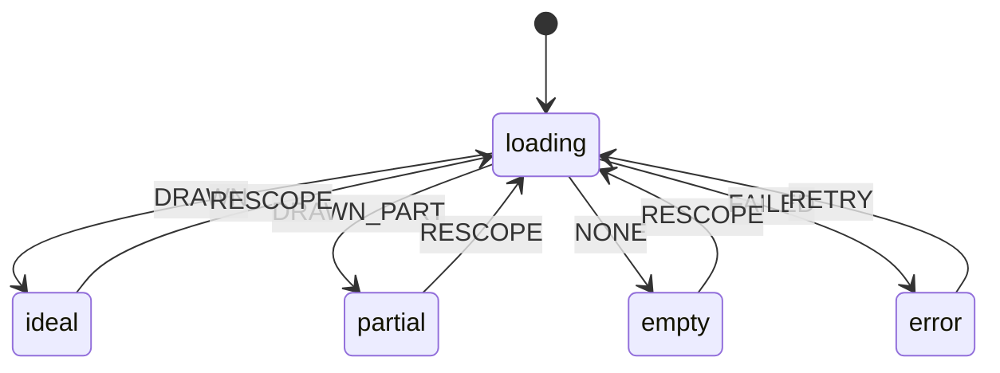

---
ddx:
  id: UF-013-01-argument-map
  type: wireframe
  activity: design
  authoring:
    home: repo
  depends_on:
    - UF-013
    - US-095
    - stemma.design-system
---

# UF-013-01-argument-map: Argument Map

**User flow**: [[UF-013]] view `argument map` | **Stories**: [[US-095]]

## Scope and Fidelity

- **View**: Show the recorded argument for one chapter or branch.
- **Modality**: screen
- **Fidelity**: mid
- **Size classes**: compact, expanded
- **Pattern**: View-only node-link map with an outline list

## Layouts

### Expanded

```text
[Top bar]
[Scope] [Counts] [Zoom - + Fit] [Key]
[Tabs: Map | List]
[Thesis]                               | [Details: kind, text, states]
  [Claim] <-supports- [Note]           |   [Open record]
  [Claim] |--contradicts-- [Note]      |
  [Rival reading] --attacks--> [Claim] |
  [Construct]                          |
```

### Compact

```text
[Scope] [Counts] [Key]
[Tabs: List | Map]
[List: thesis > claims > what supports, opposes, rivals; constructs]
[Details]
```

### Annotations

| Element | Kind | Annotation | Size classes | Links |
|---|---|---|---|---|
| Scope | control | Chapter or branch; a large scope is said to be hard to read (a 300-claim prototype was) | all | UF-013 Choose argument scope |
| Zoom and fit | control | Buttons, no drag | all | UF-013 Zoom argument map |
| Counts | feedback | Items and links shown, unverified count, anything left out | all | US-095-AC1 |
| Key | content | Shapes and line styles in words (DESIGN.md encoding) | all | US-095-AC3 |
| Map and list tabs | control | The list nests each claim's recorded relations and names each in words, including linked premises and links that undercut an inference. Items reached twice are cross-referenced | all | UF-013 Switch argument form |
| Item or link | control | Only recorded relations are drawn; none is inferred. Unverified is marked by dotted line, "?" and word | all | UF-013 Select argument item |
| Open record | control | Opens the record | all | UF-013 Open argument record |
| Places link | control | Other map | all | UF-013 Go to places |
| Close | control | Browser tab | all | UF-013 Close from argument map |

## States and Events

### States

| State | Applies | Entered when | Person sees | Available actions | Announcement | Exit |
|---|---|---|---|---|---|---|
| ideal | yes | Scope drawn | Map or list | All controls | Focus on the heading | RESCOPE |
| empty | yes | No claims in scope | "No claims in this scope" | Choose scope, leave | "No claims in this scope" (polite) | RESCOPE |
| loading | yes | Open or scope change | "Laying out map" | Choose scope, leave | "Laying out map" (polite) | DRAWN, DRAWN_PART, NONE, FAILED |
| partial | yes | Missing or withheld targets, or no thesis, construct or rival | What is absent; nothing invented | All controls | "Some items are absent or not shown" (polite) | RESCOPE |
| error | yes | Layout fails | Cause; list if available | Retry, change scope | "Map could not be drawn" (assertive) | RETRY |
| offline | no: no request is made |  |  |  |  |  |
| slow | no: no threshold is set; progress text stays |  |  |  |  |  |
| permission-denied | no: audience filtering happens before export |  |  |  |  |  |
| success | no: view only |  |  |  |  |  |

### Statechart



### Events

| Event | From | Guard | To | Effect |
|---|---|---|---|---|
| DRAWN | loading | complete | ideal | Counts set |
| DRAWN_PART | loading | absences | partial | Absences listed |
| NONE | loading | no claims | empty | Said |
| FAILED | loading | layout failure | error | List offered |
| RESCOPE | ideal | scope chosen | loading | Redraw |
| RESCOPE | partial | scope chosen | loading | Redraw |
| RESCOPE | empty | scope chosen | loading | Redraw |
| RETRY | error | user asks | loading | Redraw |

## Accessibility

- **Focus order**: scope, zoom, key, tabs, map or list, details.
- **Accessible names**: items "Claim: <text>"; links "<source> contradicts <target>, unverified".
- **Headings and landmarks**: `h1` names the scope; list uses nested lists.
- **Target size and input**: list rows are the equivalent; arrow keys are optional, Tab always works.

## Open Questions

- Which record states make a link "unverified" is open in FEAT-013: product owner. The design shows whatever word the data gives.
- Layout library and readable scope size: SD-013 owner. Whether this view composes with arras without an extension is unverified.
