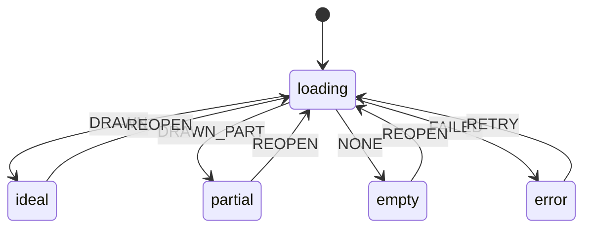

---
ddx:
  id: UF-013-02-places-map
  type: wireframe
  activity: design
  authoring:
    home: repo
  depends_on:
    - UF-013
    - US-096
    - US-097
    - stemma.design-system
    - CONTRACT-001
---

# UF-013-02-places-map: Places Map

**User flow**: [[UF-013]] view `places map` | **Stories**: [[US-096]], [[US-097]]

## Scope and Fidelity

- **View**: Show each sourced location assertion and its uncertainty without merging or locating what is restricted.
- **Modality**: screen
- **Fidelity**: mid
- **Size classes**: compact, expanded
- **Pattern**: View-only map over bundled background data, with an equal list

## Layouts

### Expanded

```text
[Top bar]
[Notice: unmarked places are public. Hiding restricted values does not
 prove that no location is disclosed. Background is coarse.]
[Zoom - + Fit] [Arrows] [Counts] [Key]
[Tabs: Map | List]
[Map: lettered marks, uncertainty    | [Details: place, every assertion,
 circles, hatched broad areas]       |  source, certainty] [Open record]
[Not drawn: place, reason]
[Background data: source and licence]
```

### Compact

```text
[Notice]
[Tabs: List | Map]
[List grouped by place, then "Not drawn"]
[Details]  [Background data: source and licence]
```

### Annotations

| Element | Kind | Annotation | Size classes | Links |
|---|---|---|---|---|
| Notice | feedback | Always visible, in both audiences | all | US-097-AC7 |
| Zoom, arrows and fit | control | Move without dragging; nothing is fetched | all | UF-013 Move places map |
| Map and list tabs | control | The list has every assertion: place, name, source, certainty, distance or "not stated", restriction wording | all | UF-013 Switch places form |
| Mark or row | control | Selects a place. Overlapping marks open a chooser through the same list | all | UF-013 Select place item |
| Disagreement | content | Each source's assertion has its own letter and mark; no centre, average or preferred point. "Sources disagree" appears only where records give different locations | all | US-096-AC5 |
| Uncertainty | content | Circle only for a stated distance; coordinate digits never imply precision | all | US-096-AC4 |
| Restricted | content | "Restricted: broad area" (only an area the author recorded) or "Restricted: not shown" with no mark, centre or zoom target. Fit and counts use only exported shapes | all | US-097-AC3 |
| Not drawn | content | Reason: no source (untraced), no geometry, withheld; unreviewed items are drawn and marked | all | US-096-AC3, US-096-AC6 |
| Background data | content | Bundled source and licence; its coarseness and borders are not claims of the book | all | US-096-AC8 |
| Open record | control | Opens the record | all | UF-013 Open place record |
| Argument map link | control | Other map | all | UF-013 Go to argument map |
| Close | control | Browser tab | all | UF-013 Close from places map |

## States and Events

### States

| State | Applies | Entered when | Person sees | Available actions | Announcement | Exit |
|---|---|---|---|---|---|---|
| ideal | yes | All connected assertions drawable | Map or list | All controls | Focus on the heading | REOPEN |
| empty | yes | No places connected to evidence | "No places to show" | Navigate away | "No places to show" (polite) | REOPEN |
| loading | yes | Opening | "Drawing map" | Navigate away | "Drawing map" (polite) | DRAWN, DRAWN_PART, NONE, FAILED |
| partial | yes | Some are untraced, without geometry or restricted | Map plus "Not drawn" with count | All controls | "<n> locations are not drawn" (polite) | REOPEN |
| error | yes | Drawing or background fails | Cause; list stays | Retry, use list | "Map could not be drawn" (assertive) | RETRY |
| offline | no: background is bundled and no request is made |  |  |  |  |  |
| slow | no: no threshold is set |  |  |  |  |  |
| permission-denied | no: restricted content is absent from the data and shown as partial |  |  |  |  |  |
| success | no: view only |  |  |  |  |  |

### Statechart



### Events

| Event | From | Guard | To | Effect |
|---|---|---|---|---|
| DRAWN | loading | all drawable | ideal | Counts set |
| DRAWN_PART | loading | some not drawn | partial | Reasons listed |
| NONE | loading | no places | empty | Said |
| FAILED | loading | draw failure | error | List offered |
| RETRY | error | user asks | loading | Redraw |
| REOPEN | ideal | destination reopened | loading | Redraw |
| REOPEN | partial | destination reopened | loading | Redraw |
| REOPEN | empty | new export reloaded | loading | Redraw |

## Accessibility

- **Focus order**: notice, controls, tabs, map or list, details, not drawn, background data.
- **Accessible names**: marks "Location A for <place>, according to <source>, <certainty>"; "Move north", "Zoom in".
- **Headings and landmarks**: `h1` "Places"; "Not drawn" has its own heading.
- **Target size and input**: list rows are the equivalent for small or overlapping marks.

## Open Questions

- When a broad area replaces no mark, and how broad it may be: open in FEAT-013, product owner.
- Release scan coverage is open in FEAT-013: product owner. The page claims no scan result.
- Background data and drawing library: SD-013 owner.
- Risk: a misclassified or unmarked restricted site is shown.
