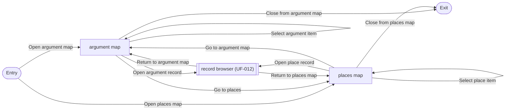

---
ddx:
  id: UF-013
  type: user-flow
  activity: design
  authoring:
    home: repo
  depends_on:
    - FEAT-013
    - US-095
    - US-096
    - US-097
    - US-098
    - stemma.design-system
    - CONTRACT-001
    - CONTRACT-005
---

# UF-013: Argument and Geographic Maps User Flow

**Feature**: [[FEAT-013]] | **Solution design**: [[SD-013]] | **Journey maps**: none | **Interface system**: [[stemma.design-system]]

## Scope

- **Covers** (M3): two view-only maps inside the explorer ([[UF-012]]).
- **Entry points**: the "Argument map" and "Places" destinations.
- **Exits**: record pages (UF-012); closing the page.
- **Navigation**: top-bar links also lead to the other explorer destinations (UF-012).
- **Size classes**: compact, expanded. Compact opens on the list.
- **Out of scope**: editing; recording places or restrictions (done through the agent); judging an argument.
- **Restricted sites**: exact restricted values are left out before export data is written. The map shows the broad area the author recorded, or no mark.
- **Disclosure risk, by decision only reported, or undetectable**: a place not marked restricted is public and shown; stray-coordinate findings only warn; place names, prose, images, git history and text already sent to a model can reveal a site. Marking a site later does not recall copies. A clean scan is not proof.

## Views

| View | Kind | Purpose | Stories | Wireframe |
|---|---|---|---|---|
| argument map | screen | See what supports, opposes and rivals the claims in a chapter or branch | US-095 | [[UF-013-01-argument-map]] |
| places map | screen | See sourced locations, their uncertainty and disagreement | US-096, US-097 | [[UF-013-02-places-map]] |
| record browser (UF-012) | external | Read the record behind a mapped item | US-095 | none |

## Flow Diagram

## Transitions

| Action | From | Control | Guard | To | Feedback | Changed region |
|---|---|---|---|---|---|---|
| Open argument map | Entry | "Argument map" link | none | argument map | Layout progress, scope and counts | full view |
| Open places map | Entry | "Places" link | none | places map | Drawing progress, counts, undrawn list | full view |
| Zoom argument map | argument map | zoom and fit buttons | none | argument map | View changes; no data changes | drawing |
| Choose argument scope | argument map | chapter or branch select | none | argument map | New counts | map and list |
| Switch argument form | argument map | "Map" or "List" tab | none | argument map | Same items in the other form | main region |
| Select argument item | argument map | node, link or row | none | argument map | Details with states | details panel |
| Open argument record | argument map | "Open record" | record in export | record browser (UF-012) | Record page | full view |
| Return to argument map | record browser (UF-012) | browser back | none | argument map | Scope and selection restored where the URL holds them | full view |
| Go to places | argument map | "Places" link | none | places map | Drawing progress | full view |
| Move places map | places map | zoom, pan and fit buttons | none | places map | View changes; no request sent | drawing |
| Switch places form | places map | "Map" or "List" tab | none | places map | Same items | main region |
| Select place item | places map | mark or row | none | places map | All assertions for that place with sources and uncertainty | details panel |
| Open place record | places map | "Open record" | record in export | record browser (UF-012) | Record page | full view |
| Return to places map | record browser (UF-012) | browser back | none | places map | Selection restored where the URL holds it | full view |
| Go to argument map | places map | "Argument map" link | none | argument map | Layout progress | full view |
| Close from argument map | argument map | close the tab | none | Exit | none | none |
| Close from places map | places map | close the tab | none | Exit | none | none |

## Alternate Paths

| Path | Trigger | Transitions | Recovery |
|---|---|---|---|
| Error | Layout or drawing fails | Open argument map → Switch argument form | The list stays available; no partial drawing is presented as complete |
| Error | Background map data cannot be drawn | Open places map → Switch places form | The list holds every item |
| Cancel | The reader leaves while drawing | Open argument map → Go to places | Nothing is saved or lost |
| Empty | Scope with no claims, or no places connected to evidence | Choose argument scope | Says which and why |
| Empty | An assertion cannot be drawn: no source, no geometry, withheld | Open places map → Switch places form | Listed with its reason, never placed by guess |
| Permission denied | A restricted location | Select place item | Broad area or "Restricted: not shown"; no route reveals the exact value |

## Story Traceability

| Journey | Task | Stories / ACs | Path |
|---|---|---|---|
| read an argument | See support and challenge | US-095-AC1, US-095-AC3, US-095-AC4, US-095-AC7, US-095-AC8 | Open argument map → Choose argument scope → Switch argument form → Select argument item → Open argument record |
| read places | See sources and disagreement | US-096-AC2, US-096-AC3, US-096-AC5, US-096-AC6, US-096-AC10 | Open places map → Switch places form → Select place item → Open place record |
| restricted site | Confirm nothing exact is shown | US-097-AC3, US-097-AC7 | Open places map → Select place item |

## Dead Ends

- None.
