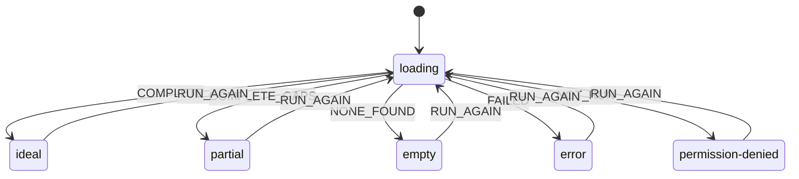

---
ddx:
  id: UF-015-01-intake-report
  type: wireframe
  activity: design
  authoring:
    home: repo
  depends_on:
    - UF-015
    - US-099
    - US-100
    - stemma.design-system
---

# UF-015-01-intake-report: Intake Report Turn

**User flow**: [[UF-015]] view `intake report turn` | **Stories**: [[US-099]], [[US-100]]

## Scope and Fidelity

- **View**: State what takeover read, bound, left uncertain and could not convert.
- **Modality**: chat
- **Fidelity**: mid
- **Size classes**: not applicable: chat; the host sets the width
- **Pattern**: DESIGN.md chat turn rules

## Layouts

### Turn

```text
[Run line]       Takeover finished. Your original files were not changed.
[Counts]         Notes read; citations created, bound, ambiguous, unclassified;
                 claims and quotations; reference-list entries. All in
                 effect, unverified and unreviewed.
[Not read]       Tracked changes (view read), comments, text boxes, fields,
                 lost styling kinds, unconverted blocks, each with position
[Disagreements]  Embedded data against visible text or library; duplicates.
                 Each item: what it is, both values, why it matters, what to do
[Support level]  For each input and producing tool: supported or untested
[Next]           No stored copies yet: source.held reports each, as expected
[Choices]        Review items / start rounds / run again / stop, or carry on
```

### Annotations

| Element | Kind | Annotation | Size classes | Links |
|---|---|---|---|---|
| Run line | feedback | Completion and the unchanged originals | all | US-099-AC1 |
| Counts | content | Report counts. "Bound" means a deterministic rule found one candidate, not that it is right | all | US-101-AC5 |
| Not read | content | Nothing is dropped silently; long lists are paged with a total. Each kind says why it matters and what the author can do (FR-74) | all | US-099-AC4 |
| Support level | content | An input with no real-file tests is called untested | all | US-099-AC3 |
| Next | content | A recovered reference with no stored copy is reported as unchecked, and that finding cannot be dismissed. The turn says why (its quotations and pages cannot be checked) and how to close it (add a stored copy). Unreviewed counts do not change the label | all | US-101-AC7 |
| Choices: review | control | Opens the first review batch; optional | all | UF-015 Review items |
| Choices: rounds | control | Opens the first open item | all | UF-015 Start rounds |
| Choices: run again | control | Reruns without overwriting choices (assumption in CONTRACT-003) | all | UF-015 Run takeover again |
| Choices: stop | control | Ends the task | all | UF-015 Leave after intake |

## States and Events

### States

| State | Applies | Entered when | Person sees | Available actions | Announcement | Exit |
|---|---|---|---|---|---|---|
| ideal | yes | Intake completed and nothing was left unread | The turn | All four choices | "Takeover finished" (host-controlled) | RUN_AGAIN |
| empty | yes | No references found | "No references were found. This is not a pass." | Run again, stop | That sentence (host-controlled) | RUN_AGAIN |
| loading | yes | Intake starts | "Reading <files>; originals stay unchanged" | Interrupt | That line (host-controlled) | COMPLETE, COMPLETE_GAPS, NONE_FOUND, FAILED, NOT_RUN |
| partial | yes | Completed with unread, unconverted or unclassified content | The turn with the unread count first | All four choices | "Finished; <n> items not read or not settled" (host-controlled) | RUN_AGAIN |
| error | yes | Named failure | The error code, location where known, and that no complete import exists | Fix and rerun, stop | "Takeover failed" (host-controlled) | RUN_AGAIN |
| offline | no: intake needs no network |  |  |  |  |  |
| slow | no: no tested duration; the one target is an unconfirmed assumption |  |  |  |  |  |
| permission-denied | yes | Scripts or file access unavailable | "Takeover did not run" | Fix access and rerun | That sentence (host-controlled) | RUN_AGAIN |
| success | no: ideal and partial are the completed states |  |  |  |  |  |

### Statechart



### Events

| Event | From | Guard | To | Effect |
|---|---|---|---|---|
| COMPLETE | loading | nothing unread | ideal | Report shown |
| COMPLETE_GAPS | loading | unread or unsettled items | partial | Report shown |
| NONE_FOUND | loading | no references | empty | Report shown |
| FAILED | loading | input or internal error | error | No partial import presented as complete |
| NOT_RUN | loading | host will not run it | permission-denied | Nothing ran |
| RUN_AGAIN | ideal | author asks | loading | Choices kept |
| RUN_AGAIN | partial | author asks | loading | Choices kept |
| RUN_AGAIN | empty | author asks | loading | Rerun |
| RUN_AGAIN | error | input fixed | loading | Rerun |
| RUN_AGAIN | permission-denied | access fixed | loading | Rerun |

## Accessibility

- **Focus order**: run line, counts, unread items, support level, choices.
- **Accessible names**: each unread item states kind and position in words.
- **Headings and landmarks**: text labels in the order shown; counts as a list, not a wide table.
- **Target size and input**: typed replies.

## Open Questions

- Which producing tools and versions the pilot covers is open in FEAT-015: product owner with the pilot author.
- No file saved by a real tool has been tested; the German "a.a.O." and author-date forms were missed by a prototype.
