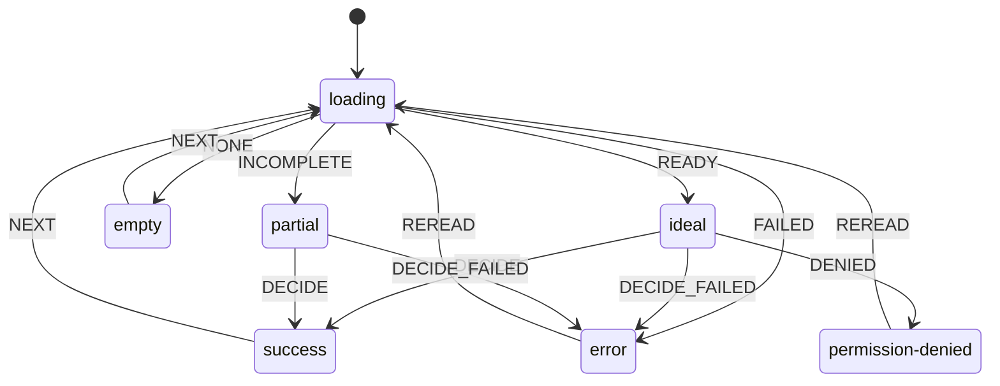

---
ddx:
  id: UF-015-02-review-batch
  type: wireframe
  activity: design
  authoring:
    home: repo
  depends_on:
    - UF-015
    - US-101
    - US-106
    - stemma.design-system
---

# UF-015-02-review-batch: Review Batch Turn

**User flow**: [[UF-015]] view `review batch turn` | **Stories**: [[US-101]], [[US-106]]

## Scope and Fidelity

- **View**: Put each unreviewed item beside its original passage when the author chooses to review. The turn is optional and never a condition of continuing.
- **Modality**: chat
- **Fidelity**: mid
- **Size classes**: not applicable: chat; the host sets the width
- **Pattern**: Batch review turn

## Layouts

### Turn

```text
[Status]   Batch <k>: <n> items; <m> still unreviewed. All are in effect.
           Marking reviewed records what you looked at. It verifies nothing.
[Item A]   Kind: claim | construct | methodology
           Current wording
           [Original] Quoted text (data), chapter and position
           (suggestion) every supporting passage
[Item B]   ...
[Choices]  Mark reviewed <letters or "this batch"> / edit <letter>
           / retire <letters> / go to rounds / stop
```

### Annotations

| Element | Kind | Annotation | Size classes | Links |
|---|---|---|---|---|
| Status | feedback | States that the items are already in effect and what a review mark means. Unreviewed items are counted in reports and do not change the checked-clean label | all | US-101-AC8 |
| Item | content | Wording and kind, lettered for replies within this turn only; record IDs are shown too | all | US-101-AC9 |
| Original | content | Shown in full. Long passages continue in a following part of the same batch | all | US-101-AC9, US-106-AC1 |
| Choices: reviewed | control | "This batch" covers only what was shown | all | UF-015 Mark reviewed |
| Choices: edit | control | The edit takes effect and is shown again. Wording the author gives keeps the review state; wording the agent proposes marks the item unreviewed | all | UF-015 Edit an item |
| Choices: retire | control | The item has no further effect | all | UF-015 Retire items |
| Choices: rounds | control | Leaves the rest unreviewed | all | UF-015 Go to rounds |
| Choices: stop | control | Same | all | UF-015 Leave review |

## States and Events

### States

| State | Applies | Entered when | Person sees | Available actions | Announcement | Exit |
|---|---|---|---|---|---|---|
| ideal | yes | A batch is ready | The turn | All choices | "Batch of <n>, all in effect" (host-controlled) | DECIDE, DECIDE_FAILED, DENIED |
| empty | yes | Nothing unreviewed | "Nothing is unreviewed" | Go to rounds, stop | That sentence (host-controlled) | NEXT |
| loading | yes | The list is read | "Reading unreviewed items" | Interrupt | That line (host-controlled) | READY, NONE, INCOMPLETE, FAILED |
| partial | yes | An item's original passage cannot be shown | It is listed with the reason; the others are unaffected | Review the others, retire, stop | "<n> items lack a passage" (host-controlled) | DECIDE, DECIDE_FAILED |
| error | yes | A command fails or the text changed | "Decision not recorded" and cause | Reread, stop | That sentence (host-controlled) | REREAD |
| offline | no: local records only |  |  |  |  |  |
| slow | no: no timing target |  |  |  |  |  |
| permission-denied | yes | The command cannot run | "Nothing was recorded" and the reason | Reread, stop | That sentence (host-controlled) | REREAD |
| success | yes | A decision was saved | Which were marked reviewed, edited or retired; all remain unverified | Next batch, rounds, stop | "Recorded: <counts>" (host-controlled) | NEXT |

### Statechart



### Events

| Event | From | Guard | To | Effect |
|---|---|---|---|---|
| READY | loading | passages available | ideal | Batch shown |
| NONE | loading | nothing unreviewed | empty | Said |
| INCOMPLETE | loading | a passage missing | partial | Marked |
| FAILED | loading | read failed | error | Nothing recorded |
| DECIDE | ideal | explicit instruction | success | reviewed, retire, or an edit |
| DECIDE | partial | explicit instruction on shown items | success | Same |
| DECIDE_FAILED | ideal | command fails | error | Nothing reported as recorded |
| DENIED | ideal | command cannot run | permission-denied | Nothing recorded |
| DECIDE_FAILED | partial | command fails | error | Same |
| NEXT | success | more unreviewed or edit made | loading | Next batch or edited item |
| NEXT | empty | author asks again | loading | Reread |
| REREAD | error | author asks | loading | Reread |
| REREAD | permission-denied | author asks | loading | Reread |

## Accessibility

- **Focus order**: status, then each item with its passage, then choices.
- **Accessible names**: wording and original are labelled "Current" and "Original"; letters are repeated in choices.
- **Headings and landmarks**: one short heading per item; no side-by-side columns.
- **Target size and input**: typed replies.

## Open Questions

- Batch size: SD-015 owner. It must stay small enough to read; Stemma cannot show that the author read a passage.
- Review marks and retirement are as CONTRACT-001 defines; the turn adds none.
