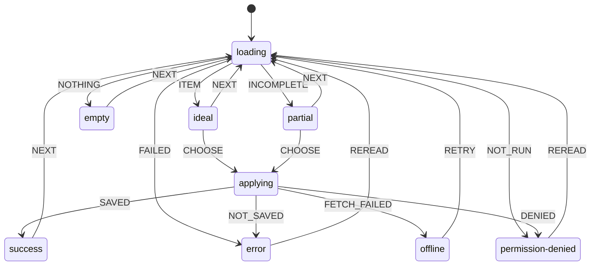

---
ddx:
  id: UF-015-03-reference-round
  type: wireframe
  activity: design
  authoring:
    home: repo
  depends_on:
    - UF-015
    - US-102
    - US-103
    - stemma.design-system
---

# UF-015-03-reference-round: Reference Round Turn

**User flow**: [[UF-015]] view `reference round turn` | **Stories**: [[US-102]], [[US-103]]

## Scope and Fidelity

- **View**: Show one open item with its evidence, apply only the choice the author names, and report the recheck.
- **Modality**: chat
- **Fidelity**: mid
- **Size classes**: not applicable: chat; the host sets the width
- **Pattern**: One-item decision loop

## Layouts

### Turn: on resume, then each item

```text
[Progress]     Choices made: <n>. Open: <m>. (resume) Changed since last time.
[Left uncited] Claims with no citation after a removal: <list>. They have no
               source until cited again, rewritten or retired.
[Item]         <chapter, sentence, footnote as found>
[Why open]     <check, outcome, reason> or <intake reason>, in plain words
[Evidence]     Quoted text (data); candidates and why each fits
[Why it matters] What a reader would meet if it stays
[Suggested]    The report's suggested action
[Depends]      Claims and notes that will be rechecked
[Proposal]     Advice (not a finding): <optional suggestion and reason>
[Choices]      Remove / repoint / replace / bind <candidate> / dismiss
               / add stored copy / skip / check / build / review / pause
```

### Turn: after a choice

```text
[Applied]      <choice>. Stemma copy: before and after. Originals unchanged.
[Recheck]      <results as returned for the item and its dependants>
```

### Annotations

| Element | Kind | Annotation | Size classes | Links |
|---|---|---|---|---|
| Progress | feedback | Computed from records, so the same in a new session. Changed sources and originals are listed | all | US-103-AC1, US-103-AC2 |
| Left uncited | content | Listed every time while it applies, with the warning | all | US-102-AC11, US-103-AC3 |
| Evidence | content | Both values are kept when embedded data and visible text disagree | all | US-102-AC1 |
| Why it matters and suggested | content | From the report's `why` and `suggestions`; an intake item gets the same parts (FR-74) | all | US-031-AC5 |
| Proposal | content | Advice, never preselected. Silence applies nothing | all | US-102-AC5 |
| Applied | feedback | Only the affected span changes | all | US-102-AC10 |
| Recheck | content | Script results as given; a round records no annotation | all | US-102-AC6, US-102-AC8 |
| Choices: remove | control | Retires the citation on the author's instruction; the result names any claim left without a citation | all | UF-015 Remove reference |
| Choices: repoint | control | New target or locator from the author | all | UF-015 Repoint reference |
| Choices: replace | control | Author's chosen source | all | UF-015 Replace reference |
| Choices: bind | control | For an unresolved footnote; no candidate is guessed | all | UF-015 Bind footnote |
| Choices: dismiss | control | Closes an intake item only | all | UF-015 Dismiss intake item |
| Choices: add copy | control | Asks rights, which govern what a reviewer package may hold and do not limit model use | all | UF-015 Add a stored copy |
| Choices: skip | control | No record written | all | UF-015 Skip item |
| Choices: check | control | Leaves to UF-007 | all | UF-015 Check the project |
| Choices: build | control | Pilot PDF | all | UF-015 Request the pilot PDF |
| Choices: review | control | Back to batches | all | UF-015 Back to review |
| Choices: pause | control | Safe at any item | all | UF-015 Pause rounds |

## States and Events

### States

| State | Applies | Entered when | Person sees | Available actions | Announcement | Exit |
|---|---|---|---|---|---|---|
| ideal | yes | An open item is ready | Progress, item, choices | All choices that fit the item | "Item <k>; <m> open" (host-controlled) | CHOOSE, NEXT |
| empty | yes | Nothing is open | "No open items", with any claims left uncited | Check, build, review, pause | "No open items" (host-controlled) | NEXT |
| loading | yes | Resume or next item | "Rechecking" | Interrupt | That line (host-controlled) | ITEM, NOTHING, INCOMPLETE, FAILED, NOT_RUN |
| partial | yes | Some dependants are `unverifiable` | Those results and the reason | All choices | "Recheck incomplete" (host-controlled) | CHOOSE, NEXT |
| error | yes | Stale file, busy, failed write, or records and copy disagree | "Choice not applied" or "state differs", with paths | Reread, pause | That sentence (host-controlled) | REREAD |
| offline | yes | Adding a URL copy with no network | "Could not fetch; supply a file" | Supply a file, skip, pause | "Could not fetch" (host-controlled) | RETRY |
| slow | no: no timing target |  |  |  |  |  |
| permission-denied | yes | Command cannot run in this host | "Nothing was changed" and why | Reread, pause | That sentence (host-controlled) | REREAD |
| success | yes | A choice was applied and rechecked | The second layout, including any new failure | Next item, add copy, pause | "Applied; recheck: <counts>" (host-controlled) | NEXT |
| applying | yes | The author names a choice | "Applying <choice>" | Interrupt | That line (host-controlled) | SAVED, NOT_SAVED, FETCH_FAILED, DENIED |

### Statechart



### Events

| Event | From | Guard | To | Effect |
|---|---|---|---|---|
| ITEM | loading | open item | ideal | Item shown |
| NOTHING | loading | none open | empty | Said |
| INCOMPLETE | loading | unverifiable recheck | partial | Listed |
| FAILED | loading | read or recheck fails | error | No result claimed |
| NOT_RUN | loading | host will not run it | permission-denied | Nothing ran |
| CHOOSE | ideal | explicit choice | applying | rounds choose, or admission commands |
| CHOOSE | partial | explicit choice | applying | Same |
| NEXT | ideal | skip | loading | Nothing saved |
| SAVED | applying | write and recheck ran | success | round_choice saved |
| NOT_SAVED | applying | stale or failed | error | Reported; resume shows actual state |
| FETCH_FAILED | applying | URL unreachable | offline | No capture added |
| DENIED | applying | command cannot run | permission-denied | Nothing changed |
| NEXT | success | author continues | loading | Next item |
| NEXT | partial | skip | loading | Next item |
| NEXT | empty | author asks again | loading | Recompute |
| REREAD | error | author asks | loading | Recompute from files |
| RETRY | offline | file supplied or online | loading | Item shown again |
| REREAD | permission-denied | author asks | loading | Recompute |

## Accessibility

- **Focus order**: progress, uncited claims, item, evidence, choices.
- **Accessible names**: each candidate by author, title and year or "unknown"; before and after text are labelled.
- **Headings and landmarks**: one heading per turn naming the item.
- **Target size and input**: typed replies.

## Open Questions

- Order of open items (by chapter position assumed): SD-015 owner.
- How an interrupted choice is made atomic across record and manuscript files: SD-015 owner.
- Risk: after a removal, a finished book can hold the claim with no source; the report is the only warning.
