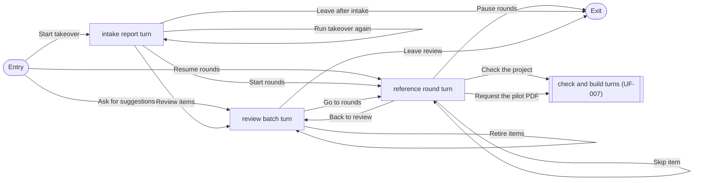

---
ddx:
  id: UF-015
  type: user-flow
  activity: design
  authoring:
    home: repo
  depends_on:
    - FEAT-015
    - US-099
    - US-100
    - US-101
    - US-102
    - US-103
    - US-106
    - stemma.design-system
    - CONTRACT-002
    - CONTRACT-003
    - CONTRACT-004
    - CONTRACT-006
---

# UF-015: Takeover Review Rounds User Flow

**Feature**: [[FEAT-015]] | **Solution design**: [[SD-015]] | **Journey maps**: none | **Interface system**: [[stemma.design-system]]

## Scope

- **Covers**: agent turns for the intake report, optional batch review of unreviewed items, and resolution rounds that stop and resume (M1). Construct and methodology suggestions use the review turn (M2). Everything takeover creates is in effect at once, unreviewed; no turn is required before other work.
- **Entry points**: the author asks to take over a Word chapter; a new session asks to resume; in M2, asks for suggestions.
- **Exits**: pause at any time; check, annotation and pilot build turns ([[UF-007]]).
- **Size classes**: not applicable (chat).
- **Out of scope**: check and annotation turns (UF-007); typesetting.
- **Resume**: there is no session record. Remaining work is computed from failing results and intake items without an applicable choice (CONTRACT-001), so nothing depends on chat history.
- **Writes**: originals are never changed; fixes go to the Stemma copy and records.

## Views

| View | Kind | Purpose | Stories | Wireframe |
|---|---|---|---|---|
| intake report turn | turn | Learn what was read, what was not and what is uncertain | US-099, US-100 | [[UF-015-01-intake-report]] |
| review batch turn | turn | Review, edit or retire unreviewed items beside their original passages, when the author chooses | US-101, US-106 | [[UF-015-02-review-batch]] |
| reference round turn | turn | Choose what to do about one open item, then pause or continue | US-102, US-103 | [[UF-015-03-reference-round]] |
| check and build turns (UF-007) | external | Run checks, annotate a finding or build the pilot PDF | US-107 | none |

## Flow Diagram

## Transitions

| Action | From | Control | Guard | To | Feedback | Changed region |
|---|---|---|---|---|---|---|
| Start takeover | Entry | author names the manuscript and any libraries | none | intake report turn | Says the originals will not be changed and that takeover is running; then the report | new turn |
| Resume rounds | Entry | author asks to resume | a taken-over project | reference round turn | Rechecks, then completed choices, open items, claims left without a citation and changes since last time | new turn |
| Ask for suggestions | Entry | author asks (M2) | taken-over project | review batch turn | Suggestions with supporting passages, already in effect and unreviewed | new turn |
| Run takeover again | intake report turn | author asks | none | intake report turn | Earlier choices kept; a changed original is reported and not applied | new turn |
| Review items | intake report turn | author asks | unreviewed items exist | review batch turn | First batch with passages | new turn |
| Mark reviewed | review batch turn | author names the items or the shown batch | none | review batch turn | Count marked; still unverified; next batch or none left | new turn |
| Edit an item | review batch turn | author gives new wording | none | review batch turn | Edited text and passage shown; in effect at once. The author's own wording keeps the item's review state; a change the agent proposes marks it unreviewed | new turn |
| Retire items | review batch turn | author names items | none | review batch turn | Retired items; they have no further effect; text still linked to them is reported | new turn |
| Start rounds | intake report turn | author asks | open items exist | reference round turn | Counts and the first item | new turn |
| Go to rounds | review batch turn | author asks | open items exist | reference round turn | Counts and the first item | new turn |
| Back to review | reference round turn | author asks | unreviewed items remain | review batch turn | Next batch | new turn |
| Add a stored copy | reference round turn | author supplies a file or URL | none; rights are asked and may stay unstated | reference round turn | Storage and text extraction progress; recheck results. A URL uses the network | new turn |
| Remove reference | reference round turn | author says remove, naming the item | citation item | reference round turn | Change, recheck, and any claim left without a citation | new turn |
| Repoint reference | reference round turn | author gives the new target or locator | target is unambiguous | reference round turn | Before and after, and rechecks of dependants | new turn |
| Replace reference | reference round turn | author names the replacement | target is unambiguous | reference round turn | Before and after and rechecks; without a stored copy it is reported as unchecked | new turn |
| Bind footnote | reference round turn | author picks a candidate source | unresolved footnote | reference round turn | Binding, and rechecks | new turn |
| Dismiss intake item | reference round turn | author says dismiss, naming the item | intake item | reference round turn | Choice saved; says that unread content is not thereby converted | new turn |
| Skip item | reference round turn | author says skip | none | reference round turn | Next item; the skipped one stays open; nothing saved | new turn |
| Check the project | reference round turn | author asks | none | check and build turns (UF-007) | Check results | new turn |
| Request the pilot PDF | reference round turn | author asks | none | check and build turns (UF-007) | Draft or unwatermarked basic PDF with its label and report | new turn |
| Pause rounds | reference round turn | author stops | none | Exit | Completed and open counts; how to resume | none |
| Leave after intake | intake report turn | author stops | none | Exit | Records are in effect, unverified and unreviewed | none |
| Leave review | review batch turn | author stops | none | Exit | Unreviewed items stay in effect, marked unreviewed | none |

## Alternate Paths

| Path | Trigger | Transitions | Recovery |
|---|---|---|---|
| Error | Unreadable, encrypted, hostile or oversized input | Start takeover → Leave after intake | Named failure; no partial import is presented as complete |
| Error | Library entry cannot be parsed | Start takeover → Run takeover again | The line is named and nothing is written for that library; fix the file |
| Error | Manuscript changed during a tool edit (`stale_input`) | Repoint reference | Nothing is written; the agent rereads and shows the item again |
| Error | Session ends during a choice | Resume rounds | The item is shown as complete and rechecked, or still open. A difference between records and the Stemma copy is reported before any new choice |
| Cancel | No choice or an unclear reply | Skip item → Pause rounds | The round changes nothing; suggestions from the agent are not choices; work continues |
| Cancel | The author wants to reverse a choice | Replace reference | The latest choice applies. A removed citation's record is kept; the author names how to restore it |
| Empty | No references found | Start takeover → Leave after intake | Reported as none found; not a pass |
| Empty | No open items | Resume rounds → Request the pilot PDF | Says nothing is open and still lists claims left without a citation |
| Permission denied | Host cannot run scripts, or a command fails to run | Resume rounds → Pause rounds | States that nothing ran; no records are hand-edited instead |

## Story Traceability

| Journey | Task | Stories / ACs | Path |
|---|---|---|---|
| take over a chapter | Bring in existing work | US-099-AC1, US-099-AC4, US-099-AC7, US-100-AC4, US-100-AC5 | Start takeover → Leave after intake |
| review the graph | Review extracted claims when wanted | US-101-AC4, US-101-AC8, US-101-AC9, US-101-AC10 | Start takeover → Review items → Edit an item → Mark reviewed → Retire items → Go to rounds |
| resolve references | Remove, repoint or replace | US-102-AC1, US-102-AC5, US-102-AC6, US-102-AC10, US-102-AC11 | Start takeover → Start rounds → Repoint reference → Remove reference → Check the project |
| stop and resume | Work in short sittings | US-103-AC1, US-103-AC2, US-103-AC3, US-103-AC5, US-103-AC6 | Resume rounds → Skip item → Pause rounds |
| review suggestions | Review constructs and methodology | US-106-AC1, US-106-AC2, US-106-AC3 | Ask for suggestions → Mark reviewed → Retire items → Leave review |

## Dead Ends

- None.
