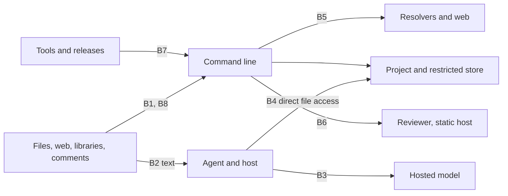

---
ddx:
  id: stemma.security-architecture
  type: security-architecture
  activity: design
  authoring:
    home: repo
  depends_on:
    - stemma.architecture
    - stemma.data-design
    - stemma.security-requirements
    - stemma.threat-model
    - stemma.adr-003
    - stemma.adr-007
    - stemma.adr-012
---

# Security Architecture

**Scope**: the whole of Stemma as laid out in the [architecture](architecture.md).
Requirements are in [security requirements](../01-frame/security-requirements.md),
threats in the [threat model](../01-frame/threat-model.md), interface rules in
[DESIGN.md](DESIGN.md), and component design in the
[solution designs](solution-designs/).

## Decision

Stemma secures what its own code does with files, and states plainly what it
cannot control. It does not sandbox or authorize the agent. The design rests on
five controls:

1. Treat every outside file, response, and string as data. Parse it in the
   owning adapter, within limits, and never run it.
2. Keep binaries and restricted coordinates outside the repository.
3. Filter and redact while constructing anything for a reviewer, then scan and
   report what remains.
4. Recompute scripted results at every build; label all other records as
   records.
5. Pin the toolchain and run without package downloads.

Hosted-model use is not gated by source. Record forgery is not prevented. No
citation, claim, source, support, image, coordinate, or working-tree finding
blocks work or a build (ADR-003); the controls report, and shape outputs by
exclusion and redaction. These are owner decisions. Items marked **(proposed)**
come from P requirements in [security requirements](../01-frame/security-requirements.md)
and bind only when the owning design or contract adopts them.

## Trust Boundaries

Boundary IDs match the [threat model](../01-frame/threat-model.md).

| Boundary | Assets | Trust Change | Control |
|----------|--------|--------------|---------|
| B1 Outside files and web | Machine, records | Hostile bytes enter parsers | Parsing only in `intake`, `extract`, `workspace`; limits; no execution or nested fetch |
| B2 Text into agent context | Machine, private data | Data can be read as instructions | Bounded, marked excerpts; skill obligations. Instruction only, not containment |
| B3 To hosted model | Sources, manuscript, coordinates | Leaves the author's machine | Needed excerpts; statement to author. No gate |
| B4 Local processes to files | Records, source files, restricted store | Any such process can read and write | None enforced. Commands validate what they read; builds recompute |
| B5 To network services | Research interests, local network | Requests leave; responses are untrusted | Named commands only; saved responses; bounded URL fetch (proposed) |
| B6 To reviewer or host | Source text, positions | Recipient gets everything in the files | Audience filtering before writing, redaction, scan |
| B7 Tools and releases | Machine | Third-party code runs with author's rights | Pins, digests, lockfile, no runtime download, release audit |
| B8 Collaborator input | Records, rules, agent behavior | Others' text becomes project content | Validation; comment import writes only comment records. `rules.md` is followed by the agent, so the author reviews changes to it |
| B9 Requests to the local server | Everything an author export holds | Any web page, local program, or local user can send a request to a loopback port | CONTRACT-005 M: loopback only, exact Host and Origin, a per-run secret got by a one-time code, no cookie and no cross-origin permission, bounded requests, fixed routes |

## Control Mapping

Verification names the SEC criterion that tests the control.

| Threat / Risk | Control | Implementation Surface | Verification |
|---------------|---------|-------------------------|--------------|
| TM-E-001, TM-I-003, TM-S-001, TM-S-006 | Source text is data. Excerpts carry the CONTRACT-002 G marker. The agent obligations are in CONTRACT-004 C. No command takes an action named by input text | `skills/stemma`, `core` | SEC-009, SEC-003 |
| TM-T-002 | The support judge gets only the prepared bundle and versioned prompt, in a separate context. Give it no tools where the host allows (proposed). A quoted-substring rule does not detect a steered verdict | `skills/stemma`, `core` | SEC-009; FR-52 error rates |
| TM-S-002, TM-T-001, TM-R-001, TM-T-006 | Accepted. Honest wording; stated limits in the disclosure; git history as a changeable trail | `core`, `publish`, `skills/stemma` | SEC-002 |
| TM-D-001, TM-E-002, TM-T-003, TM-T-013, TM-T-014 | CONTRACT-003 G for codecs. Caps for conversion and fetch (SD-002), lookup responses of at most 10 MiB with a 60 s timeout (assumption), and image conversion (SD-008); no script or code evaluation; no external entities. Input names never form paths; source text is escaped (CONTRACT-007 F); model corrections are refused | `intake`, `extract`, `workspace`, `publish` | SEC-005 to SEC-008 |
| TM-I-011 | HTTPS only, size, time, redirect, and address limits on fetches; fetched content never rendered; refusals not worked around | `workspace`, `Resolver` port | SEC-013, SEC-023 |
| TM-E-003 | Invoke with `--no-install --no-env-file --config=/dev/null`, the plugin root as working directory, and absolute project paths; exit 4 without `--no-install` (CONTRACT-002 A). On Bun 1.4.5 on macOS a working-directory `bunfig.toml` preload and `.env` were loaded under `--no-install` alone and not with all three flags. A start without the last two flags is only warned about, after any preload has run. The caller's own environment and global Bun settings are not covered | `cli`, `skills/stemma` invocation | SEC-014 |
| TM-E-005 | Escaping in the Typst output format, build-directory file access, vendored packages, no network (CONTRACT-006 G). Make an unvendored package fail without download (proposed) | `cite`, `publish` | SEC-010 |
| TM-E-004 | Run TIFF and EPS conversion as a recorded step with a pinned converter, without network or unrelated file access (proposed) | `publish` | SEC-012 |
| TM-E-006, TM-I-012 | Render record and comment text as text; encode inlined data so it cannot end its script block; display SVG without script; restrictive content security policy (proposed). Any loosening for browser Typst is reviewed in SD-012 | `explorer`, `graph` | SEC-011 |
| TM-I-007 | Allow list (CONTRACT-005 E), report redaction including sentence fields (CONTRACT-002 E1), the short-excerpt allowance (none kept until its limit is set), a verbatim scan whose unremovable hits are reported, and a coverage statement per package part (proposed) | `graph`, `core`, `publish` | SEC-017, SEC-018 |
| TM-I-006 | Report location metadata such as EXIF position data in placed images (`image.metadata`); change no original (proposed) | `publish` | SEC-031 |
| TM-I-002, TM-I-004, TM-I-005 | Outside store; structured values excluded; a packaged warning gives no location; skill instruction to read exact values only when a task needs them and never to write them into project files or outputs (proposed) | `workspace`, `core`, `skills/stemma` | SEC-016, SEC-021, SEC-022 |
| TM-I-001 | Needed excerpts; plain statement that any source may be sent | `core`, `skills/stemma` | SEC-020 |
| TM-I-009, TM-I-010, TM-I-015, TM-D-002 | Restricted-store placement refusals, ignore rules, digests, one plain statement that publishing the repository publishes its sources | `workspace` | SEC-015, SEC-019 |
| TM-T-005, TM-T-004, TM-D-003 | Derived data is never authoritative; validate on read; digest verification | `core`, `graph`, `records` | SEC-004, SEC-008 |
| TM-T-007, TM-E-007, TM-S-004, TM-R-004 | Pinned and recorded tools, lockfile, digests, controlled install scripts, identified release package, release audit and secret scan | Release and bundle scripts | SEC-025 to SEC-028 |
| TM-I-013 | Synthetic or open fixtures; secret scan | Repository | SEC-029, SEC-026 |
| TM-I-016, TM-I-017, TM-S-008 | CONTRACT-005 M rules 2 to 7, 9, 11 | `server`, `explorer` | SEC-034 |
| TM-I-018 | Launch file in a private directory; nothing in arguments or output | `server`, `cli` | SEC-035 |
| TM-D-010, TM-E-008 | CONTRACT-005 M rules 1, 10, 12; fixed routes | `server` | SEC-036 |

TM-I-008 and TM-I-014 have no preventive control; see Residual Risk.

## Identity and Access

- Authentication: none for people. Stemma has no accounts. The local server
  accepts a request only with the secret of its own run (CONTRACT-005 M). An actor in a record is a
  self-asserted label. Host, model, git, and hosting sign-ins belong to those
  services.
- Authorization: the operating system and the agent host decide access. Role
  records (FR-5) are guidance, not access control. CONTRACT-004 C reserves
  review marks, annotations, confirmations, and verdict handling by instruction.
  `annotate`
  cannot tell who ran it, and a host permission prompt adds no assurance.
- Session or token handling: the local server makes a new secret at each start
  and gives it once, for a one-time code, to the page, which keeps it in
  `sessionStorage`. Stemma writes it to no file; the code is only in the private
  launch file. No design stores an API key. A resolver that needs one requires a
  new design decision.

## Data Protection

- Data at rest:

| Data | Location | Protection and limit |
|---|---|---|
| Records, manuscript, rules | Git repository | Treat as private: holds excerpts, notes, and legacy values. Access is the author's choice of remote |
| Source files | `sources/` in the repository | Digests; readable by whoever can read the repository |
| Originals | Wherever the author keeps them; fetched ones in ignored `.stemma/originals/` | Never committed; matched by hash |
| Exact restricted coordinates | Restricted store outside the project | No hash or copy elsewhere by design; no encryption by Stemma; readable by the agent's process |
| Index, reports, builds, exports | `.stemma/`, `build/` | Ignored by git; may copy source text |

- Data in transit:
  - Local server: plain HTTP over the loopback interface, which does not leave
    the computer. Reading loopback traffic needs administrator rights, which this
    design does not defend against. The served data is everything an author
    export holds, with no size cap.
  - Hosted model: the host's transport. The data is what the threat model lists
    for B3; `excerpt` and `support prepare` bound only their own output.
  - Resolvers: HTTPS (architecture, Level 1). Requests disclose identifiers and
    bibliographic queries. With certificate checks on (assumption), responses
    are still untrusted. URL admission may use HTTP, which gives no transport
    protection.
  - Reviewer package and git: the author moves them; Stemma sends nothing.
- Restricted coordinates: the store keeps them out of structured outputs only.
  The agent may read exact values when a task needs them, which sends them to
  its model.
  Prose, images, original files, takeover copies, and history can still hold
  them.
- Reviewer package: filtering happens before writing. Source files go in only
  when the author asks. Long source text found in a generated part is shortened
  or, if it cannot be removed, reported with a warning; the package is still
  written. A coordinate hit warns. The PDF is the author's book, so its
  quotations and figures are not changed; the scan covers it and reports long
  source text as `package.leak` (CONTRACT-002 E1). Whether claim text and
  model-written fields in the explorer data are shortened or only scanned is not
  settled by the contracts (SEC-018).
- Author exports and hosted explorers: everything in the files is readable by any
  recipient.
- Secrets and key handling: no Stemma secrets or keys. Nothing is signed.
  Digests detect change against a trusted reference; they do not prove origin.
- Supply chain: the bundle ships unminified at `plugins/stemma` in the
  DocumentDrivenDX/plugins marketplace repository, not in the Stemma
  repository. That repository is a second publishing surface, and whoever can
  push to it controls the installed skill and code. On first use the launcher
  downloads Bun from the npm registry and refuses it unless its SHA-512 matches
  the digest shipped in the plugin, so the registry is trusted only for
  availability. The program is not verified again on later runs; it sits in a
  directory the author's account can write. Digests from the same publisher do
  not protect against a compromised publisher account.
## Logging and Monitoring

- Security events: none are logged. Errors use the contract exit codes and
  messages. Leak, removal, and image findings appear in check reports.
- Alerting: none beyond on-screen and report warnings. Advisory review happens at
  release.
- Audit trail: provenance stamps, retained records, build records, and git
  history. All can be altered by whoever can write them. No record lists what was
  sent to a model.

## Residual Risk

Accepted by owner decision:

- Any project source, including unpublished or community-restricted material,
  can be sent to a hosted model. Stemma cannot recall it (TM-I-001).
- The agent may read exact restricted coordinates when a task needs them; they
  then reach its model (TM-I-002).
- An agent or person can forge review marks, annotations, confirmations,
  restriction changes, and support verdicts without detection (TM-S-002,
  TM-T-001).
- Nothing blocks a build. A book or package can disclose a restricted site or
  protected material, hold unsupported, unreviewed, or unsourced claims, or
  carry image problems; the report and label are the only control (TM-I-004 to
  TM-I-007, TM-T-006). The label reflects check results only, so a book
  labelled checked clean can still hold unreviewed AI items; the report counts
  them separately.

Remaining by design limits:

- The local server does not defend against a process running as the author, a
  browser extension with access to the page, or an administrator. Another local
  user can use up its connections. The other limits are in CONTRACT-005 M.

- Prompt injection is not contained. A steered agent has whatever the host
  allows, including the restricted store and files unrelated to Stemma.
- Package scans find verbatim text only. Paraphrase, altered copies, text inside
  images, and legitimate quotations in the book are outside them.
- Parser, converter, Typst, browser, and runtime flaws remain possible; Stemma
  adds no process sandbox. Container tools are not a required dependency.
- A cloned project from an untrusted person remains untrusted input to the agent.
- Preserved legacy values can hold local paths or private annotations in git, and
  author exports are open to any recipient (TM-I-014, TM-I-008).
- Audits run only before release, so a new advisory can affect installed copies.
- Little here is built; Linux, Windows, and desktop hosts are untested. On
  Linux only the local tools are targeted; no desktop-app host is promised there.

## Security Test Hooks

Hooks run locally and, advisory only, on release tags (ADR-007). Results state
the system they ran on; none is required to continue.

| Hook | Proves | Step |
|---|---|---|
| Hostile corpus: Word archive and XML, libraries, PDF, scan, web page, resolver payload, comment file | SEC-005 to SEC-008, SEC-013 | M1; comments M3 |
| Seeded injection in sources and support passages, live session per claimed host | Observed behavior for SEC-009, SEC-021; no guarantee | M1 |
| Seeded `bunfig.toml` and `.env` start test | SEC-014 | M1, before pilot |
| Tampered cache and report, then a build | SEC-004 | M2 |
| Seeded restricted value, prose coordinate, image metadata, absent store | SEC-016, SEC-022, SEC-031 | M1; images M2 |
| Typst escape, outside-file read, unvendored package, hostile EPS | SEC-010, SEC-012 | M1 basic build; EPS M2 |
| Browser: hostile strings and SVG, network denied | SEC-011, SEC-023 | M3 |
| Seeded long source text in every package part | SEC-017, SEC-018 | M3 |
| Local server: refusals for each rule, sockets, outbound connections, code and secret in output, arguments, and files | SEC-034 to SEC-036 | With the server |
| Release: version and digest check, `bun audit`, secret scan, install digest comparison | SEC-025 to SEC-029 | Each release |
