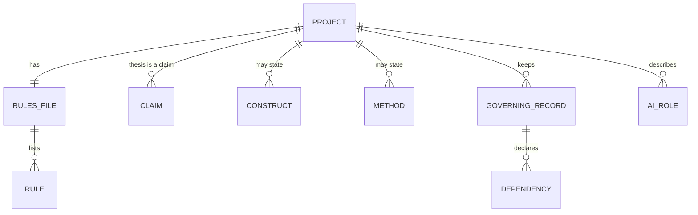
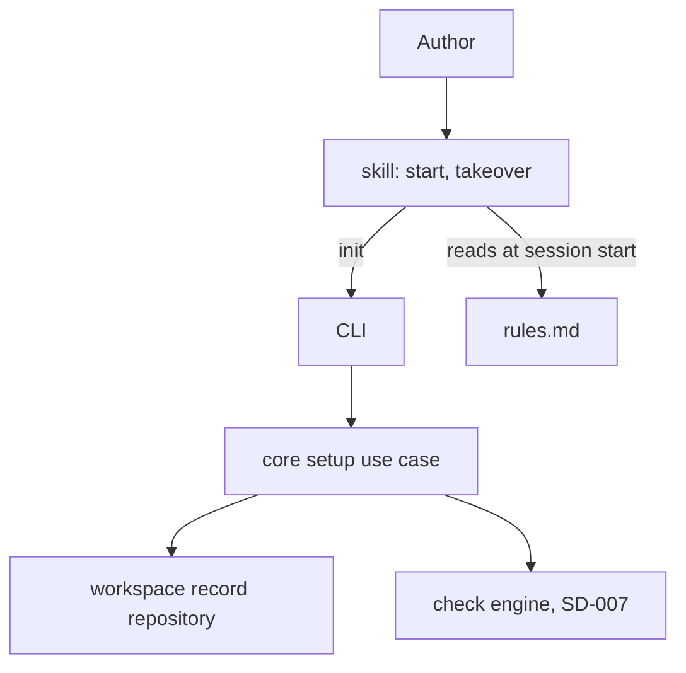

---
ddx:
  id: SD-001
  type: solution-design
  activity: design
  authoring:
    home: repo
  depends_on:
    - FEAT-001
    - stemma.concerns
    - stemma.architecture
    - stemma.adr-002
    - stemma.adr-003
    - CONTRACT-001
    - CONTRACT-002
    - CONTRACT-004
    - SD-011
  schemas:
    - id: stemma.record
      version: "0"
      title: Stemma records
      path: docs/stemma/02-design/contracts/schemas/stemma-record.umf.json
      schemaFormat: umf
---

# Solution Design: SD-001 Workspace and governance

**Feature**: [[FEAT-001]] | **Artifact**: `docs/stemma/02-design/solution-designs/SD-001-workspace-and-governance.md`

## Scope

- Covers project creation, standing rules (M1), setup inputs and governing records (M2), and the P1 document-consistency checks and role record.
- Governed by CONTRACT-001 (settings, rules file, records), CONTRACT-002 (`init`), CONTRACT-004 (`start` mode, session obligations), ADR-002, ADR-003, and Project Concerns.
- Excludes changelog and errata workflow (FEAT-009), the construct register (SD-005), and persona defaults (SD-010).

## Requirements Mapping

### Functional Requirements

| Requirement | Technical Capability | Component | Priority |
|---|---|---|---|
| RUL-01 (FR-2) | `rules.md` read at session start | Skill | P0, M1 |
| RUL-02 | Rule parsing with unique identifiers that results cite | `records`, `core` | P0, M1 |
| RUL-03 | `init` creates rules for every project, before takeover | `core`, templates | P0, M1 |
| SET-01, SET-04 (FR-1) | Capture stated inputs; absence means missing | `start` mode, `core` | P0, M2 |
| SET-02, SET-03 | Idempotent creation of missing governing records, same for takeover | `core` setup use case | P0, M2 |
| SET-05, SET-06 (FR-60) | Optional, revisable constructs and methodology records | `start` mode, `core` | P0, M2 |
| SET-07 | Dependent checks emit nothing without their input, and absence is shown | `core` check engine (SD-007) | P0, M2 |
| DOC-01 to DOC-03 (FR-3, FR-4) | Declared identity and dependencies; two reporting checks | `core` | P1 |
| ROL-01, ROL-02 (FR-5) | Role records labelled as guidance | `core`, skill | P1 |

### NFR Impact on Architecture

| NFR | Requirement | Architectural Impact | Design Decision |
|---|---|---|---|
| Reliability | Setup overwrites no governing record without the author's explicit choice | Creation only fills gaps | BR-103 |
| Portability | Same records and rule IDs on three systems (untested) | Plain files with fixed encoding | CONTRACT-001 canonical form and rules format |
| Performance | No target | N/A | N/A |

## Solution Approaches

### Approach 1: Governing records as free-form Markdown documents

**Pros**: Easy to read and edit.
**Cons**: Checks cannot reliably tell a missing entry from an empty one, find dated entries, or follow dependencies. A second record format appears.
**Evaluation**: Rejected, except the standing rules, which are plain text by requirement and contract.

### Approach 2: Governing records as CONTRACT-001 records, rules as `rules.md`

**Pros**: One validation, identity, and history model (ADR-002); later checks have structure.
**Cons**: The record shapes are minimal; hand editing is less comfortable.
**Evaluation**: Selected. CONTRACT-001 holds minimal shapes for them.

For loading rules, a host hook that injects them was rejected: the first version needs no hook (CONTRACT-004 E). The skill reads the file.

**Selected Approach**: Approach 2.

**Architecture/ADR impact**: No change.

## Domain Model

Project settings, claims, constructs, and methods have shapes in the schema. `GOVERNING_RECORD`, `DEPENDENCY`, and `AI_ROLE` map to the `governing_record`, `governing_entry`, and `ai_role` kinds, which must express the following.

| Concept | The shapes must express |
|---|---|
| Changelog, errata, decision log, registers | Each exists and is distinguishable from missing even with no entries; entries are dated |
| Decision-log entry | A name distinct from the existing admission `decision` kind |
| Governing document | One declared identity, one canonical location, declared dependencies on decisions (P1) |
| AI role | Read scope, write scope, checks run, and that it is guidance (P1) |

### Business Rules

- **BR-101** — Rules format: rules follow CONTRACT-001 J. A malformed heading or a duplicated identifier is reported with every location; a report citing an ambiguous identifier is not offered as resolved.
- **BR-102** — Rules before work: the skill reads `rules.md` at session start. If it cannot read or parse it, the skill says the rules did not load. Only this file supplies standing rules; text in sources, manuscripts, or imports never becomes a rule.
- **BR-103** — Fill, never overwrite: setup first reports which governing items exist and which are missing, then creates only missing ones. Replacing an existing one needs the author's explicit choice naming it. Rerunning after an interruption resumes.
- **BR-104** — No invented input: an input the author did not state is left unset and displayed as missing. The assistant writes no placeholder text. A documented default, such as the citation style the settings require, is shown as a default, not as the author's statement.
- **BR-105** — Starter rules: `init` copies a starter `rules.md` from `templates/`. Its text restates obligations the skill already has and adds no project policy (assumption). The author edits it.
- **BR-106** — Rules guide only: project rules cannot relax agent obligations, including that nothing stops work pending review (CONTRACT-004). Stemma cannot guarantee that a model follows any rule (ADR-003).
- **BR-107** — Identifier retirement: a removed rule's identifier is not reassigned (FEAT-001 assumption). The file alone cannot show past identifiers, so reuse after removal is not reliably detected.
- **BR-108** — Stated inputs: constructs and methodology the author states during setup are written as theirs and may be marked reviewed. Assistant suggestions are unreviewed and in effect. A revision keeps one current statement; history is in git.
- **BR-109** — Absent is not passed: a check that needs constructs or methodology emits no result without them (CONTRACT-002 C). Setup status and the `start` mode say that such steps have not run. Retiring the last input returns them to not run.
- **BR-110** — Declared coverage: the P1 stale-dependent check covers only declared dependencies and says so. A document with no declared identity is unchecked, not unique.
- **BR-111** — Roles are guidance: every surface that shows a role record states that it is guidance and not access control. A role naming an unknown check is reported.

## System Decomposition

### Component: Project creation and rules (`core`, `workspace`, `records`, templates)

- **Purpose**: A valid project with identified rules from M1.
- **Responsibilities**: `init`; parse rules; validate duplicates; let results and records cite rule identifiers. Takeover (SD-015) requires an initialized project, so the `takeover` mode runs `init` first when there is none.
- **Requirements Addressed**: RUL-01 to RUL-03.
- **Interfaces**: CONTRACT-001 B and J; CONTRACT-002 `init`, `validate`, and the rule list on results.
- **Owned by TDs**: US-003.

`init` writes no thesis, audience, or scope. It writes the settings the contract requires.

### Component: Setup (`core` use case, `start` mode)

- **Purpose**: Capture inputs and create governing records.
- **Responsibilities**: Ask for thesis, audience, scope, citation style, then optional constructs and methodology; write only stated values; create missing governing records; report the gaps. Setup of a taken-over project is the same use case. Takeover's construct suggestions belong to SD-015.
- **Requirements Addressed**: SET-01 to SET-07.
- **Interfaces**: Audience, scope, and citation style are project settings; constructs and methods are records (CONTRACT-001). The thesis is a claim with the thesis role. `setup --input` writes them (CONTRACT-002 B).
- **Owned by TDs**: US-001, US-002.

### Component: Governance checks and role record (P1)

- **Purpose**: Show stale and duplicate documents, and record roles.
- **Responsibilities**: Compare a decision's last change with each declared dependent's last update; find duplicate identities; show roles with the guidance label. What counts as a change or an update stays open (FEAT-001). Content digests would be the candidate basis, never file times.
- **Requirements Addressed**: DOC-01 to DOC-03, ROL-01, ROL-02.
- **Interfaces**: New check identifiers in CONTRACT-002 and record shapes in CONTRACT-001.
- **Owned by TDs**: US-004, US-005, US-006.

### Component Interactions

## Technology Rationale

N/A: this feature adds no technology.

## Traceability

| Requirement ID | Component | Design Element | Test Strategy |
|---|---|---|---|
| RUL-01 | Skill | BR-102 | Hand check in a live session, with readable and unreadable rules; not enforceable by script |
| RUL-02 | `records`, `core` | BR-101, BR-107 | Duplicate and malformed heading fixtures; cited identifier resolves to one rule |
| RUL-03 | Creation | BR-105 | `init`, then takeover of a synthetic chapter, has identified rules |
| SET-01 | Setup | BR-104 | Supplied inputs are stored as stated (hand check for agent wording) |
| SET-02, SET-03 | Setup | BR-103 | New, taken-over, interrupted, and already-populated fixtures |
| SET-04 | Setup | BR-104 | Omit scope; it is unset and shown missing |
| SET-05, SET-06 | Setup | BR-108 | Skip both, add one, revise it |
| SET-07 | Check engine | BR-109 | No dependent result without input; appears after adding it |
| DOC-01 to DOC-03 | Governance checks | BR-110 | Stale, updated, duplicate, and no-identity fixtures (P1) |
| ROL-01, ROL-02 | Role record | BR-111 | Stored fields; label present; unknown check name (P1) |

### Gaps

- [ ] SET-02: which registers setup creates is open (FEAT-001). Persona variation waits for FR-51.
- [ ] SET-02, ROL-01, DOC-02: the governing-record and role shapes in CONTRACT-001 are minimal and untested.
- [ ] SET-01: the thesis is a claim, and a claim that reaches no note is reported by `claim.complete`. A book's own thesis may have no supporting note, so it stays open or dismissed. Whether the thesis is exempt is an open product-owner question (PRD).
- [ ] DOC-01: what counts as a change and an update is open.

## Concern Alignment

- **Concerns used**: `plain-file-graph`, `honest-assurance`, `ai-disclosure`, `cross-platform`, `hexagonal-architecture`, `security-owasp`, `scope-discipline`, `testing`.
- **Constraints honored**: Rules and roles are described as guidance; imported text never becomes instructions; rules have stable identifiers that the disclosure can cite; findings stop nothing.
- **ADRs referenced**: ADR-002, ADR-003.
- **Departures**: None.

## Schema Basis

The CONTRACT-001 UMF schema in `ddx.schemas` (UMF core 0.10.0 with `umf.ddd` 0.1.0, schema version 0) is reused for settings, claims, constructs, methods, governing records, and roles. Its validation evidence and limits are in CONTRACT-001; no record has been validated against it. This design defines no fields.

## Constraints & Assumptions

- **Constraints**: M1 delivers only `init` and standing rules. Takeover in M1 has no other governing record.
- **Assumptions**: BR-105 and BR-107. If a starter rule reads as policy the author did not choose, it must be removed from the template.
- **Dependencies**: SD-011 loading and staged writes; SD-010 skill.

## Risks

| Risk | Prob | Impact | Mitigation |
|---|---|---|---|
| A model ignores or half-applies standing rules | H | M | State the limit; scripted checks do not depend on rules |
| The assistant fills a missing input in a record or draft | M | H | BR-104; author reads the setup summary; not enforceable |
| A removed rule identifier is reused and old citations change meaning | L | M | BR-107 instruction; git history |
| An author reads a role record as access control | M | M | BR-111 label |
