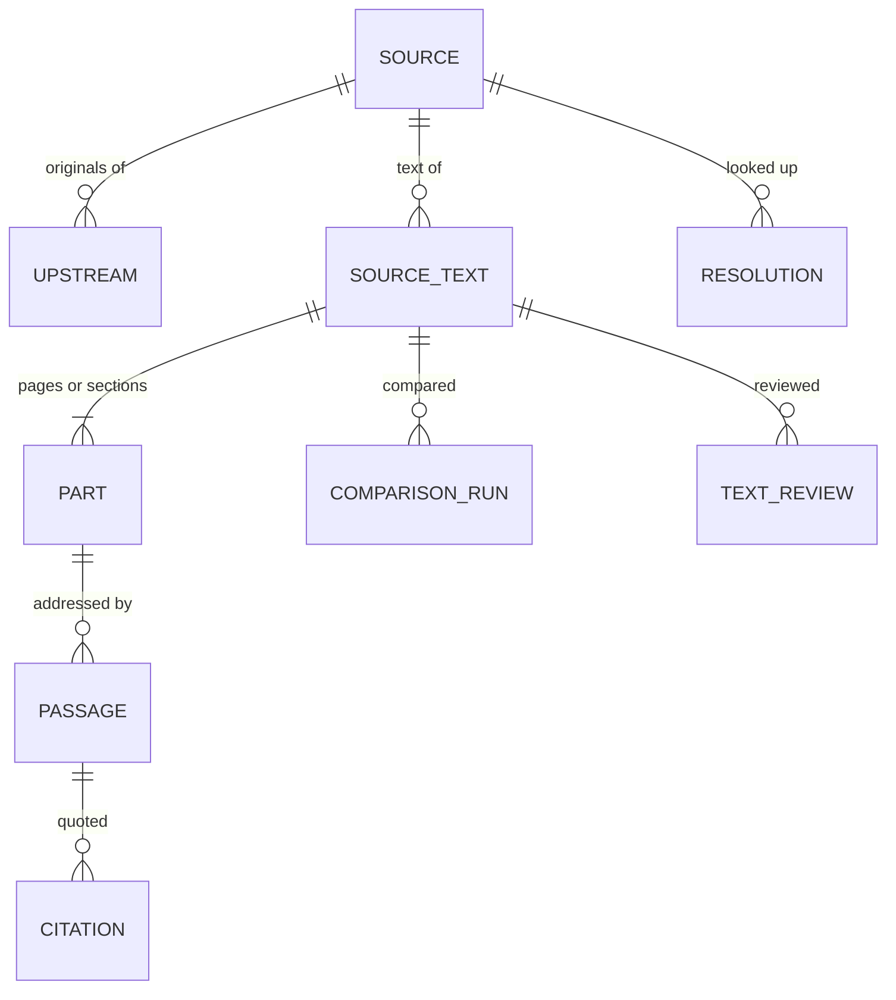
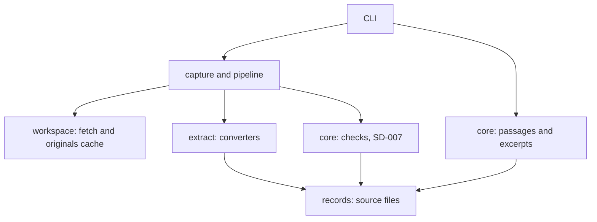

---
ddx:
  id: SD-002
  type: solution-design
  activity: design
  authoring:
    home: repo
  depends_on:
    - FEAT-002
    - stemma.concerns
    - stemma.architecture
    - stemma.data-design
    - stemma.adr-002
    - stemma.adr-003
    - stemma.adr-004
    - stemma.adr-010
    - CONTRACT-001
    - CONTRACT-002
    - CONTRACT-004
    - CONTRACT-007
    - SD-011
  schemas:
    - id: stemma.record
      version: "0"
      title: Stemma records
      path: docs/stemma/02-design/contracts/schemas/stemma-record.umf.json
      schemaFormat: umf
---

# Solution Design: SD-002 Source corpus

**Feature**: [[FEAT-002]] | **Artifact**: `docs/stemma/02-design/solution-designs/SD-002-source-corpus.md`

## Scope

- Covers capture, conversion into source files, structure checks, comparisons
  and reviews, passage capture, change flags, and bounded excerpts. All M1.
- Governed by CONTRACT-007 (source files), CONTRACT-001 (upstream, source text,
  passage, review, comparison, and resolution records), CONTRACT-002 (commands
  and checks), CONTRACT-004 (agent obligations), the Data Design, and ADR-002 to
  ADR-004 and ADR-010.
- The PDF text library is `pdfjs-dist`. No recognition engine is built in.

## Requirements Mapping

### Functional Requirements

| Requirement | Technical Capability | Component | Priority |
|---|---|---|---|
| STO-01 to STO-03 (FR-6) | Upstream records, original ties, documented fetch routes | Capture | P0 |
| CNV-01 to CNV-05 (FR-84) | One converter per format, deterministic, no model | Converters | P0 |
| TXT-01 to TXT-03 (FR-8) | Page and section files with labels and their basis | Converters, source format | P0 |
| STR-01 to STR-03 (FR-87) | Structure checks, cross-page streams, page checks | Checks | P0 |
| PIP-01, PIP-02 (FR-85, FR-86) | One pipeline command; checks read only the project | Pipeline | P0 |
| VER-01 to VER-04 (FR-88, FR-89) | Comparison runs and text reviews bound to page digests | Verification records | P0 |
| PAS-01, PAS-02 (FR-90) | Passage addresses; copied quotation and locator | Passage service | P0 |
| CIT-01, CIT-02 (FR-9) | Citability over source files | Checks | P0 |
| CHG-01, CHG-02 (FR-10) | Dependant flags from retirement and page digests | Checks | P0 |
| RGT-01, RGT-02, RGT-06 (FR-7, FR-61) | Optional rights metadata, bounded excerpts, no gate | Records, excerpt service | P0 |

### NFR Impact on Architecture

| NFR | Requirement | Architectural Impact | Design Decision |
|---|---|---|---|
| Security | No execution of file content; no write outside the project | Converters are isolated and bounded | Zip entries read in memory with size caps; no entity expansion; names never form paths; output escaped |
| Privacy | Prepared model input holds the identified excerpts only | One preparation path | BR-209; it cannot control direct file reads |
| Reliability | Same original, options, and versions give the same files | Pure converters | No time, ID, or machine detail in part files; repeat-run tests |
| Portability | Same hashes and names on three systems (untested) | Byte hashing | LF part files; lowercase names |

## Solution Approaches

### Text representation

| Approach | Finding | Decision |
|---|---|---|
| One extracted text file for each copy | Page boundaries, running heads, notes, and folios are lost or mixed; completeness cannot be checked | Rejected |
| Structured JSON for each page | Checkable, but a person cannot read or correct it comfortably | Rejected |
| One Markdown file for each page or section, with annotations (CONTRACT-007) | Readable, diffable, checkable, and addressable | Selected |

### Recognition

Most sources are text-native files or PDFs with a text layer, so no recognition
engine is built into this version. An image-only or paper original enters as a
transcription from a tool the author runs, named in the record, or typed. A
language model does not transcribe: fluent invented text is the failure this
product exists to prevent, while recognition errors are recognizable and can be
compared and reviewed. Adding a pinned engine later needs page images from
scanned PDFs without a native drawing module and an engine that runs on all
three systems; both are unproven (PRD open question).

### PDF text

`pdfjs-dist` 6.5.438 (Apache-2.0), approved by the product owner, installed with
install scripts off and pinned in `bun.lock`, behind `packages/extract`.

**Selected Approach**: Converters write CONTRACT-007 source files; every later
reader works from them. **Architecture/ADR impact**: ADR-010.

## Domain Model

Shapes are those of CONTRACT-001 and CONTRACT-007.

### Business Rules

- **BR-201** — Verified write: a source file is written only after every part is built and read back; parts are written before the manifest. An existing directory is never overwritten.
- **BR-202** — Same original: when another source's source file holds the same original digest, Stemma names it and writes nothing unless the author names the source. It never merges.
- **BR-203** — Provenance as stated: origin, holder, dates, version, and actor are recorded as given. An unknown value is recorded or shown as unknown, never inferred.
- **BR-204** — Admission is the author's optional decision (CONTRACT-001 G). No check result, missing text, or missing rights value withholds it.
- **BR-205** — Integrity: a source file with a missing, unlisted, edited, or out-of-sequence part is not used by checks or excerpts, and `source.pages` reports it.
- **BR-206** — Checkable: a source's citations can be checked once it has a non-retired, intact source file with text, whatever its admission. The cited page or chapter must be present for locator checks.
- **BR-207** — Reproducible conversion: tool and version are recorded; re-conversion writes a new source file. Passages are not re-anchored silently.
- **BR-208** — No inferred labels: a page gets a printed label only from printed numbers (`source pages` runs), labels embedded in the file that agree with them or that the author confirms, a page marker the source carries, a page image, or the author's statement. Automatic proposal drops a run whose labels a longer run gives, leaving its pages undetermined.
- **BR-209** — Bounded excerpts: model input is built only by `excerpt` and `support prepare`. A whole-source request is not an excerpt. Output marks the content as quoted data.
- **BR-210** — No gate: no rights field, flag, or setting withholds a source. Stemma never says that a license permits sending.
- **BR-211** — Honest quality: method, level, and recognition are recorded per part. Recognized text is labelled; a match against it shows agreement with that text only. A person's whole-page review and comparison runs are reported as coverage; their absence is not a finding.
- **BR-212** — Change flags: a new conversion is a new source file; the old one is retired, never deleted. A passage binds to the page text digests it covers, so only changes to those pages flag it.
- **BR-213** — Untrusted files: size, expanded-size, part-count, and time limits apply before and during parsing. Encrypted, damaged, or unsupported files are reported and write nothing. Document scripts, links, attachments, entities, and external references are never run or fetched.
- **BR-214** — Structure by rule: a converter assigns a role only by a rule stated in CONTRACT-007 I, records the rule as the block's basis, and lists on each part what it did not determine.
- **BR-215** — Copied evidence: passage capture copies the exact stream text at the address and derives the locator from labels, or chapter and paragraph counts. No command accepts a typed quotation or locator for a passage.
- **BR-216** — Fetching: only HTTPS addresses, by a route the library documents for automated use, with a plain user agent. A refusal or failure is reported with what to supply; no other address is tried.

## System Decomposition

### Component: Capture and pipeline (`core`, `workspace`, `cli`)

- **Purpose**: Bring originals in and run stages 1 and 2.
- **Responsibilities**: `ingest`; upstream records; the ignored originals cache; fetching with limits; lookups; running the checks.
- **Requirements Addressed**: STO-01 to STO-03, PIP-01, PIP-02.
- **Interfaces**: CONTRACT-002 B.
- **Owned by TDs**: US-007, US-110.

### Component: Converters (`packages/extract`)

- **Purpose**: Turn an original into parts with structure and stated metadata.
- **Responsibilities**: Plain text with library headers; Markdown; HTML and XHTML; EPUB; DOCX; PDF with the structure rules of CONTRACT-007 I; transcription input; page-label application.
- **Requirements Addressed**: CNV-01 to CNV-05, TXT-01 to TXT-03, CIT-02.
- **Interfaces**: A converter returns identity, parts, and notes; it writes nothing and opens no connection.
- **Owned by TDs**: US-009, US-010, US-110.

### Component: Source files (`packages/records`)

- **Purpose**: The one reader and writer of the CONTRACT-007 format.
- **Responsibilities**: Parse and serialize manifests and parts; derive streams, digests, and offset maps; report format problems.
- **Requirements Addressed**: TXT-01, STR-01.
- **Interfaces**: CONTRACT-007.
- **Owned by TDs**: US-110.

### Component: Checks and verification records (`core`)

- **Purpose**: Decide what is complete, correct, citable, and changed.
- **Responsibilities**: Structure, metadata, identifier, page, and change checks; comparison runs; reviews; coverage. SD-007 owns check results.
- **Requirements Addressed**: STR-01 to STR-03, VER-01 to VER-04, CIT-01, CHG-01, CHG-02.
- **Interfaces**: CONTRACT-002 C.
- **Owned by TDs**: US-011, US-111.

### Component: Passage and excerpt service (`core`)

- **Purpose**: Copy selected evidence, and give a model only what a task needs.
- **Responsibilities**: Find and capture passages by address; resolve a passage or page range to bounded text; mark it.
- **Requirements Addressed**: PAS-01, PAS-02, RGT-02.
- **Interfaces**: `passage`, `excerpt`, `support prepare`.
- **Owned by TDs**: US-012, US-112.

Stemma keeps no log of prepared excerpts. An agent with file access can read any source file directly, so such a log would not show what reached a model.

### Component Interactions

## Technology Rationale

| Layer | Choice | Why | Alternatives Rejected |
|---|---|---|---|
| PDF text and positions | `pdfjs-dist` 6.5.438, bundled | One runtime, no native module, owner approval | Native extractors |
| EPUB and DOCX containers | A small reader over the ZIP central directory with the runtime's built-in inflate and output caps | No dependency; only reading is needed | A ZIP library |
| HTML and XML | A small tag tokenizer; no entity expansion beyond character references | No dependency; no network or execution | A browser DOM library |
| Recognition | None built in | Secondary to text-native sources | Model transcription |

## Traceability

| Requirement ID | Component | Design Element | Test Strategy |
|---|---|---|---|
| STO-01, STO-02 | Capture | BR-201 to BR-203 | Capture synthetic originals; no binary in the project |
| STO-03 | Fetch | BR-216 | Refusing server; non-HTTPS address |
| CNV-01 to CNV-05 | Converters | BR-207, BR-214 | One synthetic original per format, converted twice; a model correction refused |
| TXT-01 to TXT-03 | Converters, format | BR-208 | Roman and arabic labels; unlabelled plates; unpaged chapters |
| STR-01 to STR-03 | Checks | BR-205 | Delete, reorder, edit, and add parts; unpaired notes; a quotation across pages |
| PIP-01, PIP-02 | Pipeline | BR-216 | Run ingest, then check a copy without originals |
| VER-01 to VER-04 | Verification records | BR-211 | Differing second text; review then edit; model flag |
| PAS-01, PAS-02 | Passage service | BR-215 | Range across pages; typed quotation refused; edit elsewhere |
| CIT-01, CIT-02 | Checks | BR-206 | Citation with no source file; a transcription |
| CHG-01, CHG-02 | Checks | BR-212 | Retire and hand-edit with a full dependant chain |
| RGT-01, RGT-02, RGT-06 | Excerpt service | BR-209, BR-210 | Seeded task; flagged source excerpt is prepared |

Security (BR-213) is tested with traversal names, oversized and zip-bomb containers, annotation-imitating source text, encrypted and damaged files.

### Gaps

- [ ] No built-in recognition engine; an image-only original needs a transcription from elsewhere.
- [ ] Real Gutenberg, EPUB, DOCX, and HTML files from the range of tools are untested.
- [ ] PDF structure rules are conservative: most scanned pages keep paragraphs, notes, and headings undetermined.
- [ ] The staged multi-file write is not built; an interrupted conversion can leave a partial directory, which `source.pages` or `record.valid` reports.

**Hostile input limits.** Starting caps, as design assumptions to test and report through `doctor`: original 500 MiB; 5,000 pages or sections; converted text 100 MiB; expanded container 400 MiB with each entry at most 100 MiB; 300 s per conversion. A fetch accepts HTTPS only, at most 200 MiB, 300 s, and 5 redirects, and rejects loopback, link-local, and private addresses after each redirect (SEC-013). Exceeding a cap writes nothing and says which cap.

## Concern Alignment

- **Concerns used**: `citation-integrity`, `rights-and-permissions`, `security-owasp`, `deterministic-checks`, `plain-file-graph`, `hexagonal-architecture`, `cross-platform`, `honest-assurance`, `family-reuse`, `typescript-bun`, `testing`.
- **Constraints honored**: Synthetic fixtures in tests; checks read committed text; excerpts only, with no per-source gate; no family tool is known to convert these formats.
- **ADRs referenced**: ADR-002, ADR-003, ADR-004, ADR-010.
- **Departures**: None.

## Schema Basis

The CONTRACT-001 UMF schema in `ddx.schemas` (UMF core 0.10.0 with `umf.ddd` 0.1.0) defines the source text, part, upstream, review, comparison, resolution, and passage records. The page-map list given to `source label` uses its `PageSegment` value. This design defines no fields. No record has been validated by a UMF validator.

## Constraints & Assumptions

- **Constraints**: Conversion makes no network request and needs no WSL or Docker.
- **Assumptions**: Pilot sources are mostly text-native or have usable text layers; other originals are transcribed by the author or stay reported as unchecked.
- **Dependencies**: The pinned PDF library; source libraries and catalogues for explicit fetches and lookups.

## Risks

| Risk | Prob | Impact | Mitigation |
|---|---|---|---|
| A converter loses or reorders text | M | H | Structure checks, fresh-conversion comparisons, reviews |
| A wrong page label makes a wrong locator pass | M | H | BR-208; label basis recorded; label anomaly check |
| Recognized text is wrong and a quotation matches it | H | H | BR-211; comparisons and reviews; skill compares quotations with page images |
| Material that may not be sent to a hosted model is added and sent | M | H | BR-210 notice; local models are unsupported |
| A repository with full texts is published | M | H | State it once in documentation (SEC-019) |
| A malicious file exploits a converter | L | H | BR-213; pinned library; hostile fixtures. Process isolation is not designed |
