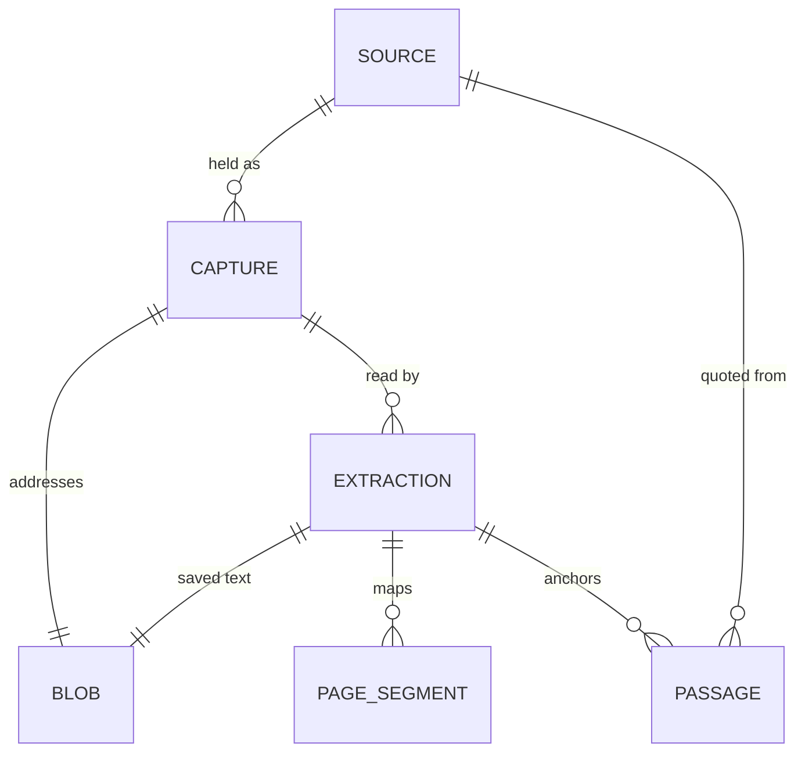
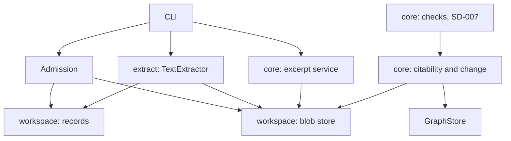

---
ddx:
  id: SD-002
  type: solution-design
  activity: design
  authoring:
    home: repo
  depends_on:
    - FEAT-002
    - stemma.concerns
    - stemma.architecture
    - stemma.data-design
    - stemma.adr-002
    - stemma.adr-003
    - stemma.adr-004
    - CONTRACT-001
    - CONTRACT-002
    - CONTRACT-004
    - SD-011
  schemas:
    - id: stemma.record
      version: "0"
      title: Stemma records
      path: docs/stemma/02-design/contracts/schemas/stemma-record.umf.json
      schemaFormat: umf
---

# Solution Design: SD-002 Source corpus

**Feature**: [[FEAT-002]] | **Artifact**: `docs/stemma/02-design/solution-designs/SD-002-source-corpus.md`

## Scope

- Covers admission, the private content store, rights fields, text extraction and printed page maps, citability, change flags, and bounded excerpts. All M1.
- Governed by CONTRACT-001 (source, capture, extraction, passage, blobs, digests), CONTRACT-002 (`source add`, `source text`, `excerpt`, `support prepare`, checks), CONTRACT-004 (agent obligations), the Data Design, and ADR-002 to ADR-004.
- The PDF text library and the recognition engine are PRD open questions and stay open. Real publisher PDFs, scans, and non-Latin scripts are untested.

## Requirements Mapping

### Functional Requirements

| Requirement | Technical Capability | Component | Priority |
|---|---|---|---|
| STO-01, STO-03 (FR-6) | Hash, store, and record provenance; store outside git | Admission, blob store | P0 |
| STO-02 | Digest verification on use | Blob store, checks | P0 |
| RGT-01 (FR-7) | Rights fields on the source | Admission | P0 |
| RGT-02 (FR-61) | Bounded excerpt preparation | Excerpt service | P0 |
| RGT-06 | Plain statement that nothing is gated | Admission output, skill | P0 |
| TXT-01, TXT-02 (FR-8) | Pluggable extraction with saved text, tool version, and quality | Extraction | P0 |
| TXT-03 | Page map that leaves unproved pages unmapped | Page mapper | P0 |
| CIT-01, CIT-02 (FR-9) | Citability test over admission, held copy, and text | Citability and change | P0 |
| CHG-01, CHG-02 (FR-10) | Dependant flags from record and blob state | Citability and change | P0 |

### NFR Impact on Architecture

| NFR | Requirement | Architectural Impact | Design Decision |
|---|---|---|---|
| Security | No execution of file content; no write outside intended locations | Parsers are an isolated adapter | Paths come only from digests and IDs; limits; no scripts, network, or attached-file handling |
| Privacy | Prepared model input holds the identified excerpts only | One preparation path | BR-209; it cannot control direct file reads |
| Reliability | Same file and tool version give the same text and page map | Saved output | Extract once, save, never regenerate in place; repeat-run test |
| Portability | Same hashes and names on three systems (untested) | Byte hashing | Raw-byte digests, lowercase hex paths |

## Solution Approaches

PDF extraction is the main unsettled choice.

### Approach 1: A JavaScript PDF library bundled with the command line

**Pros**: One runtime. One candidate, pdfjs-dist (Apache-2.0, about 38 MB unpacked), served the feasibility test on synthetic PDFs.
**Cons**: Layout and hyphen handling needed corrections in that test; bundling its data files with Bun is unproven.
**Evaluation**: First candidate to prove. Not selected as the library.

### Approach 2: An external native extractor installed on the author's computer

**Pros**: Mature text tools exist.
**Cons**: A per-system program the plugin would have to obtain and pin; licenses differ; research found no guarantee of identical output across platforms.
**Evaluation**: Considered if Approach 1 fails on pilot sources.

### Approach 3: Model-based transcription

**Pros**: May read difficult pages.
**Cons**: Research reports fluent but wrong text; output is not repeatable; pages go to a model.
**Evaluation**: Rejected for M1.

**Selected Approach**: A `TextExtractor` port in `core` with saved, immutable output. That makes the library and any recognition engine replaceable, so both stay open. The pinned library is chosen after a proof on pilot sources: page text, printed labels, hyphens, ligatures, right-to-left and diacritic text, repeat runs, and the same results from the installed package.

**Architecture/ADR impact**: No change. The chosen library is pinned and recorded (ADR-004); an ADR is warranted if it adds a tool the plugin must set up.

For storage, git and git LFS (Large File Storage) were rejected by owner decision and the Data Design.

### Built so far

- **Store location** (`workspace`): `--store-dir`, then `STEMMA_STORE_DIR`, then
  `Library/Application Support/stemma/stores/<project_id>` on macOS,
  `%LOCALAPPDATA%` on Windows, or the XDG data directory elsewhere (assumption;
  the last two are untested). A `project_id` that is not plain lowercase letters
  and digits cannot form a directory name. A location inside the project, holding
  the project, or inside a git working tree is refused, except where `git
  check-ignore` says the tree ignores it and `git ls-files` finds nothing tracked
  there. git is asked only in that case, with its file-system monitor off.
- **Put**: temporary file in the store, hash of what was written, rename. A
  damaged blob is replaced only by bytes that match its address. Blob paths come
  from digests, and a symbolic link in the store is not followed.
- **Text**: UTF-8 text copies and supplied text layers, under profile
  `utf8-lf/0` (CONTRACT-001 G). Reading a PDF is not built. A pinned library has
  not been added.
- **PDF library trial** (one macOS arm64 system, outside the project, not
  bundled): `pdfjs-dist` 6.5.438 (Apache-2.0, about 37 MB unpacked, one optional
  native package that text extraction did not need) read a 258-page scan with an
  old text layer in 0.65 s and a 22-page two-column article in 0.2 s on Bun
  1.4.5, with equal output on a second run, one string per page, and embedded
  page labels. On the scan its words agreed with the Internet Archive's text at
  99.9%. A running head can come out in content order without a space. It warns
  at load time about drawing support it cannot find. Not tried: bundling,
  right-to-left, diacritic or CID-font text without an embedded character map,
  and hostile files. Recommended as the library; adoption is not done.
- The command line is run by the plugin's launcher (SD-010); nothing here is set
  up by the author.
- Not built: URL fetch, hostile-input time and memory limits, the project lock
  and staged multi-record write, admission, replacement, retirement, excerpts.

## Domain Model

Shapes and relationships are those of CONTRACT-001.

### Business Rules

- **BR-201** — Verified put: a file is streamed, hashed, written to a temporary file in the store, verified, and renamed. The record is written after the blob. A store inside a git-tracked path is refused.
- **BR-202** — Same bytes: when the digest already belongs to a capture, Stemma names that source and writes no second copy; `source add --source <id>` attaches the file to a source the author names. It never merges.
- **BR-203** — Provenance as stated: origin, date, version, and admitting actor are recorded as given. An unknown value is recorded or shown as unknown, never inferred. The author is told that any source in the project may be sent to a hosted model and that backing up the store is the author's task.
- **BR-204** — Admission is the author's optional decision, recorded as given (CONTRACT-001 G). No check result, missing copy, or missing rights value withholds it; those are reported by their checks. Import and takeover create candidates. The admitting actor is a record of intent, not proof.
- **BR-205** — Copy integrity: a missing, unreadable, or digest-mismatched blob is not a held copy. `source.held` and dependent results do not pass, and `source.held` cannot be dismissed.
- **BR-206** — Checkable: a source's citations can be checked once it has a non-retired capture and an extraction of it (CONTRACT-001 G), with its copy intact, whatever its admission. A scan without machine-readable text produces no usable text. The cited page must also be present for text checks.
- **BR-207** — Immutable text: extracted text is saved as a blob with tool, version, and normalization profile, with the page boundaries (`page_spans`) in that text and the metadata read from the copy. Re-extraction creates a new extraction. Passages are not re-anchored silently; a moved passage is unreviewed.
- **BR-208** — No inferred labels: a page gets a printed label only from evidence, namely a consistent printed-number sequence on the pages, labels embedded in the file that the author confirms or that agree with that sequence, or the author's statement. File position alone is never a label. A page with no such evidence is covered by no segment. Segments are mapped separately, so front matter does not inherit the body offset. Embedded labels alone as evidence is a case the proof must examine.
- **BR-209** — Bounded excerpts: model input is built only by `excerpt` (a passage or a page range, plus bounded context) and `support prepare` (one claim and passage). A whole-source request is not an excerpt; the command refuses a range above a stated cap (cap value is a design assumption). Output marks the content as quoted data.
- **BR-210** — No gate: no rights field, flag, or setting withholds a source from preparation. Stemma never says that a license permits sending.
- **BR-211** — Honest quality: quality is recorded with method, level, scripts, and notes. The level is `unassessed` unless a stated rule or the author sets it. Recognized text is labelled as such; a match against it shows agreement with that text only. Missing text yields no pass.
- **BR-212** — Change flags: replacing a file adds a new capture and retires the old one; removal retires. Blobs stay. Dependants, including claims reached only through notes, are flagged by `source.changed` and the SD-011 closure. Out-of-agent edits and blob damage surface at the next check that covers the source. Flags are computed, not stored, and block nothing by themselves.
- **BR-213** — Untrusted files: size, page, and expanded-size limits apply before and during parsing. Encrypted, damaged, or unsupported files are reported and yield no extraction. Document scripts, links, and attachments are never run or fetched. File names and metadata never form paths.

## System Decomposition

### Component: Admission and blob store (`core`, `workspace`)

- **Purpose**: Hold the file and say where it came from.
- **Responsibilities**: `source add` from a file, or from a URL as an explicit network command whose fetch `workspace` performs; type detection from content; blob port (`has`, `get`, `put`, `verify`); duplicate report; rights capture; backup and no-gate notices; `store verify` for restores.
- **Requirements Addressed**: STO-01 to STO-03, RGT-01, RGT-06.
- **Interfaces**: `BlobStore` port (Data Design); CONTRACT-001; CONTRACT-002.
- **Owned by TDs**: US-007, US-008.

A fetched web page is stored as captured bytes, and that copy is the cited one. M1 aims at PDF and UTF-8 text files (assumption). Other types are rejected with the reason until an extractor exists for them.

### Component: Extraction and page mapping (`packages/extract`)

- **Purpose**: Turn a capture into saved text addressed by printed page.
- **Responsibilities**: One `TextExtractor` per format; page text; label evidence; quality; extraction record.
- **Requirements Addressed**: TXT-01 to TXT-03, CIT-02.
- **Interfaces**: `TextExtractor` port; `source text` (CONTRACT-002). It opens no network connection.
- **Owned by TDs**: US-009, US-010.

A paper-only source enters as a scan. Until a recognition engine is chosen, only a scan that already carries a text layer can yield text (assumption). Stemma cannot tell reliably how that layer was made.

### Component: Citability and change (`core`)

- **Purpose**: Decide what can be cited and what a change affects.
- **Responsibilities**: Citability test; digest verification during checks; dependant traversal. SD-007 owns check results.
- **Requirements Addressed**: CIT-01, CIT-02, CHG-01, CHG-02, STO-02.
- **Interfaces**: Check identifiers in CONTRACT-002 C; `GraphStore` dependants and the SD-011 closure.
- **Owned by TDs**: US-010, US-011.

### Component: Excerpt service (`core`)

- **Purpose**: Give a model only what a task needs.
- **Responsibilities**: Resolve a passage or page range to text; bound it; mark it.
- **Requirements Addressed**: RGT-02.
- **Interfaces**: `excerpt` and `support prepare` (CONTRACT-002 G, H). No other surface is needed.
- **Owned by TDs**: US-012.

Stemma keeps no log of prepared excerpts. An agent with file access can read any stored file or extraction directly, so such a log would not show what reached a model.

### Component Interactions

## Technology Rationale

| Layer | Choice | Why | Alternatives Rejected |
|---|---|---|---|
| Extraction | Open; pinned behind `TextExtractor` after proof | PRD open question | None finally |
| Recognition | Open | PRD open question; research found no engine dependable without testing on the material | None finally |

## Traceability

| Requirement ID | Component | Design Element | Test Strategy |
|---|---|---|---|
| STO-01 | Admission | BR-201 to BR-204 | Admit a synthetic PDF; same bytes twice; unknown provenance |
| STO-02 | Blob store, checks | BR-205 | Alter and delete blobs; no pass |
| STO-03 | Blob store | BR-201, BR-203 | Repository holds digests only; tracked-path store refused; notice shown |
| RGT-01 | Admission | BR-204, BR-210 | Set and remove each flag |
| RGT-02 | Excerpt service | BR-209 | Seeded task; prepared output holds no other source text |
| RGT-06 | Admission, skill | BR-210 | Notice text; flagged source excerpt is prepared |
| TXT-01 | Extraction | BR-207 | Roman and arabic labels; repeat run bytes equal |
| TXT-02 | Extraction | BR-211 | Weak, absent, and non-Latin text fixtures |
| TXT-03 | Page mapper | BR-208 | Unnumbered and conflicting pages stay unmapped |
| CIT-01 | Citability | BR-205, BR-206 | Seeded no-copy citation fails; a dismissal is not applied |
| CIT-02 | Citability | BR-206 | Scan with and without a text layer |
| CHG-01, CHG-02 | Change | BR-212 | Replace, retire, hand-edit, and damage with a full dependant chain |

Security (BR-213) is tested with traversal names, oversized, encrypted, damaged, and script-bearing files.

### Gaps

- [ ] RGT-01: an unstated rights flag is treated as set in reviewer outputs (CONTRACT-001 assumption), so a project that never answers withholds more.
- [ ] TXT-02: quality values exist in the contract. The rule assigning them, and the level at which `quote.present` is unverifiable, are open (SD-007 proposes it).
- [ ] TXT-01: page boundaries and label evidence are defined (CONTRACT-001) and untested; how an author states labels has no command surface.
- [ ] CIT-02: no recognition engine.

**Hostile input limits.** Starting caps, as design assumptions to test and report through `doctor`: input file 500 MiB; 5,000 pages; extracted text 100 MiB; 300 s and 2 GiB memory per extraction; a page image over 100 megapixels is skipped and reported. A URL fetch accepts HTTP and HTTPS only, at most 100 MiB, 60 s, and 5 redirects, and rejects loopback, link-local, and private addresses after each redirect (SEC-013). The stored page is never rendered or executed. Exceeding a cap yields no extraction and says which cap.

## Concern Alignment

- **Concerns used**: `citation-integrity`, `rights-and-permissions`, `security-owasp`, `deterministic-checks`, `plain-file-graph`, `hexagonal-architecture`, `cross-platform`, `honest-assurance`, `family-reuse`, `typescript-bun`, `testing`.
- **Constraints honored**: Synthetic or openly licensed fixtures only; saved text precedes deterministic checks; excerpts only, with no per-source gate; no family tool is known to extract PDF text.
- **ADRs referenced**: ADR-002, ADR-003, ADR-004.
- **Departures**: None.

## Schema Basis

The CONTRACT-001 UMF schema in `ddx.schemas` (UMF core 0.10.0 with `umf.ddd` 0.1.0, schema version 0) is reused for sources, captures, extractions, passages, and rights. This design defines no fields. No record has been validated against the schema.

## Constraints & Assumptions

- **Constraints**: Extraction makes no network request and needs no WSL or Docker. A required recognition tool must run natively on all three systems.
- **Assumptions**: Pilot sources have a usable text layer or can be given one; otherwise their citations stay reported as unchecked. The M1 type list above.
- **Dependencies**: A pinned PDF library; later a recognition engine; the author's backup.

## Risks

| Risk | Prob | Impact | Mitigation |
|---|---|---|---|
| Extraction fails on real PDFs, scans, old print, or non-Latin scripts | H | H | Proof on pilot sources before pinning; record quality; never pass on missing text |
| A wrong page map makes a wrong locator pass | M | H | BR-208; show label evidence; test segmented books |
| Material that may not be sent to a hosted model is added and sent | M | H | BR-210 notice; local models are unsupported |
| An agent reads stored files directly, bypassing excerpts | M | M | State the limit; the preparation record claims nothing more |
| The author loses the store | M | H | Backup notice; `store verify` names missing digests; dependants unverifiable |
| A malicious file exploits a parser | L | H | BR-213; pinned, audited library; hostile fixtures. Process isolation is not designed |
