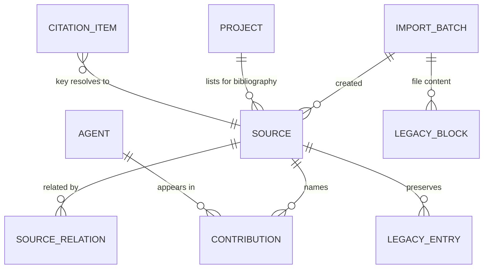
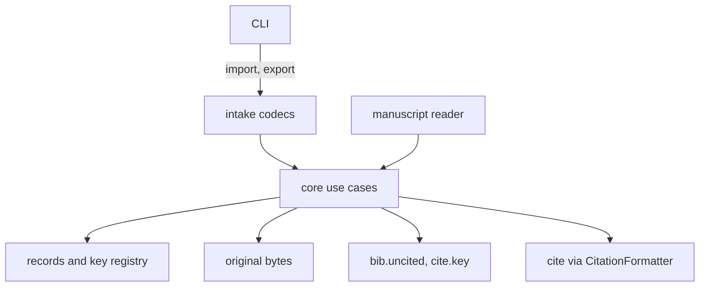

---
ddx:
  id: SD-003
  type: solution-design
  activity: design
  authoring:
    home: repo
  depends_on:
    - FEAT-003
    - stemma.concerns
    - stemma.architecture
    - stemma.adr-002
    - stemma.adr-005
    - CONTRACT-001
    - CONTRACT-002
    - CONTRACT-003
    - CONTRACT-006
    - SD-002
  schemas:
    - id: stemma.record
      version: "0"
      title: Stemma records
      path: docs/stemma/02-design/contracts/schemas/stemma-record.umf.json
      schemaFormat: umf
---

# Solution Design: SD-003 Citation store

**Feature**: [[FEAT-003]] | **Artifact**: `docs/stemma/02-design/solution-designs/SD-003-citation-store.md`

## Scope

- Covers bibliography records and types, citation keys and typed locators, legacy import and export, the citation style setting, and the uncited-entry rule.
- Governed by CONTRACT-001 (records, keys, legacy values), CONTRACT-002 (`import`, `export`, `bib.uncited`, `cite.key`), CONTRACT-003 (codecs), CONTRACT-006 (citation syntax, CSL-JSON projection), ADR-002, and ADR-005.
- Excludes Word intake (SD-015), resolver checks (SD-007), and formatted output and style examples (SD-008). M1.

## Requirements Mapping

### Functional Requirements

| Requirement | Technical Capability | Component | Priority |
|---|---|---|---|
| REC-01, REC-02 (FR-11) | One source record per work; no external manager | `records`, bibliography service | P0 |
| REC-03 (FR-12) | CSL item types with fields, names, dates, and relations | Bibliography service | P0 |
| XCH-01, XCH-02 (FR-13) | Codecs that keep native values and map a subset | `intake` | P0 |
| XCH-03, XCH-04 | Loss report; all-or-nothing import naming bad entries | `intake` | P0 |
| KEY-01 (FR-14) | Unique keys with aliases | Key registry | P0 |
| KEY-02 | Named locator on each citation item | `manuscript`, `records` | P0 |
| KEY-03 | Style as a project setting; text holds no formatted citation | Settings, `cite` | P0 |
| BIB-01 to BIB-03 (FR-15) | Built list from cited plus listed sources; check on listed uncited | `core`, `cite` | P0, M1 |

### NFR Impact on Architecture

| NFR | Requirement | Architectural Impact | Design Decision |
|---|---|---|---|
| Reliability | 0 lost values or comments in each seeded round trip | Native data must survive mapping and rewrites | BR-303; comparator independent of the exporter |
| Security | Nothing in a library executes, LaTeX included | Parsers treat input as data | No TeX expansion beyond string substitution the format defines; CONTRACT-003 G limits |
| Portability | Same records from the same library on three systems (untested) | No locale or platform parsing | Pinned codecs; deterministic mapping; generated IDs excluded from comparison |

## Solution Approaches

### Approach 1: Keep the original library file as the authority and edit it in place

**Pros**: Best byte fidelity.
**Cons**: A legacy format cannot hold Stemma's graph and would be a second authority.
**Evaluation**: Rejected (ADR-002).

### Approach 2: Map to records and regenerate exports from mapped fields only

**Pros**: Small model.
**Cons**: A feasibility test showed lost information without retained native values.
**Evaluation**: Rejected.

### Approach 3: Map to records and keep every native value beside the mapping

**Pros**: Meets the same-information guarantee and lets edits win field by field (CONTRACT-003 C, D).
**Cons**: Larger records; mapping logic per format; per-field regeneration is design only.
**Evaluation**: Selected. An exporter may replay original bytes when nothing in a whole batch changed.

For parsing, each codec may use a pinned library or its own parser. The choice is made per format at technical design: it must retain unknown fields, comments, and order of repeated values, which many bibliography parsers are built to normalize (inference, unverified).

**Selected Approach**: Approach 3.

**Architecture/ADR impact**: No change. citeproc-js license review remains a precondition of ADR-005 for formatting.

## Domain Model

A citation item is read from manuscript text (CONTRACT-006 C). It is not a bibliography record.

### Business Rules

- **BR-301** — One record per source: the source record is the bibliography entry. Every list, projection, and formatted bibliography is derived from records; editing a record changes the next read.
- **BR-302** — Type retention: the item type is stored as given. A type outside the supported list keeps all information and is reported as unrecognized. The native entry type is preserved even when mapped.
- **BR-303** — Preserve then map: import keeps every native field, repeated value, comment, and file-level block, whether mapped or not. No Stemma writer drops or normalizes them. A value Stemma cannot map is not guessed.
- **BR-304** — Atomic import: any unparseable entry or exceeded limit writes nothing. The report names each affected entry the codec can locate. Original files are only read.
- **BR-305** — Candidates only: import admits nothing and verifies nothing. A record without a held copy is reported as unchecked where cited (SD-002 BR-206).
- **BR-306** — No automatic merge: possible duplicates are reported for the author. A colliding key is reported with both entries; neither record is overwritten. The new candidate is saved without a usable key until the author chooses one, and its native key stays preserved (assumption).
- **BR-307** — Key resolution: a manuscript key resolves to the one non-retired source holding it as key or alias (CONTRACT-001 C). Renaming keeps the old key as an alias, so old citations reach the same record. Zero or several matches fail `cite.key`.
- **BR-308** — No key reassignment: keys and aliases are unique across all sources, retired ones included; only the source named in a retired source's `replaced_by` may take its keys. Replacing a source is an explicit author choice that records the replacement.
- **BR-309** — Typed locators only: a locator is stored with its term and the printed string. Untyped text is never read as a page. A folio stays a folio in projection and output.
- **BR-310** — Style independence: manuscripts hold keys and locators, not formatted text. Changing the style setting edits no citation. Only Chicago notes and bibliography is guaranteed; other styles are labelled unverified.
- **BR-311** — Export honesty: every export produces the loss report. Same-format equivalence is claimed only for an unedited batch under CONTRACT-003 C, and "supported" only after real-tool files pass. Exports omit restricted values.
- **BR-312** — Uncited means listed: cited sources enter the built bibliography automatically. Only a source listed for inclusion and cited nowhere fails `bib.uncited`; a takeover lists the whole original reference list. Unlisted, uncited corpus sources fail nothing. Footnote and caption citations count when that text is built. A dismissal binds the item's current content and ends when it changes.

## System Decomposition

### Component: Bibliography service and key registry (`core`, `records`)

- **Purpose**: One authority for sources and keys.
- **Responsibilities**: Validate types and fields; check key uniqueness; resolve keys and aliases; rename; compute the built set and listed-uncited set. Field-level checks against held copies are SD-007's.
- **Requirements Addressed**: REC-01 to REC-03, KEY-01, KEY-03, BIB-01, BIB-03.
- **Interfaces**: CONTRACT-001 C and G; `GraphStore` key lookup; CONTRACT-002 checks.
- **Owned by TDs**: US-013, US-014, US-016, US-017.

Records are created by import, `source add`, takeover, or an agent edit followed by `fmt` and `check`. `key rename` performs a rename (CONTRACT-002 B).

### Component: Citation reading (`packages/manuscript`)

- **Purpose**: Keys and typed locators from text.
- **Responsibilities**: Parse citation items for checks and build.
- **Requirements Addressed**: KEY-02.
- **Interfaces**: CONTRACT-006 C and D.
- **Owned by TDs**: US-016.

Formatting belongs to `packages/cite` behind `CitationFormatter` (SD-008).

### Component: Legacy codecs (`packages/intake`)

- **Purpose**: Libraries in and out without silent loss.
- **Responsibilities**: One versioned codec each for CSL-JSON, BibLaTeX, and RIS; store original bytes and an import batch; map and preserve; per-field export; loss report; input limits. Tests use a comparator written apart from the exporter and a native reader where one exists.
- **Requirements Addressed**: XCH-01 to XCH-04.
- **Interfaces**: CONTRACT-003; `import` and `export` (CONTRACT-002); writes go through core ports and the staged write.
- **Owned by TDs**: US-015.

### Component: Completeness check (`core`)

- **Purpose**: Catch listed but uncited entries.
- **Responsibilities**: Supply `bib.uncited` to the check engine from parsed manuscript items and the include list. Annotations and reports are SD-007's.
- **Requirements Addressed**: BIB-01, BIB-02.
- **Interfaces**: CONTRACT-002 C and F.
- **Owned by TDs**: US-017.

FR-15 and FR-29 are both M1, so the built-bibliography rule and the check ship with takeover and the pilot's basic PDF.

### Component Interactions

## Technology Rationale

| Layer | Choice | Why | Alternatives Rejected |
|---|---|---|---|
| Codec libraries | Chosen per format at technical design, pinned (ADR-004) | Fidelity requirements decide; none has been tested | An external converter program: not a product dependency (CONTRACT-003) |

## Traceability

| Requirement ID | Component | Design Element | Test Strategy |
|---|---|---|---|
| REC-01 | Bibliography service | BR-301 | Edit a record as text; next read shows it; malformed record reported |
| REC-02 | Bibliography service, `cite` | BR-301 | Create, read, check with no reference manager installed; build tested in SD-008 |
| REC-03 | Bibliography service | BR-302 | One fixture per listed type and one unlisted type |
| XCH-01, XCH-02 | Codecs | BR-303 | Independent comparator on unknown fields, comments, macros, repeated tags; then real-tool files |
| XCH-03 | Codecs | BR-311 | Export all record kinds; loss report; records unchanged; strict policy |
| XCH-04 | Codecs | BR-304 | Broken entry; nothing written and entry named; command macro not run; limit fixtures |
| KEY-01 | Key registry | BR-306 to BR-308 | Collision, rename, retire, and add-record fixtures |
| KEY-02 | Citation reading | BR-309 | Folio and chapter locators; untyped locator reported |
| KEY-03 | Settings | BR-310 | Change style; manuscript bytes unchanged |
| BIB-01 to BIB-03 | Completeness check | BR-312 | Listed uncited, footnote-only, unlisted uncited, dismissal then edit |

### Gaps

- [ ] REC-03: no source names the CSL types that cover archive items and code. The mapping needs fixtures at technical design.
- [ ] XCH-01: no file saved by a real tool has been tested, so no format is yet "supported" (CONTRACT-003 A). RIS has only had a spike-written reader.
- [ ] XCH-01: per-field export after edits (CONTRACT-003 D) is untested.
- [ ] KEY-03: whether citeproc-js produces every required Chicago form is unverified (SD-008).

## Concern Alignment

- **Concerns used**: `citation-integrity`, `plain-file-graph`, `security-owasp`, `deterministic-checks`, `hexagonal-architecture`, `cross-platform`, `typesetting-fidelity`, `family-reuse`, `testing`, `typescript-bun`.
- **Constraints honored**: Keys resolve to records and records to held files; fixtures are synthetic or openly licensed; `intake` has no network or process access.
- **ADRs referenced**: ADR-002, ADR-005.
- **Departures**: None.

## Schema Basis

Bibliography data reuses the CONTRACT-001 UMF schema in `ddx.schemas` (UMF core 0.10.0 with `umf.ddd` 0.1.0, schema version 0), with CSL variable names and locator terms as vocabulary. Native formats stay native and are not relabelled as UMF (CONTRACT-003). Research found no citation vocabulary in the UMF extensions it examined and did not search UMF domain packs. This design adds no field. UMF does not check record instances here; no record has been validated against the schema.

## Constraints & Assumptions

- **Constraints**: BibTeX, EndNote library files, and reference-manager synchronization are out of scope.
- **Assumptions**: BR-306's keyless candidate on collision; takeover lists the whole original reference list (FR-72).
- **Dependencies**: SD-011 records and index; SD-002 held copies; citeproc-js for formatting.

## Risks

| Risk | Prob | Impact | Mitigation |
|---|---|---|---|
| Real libraries contain dialects the codecs misread, losing information silently | H | H | Preserve raw values; independent comparator and native reader; claim support only after real files pass |
| One author of codec and comparator hides the same mistake | M | H | Comparator written apart from the exporter; native reader where available |
| An edited export mixes stale native values with new ones | M | M | BR-303 with CONTRACT-003 D; report conflicts |
| A reused retired key silently repoints old citations through a hand edit | L | H | BR-308; validation reports duplicate keys |
| citeproc-js license or output does not fit | M | H | License review before bundling; `CitationFormatter` port |
