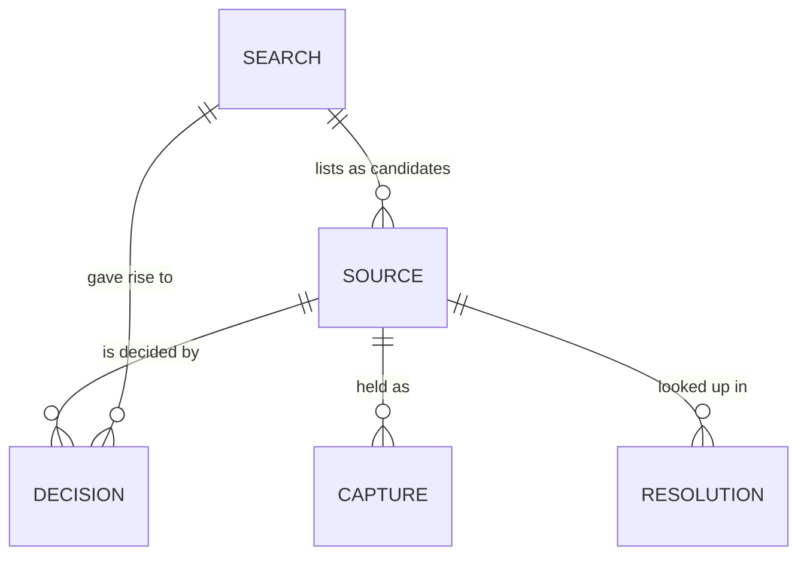
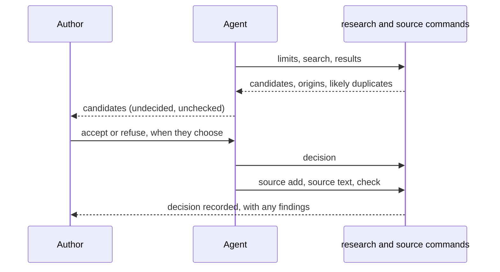

---
ddx:
  id: SD-004
  type: solution-design
  activity: design
  authoring:
    home: repo
  depends_on:
    - FEAT-004
    - stemma.architecture
    - CONTRACT-001
    - CONTRACT-002
    - CONTRACT-004
    - SD-002
    - SD-003
  schemas:
    - id: stemma.record
      version: "0"
      title: Stemma records
      path: docs/stemma/02-design/contracts/schemas/stemma-record.umf.json
      schemaFormat: umf
---

# Solution Design: Research and Discovery

**Feature**: FEAT-004 - Research and Discovery | **Artifact**: `docs/stemma/02-design/solution-designs/SD-004-research-and-discovery.md`

## Scope

- Delivery step M2. Covers candidate search, corpus-first search, admission, and
  the coverage log (coverage is P1).
- Governed by the Architecture, ADR-002, CONTRACT-001 (records), CONTRACT-002
  (`research`, `source add`, `resolve`), CONTRACT-004 (`research` mode), and the
  project concerns.
- Acquisition, extraction, and rights flags are SD-002. Bibliography records and
  keys are SD-003.
- No outside search service has been chosen or exercised.

## Requirements Mapping

### Functional Requirements

| Requirement | Technical Capability | Component | Priority |
|---|---|---|---|
| SRCH-01 (FR-16) | Limits are recorded before a search; command-run searches apply them | `core` research use case; skill | P0 |
| SRCH-02 (FR-16) | A result becomes a `source` with admission `candidate` | `core`, `records` | P0 |
| SRCH-03 (FR-16) | Each candidate keeps where it was found and which details came from there | `core`; `candidate_origins` on `search` | P0 |
| CORP-01 (FR-19) | Corpus-first run reads only project records and stored extractions | `core`, `graph`, `workspace` | P0 |
| CORP-02, CORP-03 (FR-19) | A computed scope report names searched, weakly searched, and unsearched sources | `core` | P0 |
| ADM-01 to ADM-03 (FR-17) | Author decision recorded as given, with acquisition and corpus checks reported; a `decision` record either way | `core`, SD-002, SD-003, SD-007 | P0 |
| COV-01, COV-02 (FR-18) | Review of `search` and `decision` records with an explicit unknown group | `core`, `graph` | P1 |

### NFR Impact on Architecture

| NFR | Requirement | Architectural Impact | Design Decision |
|---|---|---|---|
| Security | Instructions in a result cause no admission, limit change, or write | Result text crosses a trust boundary | Validate each result as data; the recording operation can create only candidates and their `search` record (BR-402) |
| Rights | A model receives only needed excerpts (FR-61) | Corpus search must not hand over whole sources | Return bounded hit locations; read text through `excerpt` |
| Reliability | A failed service is never reported as searched | Per-location status | Each location is searched, failed, or not run in the report |
| Performance, Scalability | No target | N/A | N/A |

## Solution Approaches

### Approach 1: The agent searches and writes records itself

**Description**: The agent uses host search tools and writes `source` and `search` files by hand.
**Pros**: No service choice, no new command code.
**Cons**: Candidate marking, limits, and the log depend on each session following instructions.
**Evaluation**: Rejected. Nothing gives a uniform candidate record.

### Approach 2: Only the command line searches, through fixed catalog adapters

**Description**: `research` queries chosen metadata services and records results.
**Pros**: The command applies limits and knows exactly what it sent.
**Cons**: No service is chosen. Research reading found no measured humanities coverage and no resolver for archives. It would miss places the author asks the agent to look.
**Evaluation**: Rejected as the only path.

### Approach 3: One recording path for command-run and agent-run searches

**Description**: Every search and result enters through `research`. Each is labelled command-run or agent-reported. Catalog adapters are added when services are chosen.
**Pros**: One candidate shape, admission path, and log. M2 does not wait for the service choice.
**Cons**: For agent-run searches, limits and completeness of the log are the agent's report.
**Evaluation**: Selected. It labels both honestly, and approach 2 fits inside it.

**Selected Approach**: Approach 3.

**Architecture/ADR impact**: Command-run adapters would live in `workspace`, which
owns resolvers and network calls. The `Resolver` port covers lookups. The
Architecture's `CandidateSearch` port covers search adapters. CONTRACT-002 lists
the `research` commands; their input file shape is set at technical design.

## Domain Model

All are CONTRACT-001 record kinds. A recorded corpus search is a `search` with
scope `corpus`.

### Business Rules

- **BR-401** — Limits come from the author. A command-run search that cannot apply a limit does not query that location and says why. The agent is instructed to do the same for its own searches; the command cannot enforce it.
- **BR-402** — Recording a result creates or matches a candidate. It cannot record an admission, change limits, or edit another record. Result text is never read as an instruction.
- **BR-403** — A candidate is undecided and unchecked. A citation of one is reported: `source.held` fails while it has no stored copy, and the report counts the source with the unreviewed items while it is not admitted (CONTRACT-002 C). Missing details stay absent and are never filled from model memory.
- **BR-404** — A likely match with an existing source (same identifier, or same folded title, creator, and year) is shown to the author before a second source record is created.
- **BR-405** — Only an author decision admits or rejects, whenever the author makes it. A `decision` record is written for each (assumption for refusal). The agent writes it only on the author's explicit instruction; it is a record of intent.
- **BR-406** — Admission records the author's decision at once, as given (SD-002 BR-204). Acquisition, extraction, and the corpus checks then run, and their results are reported under CONTRACT-002; a missing copy, missing rights, or a failing check never withholds the admitted value. Where candidate details and the stored copy disagree, both are shown and neither value is overwritten silently. Nothing here stops the candidate from being cited.
- **BR-407** — A corpus-first run queries no outside location until its report is produced.
- **BR-408** — The scope report lists every admitted source as searched, not reliably searched (extraction quality `poor` or `unassessed`), or not searched (no extraction, or blob missing), with the reason. Absence statements are limited to the searched set and name the match method.
- **BR-409** — Coverage counts a missing language, period, or region as unknown, and states that it covers logged searches only. An empty log yields "nothing logged".

## System Decomposition

### Component: Research use cases (`packages/core`)

- **Purpose**: Record searches and candidates, run corpus search, orchestrate admission, summarize coverage.
- **Responsibilities**: BR-402 to BR-409.
- **Requirements Addressed**: all.
- **Interfaces**: `RecordRepository`, `GraphStore`, `BlobStore`, `Resolver`, `TextExtractor`, `Clock`. Surfaces: CONTRACT-002.
- **Owned by TDs**: duplicate matching; scope report; admission steps.

### Component: Corpus search (`packages/core`)

- **Purpose**: Find text in admitted sources without a model.
- **Responsibilities**: Search record text through `GraphStore.search`; scan saved extraction text under the same versioned `search-fold` profile; return source, page, and a bounded location.
- **Requirements Addressed**: CORP-01, CORP-02.
- **Interfaces**: CONTRACT-005 H for records. The `search-fold` function lives in `records`, which both `core` and `graph` use.
- **Owned by TDs**: extraction-text scanning.

Literal matching misses paraphrases and other languages. The agent may run
several queries and read excerpts; those queries are logged, and its reading is
model judgment.

### Component: Service adapters (`packages/workspace`, after services are chosen)

- **Purpose**: Command-run catalog queries.
- **Responsibilities**: Apply limits, cap response sizes, report failures, follow service terms.
- **Requirements Addressed**: SRCH-01.
- **Interfaces**: the `CandidateSearch` port (Architecture).
- **Owned by TDs**: one per adapter.

### Component: `research` mode (`skills/stemma`)

- **Purpose**: Dialogue for limits, candidates, and decisions.
- **Responsibilities**: Take limits first; report agent-run searches with their locations; mark every candidate; ask for rights at admission; say that outside queries can expose unpublished titles or quotations.
- **Requirements Addressed**: SRCH-01 to SRCH-03, CORP-01, ADM-01.
- **Interfaces**: CONTRACT-004.

### Component Interactions

## Technology Rationale

N/A — no feature-specific technology is chosen; search services stay open.

## Traceability

| Requirement ID | Component | Design Element | Test Strategy |
|---|---|---|---|
| SRCH-01 | Core, adapters, skill | BR-401 | Fake adapter: a limit it cannot apply yields no query. Agent-run path: live session only |
| SRCH-02 | Core | BR-402, BR-403 | Cite a seeded candidate; `source.held` reports it and the unreviewed count includes it |
| SRCH-03 | Core | Candidate origin | Each seeded candidate shows its location and supplied details from `candidate_origins` |
| CORP-01 | Core, skill | BR-407 | Network-denied run completes the corpus report |
| CORP-02, CORP-03 | Core | BR-408 | Fixtures with good, poor, and missing extractions give exact lists |
| ADM-01 | Core, skill | BR-405 | No decision, no admission through the command |
| ADM-02 | Core | BR-406 | Missing copy and seeded wrong author are admitted as decided and each is reported by its check |
| ADM-03 | Core | BR-405, `decision` with its `search` | Admission and refusal both link the query |
| COV-01, COV-02 | Core | BR-409 | Mixed and empty logs; unknown group counted |
| Security NFR | Core | BR-402 | Seeded hostile result writes only candidate and search records |

### Gaps

- [ ] The candidate-origin, search-location, period, and region fields in CONTRACT-001 are untested; whether a period or region describes the work or its subject is undecided: product owner.

## Concern Alignment

- **Concerns used**: `rights-and-permissions` (excerpts only, rights asked at admission, no per-source gate), `security-owasp`, `citation-integrity`, `plain-file-graph`, `ai-disclosure` (agent searches record model and role), `honest-assurance`, `deterministic-checks` (search is not a check), `hexagonal-architecture`, `testing` (synthetic fixtures; no paid model calls).
- **Constraints honored**: Corpus search works offline; network only through `research`, `resolve`, and `source add <url>`.
- **ADRs referenced**: ADR-002, ADR-003, ADR-007.
- **Departures**: None.

## Constraints & Assumptions

- **Constraints**: Model-assisted search may not repeat its results. Admission follows the corpus rules of SD-002.
- **Assumptions**: Limits can express at least where to search and what to exclude; if not, the record needs more structure. Refusals are recorded. Literal corpus search plus excerpt reading is useful enough for M2.
- **Dependencies**: SD-002, SD-003, SD-007; search services (open).

## Risks

| Risk | Prob | Impact | Mitigation |
|---|---|---|---|
| The agent searches outside limits or leaves a search unlogged | M | M | Label agent-reported searches; state that the log is not proof of coverage |
| An agent with file access writes an admission itself | M | H | Not prevented, and the record is not proof; citation still needs a stored copy |
| Literal search misses relevant passages and the author reads silence as absence | H | H | Name the method and unsearched sources in every report (BR-408) |
| Service terms, keys, or rate limits rule out a catalog (research reading, unverified) | M | M | Check terms before adding an adapter; send no contact identifier without the author's setting |

## Open Questions

- [ ] Which outside search and metadata services does the first version use, under which terms? Design owner.
- [ ] Which kinds of limit must an author be able to set? Product owner.

## Schema Basis

Inspected: the CONTRACT-001 Unified Modeling Fabric (UMF) source, core 0.10.0
with the `umf.ddd` 0.1.0 extension. `search`, `decision`, `source`, and
`resolution` are reused; this design defines no fields. UMF domain packs were not
searched. Validation evidence and limits are in the CONTRACT-001 Proof Status.
