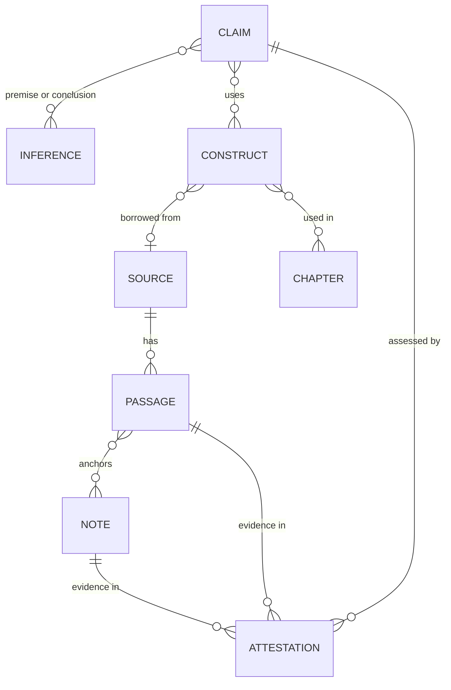
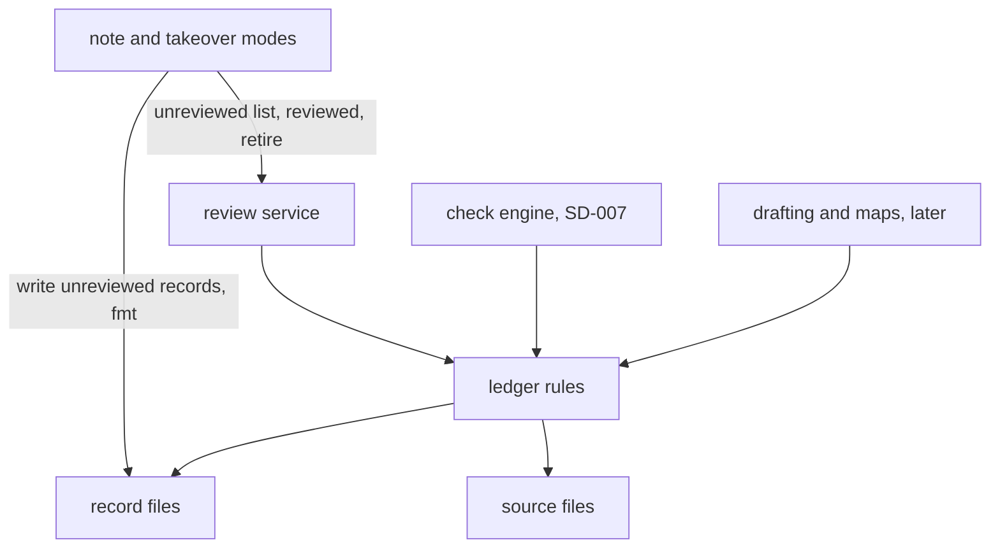

---
ddx:
  id: SD-005
  type: solution-design
  activity: design
  authoring:
    home: repo
  depends_on:
    - FEAT-005
    - stemma.architecture
    - stemma.data-design
    - stemma.concerns
    - stemma.adr-002
    - stemma.adr-003
    - CONTRACT-001
    - CONTRACT-002
    - CONTRACT-004
    - CONTRACT-006
    - SD-002
    - SD-003
  schemas:
    - id: stemma.record
      version: "0"
      title: Stemma records
      path: docs/stemma/02-design/contracts/schemas/stemma-record.umf.json
      schemaFormat: umf
---

# Solution Design: Notes, claims, constructs

**Feature**: [[FEAT-005]] | **Artifact**: `docs/stemma/02-design/solution-designs/SD-005-notes-claims-constructs.md`

## Scope

- Covers reading notes, the claim ledger, the construct register, and review of AI-proposed items (FR-20 to FR-23, FR-80).
- Delivery: **pilot (M1)** has notes, claims with completeness, review marks, and optional batch review of takeover items. **M2** adds stance and claim relations (FR-80) and the construct register (FR-22).
- Depends on SD-002 (source files and passage addresses) and SD-003 (sources and locators). SD-007 runs the checks. SD-015 supplies takeover records.
- Governing: Architecture, ADR-002, ADR-003, CONTRACT-001, CONTRACT-002, CONTRACT-004, CONTRACT-006.

## Requirements Mapping

### Functional Requirements

| Requirement | Technical Capability | Component | Priority / step |
|---|---|---|---|
| NOTE-01 to NOTE-03 (FR-20) | Notes anchor to passages; extract wording is compared with source text; paraphrase wording is never compared | Anchor rules; SD-007 `quote.present` | P0 / M1 pilot |
| CLM-01, CLM-02 (FR-21) | Claim joined to notes through attestations; completeness predicate | Ledger rules; `claim.complete` | P0 / M1 pilot |
| CLM-03, CLM-04 (FR-80) | Stance on attestations; inferences and claim roles | Ledger rules | P0 / M2 |
| CON-01 to CON-05 (FR-22) | Construct records with ownership, definition, origin, chapters | Register rules; `construct.complete` | P0 / M2 |
| CON-06 | Construct references resolve | `records` link validation | P0 / M2 |
| CON-07 | Advice only | Skill | P0 / M2 |
| ACC-01 to ACC-04 (FR-23) | One effect rule and one review-state rule; list, mark-reviewed, and retire use cases | Review service | P0 / M1 pilot |

Record shapes already carry attestation stance and inferences in M1. FR-80 is M2 for the views and rules that depend on them, not a later format change.

### NFR Impact on Architecture

| NFR | Requirement | Architectural Impact | Design Decision |
|---|---|---|---|
| Reliability | Extract and register checks repeat exactly | Checks are pure over ports | No model, clock, or locale input to any rule here |
| Traceability | Each AI entry records model and role | Provenance on every write | The agent writes `created.by` with kind `model`; the role goes in `created.activity` (assumption) |
| Security | Quoted source text causes no unasked change | Source text is data | No use case reads record text as a command; model behavior stays unguaranteed |

## Solution Approaches

### Approach 1: Separate proposal queue
**Description**: AI items wait in their own files until the author moves them into records.
**Pros**: Reviewed records are never mixed with unreviewed ones.
**Cons**: It is an approval step in the line of writing, with a second record shape and links to items that do not exist yet.
**Evaluation**: Rejected.

### Approach 2: In effect at once, with a review state bound to content
**Description**: Each note, claim, attestation, inference, construct, and method carries `review`. Effect needs no review; the reviewed mark is computed from state and content digest.
**Pros**: One shape, stable IDs, AI changes show as unreviewed automatically, and the state survives a rebuild.
**Cons**: Unreviewed AI wording is used as if settled unless the author reads the marks.
**Evaluation**: Selected; it is the CONTRACT-001 model.

### Approach 3: Versioned entries with the last reviewed version in force
**Description**: Keep reviewed and newer versions side by side.
**Pros**: The author's checked wording stays in use.
**Cons**: Two writable versions of one fact, and newer work waits for review.
**Evaluation**: Rejected.

**Selected Approach**: Approach 2.

**Architecture/ADR impact**: No change; applies ADR-003.

## Domain Model

Field shapes and allowed values are CONTRACT-001. The schema gives claim confidence three values (low, medium, high). FEAT-005 still lists the scale as open, so this design treats the schema scale as an assumption.

### Business Rules

- **BR-501** — Effect: an entry is in effect from the moment it is written until it is retired. Every consumer calls this one rule. A separate rule says whether it is reviewed: the mark applies while its reviewed digest equals the current content. The author's own edits keep it reviewed; a change by a model or software actor marks it unreviewed (CONTRACT-001 G).
- **BR-502** — Author entries: an entry the author writes or dictates MAY be marked reviewed at once. An entry written by a model or software starts unreviewed.
- **BR-503** — Review: marking reviewed applies only to named records with the digest that was shown, or to a shown batch. Each gets its own dated mark; a batch shares a token. Nothing marks reviewed as a side effect, and nothing waits for it. Rejecting is retiring, with a reason.
- **BR-504** — Shown with origin: the unreviewed listing returns each entry with its original passage or manuscript origin and its content digest. An entry with neither is listed as having no passage.
- **BR-505** — Extract: an extract note's wording is compared with the source text at its anchored passages under the CONTRACT-002 quotation profile. A match elsewhere in the source does not pass the anchor.
- **BR-506** — Paraphrase: only the passage anchor is tested. Its results name the passage as subject and make no statement about the paraphrase's wording. A comment note is not compared.
- **BR-507** — Anchor stability: a passage is resolved by its passage address. If the address no longer holds its text, the result is reported as ambiguous; no tool moves an anchor.
- **BR-508** — Completeness: a claim in effect is complete when it has confidence, reason, and at least one attestation that reaches a note. The result names every missing part.
- **BR-509** — Stance: support, opposition, and context stay distinct. A contradicting or context attestation is never counted as support (SD-007 support requirements).
- **BR-510** — Relations: argument relations between claims are inferences; thesis, rival reading, and objection are claim roles. Stemma does not derive relations. More than one thesis is listed, not rejected (assumption).
- **BR-511** — Register: author-stated and borrowed constructs share one register. A complete construct needs ownership and definition; a borrowed one also needs its origin source.
- **BR-512** — Visibility: reports list and count unreviewed records that the manuscript reaches (`body.unreviewed`, which never affects the label) and report text linked to a retired claim (`claim.inactive`).

BR numbers for this feature start at 501 so that designs written in parallel cannot collide.

## System Decomposition

### Component: Ledger rules (`packages/core`) — M1, extended M2
- **Purpose**: One definition of effect, completeness, anchoring, and register rules.
- **Responsibilities**: BR-501, BR-505 to BR-512; supplies inputs to `quote.present`, `claim.complete`, and `construct.complete`.
- **Requirements Addressed**: NOTE-01 to NOTE-03, CLM-01 to CLM-04, CON-01 to CON-06.
- **Interfaces**: Pure functions over CONTRACT-001 types; reads through `RecordRepository`, `BlobStore`, and `GraphStore`.
- **Owned by TDs**: US-018, US-019, US-020.

### Component: Review service (`packages/core`, commands in `packages/cli`) — M1
- **Purpose**: List unreviewed items, mark reviewed, and retire, singly or in batches, when the author chooses.
- **Responsibilities**: BR-502 to BR-504; staged multi-record write (Data Design); keeps the mark through an author edit and removes it on an AI change.
- **Requirements Addressed**: ACC-01 to ACC-04; the review half of FR-72.
- **Interfaces**: `unreviewed list`, `reviewed`, `retire` (CONTRACT-002 B).
- **Owned by TDs**: US-021.

### Component: Reference validation (`packages/records`) — M1
- **Purpose**: Resolve note, claim, and construct references and their allowed kinds.
- **Requirements Addressed**: NOTE-01, CON-06.
- **Interfaces**: CONTRACT-001 rules and errors.

### Component: Note mode (`skills/stemma`) — M1, advice in M2
- **Purpose**: Record entries, show passages, record the author's reviews when given, and advise.
- **Responsibilities**: Entries written unreviewed; excerpts rather than whole sources; construct-use advice kept apart from check results; no request to review before continuing.
- **Requirements Addressed**: ACC-01, ACC-02, CON-07.
- **Interfaces**: CONTRACT-004 B and C.

### Component Interactions

## Technology Rationale

N/A: no feature-specific technology; Architecture and ADR-004 govern.

## Traceability

| Requirement ID | Component | Design Element | Test Strategy |
|---|---|---|---|
| NOTE-01 | Reference validation | Note to passage links | Note without a passage is invalid |
| NOTE-02 | Ledger rules | BR-505, BR-507 | Seeded changed extract fails; exact and harmless-difference extracts pass; a repeated phrase at another position does not pass the anchor |
| NOTE-03 | Ledger rules | BR-506 | Paraphrase fixture yields no wording-match evidence |
| CLM-01, CLM-02 | Ledger rules | BR-508 | One seeded case per missing part: confidence, reason, note, effective attestation |
| CLM-03 | Ledger rules | BR-509 | Opposing attestation is kept apart and never counts as support |
| CLM-04 | Ledger rules | BR-510 | Thesis, rival, objection, and each inference relation survive rebuild |
| CON-01 to CON-03 | Ledger rules | BR-511 | Register listing shows author and borrowed entries with chapters and sources |
| CON-04, CON-05 | Ledger rules | BR-511 | Seeded missing definition and missing origin source fail |
| CON-06 | Reference validation | Dangling reference error | Seeded dangling construct reference is reported |
| CON-07 | Note mode | Advice is not a result | Instruction review and a recorded manual run; report holds no advice |
| ACC-01 | Review service | BR-501 | Every consumer uses an unreviewed entry and shows it as unreviewed |
| ACC-02 | Note mode, Review service | BR-503 | Saved agent transcript run by hand; code test that no other use case writes a review mark. Not enforceable against file edits |
| ACC-03 | Review service | Dated review mark and limit wording | Output text states what was said, not proof |
| ACC-04 | Review service | BR-501 | A model edit makes the entry unreviewed while it stays in effect, and it is listed (BR-512); an author edit keeps it reviewed |

### Experience Traceability

N/A: the feature is used through the agent and command line; FEAT-005 user stories name the tasks.

### Gaps

- [ ] CON-01 chapter use is whatever the records list. No check finds an unlisted use in manuscript text, and CONTRACT-006 has no construct marker.
- [ ] Whether authors review anything when nothing requires it is untested; the pilot should measure it.

## Concern Alignment

- **Concerns used**: `plain-file-graph`, `citation-integrity`, `deterministic-checks`, `honest-assurance`, `ai-disclosure`, `security-owasp`, `hexagonal-architecture`, `testing`.
- **Constraints honored**: Rules sit in `core` with no adapter imports; indexes stay derived; review marks are described as records of what was said.
- **ADRs referenced**: ADR-002, ADR-003; ADR-007 for local-first tests.
- **Departures**: None.

## Constraints & Assumptions

- **Constraints**: Review marks are not forgery-proof. Anyone with file access can write one.
- **Assumptions**: The AI role fits `created.activity`; wrong means a record-format addition. Confidence follows the schema scale. A retired record stays as a file with no effect.
- **Dependencies**: SD-002 source files; SD-003 sources.

## Risks

| Risk | Prob | Impact | Mitigation |
|---|---|---|---|
| An agent writes a review mark the author did not give | M | H | Skill obligation, disclosure, git history; no enforcement claimed |
| Unreviewed AI claims are treated as the author's | H | H | Marks and counts in reports, record views, and disclosure |
| Batch review is marked without reading passages | M | M | Show passages; keep edit and retire per item |
| Converted text makes true extracts fail | H | M | Test on pilot sources; near matches go to the author (SD-007) |
| Review marks lapse often and are ignored | M | M | Batch review; measure in the pilot |

All matching behavior is unverified on real sources and on Linux and Windows.

## Schema Basis

Inspected through CONTRACT-001: UMF core 0.10.0 with `umf.ddd` 0.1.0; Stemma schema version 0, reused without local additions. No record has been validated against it.

The design consumes the `stemma.record` UMF document declared in `ddx.schemas` and adds no shape. CONTRACT-001 states reuse, limits, and validation evidence; effect, review, and completeness rules are not expressed in UMF and need code and tests.
