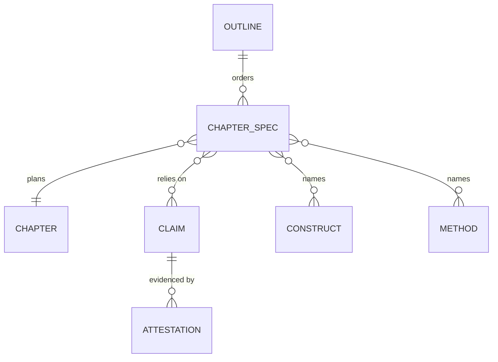
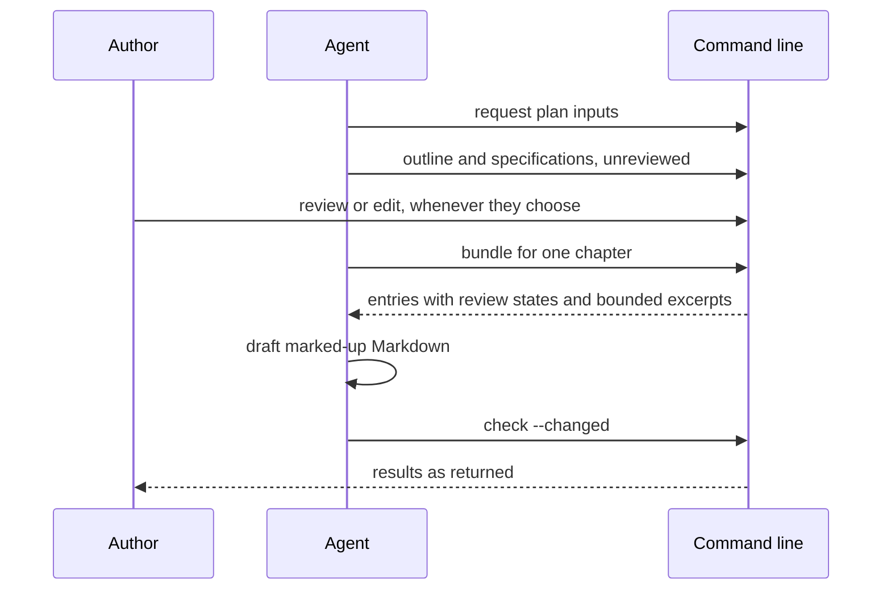

---
ddx:
  id: SD-006
  type: solution-design
  activity: design
  authoring:
    home: repo
  depends_on:
    - FEAT-006
    - stemma.architecture
    - CONTRACT-001
    - CONTRACT-002
    - CONTRACT-004
    - CONTRACT-006
    - SD-001
    - SD-005
    - SD-014
  schemas:
    - id: stemma.record
      version: "0"
      title: Stemma records
      path: docs/stemma/02-design/contracts/schemas/stemma-record.umf.json
      schemaFormat: umf
---

# Solution Design: Composition

**Feature**: FEAT-006 - Composition | **Artifact**: `docs/stemma/02-design/solution-designs/SD-006-composition.md`

## Scope

- Delivery step M2: planning and drafting (P0). Alternative interpretations,
  authorship marks, and checkpoints are P1 and designed only to their rules.
- Governed by the Architecture, ADR-002, ADR-003, ADR-009, and CONTRACT-001,
  002, 004, and 006.
- Inputs and rules come from SD-001, ledger and constructs from SD-005, and voice
  from SD-014. `draft.marked` and support checks are SD-007.

## Requirements Mapping

### Functional Requirements

| Requirement | Technical Capability | Component | Priority |
|---|---|---|---|
| PLAN-01, PLAN-02 (FR-24) | Assemble plan inputs; record the model's proposed outline and chapter specifications | `core` planning; `outline` mode | P0 |
| PLAN-03, PLAN-04 (FR-24) | Plans in effect at once with review states; changes are new unreviewed versions | `core`, `records` | P0 |
| DRFT-01 (FR-25) | A drafting bundle of ledger entries in effect, with their review states | `core` drafting | P0 |
| DRFT-02, DRFT-03 (FR-25) | CONTRACT-006 markers; `draft.marked` | `manuscript`, SD-007, `draft` mode | P0 |
| ALT-01 (FR-26) | An optional counter-argument section | `draft` mode; CONTRACT-006 `alternatives` block | P1 |
| CHK-01, CHK-02 (FR-28) | Checkpoints that ask and record, never halt | `core` | P1 |
| AUTH-01, AUTH-02 (FR-27) | Marks bound to exact text and version | `core` | P1 |

### NFR Impact on Architecture

| NFR | Requirement | Architectural Impact | Design Decision |
|---|---|---|---|
| Rights | A model receives only needed excerpts | The bundle bounds source text | The bundle holds records in effect and bounded excerpts for one chapter |
| Reliability | Same marked-assertion report on repeated runs | Reporting stays model-free | Use the one CONTRACT-006 reader and `draft.marked` |
| Performance, Security, Scalability | No feature target | N/A beyond project concerns | Note and source text are data |

## Solution Approaches

### Approach 1: The agent reads records and decides what is in effect

**Description**: Mode instructions tell the agent to read files and use them.
**Pros**: No new command.
**Cons**: Retirement and review state depend on rules and content digests (CONTRACT-001) that an agent reading files cannot be relied on to compute.
**Evaluation**: Rejected.

### Approach 2: The command line assembles a drafting bundle

**Description**: `core` computes what is in effect, and each item's review state, and returns it for one chapter. The agent drafts from it and then runs checks.
**Pros**: One effect rule, repeatable inputs, bounded excerpts.
**Cons**: Needs a command surface. It cannot stop the agent using other material.
**Evaluation**: Selected.

### Approach 3: A plan kept as a Markdown document

**Description**: The outline is one prose file with a review mark.
**Pros**: Easy to read and edit.
**Cons**: Per-chapter review and references to claims and constructs would be free text.
**Evaluation**: Rejected as the stored form; the plan may be rendered as a page for review.

**Selected Approach**: Approach 2, with the plan held as records.

**Architecture/ADR impact**: No module change. Plans are `plan` records
(CONTRACT-001), reached through `plan record` and `plan bundle` (CONTRACT-002).
The alternative-interpretations block is in CONTRACT-006.

## Domain Model

Outline and chapter specification are `plan` records. Each specification is
reviewed per chapter, and the outline for order and scope (assumption).

### Business Rules

- **BR-601** — Planning reads thesis, audience, scope, ledger entries in effect, and constructs and methods when they exist, with their review states. Their absence does not stop it. Specifications name those that exist and apply.
- **BR-602** — A chapter with no supporting entry is shown as unsupported. Planning creates no claim. Opposing entries both stay visible.
- **BR-603** — A plan is in effect as soon as it is written, marked unreviewed. A change is a new version that retires its predecessor with `replaced_by`; history is kept.
- **BR-604** — An AI change to a reviewed plan makes it unreviewed; the author's own edits keep it reviewed (CONTRACT-001 G). Drafting uses it either way and states its review state.
- **BR-605** — The bundle holds the claims, notes, attestations, inferences, constructs, and methods in effect for the chapter, the current specification, standing rules, any voice profile in use, and each item's review state. A missing specification is stated; drafting still proceeds on the author's request.
- **BR-606** — Each drafted sourced assertion is wrapped in a claim anchor naming its ledger claims, with citation keys and typed locators taken from the evidence passages. Without the anchor, no support record is required for that citation.
- **BR-607** — A drafted assertion that needs a source and has no support is marked `.needs-source`. The agent says no entry supports it and invents no source, locator, or quotation.
- **BR-608** — After drafting, the agent runs `check --changed` and reports results as returned. Composition clears no change flag and certifies no support.
- **BR-609** — Each drafting action records model, model version, prompt version, voice profile, and target chapter for the disclosure (SD-009).
- **BR-610** — A checkpoint asks for the author's input and never halts drafting or a build; only recorded author input counts as an answer, and unanswered ones are reported. The setting may turn every checkpoint off.
- **BR-611** — An authorship mark applies to the exact text it was made on. Changed or unmarked text shows as unmarked, never as human-written by default. Earlier versions keep their marks.
- **BR-612** — A counter-argument section follows BR-606 and BR-607. With no opposing evidence it argues without attributing anything and names no invented scholar. Removing it leaves a valid chapter. It is separate from the audit's rival-readings pass (SD-009).

## System Decomposition

### Component: Planning and drafting use cases (`packages/core`)

- **Purpose**: Decide what is in effect and what drafting may see.
- **Responsibilities**: BR-601 to BR-605; record plan versions and review states; create `chapter` records from an outline.
- **Requirements Addressed**: PLAN-01 to PLAN-04, DRFT-01.
- **Interfaces**: `RecordRepository`, `GraphStore`, `BlobStore`, `Clock`; `plan record` and `plan bundle` (CONTRACT-002 B).
- **Owned by TDs**: plan versions; bundle assembly.

### Component: `outline` and `draft` modes (`skills/stemma`)

- **Purpose**: Model-written plans and prose.
- **Responsibilities**: BR-606 to BR-609 and BR-612; show opposing entries; pose checkpoints and carry on.
- **Requirements Addressed**: PLAN-01, DRFT-01 to DRFT-03, ALT-01.
- **Interfaces**: CONTRACT-004. The agent writes CONTRACT-006 files, which the command line reads through `ManuscriptRepository`.

### Component: Manuscript reading and checks (`packages/manuscript`, `packages/core`)

- **Purpose**: Report marked assertions without a bound key and locator.
- **Responsibilities**: `manuscript` parses; SD-007 runs `draft.marked`, `cite.key`, `locator.extent`, quotation, and support checks.
- **Requirements Addressed**: DRFT-02, DRFT-03.
- **Interfaces**: CONTRACT-006 D, CONTRACT-002 C.

### Component: P1 records (`packages/core`)

- **Purpose**: Checkpoint input and authorship marks.
- **Responsibilities**: BR-610, BR-611.
- **Requirements Addressed**: CHK-01, CHK-02, AUTH-01, AUTH-02.
- **Interfaces**: `checkpoint_input` and `authorship_mark` records (CONTRACT-001 G) through `checkpoint record` and `authorship mark` (CONTRACT-002 B). Where checkpoints fall and the unit of a mark wait for the open questions.

### Component Interactions

## Technology Rationale

N/A — uses the Architecture's choices.

## Traceability

| Requirement ID | Component | Design Element | Test Strategy |
|---|---|---|---|
| PLAN-01 | Core, `outline` | BR-601, BR-602 | Thin ledger: unsupported chapters shown; planning code adds no claim. Proposal quality: live session |
| PLAN-02 | Core, `outline` | BR-601 | With and without constructs and methodology |
| PLAN-03 | Core | BR-603, BR-605 | Drafting uses an unreviewed plan and says so |
| PLAN-04 | Core | BR-603, BR-604 | A change takes effect unreviewed; the earlier version remains in history |
| DRFT-01 | Core | BR-605 | Retired entries absent; unreviewed entries marked |
| DRFT-02 | `draft`, checks | BR-606 | Fixtures with key and locator pass |
| DRFT-03 | Checks, `draft` | BR-607, `draft.marked` | Seeded missing key and locator; repeat runs equal |
| ALT-01 | `draft` | BR-612 | Live session with a thin ledger; removal fixture |
| CHK-01, CHK-02 | Core | BR-610 | No halt; unanswered reported; none when off |
| AUTH-01, AUTH-02 | Core | BR-611 | Edit marked text: new text unmarked, earlier mark readable |
| Rights NFR | Core | BR-605 | Bundle holds no excerpt outside the chapter's evidence |

### Gaps

- [ ] The plan, checkpoint, authorship-mark, and AI-activity shapes in CONTRACT-001 are minimal and untested.
- [ ] FR-27 and FR-28 design waits for the open questions below.

## Concern Alignment

- **Concerns used**: `citation-integrity`, `ai-disclosure`, `rights-and-permissions`, `security-owasp`, `deterministic-checks` (checks read saved model output), `honest-assurance`, `plain-file-graph`, `hexagonal-architecture`, `testing`.
- **Constraints honored**: AI-written prose is allowed; there is no mode that prevents it.
- **ADRs referenced**: ADR-002, ADR-003, ADR-009.
- **Departures**: None.

## Constraints & Assumptions

- **Constraints**: Drafts use CONTRACT-006 only.
- **Assumptions**: Plans are reviewed per chapter. A model marks assertions and anchors claims reliably enough to be useful; untested.
- **Dependencies**: SD-001, SD-005, SD-007, SD-014; SD-009 reads BR-609 records and authorship marks.

## Risks

| Risk | Prob | Impact | Mitigation |
|---|---|---|---|
| An unmarked assertion has no source and nothing reports it | H | H | State the limit; chapter audit and author reading |
| The agent omits a claim anchor, so a citation gets no support check | M | H | Mode instruction (BR-606); see Gaps |
| A drafted sentence goes beyond its claim while the claim is unchanged, and the support record stays current | M | H | State the limit (FR-54); audit |
| The agent drafts without the bundle or records no AI activity | M | M | Not enforced; the disclosure covers recorded activity only |

## Open Questions

- [ ] Where in a chapter's progress do checkpoints fall? Product owner. Blocks FR-28 design.
- [ ] At what unit are authorship marks made, and what counts as a version? Design owner. Blocks FR-27 design.

## Schema Basis

Inspected: the CONTRACT-001 Unified Modeling Fabric (UMF) source, core 0.10.0
with the `umf.ddd` 0.1.0 extension. Its review and retirement values and the
plan and activity kinds are reused; this design defines no fields. UMF domain packs were not searched. Validation evidence and
limits are in the CONTRACT-001 Proof Status.
