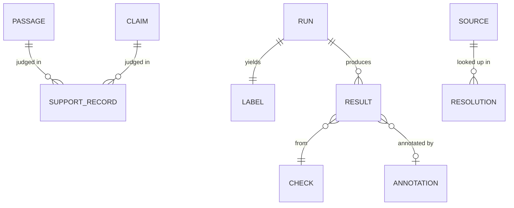
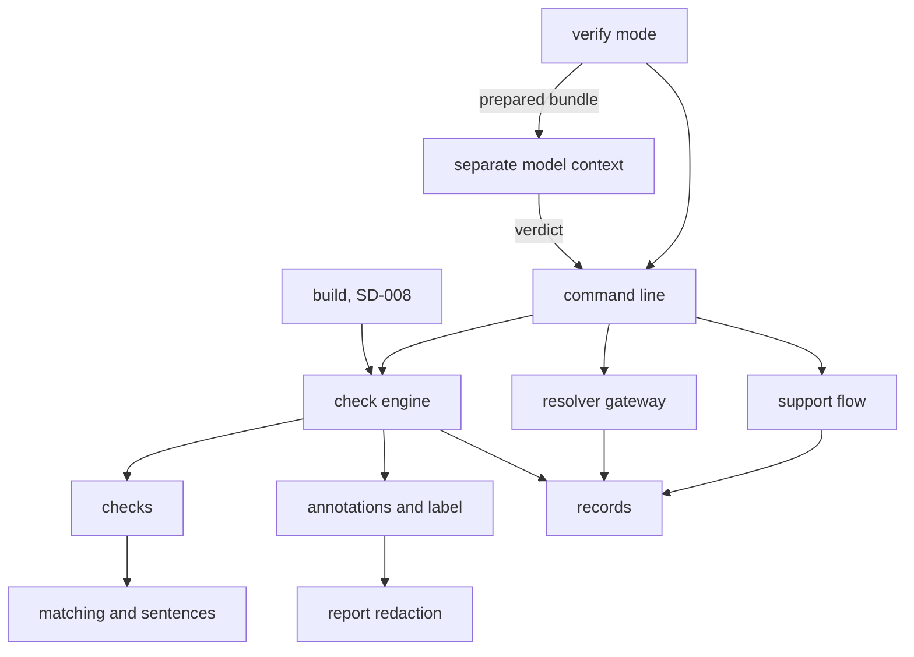

---
ddx:
  id: SD-007
  type: solution-design
  activity: design
  authoring:
    home: repo
  depends_on:
    - FEAT-007
    - stemma.architecture
    - stemma.data-design
    - stemma.concerns
    - stemma.adr-003
    - stemma.adr-007
    - CONTRACT-001
    - CONTRACT-002
    - CONTRACT-004
    - CONTRACT-006
    - SD-002
    - SD-003
    - SD-005
    - SD-011
  schemas:
    - id: stemma.record
      version: "0"
      title: Stemma records
      path: docs/stemma/02-design/contracts/schemas/stemma-record.umf.json
      schemaFormat: umf
---

# Solution Design: Verification and reports

**Feature**: [[FEAT-007]] | **Artifact**: `docs/stemma/02-design/solution-designs/SD-007-verification-and-reports.md`

## Scope

- Covers the check engine, quotation and sentence profiles, claim-support flow, annotations, explained findings, the checked-clean label, and report redaction (FR-29 to FR-34, FR-52 to FR-54, FR-74). No finding stops work or a build.
- **Pilot (M1)**: everything here except `construct.credit` and `construct.complete` (**M2**). Redaction is first used by the disclosure (M2) and the reviewer package (M3).
- Depends on SD-002, SD-003, SD-005, and SD-011 (change closure); uses the CONTRACT-006 reader. SD-008 produces outputs; SD-015 owns rounds.
- CONTRACT-002 owns check IDs, outcomes, report, commands, and exit codes. This design sets the matching rules it leaves open.

## Requirements Mapping

### Functional Requirements

| Requirement | Technical Capability | Component | Priority / step |
|---|---|---|---|
| CHK-01 to CHK-07, CHK-09 (FR-29, FR-30) | Registry of checks over one parsed model | Check engine and checks | P0 / M1 pilot |
| CHK-08 (FR-29) | Construct-credit check | Checks | P0 / M2 |
| CHK-10 to CHK-12 (FR-33) | Offline checks over saved text and saved resolutions | Resolver gateway, engine | P0 / M1 pilot |
| CHK-13 to CHK-15 (FR-34) | Pure checks, canonical report, seeded set | Engine, test set | P0 / M1 pilot |
| CHK-18 (FR-30) | Author confirmation of source details | Annotation and confirmation rules | P0 / M1 pilot |
| CHK-16, CHK-17 (FR-29) | Quotation profile and near-match flow | Text matcher | P0 / M1 pilot |
| SUP-01 to SUP-05, SUP-08 (FR-52, FR-54) | Bundle, separate-context judgment, saved verdict, computed staleness | Support flow | P0 / M1 pilot |
| SUP-06, SUP-07 | Hand-run accuracy measurement | Support evaluation set | P0 / M1 pilot |
| EXC-01 to EXC-07 (FR-32) | Optional bound annotations, computed applicability | Annotation and confirmation rules | P0 / M1 pilot |
| BLK-01 to BLK-08 (FR-30, FR-31, FR-39, FR-53) | One open-and-label function over a fresh full run | Report and label | P0 / M1 pilot |
| FBK-01 to FBK-06 (FR-31, FR-53, FR-74) | Changed-scope runs, explained and grouped findings, agent explanation | Engine, verify mode | P0 / M1 pilot |

### NFR Impact on Architecture

| NFR | Requirement | Architectural Impact | Design Decision |
|---|---|---|---|
| Reliability | Zero differences between equal runs | No hidden inputs | Checks read ports only; fixed ordering; Stemma-owned folding |
| Offline | Checks and label use no network or model | Network isolated | Only the resolver gateway holds the `Resolver` port, and `check` never calls it |
| Detection | Each class detected on its seeded error | Test data per check | Seeded, clean, and unverifiable fixtures per check ID |
| Security | No execution of input | Inputs are data | Bounded matching; no evaluation of record or source text |
| Portability | Matching results on three systems | No platform locale | Unicode data tied to the pinned runtime and recorded as a tool; unproven off macOS |
| Performance (assumption) | `check --changed` within the Architecture target | Closure, bounded alignment | Per-run text cache; no cache across runs |

## Solution Approaches

### Approach 1: Run everything, filter for the changed view
**Description**: Every work check evaluates the whole project and shows affected results.
**Pros**: Changed results equal full results by construction.
**Cons**: Quote matching over the whole corpus on each edit.
**Evaluation**: Rejected as the target, kept as the fallback and the test oracle.

### Approach 2: Cache results and invalidate
**Description**: Save results and recompute only invalidated ones.
**Pros**: Fastest feedback.
**Cons**: A stale cache is a false pass, and an agent could edit it.
**Evaluation**: Rejected.

### Approach 3: Declared inputs, selective recompute, no result cache
**Description**: Each check declares what makes a subject's result, including project-wide inputs such as the set of claims. The engine recomputes subjects reached by changed inputs. Builds always run all.
**Pros**: Fast enough without trusting saved results.
**Cons**: A missing declared input hides a change until a full run.
**Evaluation**: Selected. An equality test compares it with approach 1, and every build is a full run.

**Selected Approach**: Approach 3.

**Architecture/ADR impact**: No change; applies ADR-003.

The changed-input baseline and the conservative closure are SD-011 BR-1112 and BR-1113. The baseline holds digests and input sets, never a result. This design owns each check's declared inputs.

## Domain Model

Result and report shapes are CONTRACT-002; stored records are CONTRACT-001. The label is computed and not stored apart from the report.

### Business Rules

**Evaluation**

- **BR-701** — Pure checks: a check reads ports and returns results. A thrown error becomes the CONTRACT-002 unverifiable result; it is never dropped or passed.
- **BR-702** — Fresh build: every build's report comes from a full run in the same process. No saved result, index answer without a digest comparison, or model call enters it.
- **BR-703** — The label is one function of results, applicable dismissals and confirmations, and not-run entries, using the CONTRACT-002 rule. Unreviewed items and unadmitted cited sources are listed and counted in `body.unreviewed` and never enter it. No setting or persona changes it, and no result of it stops a build.
- **BR-704** — Every `fail` and `unverifiable` result is a finding with `message`, `why`, and `suggestions` from fixed templates keyed by check and reason code; a check without templates for each of its reason codes is a defect. Findings with one cause are grouped.

**Quotation profile `quote-fold/0`** (differences allowed are fixed by CONTRACT-002 D)

- **BR-705** — Both texts are folded by the same Stemma code, applying only the listed differences, with an offset map back to the unchanged originals. Evidence shows original text.
- **BR-706** — A pass requires the folded quotation to occur as one contiguous span that starts and ends at word boundaries, so a fragment of a longer word does not pass. An apostrophe or hyphen between letters is part of the word. Han, Hiragana, Katakana, Thai, Lao, Khmer, and Myanmar text is written without spaces, so a boundary may fall between any two of its characters (assumption). A match never ends inside a character with its combining marks or inside a ligature.
- **BR-707** — The line-end join applies only where the source text has a hyphen, or soft hyphen, directly before a line break inside a word, a page break included. The result records each join. A true compound broken at its own hyphen then appears as a near match when quoted correctly, and a quotation without that hyphen passes.
- **BR-708** — Search covers the main stream of each non-retired, intact source file of the cited source, then its notes stream; running heads, folios, and boilerplate are never searched. A note extract searches only its passages. Evidence names the source file, the pages or section found, and the passage address. No usable text, or only `poor` quality text without a pass, is unverifiable. `unassessed` text is searched (assumption).
- **BR-709** — With no pass, a bounded approximate alignment finds the closest span, widens it to whole words, and measures the edit distance on that span. It is `near` when the distance is at most 15 percent of the folded quotation's length, else `none`. A `none` result still shows the closest span within 40 percent, as US-024-AC1 asks (both values are starting values, to be tuned on pilot sources). The story's "all fields" against "some fields" is one such case: 4 changes in 25 characters is just over the near share. Alignment never turns a result into a pass.
- **BR-710** — Ellipses, bracketed edits, case changes, and translations are not on the approved list. They fail, or are unverifiable where no comparable text exists. The author fixes them or annotates the finding.

**Sentence profile `sentence-split/0`** (CONTRACT-006 D leaves abbreviation rules to this design)

- **BR-711** — A boundary follows `.`, `?`, `!`, U+061F, or U+06D4, with any closing quotes, brackets, citation cluster, and note marker, when white space and then anything but a lowercase letter follows, or the block ends. Ideographic terminators U+3002, U+FF01, and U+FF1F need no white space.
- **BR-712** — No boundary occurs inside a marked quotation or a matched pair of double quotes.
- **BR-713** — No boundary follows a listed abbreviation or a single uppercase letter used as an initial. One list covers all languages: `e.g. i.e. cf. Cf. viz. vs. Dr. Mr. Mrs. Ms. Prof. Rev. Fr. St. p. pp. f. ff. fol. fols. n. nn. no. No. vol. vols. ch. chap. sec. fig. ed. eds. trans. repr. ca. c. fl. b. d. op. ibid. Ibid. vgl. Vgl. z.B. d.h. Bd. Hg. Nr. S.`
- **BR-714** — `etc.`, `cit.`, and any unlisted abbreviation follow BR-711. Any change to BR-711 to BR-713 is a new profile version with the CONTRACT-006 migration, because it can end annotations.

**Other matching**

- **BR-715** — `locator.extent`: a recorded extent for the locator's term governs; otherwise the printed labels, chapters, or paragraph counts of the cited source's source files do. Printed labels compare within one numbering style. An unparsable locator or missing extent is unverifiable. It tests range only; `quote.page` tests that quoted words lie on the cited pages or in the cited chapter, over every occurrence.
- **BR-716** — Metadata comparison folds case, white space, punctuation, diacritics, line-end hyphens, and canonical Unicode form only. Matching rules are those of CONTRACT-002 C. A field either side lacks is listed as not compared; a result with nothing compared is unverifiable.
- **BR-717** — `id.resolves` applies only to sources with an identifier. The newest saved resolution for the same source and identifier governs, and its date is shown. No maximum age applies while that question is open.
- **BR-718** — `quote.self` compares attributed quotations of eight or more words with claims in effect that are the book's own (CONTRACT-001 G, `claim.own`). A folded quotation equal to, or contained in, claim text fails. Shorter quotations give no result.
- **BR-719** — `number.present` applies to digit-written figures, percentages, and decimals outside quotations and locators in a cited sentence. Four-digit years, dates, and ordinals are not figures (assumption). A figure passes when the same whole numeric token occurs in the cited source's main or notes stream. Several citation items, or ambiguous separators, give unverifiable. Spelled-out numbers are not detected. A pass shows presence only.
- **BR-720** — `construct.credit` (M2) reads only fixed patterns joining a registered construct label to a person: possessive, parenthetical, and listed credit verbs. A match to a registered originator passes, another name fails, and a label beside a person's name outside the patterns is unverifiable.

**Support and annotations**

- **BR-721** — A cited claim is a claim in effect in a claim span that contains a citation, reviewed or not. Its supporting passages are those reached by attestations with stance `supports` or `partly_supports` (assumption). One that reaches none is reported as unsupported (`no_source_passage`).
- **BR-722** — Currency is computed from the CONTRACT-001 digests and required fields. Manuscript sentences are not an input.
- **BR-723** — Every current `partly_supported` or `unsupported` record for a pair stays reported until its inputs change or the author dismisses it. A later `supported` run on unchanged inputs does not replace it, so rerunning until a model agrees does not remove the finding (assumption).
- **BR-724** — An annotation applies only when check, finding key, and every bound value equal current values. Applicability is recomputed each run; the result keeps its outcome. Age is never read. A source-details review applies while its pages' digests and the source's bibliographic digest equal current values.
- **BR-725** — An annotation is created only from a current result of a full-input evaluation, with bindings copied from it. Effects follow CONTRACT-002 F.
- **BR-726** — Redaction is applied to the report structure before any renderer, by evidence class, failing closed for unclassified entries. The leak search then tests the rendered outputs (CONTRACT-002 E1).

BR numbers for this feature start at 701 so that designs written in parallel cannot collide.

## System Decomposition

### Component: Check engine (`packages/core`) — M1
- **Purpose**: Load, select subjects, run checks, apply annotations and confirmations, and assemble the report.
- **Responsibilities**: BR-701, BR-702, BR-704; grouping and not-run entries; skip unreadable records where the run can continue and report them; changed-scope selection.
- **Requirements Addressed**: CHK-09, CHK-10, CHK-13, CHK-15, FBK-01, BLK-02, BLK-06.
- **Interfaces**: `check` command; ports `RecordRepository`, `ManuscriptRepository`, `BlobStore`, `RestrictedStore`, `GraphStore`, `Clock`, `Environment`.

### Component: Checks (`packages/core`) — M1; construct checks M2
- **Purpose**: One module per check ID, declaring its inputs.
- **Responsibilities**: BR-715 to BR-720; uses SD-005 ledger rules and `manuscript` reading results.
- **Requirements Addressed**: CHK-01 to CHK-08, BLK-07.
- **Interfaces**: Check IDs and finding keys of CONTRACT-002; locus rules of CONTRACT-006 D.

### Component: Text matching and sentence profiles (`packages/core` matching; `packages/manuscript` sentences) — M1
- **Purpose**: Own versioned quotation folding, alignment, and sentence splitting.
- **Responsibilities**: BR-705 to BR-714.
- **Requirements Addressed**: CHK-02, CHK-16, CHK-17.
- **Interfaces**: Pure functions; profile names recorded in results and report inputs.

### Component: Resolver gateway (`packages/core` use case, `packages/workspace` adapter) — M1
- **Purpose**: Query services on explicit command and save resolutions.
- **Responsibilities**: Send only bibliographic identifiers and query fields; treat responses as untrusted.
- **Requirements Addressed**: CHK-11, CHK-12.
- **Interfaces**: `resolve`; `Resolver` port. Services and their terms are unchosen and untested.

### Component: Support flow (`packages/core`, prompt in `skills/stemma`) — M1
- **Purpose**: List needed verdicts, prepare bundles, validate and save records.
- **Responsibilities**: BR-721 to BR-723. The skill runs the judgment in a separate context.
- **Requirements Addressed**: SUP-01 to SUP-05, SUP-08, BLK-03 to BLK-05, FBK-03.
- **Interfaces**: CONTRACT-002 H; CONTRACT-004 C8.

### Component: Annotations, confirmations, and label (`packages/core`) — M1
- **Purpose**: Create and apply optional annotations and confirmations; compute open findings and the label.
- **Responsibilities**: BR-703, BR-724, BR-725. SD-008 puts the label in build output.
- **Requirements Addressed**: CHK-18, EXC-01 to EXC-07, BLK-01 to BLK-08.
- **Interfaces**: `annotate`, `source confirm`; label consumed by builds.

### Component: Report redaction (`packages/core`; applied by `publish`) — function M2, package use M3
- **Purpose**: Produce a report that can leave the project.
- **Responsibilities**: BR-726.
- **Requirements Addressed**: FR-46 report part; EXC-05 listing.
- **Interfaces**: CONTRACT-002 E1; consumed by SD-009.

### Component: Verify mode (`skills/stemma`) — M1
- **Purpose**: Run checks after edits, explain, offer fixes, apply the author's choice.
- **Requirements Addressed**: FBK-01 to FBK-05, EXC-01.
- **Interfaces**: CONTRACT-004 C. These are instructions, not enforcement.

### Component: Seeded and support evaluation sets (`fixtures/`, `scripts/`) — M1
- **Purpose**: Verify scripted checks automatically and measure support accuracy by hand.
- **Responsibilities**: Per check: seeded error, clean input, unverifiable input. For support: labelled claims including goes-beyond, overstates, and reverses cases, plus a pilot-author sample; publish false-accept and false-reject rates with model and prompt version. No minimum is set.
- **Requirements Addressed**: CHK-14, SUP-06, SUP-07.

### Component Interactions

## Technology Rationale

| Layer | Choice | Why | Alternatives Rejected |
|---|---|---|---|
| Quotation matching | Stemma folding and bounded alignment | Exact control of the approved differences | Whole-text compatibility folding (a spike showed it changes numbers); corpus text-reuse tools (need other runtimes, aimed at corpus scale) |
| Sentence splitting | Versioned rules in `manuscript` | Same answer on every system | Platform sentence segmentation (varies with Unicode data, no scholarly abbreviations) |

## Traceability

| Requirement ID | Component | Design Element | Test Strategy |
|---|---|---|---|
| CHK-01 | Checks | `cite.key`, `bib.uncited` | Seeded unknown key; listed uncited source; unreadable manuscript stops the command |
| CHK-02, CHK-16, CHK-17 | Text matching | BR-705 to BR-710 | One pass case per allowed difference; probes for changed hyphen, joined ellipsis, word fragment, case, omission; compound broken at line end |
| CHK-03 | Checks | BR-715 | Out-of-range page and non-page extent; roman front matter; no extent |
| CHK-04 | Checks | BR-716 | Wrong author, title, year, venue against the copy's stated identity, its title page, and a saved lookup |
| CHK-05 | Checks | BR-717 | Saved not-found and other-work responses; none saved |
| CHK-06 | Checks | BR-718 | Quotation equal to a claim; short quotation |
| CHK-07 | Checks | BR-719 | Absent figure; ambiguous separator; two cited sources |
| CHK-08 | Checks | BR-720 | Each pattern with right and wrong originator; no constructs gives no result |
| CHK-09 | Check engine | Outcomes with evidence | Report schema test |
| CHK-10 to CHK-12 | Engine, Resolver gateway | Offline checks, dated cache | Run with network denied |
| CHK-13, CHK-15 | Check engine | BR-701, BR-702 | Repeat-run byte comparison; altered support verdict changes no other check's result |
| CHK-14 | Seeded set | Per-check fixtures | The set itself, local and release tags |
| CHK-18 | Annotations and confirmations | BR-724 | Unverifiable metadata with and without a confirmation; seeded mismatch stays reported |
| SUP-01 to SUP-03 | Support flow | Bundle, versioned prompt | Saved model output tests record handling; judgment quality only by hand runs |
| SUP-04, SUP-05, SUP-08 | Support flow | BR-722 | Change each bound input; change only the sentence |
| SUP-06, SUP-07 | Evaluation set | Published rates | Hand run, recorded |
| EXC-01 | Verify mode | Skill obligation | Hand-run transcript; not enforceable |
| EXC-02 to EXC-04, EXC-06 | Annotation rules | BR-724, BR-725 | Edit sentence, source, item; vary only the date |
| EXC-05 | Annotations, Redaction | Listing with limit statement | Listing test; disclosure belongs to SD-009 |
| EXC-07 | Annotation rules | BR-725 | A dismissal of `source.held` is rejected and a hand-written one is ignored |
| BLK-01, BLK-06, BLK-07 | Report and label | BR-703 | Table test: every check ID and outcome in every build mode produces output; the label follows the rule; passing checks with unreviewed claims give `checked_clean` and an unreviewed count |
| BLK-02 | Check engine | BR-702 | Tamper with a saved report and index, then build |
| BLK-03 to BLK-05, BLK-08 | Support flow, Report | BR-721 to BR-723 | Missing, stale, unsupported, no-passage, unlinked, retired-link, dismissed, and rerun-verdict cases offline |
| FBK-01 | Check engine | Changed-scope selection | Changed results equal the full run's across a mutation set |
| FBK-02 | Whole design | No hook or CI | Install test |
| FBK-03 to FBK-06 | Verify mode, Engine | BR-704; results shown as returned | Template coverage test; grouping fixtures; hand-run transcript |

### Experience Traceability

Agent turns are in [UF-007](../flows/UF-007-check-feedback/UF-007.md) and follow [DESIGN.md](../DESIGN.md); FEAT-007 user stories name the tasks.

### Gaps

- [ ] **Report volume.** Books, archive items, and non-Latin works can produce many could-not-check findings. Confirmation, grouping, and clear templates are the only controls; the pilot must measure whether authors can act on the report.
- [ ] `id.resolves` cannot be confirmed by a title page (CONTRACT-002 assumption).
- [ ] Which change to a source ends an annotation (stored file, bibliography record, or both) is open in FEAT-007. BR-724 follows whatever the CONTRACT-001 source binding holds.
- [ ] A missing resolver cache age limit stays open (BR-717).

## Concern Alignment

- **Concerns used**: `deterministic-checks`, `citation-integrity`, `honest-assurance`, `hexagonal-architecture`, `security-owasp`, `rights-and-permissions`, `ai-disclosure`, `cross-platform`, `testing`, `lightweight-verification`.
- **Constraints honored**: No model in any scripted result; seeded set per check; support output described as a record, never verification.
- **ADRs referenced**: ADR-003 and ADR-007: no hook, no required CI, no paid model call in automation.
- **Departures**: None beyond the recorded overrides.

## Constraints & Assumptions

- **Constraints**: The command line governs only itself. Edited verdicts, review marks, and annotations go undetected.
- **Assumptions**: The BR rules marked as assumptions, and every numeric value (BR-709, BR-718), are untested; wrong values cause false findings or missed errors. 
- **Dependencies**: SD-002 page maps, quality, and metadata; SD-003 records and locators; SD-005 ledger rules; the host's separate context (unverified).

## Risks

| Risk | Prob | Impact | Mitigation |
|---|---|---|---|
| Real publisher PDFs and scans cause mass near or unverifiable results, burying real findings | H | H | Test on pilot sources first; group by cause; record recognition quality |
| Recognized text with errors confirms a wrong quotation | M | H | Label recognized text; show comparisons and review coverage |
| Line-end join passes a wrong quotation | M | M | Record each join; tune on pilot sources |
| A quotation or figure on the wrong page passes | M | H | Show the page found; no check covers it |
| Citations the reader does not mark up, or claims outside spans, are never checked | M | H | State detection limits in the report; report unlinked citations |
| Nothing stops publication with open findings | H | H | Label and explanations; owner decision |
| A stronger sentence keeps a current support record | M | H | Stated limit; owner decision |
| A coordinate warning, removal, or image finding is ignored | M | H | Warn on screen and in the report |
| Separate context is unavailable or not truly separate | M | M | No record without it; the flag is the caller's statement |
| Citation detection from narrow patterns misses figures and credits | H | M | Report limits; never call absence of a result a pass |

Earlier quote and page tests used two synthetic layouts on one macOS system and passed some adversarial probes. All rules above are unverified, including on Linux and Windows.

## Schema Basis

Inspected through CONTRACT-001: UMF core 0.10.0 with `umf.ddd` 0.1.0; Stemma schema version 0, reused without local additions. No record has been validated against it.

The design consumes the `stemma.record` UMF document in `ddx.schemas` and adds no shape; reports and support bundles are CONTRACT-002 envelopes. Rules such as currency and annotation applicability are outside UMF and need code and tests.
