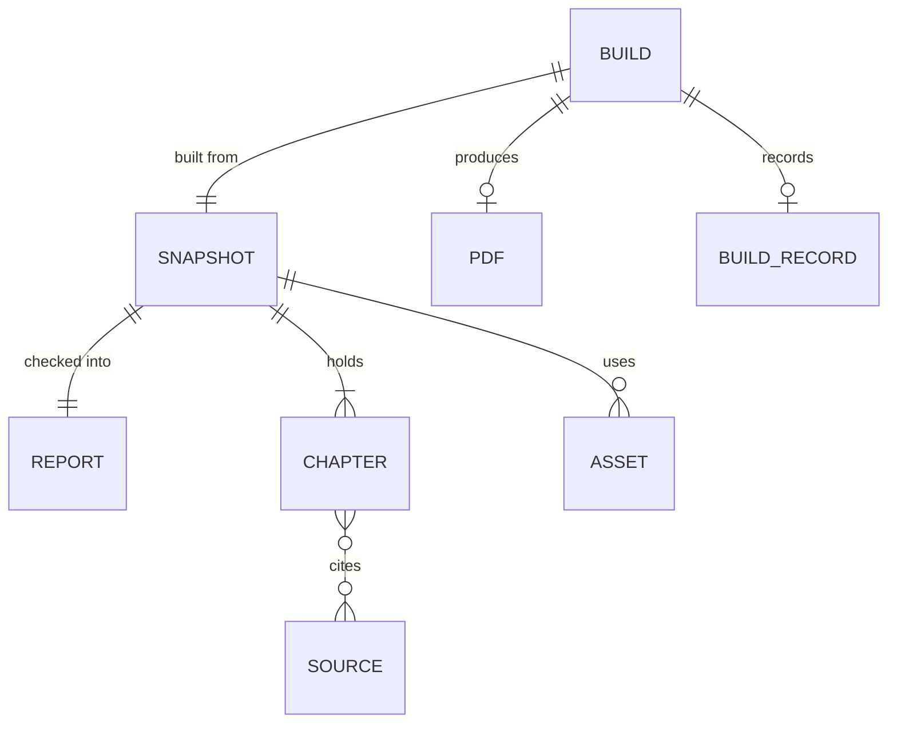
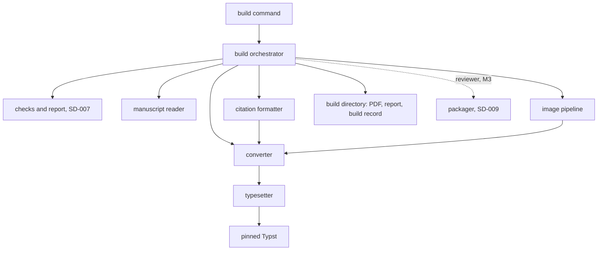

---
ddx:
  id: SD-008
  type: solution-design
  activity: design
  authoring:
    home: repo
  depends_on:
    - FEAT-008
    - stemma.architecture
    - stemma.data-design
    - stemma.concerns
    - stemma.adr-003
    - stemma.adr-005
    - stemma.adr-009
    - CONTRACT-001
    - CONTRACT-002
    - CONTRACT-006
    - SD-003
    - SD-007
  schemas:
    - id: stemma.record
      version: "0"
      title: Stemma records
      path: docs/stemma/02-design/contracts/schemas/stemma-record.umf.json
      schemaFormat: umf
---

# Solution Design: Typesetting and publishing

**Feature**: [[FEAT-008]] | **Artifact**: `docs/stemma/02-design/solution-designs/SD-008-typesetting-and-publishing.md`

## Scope

- Covers the Markdown reader's consumers, citation formatting, Typst conversion, and builds (FR-35 to FR-39, FR-55 to FR-58, FR-83, FR-91). FR-40 is deferred.
- **Pilot (M1)**: `build draft` and an unwatermarked basic PDF through `build camera-ready`, both whatever the findings, at 6 x 9 in, 5.5 x 8.5 in, or A5, with the CONTRACT-006 M1 features. It is not print-ready.
- **M2**: full book apparatus, remaining features, images, print PDF and PDF/A, approved Chicago examples. **M3**: reviewer build. Preview is SD-012; the package is SD-009.
- Depends on CONTRACT-006 (markup and conversion), SD-007 (report and label), and SD-003 (bibliography records).

## Requirements Mapping

### Functional Requirements

| Requirement | Technical Capability | Component | Priority / step |
|---|---|---|---|
| PIL-01, PIL-03, PIL-04 (FR-83) | Basic PDF from the Stemma copy, watermarked or not | Build orchestrator, Converter, Citation formatter | P0 / M1 pilot |
| STR-05, STR-02 (FR-35) | One reader; defined features only; omissions reported | Manuscript reader, Converter | P0 / M1 pilot |
| STR-01 (FR-35) | Full book structures | Converter | P0 / M2 |
| STR-03, STR-04 (FR-37) | Right-to-left quotations; main text unpromised | Converter, Typesetter | P0 / M2; M1 spans and quotations |
| BLD-01, BLD-02 (FR-36) | citeproc-js then Typst; book apparatus | Citation formatter, Converter | P0 / BLD-02 M1, BLD-01 M2 |
| BLD-03, BLD-04, BLD-08 (FR-38) | Settings, trim sizes, style labels | Book settings | P0 / M2; trim sizes M1 |
| BLD-05 to BLD-07 (FR-39) | Every build completes; build record, label, draft watermark | Build orchestrator | P0 / M2; draft, report, and label M1 |
| IMG-01 to IMG-06, IMG-09 (FR-55, FR-56) | Placement, conversion, image findings | Image pipeline | P0 / M2 |
| IMG-07, IMG-08 (FR-58) | Image records and gap findings | Image pipeline | P1 / after M2 |
| OUT-01 to OUT-03, OUT-06 (FR-57) | Print PDF and PDF/A | Typesetter | P0 / M2 |
| OUT-04 (FR-40) | Editable formats | None; deferred | P2 / past v1 |
| FTN-01, FTN-02 (FR-91) | Footnotes generated from passage records; no tool commentary in output | `cite`, `publish` | P0, M2 |

### NFR Impact on Architecture

| NFR | Requirement | Architectural Impact | Design Decision |
|---|---|---|---|
| Determinism | No model; every check recomputed | Checks run inside the build | One input snapshot for checks and layout; fixed creation timestamp |
| Reliability | Offline; no downloads | All assets local | Pinned Typst; vendored, digest-checked fonts, packages, style, and locale |
| Fidelity | No silent font or glyph fallback | Coverage must be tested | Fallback disabled and coverage reported; mechanism unverified |
| Portability | Supported only after observed runs | Native program per system | Only one macOS system observed |
| Security | Content is untrusted | No input becomes code | One escaping boundary; compiler file access limited to the build directory; no network |

## Solution Approaches

### Approach 1: Fixed Typst template reading the document model as data
**Description**: Pass the parsed model to a hand-written template.
**Pros**: Manuscript text never enters Typst source, so escaping risk is small.
**Cons**: Formatted citations still need markup; layout logic moves into Typst code; CONTRACT-006 specifies generated files.
**Evaluation**: Rejected.

### Approach 2: Convert with Pandoc
**Description**: Let an external converter produce Typst.
**Pros**: Mature Markdown handling.
**Cons**: A second reader that can disagree with checks, against ADR-009; custom markers need filters; large GPL program.
**Evaluation**: Rejected.

### Approach 3: Pure TypeScript converter from the CONTRACT-006 model to Typst source
**Description**: Emit Typst from the model that checks read, escaping all text in one function, with design values in a vendored template.
**Pros**: One reader; testable without Typst; reusable in the browser preview.
**Cons**: Stemma owns escaping and layout mapping.
**Evaluation**: Selected.

**Selected Approach**: Approach 3.

**Architecture/ADR impact**: No change; applies ADR-005 and ADR-009.

## Domain Model

A snapshot and an asset are build-time concepts, not records. Report and build record contents are CONTRACT-002; the manuscript model is CONTRACT-006.

### Business Rules

- **BR-801** — One snapshot: records, source files, settings, manuscript, and named image files are read once and digested. Checks and conversion use exactly those bytes. A change during the build cannot enter the PDF unchecked.
- **BR-802** — Order: validate and parse, run all checks, convert, format, compile, verify, compute the label, publish the files. No finding stops a step; only a tool failure does.
- **BR-803** — Publication: output is compiled in a staging directory and moved into place with its report only after the tool steps succeed. On a tool failure no earlier Stemma output at the requested path is presented as current: it is removed, and any other existing file makes the command stop at the start with a path error (assumption).
- **BR-804** — Watermark and label: draft pages are all watermarked; camera-ready pages carry no watermark or other mark, and the report states the status. The label comes from the report alone and appears in command output and the build record; no setting changes it.
- **BR-805** — Draft report: it lists check, subject, location, outcome, explanation, and suggested action. Any copy meant to circulate omits source-text evidence, so it does not copy source text.
- **BR-806** — Warnings carried: coordinate, removal, and other disclosure warnings are printed on screen first and kept in the report.
- **BR-807** — No hand-made citation text: formatting comes from citeproc-js. A cluster it cannot format is shown visibly marked in every build mode and reported by `cite.format`.
- **BR-808** — Bibliography: it is the cited sources plus `bibliography_include`, projected deterministically. An unbound occurrence prints its found text, marked, in drafts.
- **BR-809** — Escaping: manuscript, record, and processor strings reach Typst only through one escaping function. Raw Typst is never accepted from input.
- **BR-810** — Style label: output is labelled unverified in the build output and build record for any style other than Chicago notes and bibliography, and for Chicago until the approved example set passes.
- **BR-811** — Nothing dropped silently: unconverted blocks are typeset marked and listed; an unsupported or unresolved structure is reported with its location. A parse error stops the build.
- **BR-812** — Fonts: a missing glyph or substituted font is reported with the text location. Only a layout that cannot complete is a tool failure (assumption).
- **BR-813** — Images: every resolution, alternative text, credit, permission, vector, and location-metadata finding is reported. An image that cannot be placed (no converter, missing file, rejected format) appears as a labelled placeholder with a finding; nothing is substituted silently (assumption). Location metadata in placed raster images, such as EXIF position data, is reported by `image.metadata`; originals are not changed, and whether the compiled PDF carries it is unverified.
- **BR-814** — Conversion of TIFF and EPS is a recorded step with tool, version, input digest, and output digest. Originals are unchanged; loss of color or depth is reported.
- **BR-815** — Tool limits: when Typst cannot produce the PDF/A, the build says it is a tool limit, names the cause, and still produces the other outputs. No output is claimed to conform to PDF/A, to be accessible, or to be PDF/X unless verified, and no bleed box or crop marks are promised.
- **BR-816** — Provenance: the build record states the commit if any, uncommitted changes, tools, label, and report digest. Uncommitted changes are reported by `build.uncommitted` and keep the build from being labelled checked clean.

BR numbers for this feature start at 801 so that designs written in parallel cannot collide.

## System Decomposition

### Component: Manuscript reader (`packages/manuscript`) — M1; more features M2
- **Purpose**: The single parser and model for checks, takeover, build, and preview.
- **Responsibilities**: CONTRACT-006 A to F; sentence profile rules from SD-007.
- **Requirements Addressed**: STR-01, STR-02, STR-05.
- **Interfaces**: Pure, browser-safe library. SD-015 owns takeover's use of it.

### Component: Citation formatter (`packages/cite`) — M1
- **Purpose**: Project records to CSL-JSON, run citeproc-js in book order, and return Typst citation markup.
- **Responsibilities**: BR-807 to BR-810; note positions for short and repeated forms.
- **Requirements Addressed**: BLD-02, BLD-04, PIL-01.
- **Interfaces**: `CitationFormatter` port; CONTRACT-006 G.

### Component: Converter (`packages/publish/convert`) — M1; apparatus M2
- **Purpose**: Pure mapping from model and citations to Typst source and a vendored book template.
- **Responsibilities**: BR-809, BR-811; direction marks after right-to-left quotations; in M2 front and back matter, endnotes, figures, tables, cross-references, index, running heads, folios, contents.
- **Requirements Addressed**: STR-01, STR-03, STR-04, BLD-01.
- **Interfaces**: Browser-safe export for SD-012, including the CONTRACT-006 H linked build (M3).

### Component: Typesetter (`packages/publish`) — M1; output variants M2
- **Purpose**: Run the pinned Typst under restrictions and verify its output.
- **Responsibilities**: BR-812, BR-815; note-number agreement; font coverage; print PDF and PDF/A.
- **Requirements Addressed**: BLD-01, OUT-01 to OUT-03, OUT-06, STR-03.
- **Interfaces**: `Typesetter` port; subprocess. A missing or wrong tool exits as CONTRACT-002 I states.

### Component: Build orchestrator (`packages/core` use case, `packages/publish` adapter) — M1; reviewer M3
- **Purpose**: Sequence snapshot, checks, layout, label, and publication.
- **Responsibilities**: BR-801 to BR-806, BR-816.
- **Requirements Addressed**: PIL-01, PIL-03, PIL-04, BLD-05 to BLD-07.
- **Interfaces**: `build …` (CONTRACT-002 B, F); `scan release` results; `Packager` port for SD-009.

### Component: Book settings (`packages/core`, `templates/`) — M1 trim and style; M2 rest
- **Purpose**: Resolve documented defaults for style, trim, fonts, and citation style.
- **Requirements Addressed**: BLD-03, BLD-04, BLD-08.
- **Interfaces**: Project settings of CONTRACT-001 (`book_style`, `trim_size`, `tools`).

### Component: Image pipeline (`packages/publish`) — M2; records P1
- **Purpose**: Inspect, convert, place, and report on images.
- **Responsibilities**: BR-813, BR-814; effective resolution from pixel dimensions and placed size; inspection of vector content for features that vanish, rasterize, or substitute fonts.
- **Requirements Addressed**: IMG-01 to IMG-09.
- **Interfaces**: Image check IDs of CONTRACT-002; `image` and `conversion` records (CONTRACT-001); image files named by path and hash.

**Hostile image input.** TIFF and EPS (which is executable code) are converted only by a pinned converter with no network and no file access beyond its input and output, under starting caps (design assumptions to test): 500 MiB and 20,000 by 20,000 pixels per image, and 120 s per conversion. A hostile EPS fixture tests the containment. Without a converter that can be contained, EPS is not converted and the image is reported.

### Component Interactions

## Technology Rationale

| Layer | Choice | Why | Alternatives Rejected |
|---|---|---|---|
| Layout and citations | Typst 0.15.1 (release digests pinned in `packages/publish/src/typst.ts`), citeproc-js 2.4.63 | ADR-005 | See ADR-005 |
| Citation style and locale | `chicago-notes-bibliography.csl` (Chicago Manual of Style 18th edition, notes and bibliography) at styles commit 1aaf551f864d, `locales-en-US.xml` at locales commit 938c09c164a6; digests and licenses in `packages/cite/vendor/` | The official CSL repositories; no `ibid.` (the style gives shortened notes) | A hand-written style |
| Indexes and endnotes (M2) | Vendored Typst packages `in-dexter` 0.7.2 and `deixis` 0.2.0, candidates | Worked in feasibility tests | Writing both now; fetching packages at build time |
| Sort order for index | Stemma-computed keys | Native sorting misplaced diacritic initials in a test | Typst native sort |

TIFF and EPS converters are not chosen. Any converter must be pinned, run natively on three systems, and pass a license review.

## Traceability

| Requirement ID | Component | Design Element | Test Strategy |
|---|---|---|---|
| PIL-01 | Orchestrator, Formatter, Converter | Basic PDF | Taken-over synthetic chapter builds at each trim size |
| PIL-03, PIL-04 | Orchestrator | BR-804 | Same fixture with open findings, none, and a dismissal: all build; labels differ |
| STR-01 | Reader, Converter | Feature mapping | One fixture per CONTRACT-006 E feature; each appears in order |
| STR-02, STR-05 | Reader, Converter | BR-811 | Undefined feature and dangling cross-reference are reported; no older PDF remains |
| STR-03 | Converter, Typesetter | Direction marks, BR-812 | Arabic and Hebrew quotations before note markers; page inspection; diacritic coverage |
| STR-04 | Documentation, build labels | No promise | Text review: no output or help claims right-to-left main text |
| BLD-01 | Converter, Typesetter | Apparatus | Full-book fixture inspected for heads, folios, contents, bibliography, index |
| BLD-02 | Formatter | BR-807 | Typed locator and repeated-note sequence |
| BLD-03, BLD-08 | Book settings | Defaults and trim | Each trim size's page boxes; changed font applies |
| BLD-04 | Book settings | BR-810 | Approved examples when they exist; label on every other case |
| BLD-05 | Orchestrator | BR-802, BR-803 | Every seeded finding still yields output and report; an edited record is reported; a compile error leaves no stale output |
| BLD-06 | Orchestrator | BR-816 | Clean, dirty, and uncommitted projects recorded and reported |
| BLD-07 | Orchestrator | BR-804, BR-805 | Open findings give a watermarked draft with an explained report; labels follow the rule |
| IMG-01, IMG-02 | Image pipeline | Placement and resolution | Compare embedded pixel data with the original; low-resolution fixture |
| IMG-03, IMG-05 | Image pipeline | BR-814 | Conversion log; rasterized EPS and missing converter reported |
| IMG-04, IMG-06 | Image pipeline | Vector inspection | SVG with unsupported object, missing font, and filter; PDF inspection |
| IMG-07, IMG-08 | Image pipeline | `image` record (CONTRACT-001) | Image without credit or permission reported by `image.credit` and `image.permission` (P1) |
| IMG-09 | Orchestrator | BR-813 | Every image finding appears with evidence and a suggested action |
| OUT-01 | Typesetter | Trim and bleed | Inspect page boxes |
| OUT-02, OUT-06 | Typesetter | BR-815 | RGB book yields two files or a stated tool limit; CMYK states no promise |
| OUT-03 | Typesetter | BR-815 | No label or metadata claims PDF/X |
| OUT-04 | None | Deferred | N/A |
| FTN-01, FTN-02 | `publish` | Footnote generation | A built footnote holds the citation, locator, and verbatim quotation of its passage, and no tool wording |

Cross-cutting: build twice offline and compare bytes; check that no network or package fetch occurs.

### Experience Traceability

N/A: FEAT-008 user stories name the tasks.

### Gaps

- [ ] Open (owner): default print threshold; Chicago edition and who reviews the examples. Until a threshold exists, resolution is reported and no image is flagged as below it. The PDF/A part and conformance level is a design question.
- [ ] How Typst reaches a non-technical author is undecided.

## Concern Alignment

- **Concerns used**: `typesetting-fidelity`, `deterministic-checks`, `honest-assurance`, `hexagonal-architecture`, `security-owasp`, `rights-and-permissions`, `cross-platform`, `family-reuse`, `testing`, `a11y-wcag-aa` for text alternatives in accessible output.
- **Constraints honored**: Pinned tools and assets; generated files never edited or read back; image problems reported.
- **ADRs referenced**: ADR-003, ADR-005, ADR-007, ADR-009.
- **Departures**: None. Image findings are reported like all others; no accessibility claim is made without verification.

## Constraints & Assumptions

- **Constraints**: citeproc-js is licensed CPAL (Common Public Attribution License) or AGPL (GNU Affero General Public License). The review is recorded in ADR-005; Stemma distributes it under CPAL-1.0.
- **Assumptions**: Typst can report or be queried for note numbers and font coverage; if not, BR-812 and note agreement need another method before the pilot.
- **Dependencies**: Typst, citeproc-js, CSL style and locale files, fonts with distribution rights; SD-007, SD-003.

## Risks

| Risk | Prob | Impact | Mitigation |
|---|---|---|---|
| citeproc-js license does not fit | M | H | Review first; the formatter sits behind a port |
| Chicago note forms are wrong | H | H | Label unverified until approved examples pass |
| Note numbers or font gaps cannot be detected | M | H | Prove in the first pilot spike; treat disagreement as a tool failure |
| Silent font fallback or misplaced right-to-left markers | M | M | Vendored fonts, direction marks, page review |
| A finished book carries low-resolution, uncredited, unpermitted, or placeholder images | M | H | Report prominently; label the output |
| A finished book prints a restricted coordinate, an unsourced claim, or a sentence stronger than the judged claim | M | H | Carry warnings (BR-806); the label |
| The unwatermarked basic PDF is treated as print-ready or checked | H | M | State the label and that it is not print-ready in command output |
| PDF/A not produced because of placed PDF figures or missing alternative text | M | M | BR-815; independent validation still needed |
| Typst version change alters layout | M | M | Pin and record; compare pages on upgrade |

Golden tests (`tests/cite.test.ts`) fix the first and shortened notes and the
bibliography entry for fifteen kinds of source in the worked example; the
strings were compared with Chicago practice by a model, not by a person, and
not against the manual. Known differences from Chicago that come from the style
or the processor and are left as they print: year ranges in full (1879–1880,
where Chicago abbreviates 1879–80); the place of publication omitted, as the
18th edition allows; a report's series and its larger work printed in the
order the record gives them (Ladd and Schlanger); an article with an article
number prints a page locator without the number in notes. From record data: the
1842 Darwin title keeps the full stop before "Being" that its record holds;
changing it would leave the example's four citations to be captured again.
Feasibility tests on one macOS system used hand-prepared inputs: citeproc-js passed 12 of 14 Chicago rows against strings not checked against the manual; bleed wrote no bleed box; TIFF and EPS were rejected. No converter from this markup exists. Linux and Windows are untested.

## Schema Basis

Inspected through CONTRACT-001: UMF core 0.10.0 with `umf.ddd` 0.1.0; Stemma schema version 0, reused without local additions. No record has been validated against it.

The design consumes the `stemma.record` UMF document in `ddx.schemas` and adds no record shape. The manuscript is a text format owned by CONTRACT-006; the CSL-JSON projection is a native citation format. Settings (`book_style`, `trim_size`, `tools`) and the `image` and `conversion` records are CONTRACT-001 shapes.
