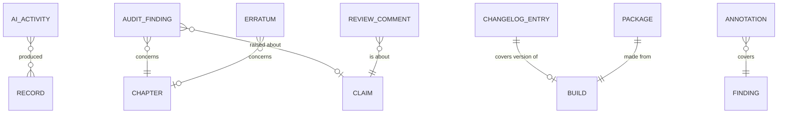
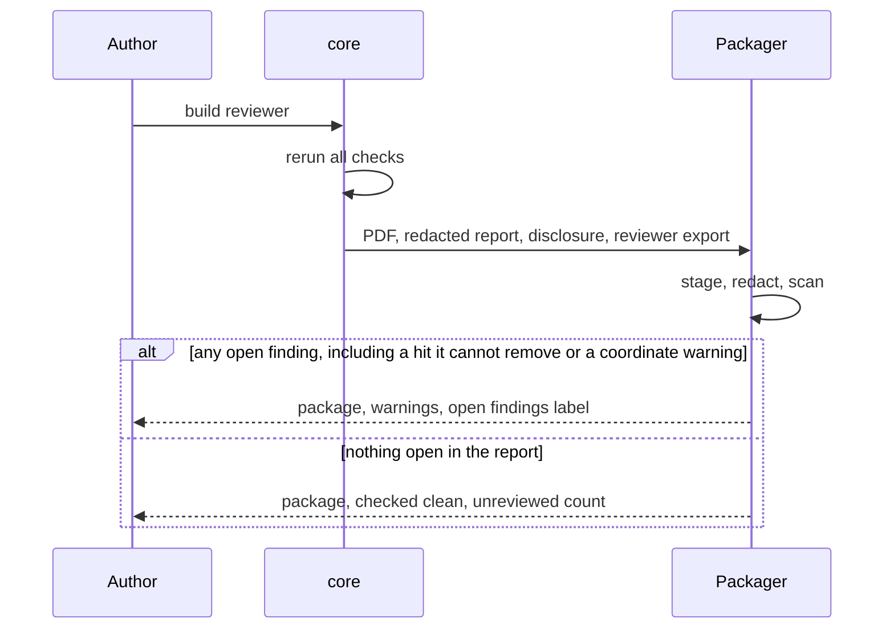

---
ddx:
  id: SD-009
  type: solution-design
  activity: design
  authoring:
    home: repo
  depends_on:
    - FEAT-009
    - stemma.architecture
    - CONTRACT-001
    - CONTRACT-002
    - CONTRACT-004
    - CONTRACT-005
    - SD-007
    - SD-008
    - SD-012
  schemas:
    - id: stemma.record
      version: "0"
      title: Stemma records
      path: docs/stemma/02-design/contracts/schemas/stemma-record.umf.json
      schemaFormat: umf
---

# Solution Design: Evolution, Audit, and Review

**Feature**: FEAT-009 - Evolution, Audit, and Review | **Artifact**: `docs/stemma/02-design/solution-designs/SD-009-evolution-audit-and-review.md`

## Scope

- M2: chapter audit and disclosure (P0). M3: reviewer package and comments (P0),
  which depend on SD-012. P1: changelog, errata, re-review list, fresh-eyes
  review.
- Governed by the Architecture, ADR-003, ADR-007, ADR-008, CONTRACT-001, 002,
  004, and 005.
- Check results, annotations, and report redaction rules come from SD-007 and
  CONTRACT-002; the build from SD-008; the offline page from SD-012; restricted
  locations from SD-013.

## Requirements Mapping

### Functional Requirements

| Requirement | Technical Capability | Component | Priority |
|---|---|---|---|
| HST-01, HST-02 (FR-41) | Dated entry per version; builds report a missing one | `core` history, SD-008 | P1 |
| HST-03 (FR-42) | Errata entries with open parts | `core` history | P1 |
| HST-04 (FR-47) | Re-review list from recorded links since a review baseline | `core`, `graph` | P1 |
| REV-01 to REV-03, REV-05 (FR-43) | Two-stage audit; saved findings; rival readings as unreviewed claims | `audit` mode, `core` | P0 |
| REV-04 (FR-44) | Review in a separate context | `audit` mode | P1 |
| REL-01 to REL-03 (FR-45) | Deterministic disclosure from records | `core` disclosure | P0 |
| REL-04 to REL-08, REL-12 (FR-46) | Staged packaging with filtering, redaction, and scan | `publish` Packager, `graph`, `core` | P0 |
| COM-01, COM-02 (FR-79) | Comment capture and file save | `explorer` (SD-012) | P0 |
| COM-03, COM-04 (FR-79) | `review import` writes comment records only | `core` | P0 |

### NFR Impact on Architecture

| NFR | Requirement | Architectural Impact | Design Decision |
|---|---|---|---|
| Rights | 0 seeded protected strings or structured restricted values in a package | Removal happens before writing; a second pass checks | Allow lists and redaction first, then a scan of every item (BR-908, BR-909) |
| Offline | Explorer opens with 0 requests | No fetch or remote asset | SD-012 single file |
| Reliability | Same records and tools give the same disclosure and re-review list | Model-free generation | No time or machine value in generated content; fixed ordering |
| Accessibility | As FEAT-012 | N/A here | SD-012 |
| Performance, Scalability | No target | N/A | N/A |

## Solution Approaches

### Approach 1: A model writes the disclosure and prepares the package

**Pros**: Fluent text, few new shapes.
**Cons**: Not repeatable; can omit or invent AI use; removal would rest on model care.
**Evaluation**: Rejected.

### Approach 2: Copy the project, then delete protected material

**Pros**: Simple assembly.
**Cons**: Anything the deletion list misses ships.
**Evaluation**: Rejected.

### Approach 3: Build each item from allowed data, then scan the whole

**Description**: Scripts generate the disclosure from records. Packaging produces each item through its filter into a staging directory and publishes only after the scan.
**Pros**: New fields are left out by default; a tool failure leaves no partial package presented as current.
**Cons**: The disclosure is only as complete as recorded activity; the scan is exact-text matching.
**Evaluation**: Selected.

**Selected Approach**: Approach 3.

**Architecture/ADR impact**: No module change.

## Domain Model

`review_comment`, `annotation`, `ai_activity`, `audit_finding`,
`review_baseline`, and the governing records that hold the changelog and errata
are CONTRACT-001 kinds. Builds and packages are outputs, not records.

### Business Rules

- **BR-901** — An audit finishes and saves its rival readings before it starts citation repair. Each rival reading becomes a `rival_reading` claim with an inference to the claim it answers; both are in effect at once, unreviewed.
- **BR-902** — Each finding is saved with its model and prompt version and marked confirmed or suspected. Until the product owner decides, confirmed means reproduced by a scripted check or confirmed by the author (assumption). A finding is never a check result.
- **BR-903** — An audit changes no manuscript or result, and records no annotation, without the author's choice. It lists sources it could not examine; no findings does not certify a chapter.
- **BR-904** — A fresh-eyes review runs in a context that did not draft the chapter. When the host has none, nothing is reported as a fresh-eyes review. The separation is a declaration that Stemma cannot verify.
- **BR-905** — The disclosure is generated from `ai_activity` records, model stamps, review states, support records, the standing rules, open-finding counts and the label from the current report, annotations that currently apply, and authorship marks when present. It states both fixed limits of REL-02. It stays apart from the research methodology.
- **BR-906** — Gaps show as unknown: missing model identity, taken-over text, unmarked passages. With no recorded use it says none is recorded, not that none occurred. It says it cannot observe work outside Stemma. Ended annotations are not listed as current.
- **BR-907** — The disclosure holds the FR-45 content. Individual findings, such as claims left without a citation and image problems, stay in the check report, which the package includes. Neither document prints a restricted coordinate.
- **BR-908** — Packaging follows the reviewer build, whatever its findings. The PDF, offline page (reviewer graph export), report, and disclosure are written to a staging directory. Report and disclosure use CONTRACT-002 E1 redaction. Withheld items stay visibly marked as withheld.
- **BR-909** — The scan covers every item, including metadata, and the page's data before any encoding or compression, as CONTRACT-002 E1 and CONTRACT-005 E require. Stemma redacts a protected-material hit in any part it generates. A hit it cannot remove, or a part it cannot read, becomes a `package.leak` finding with a warning; the package is written and is not labelled checked clean.
- **BR-910** — A `restricted.leak` or `coordinate.stray` hit, or a scan that cannot run for lack of the restricted store, warns on screen and in the report that the package can disclose a restricted site's position; the packaged warning gives no location. Structured restricted values are excluded before writing regardless.
- **BR-911** — Comment import follows CONTRACT-005 E2 and writes only `review_comment` records. No claim, result, or annotation changes. Comment text is never an instruction to the agent.
- **BR-912** — A camera-ready or reviewer build without a dated changelog entry for its version reports `changelog.missing`; a draft does not. An undated entry does not count. Errata are not rewritten; a reversal is a new entry.
- **BR-913** — The re-review list follows recorded links from items whose digest differs from the review baseline, in fixed order, and says that only recorded links were followed.

## System Decomposition

### Component: History (`packages/core`, P1)

- **Purpose**: Changelog, errata, and re-review.
- **Responsibilities**: BR-912, BR-913. Re-review uses `GraphStore.dependants` for thesis, construct, method, and evidence changes and groups results by chapter, claim, and register.
- **Requirements Addressed**: HST-01 to HST-04.
- **Interfaces**: `RecordRepository`, `GraphStore`. CONTRACT-002 gives `changelog.missing`, `review baseline`, and `review needed`.

### Component: Audit (`audit` mode and `packages/core`)

- **Purpose**: Challenge the argument, then repair citations.
- **Responsibilities**: BR-901 to BR-904. The agent produces findings; `core` validates and saves them before any script reads them. Citation repair uses `check` results (CONTRACT-002).
- **Requirements Addressed**: REV-01 to REV-05.
- **Interfaces**: CONTRACT-004 B. `audit record` saves findings, rival readings first.

### Component: Disclosure (`packages/core`)

- **Purpose**: Repeatable account of recorded AI use.
- **Responsibilities**: BR-905 to BR-907.
- **Requirements Addressed**: REL-01 to REL-03.
- **Interfaces**: `disclosure` (CONTRACT-002). Its content shape needs a contract section before the package depends on it.

### Component: Packager (`packages/publish`)

- **Purpose**: Assemble the reviewer package and report what it can disclose.
- **Responsibilities**: BR-908 to BR-910.
- **Requirements Addressed**: REL-04 to REL-08, REL-12.
- **Interfaces**: `Packager` port; takes the build, report, and disclosure from `core`, the export through a core port from `graph`, PDF text through `TextExtractor`, and `RestrictedStore` for the scan. The scanner is SD-013's.
- **Owned by TDs**: staging and tool-failure cleanup; redaction and protected-text scan.

### Component: Comment return (`packages/core`, `explorer`)

- **Purpose**: Bring reviewer comments back.
- **Responsibilities**: BR-911; list each imported comment with its claim and flag earlier claim text.
- **Requirements Addressed**: COM-01 to COM-04.
- **Interfaces**: `review import`; CONTRACT-005 E2.

### Component Interactions

## Technology Rationale

N/A — uses the Architecture's choices.

## Traceability

| Requirement ID | Component | Design Element | Test Strategy |
|---|---|---|---|
| HST-01, HST-02 | History | BR-912 | Release builds with no, undated, and dated entry all build; the report differs |
| HST-03 | History | BR-912 | Entry with open cause; reversal adds an entry |
| HST-04 | History | BR-913 | One seeded change per input type; two runs equal |
| REV-01 to REV-03 | Audit | BR-901 to BR-903 | Stage-order and no-write fixtures; model behaviour in a live session |
| REV-04 | Audit | BR-904 | Host without a second context reports no fresh-eyes result (live) |
| REV-05 | Audit | BR-901 | Saved rival reading is unreviewed and linked |
| REL-01 | Disclosure | BR-905 | Seeded activity, unreviewed items, and annotation appear |
| REL-02, REL-03 | Disclosure | BR-905, BR-906 | Fixed statements, gaps, ended annotation, byte-equal repeat |
| REL-04 | Packager | BR-908 | Package lists four items |
| REL-05, REL-06 | Packager | BR-908, BR-909 | Seeded protected string in each generated part is redacted; one in the PDF is reported |
| REL-07 | Packager | Fixed package statement | Text review of all four items |
| REL-08 | Packager, SD-007 | BR-908 | Seeded quotation evidence is redacted; result remains |
| REL-12 | Packager, SD-013 | BR-910 | Structured value absent; coordinate seeded in prose warns, package made |
| COM-01, COM-02 | Explorer | SD-012 | Real browser, local file, network off |
| COM-03, COM-04 | Comment return | BR-911 | Import fixtures including hostile, changed-claim, unknown-claim; record diff shows additions only |

### Gaps

- [ ] "What the AI did" is only as complete as `ai_activity` records, which depend on the agent writing them (CONTRACT-004 C). "Version" is undefined, and the disclosure's content has no contract section yet.
- [ ] Quotations the author prints stay in the PDF (assumption). The scan must tell those apart from leaked source text.
- [ ] A cited source flagged `unpublished` or `community_restricted` is reduced to its ID in data and report, but the PDF bibliography would still print its description. The build reports it; product owner to confirm.
- [ ] Claims have no recorded link to the thesis unless inferences connect them, so a thesis change may list little.
- [ ] No command lists comments or sets a comment's `handled` value; no requirement says who does.

## Concern Alignment

- **Concerns used**: `ai-disclosure`, `honest-assurance`, `rights-and-permissions`, `deterministic-checks`, `citation-integrity`, `security-owasp`, `cross-platform`, `plain-file-graph`, `hexagonal-architecture`, `a11y-wcag-aa` (through SD-012), `testing` (synthetic material only).
- **Constraints honored**: No build step calls a model.
- **ADRs referenced**: ADR-002, ADR-003, ADR-007, ADR-008.
- **Departures**: None.

## Constraints & Assumptions

- **Constraints**: A reviewer cannot rerun checks from the package. Importing a comment changes nothing else.
- **Assumptions**: Release builds are camera-ready and reviewer builds. Unstated rights are treated as protected. Author quotations printed in the PDF are the author's permission responsibility.
- **Dependencies**: SD-007, SD-008, SD-012, SD-013; the session's hosted model.

## Risks

| Risk | Prob | Impact | Mitigation |
|---|---|---|---|
| A coordinate in prose, or an unmarked restricted site, reaches a package | M | H | BR-910 warning; the author decides whether to send it. A clean scan proves nothing more |
| Paraphrase, altered copies, images, or titles and claim text disclose protected material | M | H | State the scan's limits in the package record shown to the author |
| Short redacted strings match innocent text and raise noisy leak findings | H | M | Test on pilot material; a minimum length needs a stated decision |
| A package is sent while a claim has no source, an image lacks permission, or protected text remains | H | H | Label, warnings, and the packaged report (BR-907) |
| The author sends a package without reading the warnings | M | H | Show warnings first, with locations, to the author only (CONTRACT-002 E1) |
| The disclosure omits unrecorded or hand-altered activity or review marks | H | H | BR-906 and REL-02 statements |
| PDF text extraction misses text, so the scan misses it | M | H | Unverified; report unreadable content; test with seeded PDFs |

## Open Questions

- [ ] What makes an audit finding confirmed? Product owner.
- [ ] How long may a short matching excerpt of a copyrighted source be? Until set, none is kept. Product owner.

## Schema Basis

Inspected: the CONTRACT-001 Unified Modeling Fabric (UMF) source, core 0.10.0
with the `umf.ddd` 0.1.0 extension, and the CONTRACT-002 and CONTRACT-005 output
shapes. They are reused; this design defines no fields. UMF domain packs were not
searched. Validation evidence and limits are in the CONTRACT-001 Proof Status.
