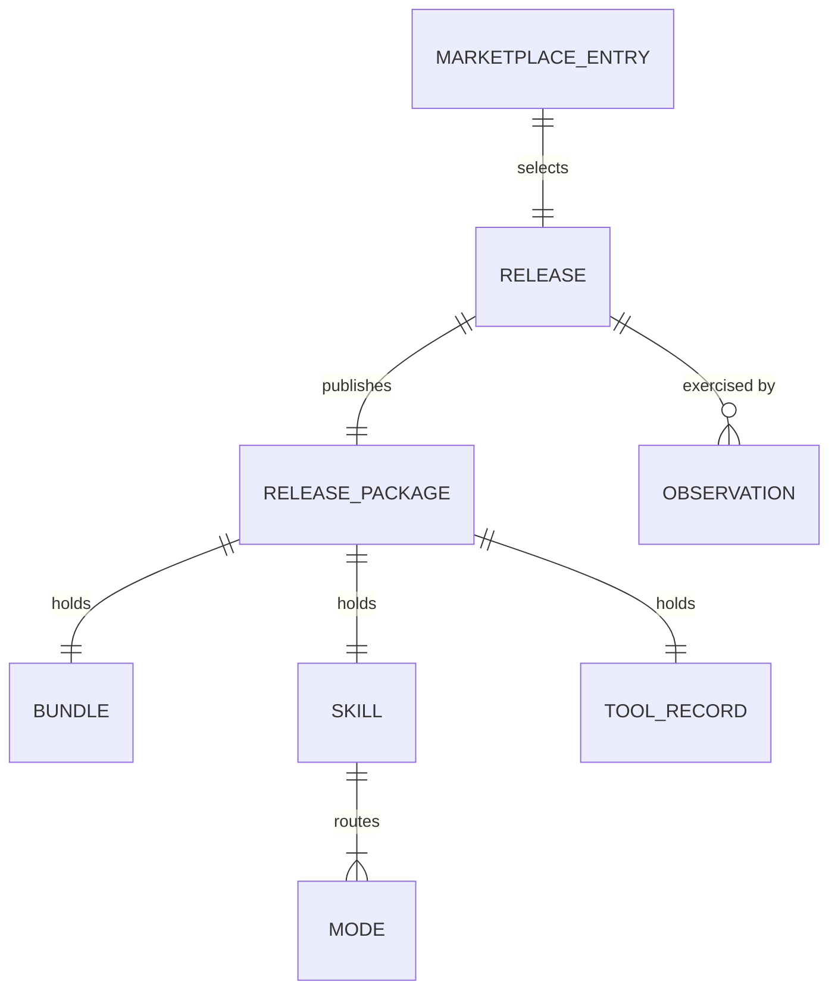
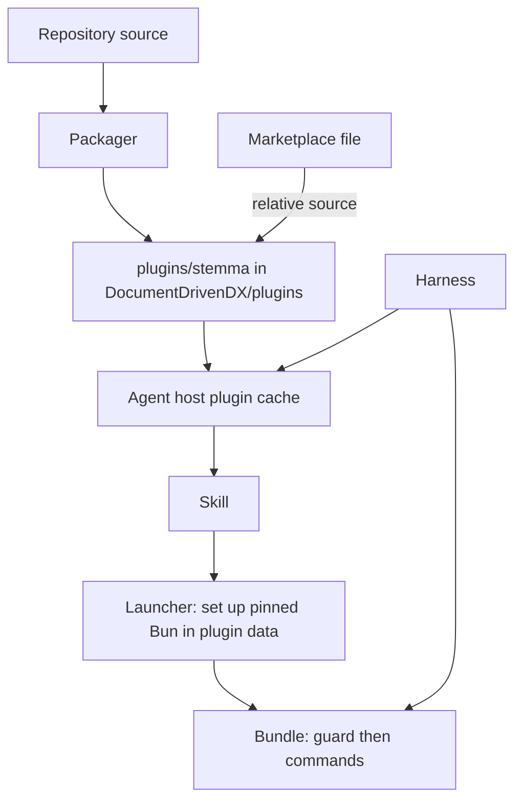

---
ddx:
  id: SD-010
  type: solution-design
  activity: design
  authoring:
    home: repo
  depends_on:
    - FEAT-010
    - stemma.prd
    - stemma.concerns
    - stemma.architecture
    - stemma.adr-001
    - stemma.adr-003
    - stemma.adr-004
    - stemma.adr-007
    - CONTRACT-002
    - CONTRACT-004
---

# Solution Design: SD-010 Plugin, skill, and distribution

**Feature**: [[FEAT-010]] | **Artifact**: `docs/stemma/02-design/solution-designs/SD-010-plugin-skill-and-distribution.md`

## Scope

- Covers the runtime, the bundled command line, the plugin and its one skill, release packages, install delivery, and install tests.
- Governed by the Architecture, ADR-001, ADR-003, ADR-004, ADR-007, CONTRACT-002 (commands, reports, exit codes), CONTRACT-004 (plugin, modes, agent obligations, host claims), and Project Concerns.
- M1, first in the design order. A first part is built: the plugin launcher that sets up the pinned runtime, the runtime guard, the bundle script, part of the command line, the script that copies a release into the marketplace repository, and a local check that installs through a marketplace entry with the Claude command-line tool. Install and host behaviour below is otherwise unverified unless a row says so.

## Requirements Mapping

### Functional Requirements

FEAT-010 identifiers carry the PRD requirement in parentheses.

| Requirement | Technical Capability | Component | Priority |
|---|---|---|---|
| SKL-01 to SKL-03 (FR-48) | One skill file routes to one file per mode | Skill | P0 |
| SKL-04 to SKL-06 (FR-48) | Delivery table in the skill, exit 2 backstop, relay and data-not-instruction rules | Skill, command line | P0 |
| CLI-01 to CLI-03 (FR-49) | One bundle for terminal and agent; distinct exit codes | `cli` | P0 |
| CLI-04, CLI-05 (FR-49) | Each function is a command over a core operation that interfaces also use | `cli`, `core` | P0 |
| RUN-01 to RUN-06 (FR-75) | One pinned Bun set up by the plugin, tool record, no run-time packages, platform rules | Launcher, runtime guard, bundler, release check | P0 |
| DST-01, DST-06 (FR-50) | Self-contained release tree published as `plugins/stemma` in the DocumentDrivenDX/plugins marketplace repository | Packager, manifests | P0 |
| DST-02, DST-03, DST-05 (FR-50) | Support statement and skill wording per session type | Skill, README, release report | P0 |
| DST-04 (FR-77) | Same package; claim withheld until observed | Manifests | P1 |
| PER-01 to PER-03 (FR-51) | Persona settings read by the skill only | Skill, project settings | P1 |
| TST-01 to TST-06 (FR-78) | Local and release-tag install and load script with a three-state report | Install harness | P0 |

### NFR Impact on Architecture

| NFR | Requirement | Architectural Impact | Design Decision |
|---|---|---|---|
| Reliability | 0 differing scripted results between agent and terminal, and across systems | One execution path | The skill runs the same bundle with the same options; the report records tools and inputs. A system with no run is "not observed" |
| Security | 0 package downloads during checks or builds | No run-time resolution | Every library is bundled; invocation uses `--no-install` (CONTRACT-002 A) |
| Cost | 0 paid model calls in automation | No model in tests | The harness drives host command-line tools and the bundle only |
| Process | 0 required CI checks, 0 commit hooks | Local-first | One local check command; tag workflow is advisory (ADR-007) |

## Solution Approaches

The choice is how installing from a marketplace delivers a bundle
that is not in the Stemma repository.

| Approach | Finding | Decision |
|---|---|---|
| Commit the bundle to the repository, or to a release branch of it | Works through git, but puts built files in the repository | Rejected by owner decision |
| Fetch the bundle on first run | The installed plugin would download its own code while in use | Rejected |
| Marketplace `archive` source naming a release archive | Documented by the vendor with a SHA-256. In Claude command-line tool 2.1.236, `plugin validate` rejects the source, and an install requires a public HTTPS address, so it cannot be shown to work before publishing | Not selected; revisit when the target hosts accept it |
| Marketplace `npm` source | Adds a package registry as a publishing surface and its tooling on the author's side | Not selected |
| The built tree at `plugins/stemma` in the DocumentDrivenDX/plugins marketplace repository, a relative marketplace source | Family marketplace; observed to install with the Claude command-line tool from a local stand-in and, for 0.0.2, from GitHub | Selected |

**Selected Approach**: The DocumentDrivenDX/plugins repository's marketplace
file, named `documentdrivendx`, lists `stemma` at `./plugins/stemma`.
`dev.sh publish-plugin <checkout>` copies the release tree (manifest, skill,
launcher, bundle, library data, license) there, changes nothing else, and
commits and pushes nothing. Publishing is the owner's push of a release tag
`v<version>`: a GitHub Actions workflow (`.github/workflows/publish.yml`) checks
that the tag names the manifest's version, builds, runs that command, and
commits and pushes `plugins/stemma` with a short-lived token of a GitHub App
installed only on the marketplace repository. It runs no tests and no check waits on it.
Each release tag has a GitHub release: the workflow creates one when the tag has
none, even if publishing fails, and publishing a release on GitHub for a new tag
creates the tag. A release therefore does not show that the version reached the
marketplace; the workflow run does. Deleting a tag or a release leaves the other. An author
installs with `claude plugin marketplace add DocumentDrivenDX/plugins` and
`claude plugin install stemma@documentdrivendx`. The manifest declares `docsync`
as a dependency, which that command installs too (ADR-011). The install check
uses a stand-in `docsync` to show this.

**Observed.** Version 0.0.2 installed from GitHub with the Claude command-line
tool.

**Not shown.** Any install or run in Claude desktop, an update from one version
to the next, and operation with the network denied after setup.

**Architecture/ADR impact**: None.

## Domain Model

An **observation** is one result for a host and operating system: passed, failed, or not observed. A **tool record** lists each pinned tool and version.

### Business Rules

- **BR-1001** — One version: the plugin manifest, marketplace entry, skill, bundle, and prompts of a release carry one version. The release script fails on a mismatch.
- **BR-1002** — No built file in git: `dist/` is ignored, and the local check fails if a built bundle is tracked.
- **BR-1003** — Self-contained package: the bundler fails if an import stays unresolved at run time. A library data file (fonts, character maps, workers) ships inside the package and is loaded by a package-relative path. For the PDF library, the worker is inside the bundle, and character maps, standard fonts, and licenses ship in `dist/pdfjs/`. No native module and no `node_modules` ships; a package test and the install check look for them.
- **BR-1004** — Readable bundle: the bundle is unminified. Bundled third-party licenses ship with it. The citeproc-js license review precedes the first package that contains it (ADR-005).
- **BR-1005** — One pin: one source file states the Bun version. The runtime guard, `doctor`, the tool record, the install instructions, and the harness all derive from it. The first pin is Bun 1.4.5 (Architecture assumption).
- **BR-1006** — Guard first: the version guard runs before any command work. A wrong version exits 4 and names the found version, the required version, and the launcher that provides it.
- **BR-1007** — Setup by the plugin: the launcher takes the plugin's data
  directory, which the skill gets from the host's `${CLAUDE_PLUGIN_DATA}`
  substitution. When that directory lacks the pinned Bun it fetches the platform
  package from the npm registry over HTTPS, compares its SHA-512 with the pinned
  digest before unpacking, extracts only the program, moves it into place, and
  confirms its version. A failure exits 4, says that nothing was checked, and
  leaves nothing unpacked. It writes only inside the data directory.
- **BR-1008** — Permissions: setup runs only as a command Claude issues. The
  skill declares no `allowed-tools`, the plugin ships no hook and no `bin/`
  directory (claude.ai and Cowork do not install a plugin that has one), and
  nothing changes a permission setting. If the host or author refuses, the skill
  stops that action and says nothing was checked.
- **BR-1009** — Mode availability: `SKILL.md` marks each mode delivered or not in the shipped version. A release marks a mode delivered only when its commands are implemented; a package test compares the two. An unimplemented command exits 2.
- **BR-1010** — Platform neutrality: scripts are TypeScript run by Bun. The bundle builds paths with platform functions, passes subprocess arguments as lists, sorts by code point, and depends on no shell or locale. Record normalization is SD-011's.
- **BR-1011** — Observed claims only: a listing or manifest validation never yields "passed". "Passed" requires that the installed skill is loadable and the delivered command line ran.
- **BR-1012** — Persona isolation: no persona value reaches the check engine's findings or label rule. `core` takes no persona input for either.
- **BR-1013** — MCP declaration: the manifest declares the one MCP server of
  CONTRACT-005 N, started by the launcher behind a guard that runs nothing
  unless both plugin directories were filled in. For `mcp` the launcher fetches and
  writes nothing, and without the pinned Bun answers the protocol itself, from
  the tool list the release tree ships. A package test holds the declaration, and
  the install check runs the declared command from the installed copy.

## System Decomposition

### Component: Skill (`skills/stemma`)

- **Purpose**: The one public entry for agent hosts.
- **Responsibilities**: Route by first argument or wording and ask when two modes fit; state unavailable modes; run `doctor` first; state that only Claude desktop's local Code tab carries the full-function promise; describe local models as an unsupported experiment; hold the obligations of CONTRACT-004 C and the versioned support prompt.
- **Requirements Addressed**: SKL-01 to SKL-06, DST-02, DST-03, DST-05, PER-01, PER-02.
- **Interfaces**: Runs the command line only (CONTRACT-002; CONTRACT-004).
- **Owned by TDs**: US-080, US-082, US-083, US-084. Each mode's dialogue belongs to the owning feature's design.

Stemma does not enforce these instructions against an agent with file access (CONTRACT-004 C). Relaying a result faithfully and treating source text as data are instructions, not controls.

### Component: Command-line shell and runtime guard (`packages/cli`)

- **Purpose**: One composition root for every caller.
- **Responsibilities**: Guard the version; parse arguments; read environment variables in one environment module with one schema; construct adapters; map outcomes to exit codes; answer unimplemented commands.
- **Requirements Addressed**: CLI-01 to CLI-05, RUN-02, RUN-05.
- **Interfaces**: CONTRACT-002.
- **Owned by TDs**: US-081, US-085.

A desktop app can start with a different environment from a terminal. Checks read only the project, so results do not depend on that environment; `doctor` shows the resolved paths.

### Component: Bundler and release packager (`scripts/`)

- **Purpose**: Turn the workspace into a release package.
- **Responsibilities**: Generate code from the record schema (SD-011); bundle; copy assets, skill, manifests, and templates; write the tool record; check versions, unresolved imports, tracked build output, and licenses.
- **Requirements Addressed**: RUN-03, RUN-04, DST-01, DST-06.
- **Interfaces**: Package layout in CONTRACT-004 A.
- **Owned by TDs**: US-082, US-085.

The tool record covers every tool and bundled library that can change a result, including Typst and extraction libraries. `doctor` compares installed external tools with it. SQLite is only reported, since Bun uses the system library on macOS (ADR-004).

### Component: Install harness (`scripts/`)

- **Purpose**: Evidence that a release installs and loads.
- **Responsibilities**: Install into a throwaway host profile; list skills; run the installed bundle on a seeded project with network denied where the system allows; report each promised host on each system.
- **Requirements Addressed**: TST-01 to TST-06.
- **Interfaces**: Reads host command-line output; runs CONTRACT-002 commands.
- **Owned by TDs**: US-086.

The harness runs locally during development and in one workflow triggered only by release tags, which stops nothing. A desktop app with no automated route gets a recorded hand check or "not observed". A seeded broken component that still lists as installed must produce "failed". In the tested Claude Code version, folder validation missed broken hooks and manifest validation caught them; the harness still requires a load and run.

**Runtime configuration.** On Bun 1.4.5 (macOS), `bunfig.toml` and `.env` in the working directory were loaded even with `--no-install`; adding `--no-env-file --config=/dev/null` stopped both. The invocation uses all three flags, starts in the plugin root, and passes absolute paths (CONTRACT-002 A); the guard exits 4 without `--no-install`. A seeded-file test covers SEC-014. Windows is untested. The author's own global Bun settings and environment, such as `BUN_OPTIONS`, are outside this control.

**Release integrity and delivery.** Each release is one commit in the marketplace repository that replaces `plugins/stemma`; the publish script refuses different content under a published version, or a version older than the published one, and pushes nothing itself. The install check compares the installed bundle with the built one (SEC-028). Whoever can push to that repository, or push a release tag to Stemma's, can change what installs; a digest from the same publisher does not protect against a compromised publisher account. Claude's command-line tool may drive repeatable install tests; its results are recorded as command-line observations and never as desktop ones.

### Component Interactions

## Technology Rationale

| Layer | Choice | Why | Alternatives Rejected |
|---|---|---|---|
| Bundling | Bun's bundler, unminified, one entry file plus package assets | No second build tool; authors and reviewers can read the output | Compiled per-system executables: not a supported route (FEAT-010 Out of Scope) |
| Environment validation | One schema in the environment module (`typescript-bun`) | One place reads the environment | Reads scattered across packages |

Layered configuration files from `typescript-bun` are not used: CONTRACT-002 fixes precedence among options, environment, and `stemma.json`. The runtime choice is ADR-004.

## Traceability

| Requirement ID | Component | Design Element | Test Strategy |
|---|---|---|---|
| SKL-01 | Skill | BR-1001 | Installed package lists one skill |
| SKL-02, SKL-03 | Skill | Mode files | Hand-run request script per mode in a live session; not automatable without model calls |
| SKL-04 | Skill, `cli` | BR-1009 | Package test of table against commands; hand check of wording |
| SKL-05, SKL-06 | Skill | CONTRACT-004 C | Hand check with a seeded failing result and a source containing instructions |
| CLI-01, CLI-02 | `cli` | One bundle | Same fixtures from terminal and harness; compare report bodies |
| CLI-03 | `cli` | CONTRACT-002 I | Nothing-open, open-findings, and missing-tool fixtures |
| CLI-04 | `cli` | CONTRACT-002 B | Command-line end-to-end test per function; then a Playwright test of the same function against the built interface (ADR-007) |
| CLI-05 | `core` | Architecture, Command line first | Boundary check; review |
| RUN-01, RUN-06 | `cli`, packager | BR-1010 | Seeded set with CRLF checkout, spaced and non-Latin paths; three systems on tags |
| RUN-02, RUN-05 | Launcher, guard, skill | BR-1005 to BR-1008 | Clean profile with no Bun on the search path; mismatched archive; wrong-version fixture; hand check in a desktop app |
| RUN-03 | Packager | Tool record | Inspect record against lockfile and `doctor` |
| RUN-04 | Packager | BR-1003 | Empty package cache, network denied |
| DST-01, DST-06 | Packager, manifests | BR-1002, S-DIST | S-DIST pass criteria |
| DST-02, DST-03, DST-05 | Skill, README | Support statement | Read published text; hand check in a non-local session |
| DST-04 | Manifests | No claim until observed | ChatGPT desktop and Codex hand test (P1) |
| PER-01, PER-02 | Skill | Persona settings | Override fixtures (P1) |
| PER-03 | `core` | BR-1012 | Same findings and label under every persona |
| TST-01, TST-02, TST-05, TST-06 | Harness | BR-1011 | Seeded broken component; report states |
| TST-03, TST-04 | Harness, workflow | ADR-007 | Inspect triggers, hooks, and jobs |

### Gaps

- [ ] DST-01 and DST-06: shown only with the command-line tool and a local stand-in repository.
- [ ] RUN-02 on Windows: the launcher needs Git Bash; Claude Code without it uses PowerShell, which this launcher does not support.
- [ ] RUN-01: nothing has run on Linux, Windows, or any desktop app. Those cells stay "not observed". On Linux the harness exercises the command line only; no desktop-app integration is promised there in v1.
- [ ] RUN-02: no musl Linux build is selected.
- [ ] RUN-03: Typst will be set up the same way as Bun, by the launcher; not built.
- [ ] RUN-03: no contract defines the tool record, which `doctor` compares with installed tools.
- [ ] PER-01 and PER-02: `Project.persona` (CONTRACT-001) holds name, explanation level, and checkpoints only; any further persona default needs a field before the P1 work.
- [ ] The ChatGPT install route stays open (FEAT-010).

## Concern Alignment

- **Concerns used**: `plugin-distribution`, `typescript-bun`, `cross-platform`, `honest-assurance`, `lightweight-verification`, `modularity-and-encapsulation`, `hexagonal-architecture`, `security-owasp`, `verification`, `testing`, `code-shape-ceilings`.
- **Constraints honored**: Strict TypeScript, `bun:test`, Biome, committed `bun.lock`, shape ceilings, and `bun run check:boundaries` sit in one local check command. The checker and its allowed and forbidden cases precede feature code. A dependency audit and secret scan run before a release. Only `cli` names concrete adapters.
- **ADRs referenced**: ADR-001, ADR-003, ADR-004, ADR-007.
- **Departures**: Only the recorded overrides (ADR-007): no required CI job and no commit hook.

Diagnostic flow: N/A, `o11y-otel` is not selected; `doctor` and command output are the diagnostics.

## Schema Basis

The domain model above only explains release concepts and adds no record kind. Plugin and marketplace manifests keep each host's native format, so UMF is not used for them (CONTRACT-004). No UMF definition was inspected for the release concepts. The tool record becomes a structured interface once `doctor` reads it; its shape needs a contract addition that records the UMF inspection.

## Constraints & Assumptions

- **Constraints**: The first version needs no host hook (CONTRACT-004 E). Required features need no WSL or Docker.
- **Assumptions**: A host lets the skill run a Bun process on the author's computer; if not, that host gets no full-function claim. Package size stays within host plugin limits; research read limits of 200 MB and 5,000 files, unverified here.
- **Dependencies**: Claude desktop and its marketplace, the npm registry (setup only), git hosting for releases.

## Risks

| Risk | Prob | Impact | Mitigation |
|---|---|---|---|
| Claude desktop does not install from the marketplace repository | M | H | Observe it before any support claim; the owner decides what changes |
| A desktop app or sandbox blocks the setup download or the fetched program | M | H | BR-1007 message; hand check per system; claim only observed cells |
| A bundled library needs files or native code that bundling breaks | M | M | BR-1003; run extraction and citation fixtures from the installed package |
| The skill claims a check ran, or paraphrases a result | M | H | CONTRACT-004 C; hand checks; the author can rerun from a terminal; not enforceable |
| A defect on another system appears only at a release tag | H | M | Advisory three-system run; state failures with the release (ADR-007) |
