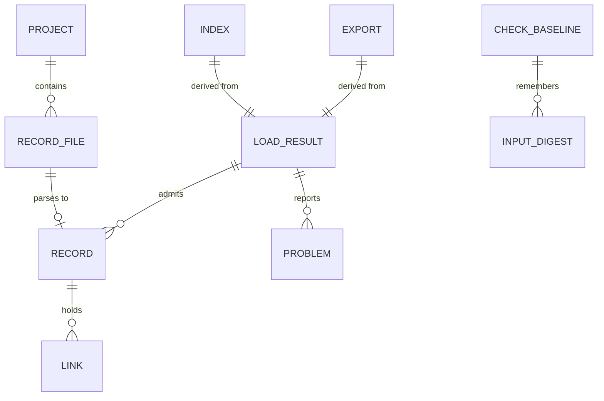
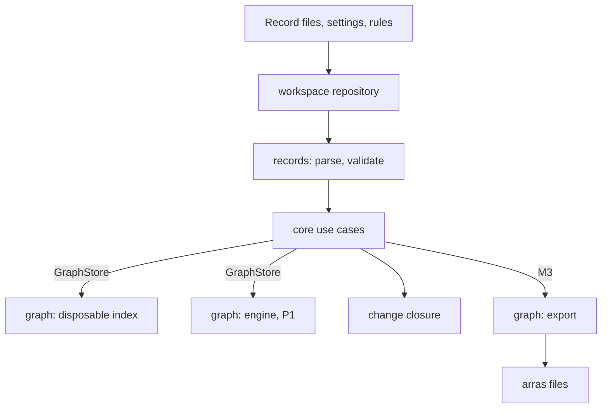

---
ddx:
  id: SD-011
  type: solution-design
  activity: design
  authoring:
    home: repo
  depends_on:
    - FEAT-011
    - stemma.concerns
    - stemma.architecture
    - stemma.data-design
    - stemma.adr-002
    - stemma.adr-006
    - stemma.adr-008
    - CONTRACT-001
    - CONTRACT-005
    - SD-010
  schemas:
    - id: stemma.record
      version: "0"
      title: Stemma records
      path: docs/stemma/02-design/contracts/schemas/stemma-record.umf.json
      schemaFormat: umf
---

# Solution Design: SD-011 Evidence graph and graph engine

**Feature**: [[FEAT-011]] | **Artifact**: `docs/stemma/02-design/solution-designs/SD-011-evidence-graph-and-graph-engine.md`

## Scope

- Covers record types and validation, loading and integrity, migration, the disposable index, the change closure, and later the graph export and the read-only engine.
- Governed by CONTRACT-001 (record format), CONTRACT-005 (export, `GraphStore` port, engine scope), the Data Design, ADR-002, ADR-006, ADR-008, and the Architecture.
- M1: records, loading, index, closure. M3: export, whose screens belong to SD-012. P1: engine, which delays neither the pilot nor the first Claude release.

## Requirements Mapping

### Functional Requirements

| Requirement | Technical Capability | Component | Priority |
|---|---|---|---|
| REC-01, REC-02, REC-03 (FR-62) | Generated record types and validators from the UMF schema; one file per record | `records`, record repository | P0 |
| REC-04, REC-05, REC-06 | Strict parser, canonical writer, name rules, digests | `records` | P0 |
| REC-07 | Versioned, repeatable migration | `core` use case, record repository | P0 |
| INT-01 to INT-04 | Staged loader that returns graph, problems, and completeness | `records`, `workspace` | P0 |
| IDX-01 to IDX-04, IDX-06 | Disposable SQLite index behind `GraphStore`; canonical dump; freshness test | `graph` | P0 |
| IDX-05 | Stemma-owned versioned folding | `graph` | P0 |
| IDX-07 | Export to an ignored directory, rebuilt on demand | `graph` export | P0 |
| ENG-01 to ENG-05 (FR-63) | Read-only engine over a rebuildable SQLite database | `graph` engine | P1 |

### NFR Impact on Architecture

| NFR | Requirement | Architectural Impact | Design Decision |
|---|---|---|---|
| Reliability | 0 differences between two rebuild dumps, across systems once observed | No hidden state or platform ordering | Path-order input, Stemma sorting and folding, no SQLite collation |
| Integrity | Every seeded invalid, duplicate, dangling, and conflicted record reported | Loading continues past the first defect | Collect all problems, then judge completeness |
| Security | 0 executions from record text | Text is data | Strict parse, bound SQL parameters, no evaluation, plain-text projection |
| Performance (assumptions, unverified) | A full rebuild of 25,000 records in 5 s or less and a chain query under 100 ms; no PRD target | Disposable index, change closure | Measure on a stated machine |

## Solution Approaches

### Approach 1: Load all record files in memory for each command

**Pros**: No cache can go stale; least code.
**Cons**: Search, reverse links, and later graph serving need indexes built each time; the engine would share nothing.
**Evaluation**: Rejected as the only path. An in-memory `GraphStore` serves tests.

### Approach 2: Disposable SQLite index behind the `GraphStore` port

**Pros**: Query support with no fact of its own; the engine can replace it behind the same port.
**Cons**: Freshness must be proved before each query.
**Evaluation**: Selected (Data Design, ADR-006).

### Approach 3: Build the engine first

**Pros**: One implementation.
**Cons**: Delays the pilot.
**Evaluation**: Rejected by ADR-006.

For validators, two options were compared. A UMF runtime was rejected: research measured a large, slow module that accepted broken definitions. Hand-written types were rejected as a second authority. Selected: a development-time generator from the UMF file, plus hand-written CONTRACT-001 rules.

**Selected Approach**: Approach 2 with generated validators.

**Architecture/ADR impact**: No change. The first engine is called in process, with no network listener (CONTRACT-005 I assumption).

## Domain Model

Record kinds, fields, and reference targets are defined by the schema in `ddx.schemas` and CONTRACT-001. This model shows the load and derivation objects only.

### Business Rules

- **BR-1101** — One authority: types and structural validators are generated from the UMF file. A generator check fails on any schema construct it does not handle; it never skips one.
- **BR-1102** — Rules in code: every CONTRACT-001 rule the schema cannot express is a named pure function with a seeded failing record. UMF validation alone never accepts a record (ADR-002).
- **BR-1103** — Strict reading: the reader decodes UTF-8 strictly and uses a parser that detects duplicate keys, lone surrogates, and out-of-range numbers. Platform JSON parsing alone drops duplicate keys.
- **BR-1104** — Code-point order: key and record sorting compare Unicode code points. The default JavaScript string sort compares UTF-16 units and is not used.
- **BR-1105** — Load stages: parse, structure, record rules, then graph rules (placement, unique IDs and citation keys, reference targets, case-colliding names). Every stage reports all its findings.
- **BR-1106** — No silent repair: loading rewrites nothing. A failed or newer-version record stays byte-identical, is reported, and is not offered as a valid record.
- **BR-1107** — Visible incompleteness: a load with an error marks the result incomplete. Queries, views, reports, and builds over it say so and list what was skipped; export of an incomplete graph stops as a tool failure (CONTRACT-005).
- **BR-1108** — Files first: a write validates the resulting graph, writes record files through the staged, journaled write of the Data Design, then refreshes the index. No operation writes only the index.
- **BR-1109** — Freshness by content: before a query, the store compares the corpus digest computed from current file content. File times are not evidence. A mismatch refreshes or returns `index_stale`.
- **BR-1110** — Atomic rebuild: a rebuild writes a new database and renames it into place. A refresh runs in one transaction. Graph-level problems are recomputed after every refresh.
- **BR-1111** — Derived versions: an index schema or `search-fold` version change forces a rebuild.
- **BR-1112** — Check baseline: "changed" means different from the inputs remembered by the last completed check, never from the last index refresh. Inputs are records, settings, rules, manuscript and source files, and profile and tool versions. No baseline means scope `all`.
- **BR-1113** — Conservative closure: the closure holds every check subject whose old or new input set meets a changed input. Reverse references alone are not enough. Deleting an attestation changes the completeness of the claim it points to, and renaming a key changes citations that hold no record ID. When the closure cannot be bounded, it widens to the whole project. `--changed` results must equal the same results under `--all`.
- **BR-1114** — Retirement keeps links: retired records stay loadable, indexed, and linkable. A file deleted by hand enters the closure through its remembered inputs and yields dangling references.
- **BR-1115** — Repeatable migration: `migrate` follows the Data Design and runs only on the author's request. `migrate --list` lists file changes and the review marks, support records, confirmations, and annotations that would end; `migrate --apply` writes that list. It needs a project it can read, preserves IDs, legacy values, and unknown fields, and changes nothing on a second run.
- **BR-1116** — Export is one way: export reads a complete load, filters by audience before writing, and is never read back. A reviewer export uses an allow list, so a new field stays out until listed.

## System Decomposition

### Component: Record model (`packages/records`)

- **Purpose**: Pure definition of valid records.
- **Responsibilities**: Generated types and validators, strict parse, canonical form, digests, record and graph rules. No filesystem and no Bun-only API, so the browser can use it.
- **Requirements Addressed**: REC-01 to REC-04, REC-06, INT-01, INT-02, INT-04.
- **Interfaces**: CONTRACT-001.
- **Owned by TDs**: US-087.

### Component: Record repository (`packages/workspace`)

- **Purpose**: Files behind the `RecordRepository` port.
- **Responsibilities**: Enumerate in path order; report conflict markers, unexpected files under `records/`, and names that differ only by case; project lock; staged write and journal recovery; apply migrations.
- **Requirements Addressed**: REC-02, REC-05, REC-07, INT-03, IDX-02.
- **Interfaces**: Core ports; CONTRACT-001 B.
- **Owned by TDs**: US-087, US-088.

### Component: Disposable index (`packages/graph`)

- **Purpose**: Queries without a second source of truth.
- **Responsibilities**: Rebuild, refresh, query, dependants, folded search, dump.
- **Requirements Addressed**: IDX-01 to IDX-06.
- **Interfaces**: `GraphStore` (CONTRACT-005 H); logical tables in the Data Design.
- **Owned by TDs**: US-088.

`search-fold`, which lives in `records` so that `core` and `graph` share it, removes diacritics and applies defined rules for forms such as Greek final sigma and Arabic transliteration marks. Its rule list is versioned data with seeded cases. Folding changes derived keys only.

### Component: Change closure (`packages/core`)

- **Purpose**: Decide what an edit can affect.
- **Responsibilities**: Each check declares the inputs it reads per subject. Core compares the baseline, takes reverse references from `GraphStore`, adds non-reference inputs, and returns subjects to rerun and records to flag. SD-007 owns the check declarations; SD-002 uses the same dependants for source change flags.
- **Requirements Addressed**: IDX-03 for check results; supports FR-10 and FR-31.
- **Interfaces**: Core ports; report scope in CONTRACT-002 E.
- **Owned by TDs**: US-088 and the check stories of SD-007.

The baseline is a disposable file under `.stemma/` that holds digests and subject input sets, not facts. Losing it costs one full check. A build ignores it and reruns everything.

### Component: Graph export (`packages/graph`, M3)

- **Purpose**: Project records into files arras can read.
- **Responsibilities**: Generate the arras module from the schema, map records, filter by audience, count omissions, write the manifest, assemble the offline page. Git ignore status and the restricted-value scan arrive through core ports, since `graph` imports no other adapter.
- **Requirements Addressed**: IDX-07.
- **Interfaces**: CONTRACT-005 A to G.
- **Owned by TDs**: US-088; viewing stories belong to SD-012.

A reviewer export can disclose a restricted site: a coordinate typed in prose is warned about and does not stop the export (CONTRACT-005 E). A site nobody marked restricted is exported as public. Both are reported, not prevented.

### Component: Graph engine (`packages/graph`, P1)

- **Purpose**: Serve arras's static-profile reads from SQLite.
- **Responsibilities**: Build the engine database from a direct load, answer the reads, refuse stale or incomplete graphs, and apply no write.
- **Requirements Addressed**: ENG-01 to ENG-05.
- **Interfaces**: CONTRACT-005 H and I.
- **Owned by TDs**: US-089.

Two internal shapes are candidates. Loading SQLite rows into arras's in-memory client reuses its behaviour but adds little engine. Answering reads from SQL serves from the database, as ENG-02 requires, but must reproduce arras ordering, paging, and search. The second is the intended direction (assumption). The P1 technical design confirms it against the arras read and view cases. Whether the database reuses the disposable index tables is decided then, with the `relational-data-modeling` concern reconsidered.

### Component Interactions

## Technology Rationale

N/A: system-wide choices are in the Architecture and ADR-002, ADR-004, and ADR-006; this feature adds none.

## Traceability

| Requirement ID | Component | Design Element | Test Strategy |
|---|---|---|---|
| REC-01, REC-02, REC-03 | `records`, repository | BR-1101, BR-1105 | One fixture per record kind; link chain to a source |
| REC-04 | `records` | BR-1103, BR-1104 | Byte comparison; duplicate-key and supplementary-character cases |
| REC-05 | `records`, repository | BR-1105 | Case-colliding and reserved names |
| REC-06 | `records` | CONTRACT-001 D, E | CRLF checkout; legacy value unchanged |
| REC-07 | Repository, `core` | BR-1115 | Run twice; listing of marks that end |
| INT-01, INT-02 | `records` | BR-1105, BR-1106 | Seeded invalid, duplicate, dangling, conflicted set |
| INT-03 | `core` | BR-1107 | Query, export, and build over an incomplete load |
| INT-04 | `records` | BR-1102 | Definitions and records that arras rejects |
| IDX-01, IDX-04 | Index | BR-1111 | Delete and rebuild; dump equality, incremental against full |
| IDX-02 | Repository | BR-1108 | Fault injected before and during rename |
| IDX-03 | Index, closure | BR-1109, BR-1110, BR-1112, BR-1113 | Hand edits then query; randomized edits comparing `--changed` with `--all`; interrupted rebuild |
| IDX-05 | Index | `search-fold` | Seeded diacritic and script cases |
| IDX-06 | Index | `GraphStore` | One conformance suite, also run on the in-memory store |
| IDX-07 | Export | BR-1116 | Fresh clone export with no store; refusal of a tracked path; arras loader load |
| ENG-01 to ENG-03, ENG-05 | Engine | CONTRACT-005 I | arras read corpus and view cases; engine against direct load; write refusal (P1) |
| ENG-04 | `core` | Port only | Boundary check; P0 suite runs without the engine |

### Gaps

- [ ] Performance: only an earlier prototype was timed (25,000 synthetic records, about 1 s, one macOS system). Hashing before every query, refresh, validation, and closure cost are unmeasured.

## Concern Alignment

- **Concerns used**: `plain-file-graph`, `hexagonal-architecture`, `modularity-and-encapsulation`, `deterministic-checks`, `cross-platform`, `security-owasp`, `rights-and-permissions`, `family-reuse`, `testing`, `typescript-bun`.
- **Constraints honored**: Files are the only truth; dumps, not database bytes, are compared; `records` stays pure; `core` owns `RecordRepository` and `GraphStore`, each with a second in-memory adapter; only `graph` index and engine code uses `bun:sqlite`.
- **ADRs referenced**: ADR-002, ADR-006, ADR-008.
- **Departures**: None.

## Schema Basis

The CONTRACT-001 UMF document (core 0.10.0 with `umf.ddd` 0.1.0) is the one authored schema. This design adds no record shape. Generated types, validators, and the arras module are projections; losses in the arras mapping are in CONTRACT-005 F. UMF does not enforce the extension semantics, so BR-1101 and BR-1102 carry them. No generator or validator exists yet.

## Constraints & Assumptions

- **Constraints**: No runtime UMF dependency (Architecture, proposed). The index has no write operation.
- **Assumptions**: A whole-content hash of every input is affordable at project scale; if not, freshness needs another proof, never file times alone. Unexpected files under `records/` are reported and not ignored.
- **Dependencies**: `bun:sqlite` with the system SQLite on macOS; arras 0.8.1 for export and engine conformance.

## Risks

| Risk | Prob | Impact | Mitigation |
|---|---|---|---|
| A check reads an input it did not declare, so `--changed` misses a failure | M | H | BR-1113 widening; randomized equality tests; builds rerun everything |
| Agent or hand edits bypass the lock and race a command | M | M | Validate on every read; detect changed inputs before writing |
| The generator or hand rules drift from the schema or CONTRACT-001 | M | H | BR-1101 failure on unknown constructs; one seeded case per rule |
| SQLite differs between systems | M | M | Stemma sorting and folding; dump comparison per system |
| Static-profile reads need wider server behaviour | M | M | Conformance cases first; scope change goes to ADR-006 |
