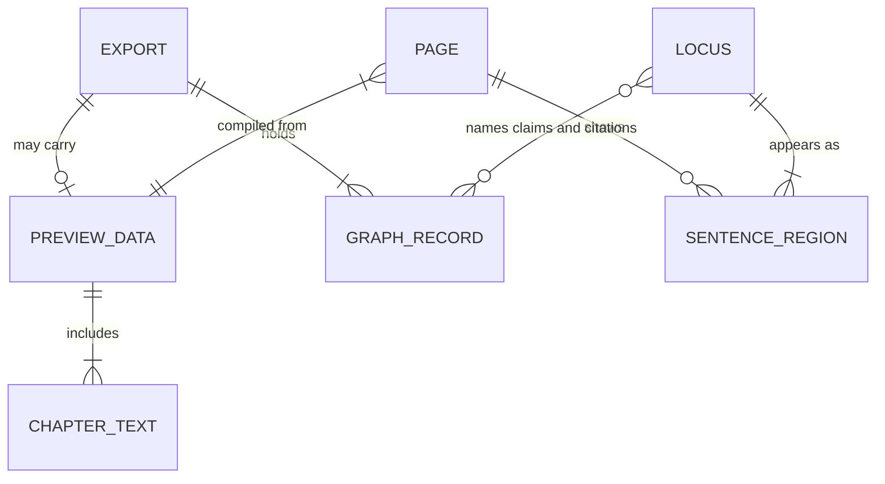
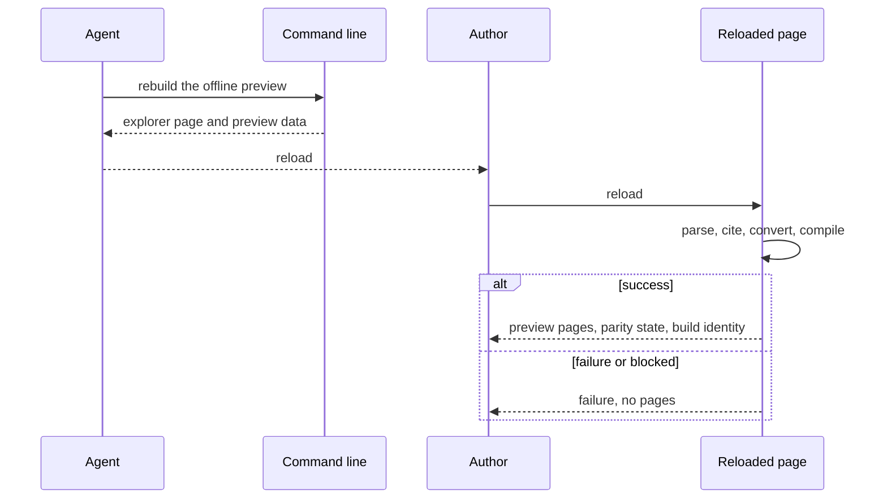

---
ddx:
  id: SD-012
  type: solution-design
  activity: design
  authoring:
    home: repo
  depends_on:
    - FEAT-012
    - stemma.architecture
    - stemma.adr-005
    - stemma.adr-006
    - stemma.adr-008
    - CONTRACT-005
    - CONTRACT-006
    - CONTRACT-002
    - SD-008
    - SD-011
  schemas:
    - id: stemma.record
      version: "0"
      title: Stemma records
      path: docs/stemma/02-design/contracts/schemas/stemma-record.umf.json
      schemaFormat: umf
---

# Solution Design: Explorer and Typeset Preview

**Feature**: FEAT-012 - Explorer and typeset preview | **Artifact**: `docs/stemma/02-design/solution-designs/SD-012-explorer-and-typeset-preview.md`

## Scope

- Delivery step M3: `packages/explorer`, its inputs, typeset pages, browser
  preview, and the reviewer's comment capture.
- Governed by the Architecture, ADR-005, ADR-006, ADR-008, CONTRACT-005, and
  CONTRACT-006 G and H.
- User views and transitions are in [UF-012](../flows/UF-012-explorer/UF-012.md).
- SD-011 owns the graph export and engine. SD-013 owns maps. SD-009 owns package
  contents and comment import.
- First work item: a browser Typst test with citeproc-js. Browser compilation
  has not been tried.

## Requirements Mapping

### Functional Requirements

| Requirement | Technical Capability | Component | Priority |
|---|---|---|---|
| EXP-01, EXP-02, EXP-03 (FR-64) | arras browser over the static client; folded search field | `explorer`, `graph` | P0 |
| EXP-04 (FR-64) | State shown on record views | `explorer`; computed at export | P0 |
| SRC-01 to SRC-04 (FR-64; FR-61) | One source view operation; a panel beside the browser; `excerpt` | `core`, `graph`, `explorer`, `cli` | P0 |
| MAN-01 to MAN-07 (FR-64; FR-61) | The report builder's segments as a derived manuscript view; a reading view that opens source views | `publish`, `core`, `graph`, `explorer`, `cli` | P0 |
| GRV-01 to GRV-04 (FR-64) | Larger connected view released in arras | arras contribution, `explorer` | P0 |
| TPG-01 to TPG-04 (FR-65) | Linked pages and a two-way locus map | `explorer`, `publish/convert` | P0 |
| PRV-01 to PRV-06 (FR-65) | Compile the rebuilt text in the browser | `explorer` preview, `cite`, `publish/convert` | P0 |
| BRW-01, BRW-02, BRW-06 (FR-76) | TypeScript bundle; single offline file; generated and untracked | `explorer`, `graph` | P0 |
| BRW-03, BRW-04 (FR-76) | No network; record text rendered as text | host page | P0 |
| BRW-05 (FR-76) | Page built only from the data it is given | `graph`, `explorer` | P0 |

### NFR Impact on Architecture

| NFR | Requirement | Architectural Impact | Design Decision |
|---|---|---|---|
| Accessibility | WCAG 2.2 AA; 0 axe-core violations; text for every page image, node, and link | Page images carry no text | A text layer from the document model beside each page; a list view beside the graph view |
| Security | 0 requests; 0 scripts run from record text | Untrusted text and generated SVG | Text nodes only; pages shown as images; a content security policy that denies connections |
| Verification | One core flow in a real browser from a local file | Test the built file | Playwright against `explorer.html` |
| Scale (assumption) | Unverified assumptions: 10,000 records open in 5 s, a record in 1 s; view draws more than 150 nodes | Data and compiler are inlined | Load the compiler only when pages are opened; measure |

## Solution Approaches

### Approach 1: Native Typst renders pages at each rebuild; the browser only shows them

**Pros**: No compiler in the page; same version as print; small page.
**Cons**: Does not compile Typst in the browser.
**Evaluation**: Rejected: it does not meet FR-65. No substitute is designed if the browser test fails; that returns to the product owner.

### Approach 2: The page compiles from rebuilt preview data

**Description**: The agent rebuilds data; the reloaded page runs the CONTRACT-006 reader, citeproc-js, the conversion, and a WebAssembly Typst compiler.
**Pros**: Meets FR-65 with one reader and conversion.
**Cons**: Large download, version match, security policy, and local-file loading are unproven.
**Evaluation**: Selected.

### Approach 3: A Stemma-only browser or graph canvas

**Pros**: No upstream dependency.
**Cons**: ADR-008 rejects a Stemma-only canvas, and FR-64 requires arras.
**Evaluation**: Rejected.

**Selected Approach**: Approach 2 on the arras static client.

**Architecture/ADR impact**: No module change. CONTRACT-005 J gives provisional
shapes for preview data, the sentence map, and computed states; this design may
extend them.

## Domain Model

These are derived and in memory or generated files; none is a record. A locus is
defined by CONTRACT-006 D.

### Business Rules

- **BR-1201** — The page reads only data it was built with or fetched from its own export. It computes no filtering and writes no record.
- **BR-1202** — Unreviewed, missing, stale, and other states are computed by `core` at export (CONTRACT-005 J) and shown as given; the page does not infer them. A support verdict is labelled a recorded model judgment.
- **BR-1203** — Only a claim anchor links a sentence to claims. A sentence without one shows no support indication. A citation alone is shown as a citation.
- **BR-1204** — Every line or page fragment of a linked sentence leads to the same locus. A locus with several claims offers all; a claim lists every locus. A broken target is reported.
- **BR-1205** — Preview pages are labelled previews. They are never written as build output and satisfy no check.
- **BR-1206** — The preview reports one of three states: differs from print, shown to match, or cannot tell. It says "match" only when the same inputs have a print reference, the compiler version matches the pin, and a tested comparison agrees. Until such a comparison exists, a version match gives "cannot tell" and a version mismatch gives "differs from print".
- **BR-1207** — A failed or blocked compile shows the failure and no earlier pages. An unsupported figure or construct is named, not dropped.
- **BR-1208** — An open page does not update. It shows the data identity (CONTRACT-005 J), which the rebuild report repeats; no export holds a time. After an edit the agent rebuilds and asks the author to reload.
- **BR-1209** — Record, source, and comment text is rendered as text, and inlined data is encoded so it cannot end its script block. Compiled SVG (Scalable Vector Graphics) is shown as an image with overlay links; no generated markup is injected.
- **BR-1210** — The connected view ships only from an arras release. It states omissions, opens a record from a node, and has a text list of its nodes and links.
- **BR-1211** — The reviewer page offers comments on claims, saves them as one CONTRACT-005 E2 file, and says that unsaved or unexported comments can be lost.
- **BR-1213** — Source text is highlighted only as CONTRACT-005 K allows. The page highlights only what a view cut as `quoted`, only when every view involved says `highlighted`, and never a view loaded for another record.
- **BR-1214** — A manuscript link or highlight comes only from the report builder's own data (CONTRACT-005 L): its segments, its note citations, and the formatter's entry IDs. Nothing is found by matching text. A quotation the builder refuses shows no text and no highlight.
- **BR-1212** — Built pages are optional (`built_pages[]`, CONTRACT-005 J): an author export includes them only when a native build exists for the same manuscript inputs. They are a linked rendering made apart from the print PDF, labelled Built with the build identity and watermark state. Otherwise the Built view is unavailable. Built pages never stand in for browser compilation.

## System Decomposition

### Component: Record browser (`packages/explorer`)

- **Purpose**: Browse and search.
- **Responsibilities**: Mount the arras browser on a static client; own routing that works from a local file; BR-1201, BR-1202, BR-1209.
- **Requirements Addressed**: EXP-01 to EXP-04, BRW-03, BRW-04.
- **Interfaces**: CONTRACT-005 D and F. Stemma views sit beside the browser through its `client` and `location` properties, which is untried.
- **Owned by TDs**: host page; record states; search.

Search uses the `searchText` field because arras does not fold diacritics. The
query needs the same folding: the host wraps the static client's `moduleQuery`
and folds the search text, so no arras change is needed for it.

**Built so far** (record browser and source panel). `packages/explorer` holds the
host, a banner, the source panel, and the template build; `packages/graph` fills
the template. The host leaves the arras `location` property uncontrolled, and
arras's own fragment routing works from a local file. arras node pages show
states and the support notice as ordinary properties (CONTRACT-005 F). The source
panel sits beside the browser, using the arras `parseExplore` and `onLocation`;
composing a view through the `client` or a controlled `location` property
remains untried. The banner is styled with Tailwind without its reset, under a
prefix. One style lets arras list badges wrap. Not built: the connected view,
pages, preview, maps, and comments. Support states are not computed, so EXP-04 is
partly met.

### Component: Source view (`core`, `graph`, `explorer`, `cli`)

- **Purpose**: A citation or passage shown in its source text.
- **Responsibilities**: `core` has one operation, `sourceView`, that decides the
  state, cuts the text, and gathers quality and original (CONTRACT-005 K,
  BR-1213). It reuses the passage address reader. `graph` writes the views of
  exported records within the audience and size rules; `cli` serves `excerpt`
  (CONTRACT-002 G) and alone looks for held originals; `explorer` shows them.
- **Requirements Addressed**: SRC-01 to SRC-04.
- **Interfaces**: `stemma.sourceview/0`. The panel takes a getter that returns a
  promise, so a later server can answer it with the same objects. The host reads
  the route with the arras `parseExplore` and its `onLocation` call, and leaves
  `location` uncontrolled, so arras keeps its own fragment routing.
- **Not built**: opening an original or page image. Report quotations and their
  places are shown by the manuscript browser; a Stemma manuscript copy is not.

### Component: Manuscript browser (`publish`, `graph`, `explorer`, `cli`)

- **Purpose**: The report, read in the page, with each quotation, note citation, and bibliography entry opening its source.
- **Responsibilities**: `publish` assembles the report once into blocks, notes, and quotations; `build report` writes its files from that assembly, and `manuscriptView` makes `stemma.manuscript/0` from it, collecting errors instead of stopping (CONTRACT-005 L). `core` defines the view's shape and makes each quotation's source view. `graph` writes the file, applies the cap and the coordinate scan, digests it, and covers the report inputs in the data identity, taking the view through a port, since it imports only `records` and `core`; `cli` composes them. `workspace` reads the report inputs without following links. `explorer` renders the view and reuses the source panel's components.
- **Requirements Addressed**: MAN-01 to MAN-07.
- **Interfaces**: CONTRACT-005 L; routes `#/manuscript`, `#/manuscript/quotation/<id>`, `#/manuscript/citation/<note>/<index>`, and `#/manuscript/source/<source id>`. The record browser is not mounted while the manuscript is shown, so arras routing is untouched. A later server serves the same view.
- **Not built**: a Stemma manuscript copy, originals, and the printed PDF.

### Component: Connected view (arras contribution)

- **Purpose**: A larger view of connected records.
- **Responsibilities**: BR-1210. Specified and released with arras; Stemma supplies synthetic cases.
- **Requirements Addressed**: GRV-01 to GRV-04.
- **Interfaces**: arras component. No private fork. Until a release holds it, the explorer has no connected view and FR-64 is incomplete.

### Component: Preview data (`packages/graph` with `publish`)

- **Purpose**: Everything the page needs to compile, produced by a rebuild.
- **Responsibilities**: Package manuscript files, the deterministic citation projection, style, locale, pinned fonts and packages, figure bytes for the audience, built pages and print reference data (BR-1212), and computed record states. Filtering happens here.
- **Requirements Addressed**: TPG-01, PRV-01, PRV-06, BRW-05, BRW-06.
- **Interfaces**: Writes the CONTRACT-005 J files. `graph` receives the citation projection and built pages through `core` ports, never by importing `cite` or `publish`; only `cli` composes them.

### Component: Compile and page view (`packages/explorer`)

- **Purpose**: Preview pages and sentence links.
- **Responsibilities**: In order: parse (`manuscript`), format (`cite`), convert (`publish/convert`), compile (WebAssembly compiler in a worker if the policy allows), draw pages, extract link regions into the two-way map, add the text layer; BR-1203 to BR-1208.
- **Requirements Addressed**: TPG-01 to TPG-04, PRV-01 to PRV-05.
- **Interfaces**: CONTRACT-006 H (linked build, flattened nested links, hanging punctuation off).
- **Owned by TDs**: compiler loading; link regions; parity comparison; text layer.

### Component: Comment capture (`packages/explorer`)

- **Purpose**: Reviewer comments without a server.
- **Responsibilities**: BR-1211.
- **Requirements Addressed**: FEAT-009 COM-01, COM-02.
- **Interfaces**: CONTRACT-005 E2. Saving from a local page is untested.

### Component Interactions

## Technology Rationale

| Layer | Choice | Why | Alternatives Rejected |
|---|---|---|---|
| Browser compiler | A WebAssembly Typst compiler; the packaging is chosen by the first test | FR-65 | Native page images only (Approach 1); Typst HTML export, which research reading found experimental and unpaged |
| Page display | SVG pages as images with link overlays and a text layer | Keeps generated markup out of the document; worked for 43 synthetic sentences with native Typst | Inline SVG (injection); the browser's PDF viewer (research reading: blocked by the arras policy) |
| Search, browse, data | arras static client | ADR-006, ADR-008 | Second data layer |
| Styling | Tailwind for Stemma views, alongside arras styles | HELIX React guideline; arras components keep their own styles | A second component library |

Research reading, unverified: one browser compiler build is about 28 MB before
encoding, and its packaged release used an older Typst than the pinned 0.15.1.

## Traceability

| Requirement ID | Component | Design Element | Test Strategy |
|---|---|---|---|
| EXP-01, EXP-02 | Record browser | arras client | Playwright browse, search, back |
| EXP-03 | Record browser, export | Folded search | Diacritic cases in both record and query |
| EXP-04 | Record browser | BR-1202 | Seeded stale, missing, and unreviewed states; label text |
| SRC-01, SRC-02 | Source view | BR-1213 | Every state; pages across a break; notes; characters outside the basic plane; changed page; local-file flow |
| SRC-03, SRC-04 | Source view | CONTRACT-005 K | Stale and model reviews; hostile text; local paths withheld; no request; excerpt limits |
| MAN-01 to MAN-07 | Manuscript browser | BR-1214 | Byte-identical `report.md`; every link checked against the builder's data; a changed passage, no passage, a letter, hostile text, local path, retired record, coordinate; staleness; local-file and narrow-screen flows |
| GRV-01 to GRV-04 | Connected view | BR-1210 | 600 synthetic nodes; omission notice; keyboard; dependency inspection |
| TPG-01 to TPG-04 | Page view | BR-1203, BR-1204 | Both directions across line, page, and footnote splits; unlinked sentence; screen reader by hand |
| PRV-01, PRV-06 | Preview data, compile | BR-1208 | Edit, rebuild, reload from local file |
| PRV-02 | Compile | citeproc-js before layout | Change a locator; compare citation text with the native build |
| PRV-03 | Compile | BR-1206 | Seeded difference; no reference; version mismatch |
| PRV-04 | Compile | BR-1205 | Release state shows no build output |
| PRV-05 | Compile | BR-1207 | Blocked and failing compiles |
| BRW-01, BRW-02 | Bundle | Single file | Source inspection; local-file flow with network off |
| BRW-03, BRW-04 | Host page | BR-1209 | Request monitor; hostile record and comment fixtures |
| BRW-05 | Preview data | BR-1201 | Filtered input; seeded absent source not found in the file |
| BRW-06 | Export | CONTRACT-005 C | Fresh clone rebuild; git status clean |

### Experience Traceability

FEAT-012 has no Task Model; task names come from the UF-012 journeys.

| Need | Task | Flow | View |
|---|---|---|---|
| Not mapped | Find and follow records | UF-012 | UF-012-01-record-browser |
| Not mapped | Use the larger graph | UF-012 | UF-012-02-connected-graph |
| Not mapped | Sentence to evidence and back | UF-012 | UF-012-03-page-reader, UF-012-04-sentence-trail |
| Not mapped | Edit, rebuild, reload | UF-012 | UF-012-06-rebuild-turn, UF-012-03-page-reader |
| Not mapped | Comment, save, send and import | UF-012 | UF-012-05-comment-file, UF-012-07-comment-import-turn |

### Gaps

- [ ] No PRD User Needs row is mapped to a UF-012 task, because neither FEAT-012 nor the PRD links them.
- [ ] The CONTRACT-005 J shapes are provisional; the command is `graph export --page`.
- [ ] Search lists at most 50 results, and 50 of a type, from 20 types (CONTRACT-005 G). A citation record that names a key and no passage has no link to its source, because a key is not a reference field.
- [ ] The record browser has run only in headless Chromium on one macOS system; other browsers, systems, and desktop hosts are untested.
- [ ] Layout parity method is untested; until proven, no page is shown as matching.
- [ ] A fresh-clone export without the author's image files lacks figure bytes; the page names what is missing.

## Concern Alignment

- **Concerns used**: `react-vite` (client only; overrides for routing and no backend), `typescript-bun`, `hexagonal-architecture`, `modularity-and-encapsulation` (allowed imports as in the Architecture), `a11y-wcag-aa`, `e2e-playwright`, `typesetting-fidelity`, `family-reuse`, `security-owasp`, `rights-and-permissions`, `honest-assurance`, `plain-file-graph`, `cross-platform`.
- **Constraints honored**: Tests and axe-core run locally and on release tags, advisory (ADR-007).
- **ADRs referenced**: ADR-005, ADR-006, ADR-008, ADR-009.
- **Departures**: None.

## Constraints & Assumptions

- **Constraints**: No backend. Anyone with a file sees everything in it. Writes are refused; edits go to records.
- **Assumptions**: The arras browser accepts a Stemma host page and external routing; the compiler can run from one local file under a policy that still denies network connections. If either is false, the design must change.
- **Dependencies**: arras 0.8.1 or a later pinned release, citeproc-js (license review open), a browser Typst compiler, SD-008, SD-011.

## Risks

| Risk | Prob | Impact | Mitigation |
|---|---|---|---|
| Browser compilation is blocked, too large, or cannot start from a local file | H | H | Test first, before other preview work; report to the product owner |
| Compiler version differs and layout drifts from print | M | H | BR-1206 flags it |
| arras does not accept the view, or later than planned | H | M | Ship browsing and pages without claiming FR-64 complete |
| Views cannot be composed beside the arras browser | M | H | Try early; request an extension point upstream |
| A relaxed policy for WebAssembly or inline script weakens injection defence | M | H | Smallest allowance; text-only rendering; hostile fixtures |
| The page shows earlier text after an edit | H | M | BR-1208 |
| The author export holds passage text, unpublished material, and unmarked places | M | H | State this where it is exported |
| Only headless Chromium on one macOS system was tried, with synthetic data; other browsers and systems are untested | H | M | Name untested browsers; claim only observed ones |

## Open Questions

- [ ] What graph size must the larger view handle? Product owner. Blocks GRV-01 acceptance and the arras contribution.
- [ ] Does the reviewer's offline explorer include typeset pages or live preview, and which source text? Product owner. Blocks BRW-05. Preview data carries manuscript text and fonts, so it affects redaction, font licences, and size.

## Schema Basis

The graph module is the CONTRACT-005 projection of the CONTRACT-001 Unified
Modeling Fabric (UMF) source into the subset arras reads (core 0.10.0,
`umf.ddd` 0.1.0, `arras.view`), with its stated losses. It is reused unchanged.
Preview data and computed states have provisional shapes in CONTRACT-005 J. UMF domain packs were not searched for them. Load evidence and limits
are in the CONTRACT-005 Proof Status.
