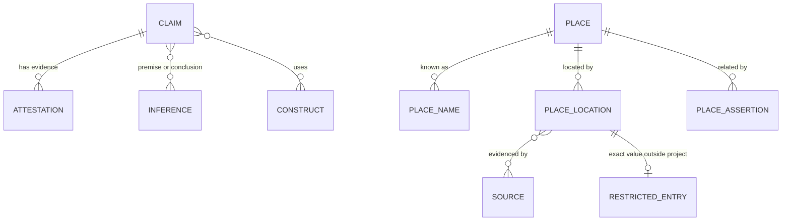
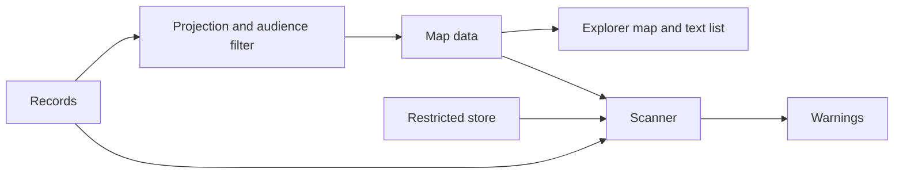

---
ddx:
  id: SD-013
  type: solution-design
  activity: design
  authoring:
    home: repo
  depends_on:
    - FEAT-013
    - stemma.architecture
    - CONTRACT-001
    - CONTRACT-002
    - CONTRACT-005
    - SD-005
    - SD-011
    - SD-012
  schemas:
    - id: stemma.record
      version: "0"
      title: Stemma records
      path: docs/stemma/02-design/contracts/schemas/stemma-record.umf.json
      schemaFormat: umf
---

# Solution Design: Argument and Geographic Maps

**Feature**: FEAT-013 - Argument and geographic maps | **Artifact**: `docs/stemma/02-design/solution-designs/SD-013-argument-and-geographic-maps.md`

## Scope

- Delivery step M3: place records' behaviour, two view-only maps, restricted
  locations, and the coordinate scan (`scan release`, M3 in CONTRACT-002 and the
  PRD).
- Governed by the Architecture, ADR-002, ADR-008, CONTRACT-001 H, CONTRACT-002,
  and CONTRACT-005 E.
- User views and transitions are in [UF-013](../flows/UF-013-maps/UF-013.md).
- Claims and relations come from SD-005; export from SD-011; the host page from
  SD-012; packaging from SD-009.
- Restriction protects only locations marked restricted. Stray coordinates are
  reported only.

## Requirements Mapping

### Functional Requirements

| Requirement | Technical Capability | Component | Priority |
|---|---|---|---|
| PLC-01 to PLC-04 (FR-81) | Place, name, location, and assertion records; restriction marks | `core` places | P0 |
| ARG-01 to ARG-05 (FR-66) | Scoped argument projection from stated relations | `graph` projection | P0 |
| ARG-03, ARG-06, ARG-07 (FR-66) | View-only drawing with a text equivalent | `explorer` | P0 |
| GEO-01 to GEO-05 (FR-67) | Place projection with per-assertion source and uncertainty | `graph`, `explorer` | P0 |
| GEO-06, GEO-07 (FR-67) | Bundled background with recorded licence | `explorer` | P0 |
| LOC-01 to LOC-04, LOC-08 (FR-68, FR-81) | Outside store; removal before writing; public default stated | `core`, `workspace`, `graph` | P0 |
| LOC-05, LOC-06, LOC-09 (FR-68) | Warning scan that states its coverage | `core` scanner | P0 |

### NFR Impact on Architecture

| NFR | Requirement | Architectural Impact | Design Decision |
|---|---|---|---|
| Security | 0 seeded structured restricted coordinates in map data, output, or repository | Exact values never enter records or projections | Projection never reads the restricted store (BR-1307) |
| Scan coverage | Every seeded item of a stated form is reported | The coverage list and recognizers stay together | The result carries the checked file kinds and forms |
| Privacy | 0 network requests while viewing | No tiles or lookups | All geometry and libraries inlined |
| Accessibility | WCAG 2.2 AA; text for every item, link, uncertainty, and mark | Drawings cannot be the only form | A keyboard-reachable list equal to the drawn set |
| Reliability | Same records and tools give the same items and links | Deterministic projection | Fixed ordering; layout is not compared |
| Performance | No target | N/A | Scope by chapter or branch |

## Solution Approaches

### Approach 1: The page derives maps from the exported graph

**Pros**: No extra data file.
**Cons**: Review state and staleness depend on digests and rules in `core`, which the explorer may not import. Filtering by display would break LOC-04.
**Evaluation**: Rejected.

### Approach 2: `graph` projects map data at export; the page only draws

**Pros**: One filtering point before any write; pure, testable projection.
**Cons**: Map data needs a contract surface; maps change only after re-export.
**Evaluation**: Selected.

### Approach 3: An external or editable mapping tool

**Pros**: Rich interaction.
**Cons**: No family tool offers either projection (research reading), editing is parked, and tile services disclose what is viewed.
**Evaluation**: Rejected.

**Selected Approach**: Approach 2, with maps composed inside the explorer.

**Architecture/ADR impact**: No module change. Map data is the provisional `stemma.maps.json` of CONTRACT-005 J, filtered by audience before writing.

## Domain Model

All are CONTRACT-001 shapes; `RESTRICTED_ENTRY` is its restricted-store file.
Evidence may also be a passage.

### Business Rules

- **BR-1301** — Chapter scope is the claims that name the chapter or are anchored in its manuscript text (assumption). Branch scope is a chosen claim with the premises that reach it through inferences. Linked evidence, inferences, rival readings, and constructs come with them; the thesis is included when connected, otherwise listed as unconnected.
- **BR-1302** — A map draws only stated relations. Support, contradiction, qualification, context, attack, and undercut stay distinct. Several premises of one inference are drawn as joint support through one node; an undercut points at an inference. Nothing is inferred from text or proximity.
- **BR-1303** — Records in effect are drawn; unreviewed ones are marked. For each link the map shows the facts known: attestation or inference, review state, support record present, stale, or absent. Which of these mean "unverified" is open; until decided the map marks a link that has no current supporting record and names the reason (assumption).
- **BR-1304** — Kinds differ by shape, line style, and text label, never by color alone. An empty scope says why. Selecting an item opens its record. There is no edit action.
- **BR-1305** — Each location assertion is drawn separately with its source, certainty, method, and stated uncertainty. A missing uncertainty distance is shown as unstated, never as exact. Disagreeing assertions are never merged or averaged.
- **BR-1306** — Assertions with no source, no geometry, or withheld geometry are listed with the reason and not positioned. A name is never geocoded. The background never implies site-level accuracy.
- **BR-1307** — A restricted location contributes nothing or its author-set broad area. Export and maps never read the restricted store, so they work when it is absent. Exact geometry wrongly held on a restricted record is omitted and reported.
- **BR-1308** — A location with no restriction mark is public, drawn, and exported, whether or not anyone has reviewed it. Stemma says so where places are recorded. Anyone may mark a location restricted, effective at once; only a `person` actor may make it public (CONTRACT-001 H). This is a record rule, not access control.
- **BR-1309** — Saving a restricted exact value writes it only to the restricted store. No tracked or derived file receives it or a hash of it. Git history and earlier outputs may already hold a value marked late, and Stemma says so at marking. The agent may read the store when a task needs exact coordinates, which sends them to its model. The mark applies to a location: place names, gazetteer identifiers, relations such as near, another public location, and prose can still disclose the site.
- **BR-1310** — Assistant-added places, names, locations, and assertions are in effect at once, unreviewed.
- **BR-1311** — The scan reports, with file and position and without repeating the value: restricted-store values and listed strings (`restricted.leak`), and text matching a stated coordinate form, including coordinates that may be public (`coordinate.stray`). It states file kinds and forms checked and files not read, and says a clean result is no proof. Without the store, the restricted-value part is unverifiable.
- **BR-1312** — A scan finding stops no build, export, or package. The warning says the output can disclose a site; a packaged copy gives no location.

## System Decomposition

### Component: Place operations (`packages/core`, `packages/workspace`)

- **Purpose**: Record places and restrictions.
- **Responsibilities**: BR-1308 to BR-1310.
- **Requirements Addressed**: PLC-01 to PLC-04, LOC-01, LOC-02, LOC-08.
- **Interfaces**: `RecordRepository`, `RestrictedStore`. `restricted set`, `restricted get`, and `restricted mark` (CONTRACT-002 B). A value an agent enters or reads passes through the model session.

### Component: Map projection (`packages/graph`)

- **Purpose**: Pure, filtered map data for an audience and scope.
- **Responsibilities**: BR-1301 to BR-1303, BR-1305 to BR-1307. States come from `core`.
- **Requirements Addressed**: ARG-01, ARG-02, ARG-04, ARG-05, GEO-01 to GEO-05, LOC-03, LOC-04.
- **Interfaces**: records and `core`; writes `stemma.maps.json` (CONTRACT-005 J).
- **Owned by TDs**: argument projection; place projection.

### Component: Map views (`packages/explorer`)

- **Purpose**: Draw and list.
- **Responsibilities**: BR-1304; lay out arguments; project geography; provide equal text lists; bundle background data with a record of source, version, and licence.
- **Requirements Addressed**: ARG-03, ARG-06, ARG-07, GEO-06, GEO-07.
- **Interfaces**: arras `client` and `location` properties (untried), SD-012 host page.

### Component: Coordinate scanner (`packages/core`)

- **Purpose**: Warn of coordinates in tracked files and outputs.
- **Responsibilities**: BR-1311, BR-1312.
- **Requirements Addressed**: LOC-05, LOC-06, LOC-09.
- **Interfaces**: `scan release`, `restricted.leak` for restricted values, and `coordinate.stray` for other coordinate-shaped text (CONTRACT-002); `RestrictedStore`, `TextExtractor` for PDF output; also called by export and packaging.

### Component Interactions

## Technology Rationale

Proposed; versions are pinned at implementation, and licences are from research
reading and need checking.

| Layer | Choice | Why | Alternatives Rejected |
|---|---|---|---|
| Argument layout | dagre with Stemma-drawn SVG | Small, layered layout, MIT | ELK (EPL or GPL terms to review); Cytoscape (extra work for vector output) |
| Geography | d3-geo drawing SVG | Needs no tiles or WebGL; ISC | MapLibre (WebGL and workers under a strict page policy); Leaflet or OpenLayers (more than overlays require) |
| Background | Bundled coarse Natural Earth outlines | Research reading: public domain and small | Online tiles (disclose viewing, break offline); OpenStreetMap extracts (share-alike duties to review) |

## Traceability

| Requirement ID | Component | Design Element | Test Strategy |
|---|---|---|---|
| PLC-01, PLC-02 | Place operations | CONTRACT-001 records | Place with two names and a sourced location |
| PLC-03, LOC-08 | Place operations | BR-1308 | Unmarked place exports; notice shown |
| PLC-04 | Place operations | BR-1308, BR-1310 | Added place drawn and marked unreviewed; restriction immediate; a change to public by a model or software actor is reported as invalid |
| ARG-01, ARG-02 | Projection | BR-1301 | Two-chapter fixture with every kind; audit rival reading without FR-26 |
| ARG-03, ARG-06, ARG-07 | Views | BR-1304 | Grayscale, no edit path, record open, keyboard and screen reader |
| ARG-04 | Projection | BR-1303 | Seeded missing and stale support |
| ARG-05 | Projection | BR-1302 | Unrelated claims get no link |
| GEO-01 to GEO-04 | Projection, views | BR-1305 | Disputed place with two sources and uncertainty |
| GEO-05 | Projection | BR-1306 | Name-only and untraced cases listed |
| GEO-06 | Views | Inlined assets | Request monitor while panning and zooming |
| GEO-07 | Views | Background record | Inspect source and licence |
| LOC-01, LOC-02 | Place operations | BR-1309 | Search files, history of the test repository, and hashes for a synthetic value |
| LOC-03, LOC-04 | Projection | BR-1307 | Search data files, with and without the store |
| LOC-05, LOC-06 | Scanner | BR-1311 | Seeded set per stated form; repeat run equal; coverage and limit text |
| LOC-09 | Scanner | BR-1312 | Prose coordinate; camera-ready, export, and package are produced with warning |

### Experience Traceability

FEAT-013 has no Task Model; task names come from the UF-013 journeys.

| Need | Task | Flow | View |
|---|---|---|---|
| Not mapped | See support and challenge | UF-013 | UF-013-01-argument-map |
| Not mapped | See sources and disagreement | UF-013 | UF-013-02-places-map |
| Not mapped | Confirm nothing exact is shown | UF-013 | UF-013-02-places-map |

### Gaps

- [ ] The restriction mark is on each location (PRD FR-81, CONTRACT-001 H), and `place` has no such field. So one public location, a gazetteer identifier, a name, or a "near" assertion can disclose a place whose other location is restricted; the mark does not cover them.
- [ ] US-097, US-098, and US-105 work (marking, scanning, recording places) happens through the agent or commands; UF-013 has no view for recording or scanning. No PRD User Needs row is mapped to a task.
- [ ] Printed map figures are out of scope.

## Concern Alignment

- **Concerns used**: `rights-and-permissions`, `honest-assurance`, `a11y-wcag-aa`, `plain-file-graph`, `deterministic-checks`, `security-owasp`, `hexagonal-architecture`, `modularity-and-encapsulation`, `family-reuse`, `e2e-playwright`, `react-vite` (client only), `cross-platform`, `testing` (synthetic coordinates only).
- **Constraints honored**: Public unless marked; warn without blocking.
- **ADRs referenced**: ADR-002, ADR-007, ADR-008.
- **Departures**: None.

## Constraints & Assumptions

- **Constraints**: View-only; no online geocoding or tiles.
- **Assumptions**: Initial scan forms are decimal-degree pairs and degree-minute-second text in readable text files and extractable PDF text; images are not checked. Coarse outlines suffice for a first version.
- **Dependencies**: SD-005, SD-011, SD-012; the three libraries and data above.

## Risks

| Risk | Prob | Impact | Mitigation |
|---|---|---|---|
| A restricted site nobody marked is shown, exported, committed, and packaged | M | H | State the default where recorded (BR-1308); later marking does not recall shared copies |
| A stray coordinate reaches a book or package despite the warning | M | H | Prominent warning with location; reported only, by decision |
| Prose, place names, relations, images, gazetteer identifiers, git history, or earlier model input disclose a site | H | H | State the limits; author review |
| The scan misses a form (other grids, split text, images, compressed data) or flags many ordinary numbers | H | M | State forms checked; test on pilot text; scan page data before encoding |
| A large argument map is unreadable; a synthetic 300-claim map was | H | M | Scope by chapter or branch |
| Coarse borders or detail mislead readers or concern a press | M | M | Label the background's source and resolution |
| Views cannot be composed with arras; prototypes ran only in headless Chromium on one macOS system | M | H | Try composition early with SD-012 |

## Open Questions

- [ ] Which states make a link unverified? Product owner. Blocks ARG-04.
- [ ] When is a broad area shown instead of nothing, and how broad may it be? Product owner. Blocks LOC-03.
- [ ] What does the release scan cover? Product owner. Blocks LOC-05.
- [ ] Is the default location of the outside coordinate store (CONTRACT-001 H) acceptable? Design owner.

## Schema Basis

Inspected: the CONTRACT-001 Unified Modeling Fabric (UMF) source, core 0.10.0
with the `umf.ddd` 0.1.0 extension. Its place records and geometry values are
reused; WGS 84 (World Geodetic System) positions follow CONTRACT-001 H. Map data
is a derived projection specified provisionally in CONTRACT-005 J, with no second record
schema. UMF domain packs were not searched for map shapes. Limits are in the
CONTRACT-001 and CONTRACT-005 Proof Status.
