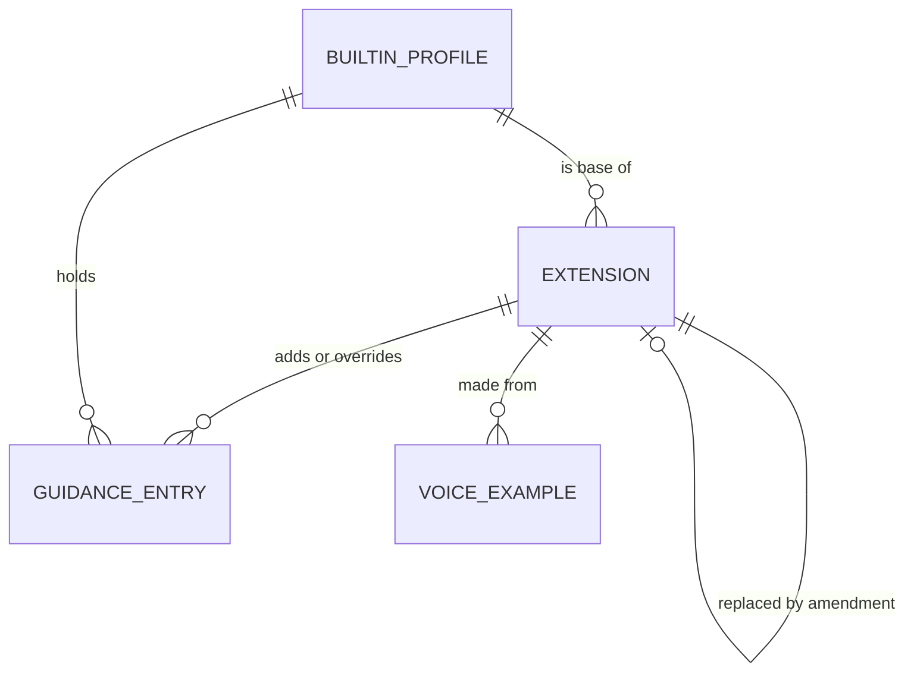
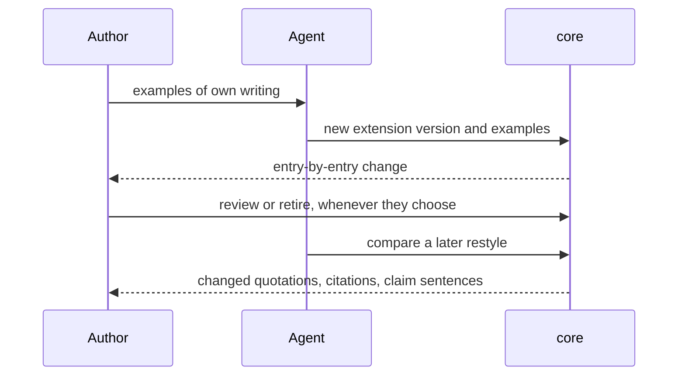

---
ddx:
  id: SD-014
  type: solution-design
  activity: design
  authoring:
    home: repo
  depends_on:
    - FEAT-014
    - stemma.architecture
    - CONTRACT-001
    - CONTRACT-004
    - CONTRACT-006
    - SD-001
  schemas:
    - id: stemma.record
      version: "0"
      title: Stemma records
      path: docs/stemma/02-design/contracts/schemas/stemma-record.umf.json
      schemaFormat: umf
---

# Solution Design: Voice and Style

**Feature**: FEAT-014 - Voice and Style | **Artifact**: `docs/stemma/02-design/solution-designs/SD-014-voice-and-style.md`

## Scope

- Delivery step M2: shipped profiles, extension, and amendment from the author's
  writing.
- Governed by the Architecture, ADR-002, ADR-009, and CONTRACT-001, 004, and
  006.
- Citation style is a separate project setting handled by SD-008. SD-006 applies
  the effective profile.

## Requirements Mapping

### Functional Requirements

| Requirement | Technical Capability | Component | Priority |
|---|---|---|---|
| PRO-01 (FR-69) | Read-only profiles shipped in the plugin | Plugin files | P0 |
| PRO-02 (FR-69) | Project extension layered on a pinned built-in | `core` resolution | P0 |
| PRO-03 (FR-69) | Profile data shares no field with citation style | `records` | P0 |
| AMD-01, AMD-02 (FR-70) | A change from examples takes effect at once, unreviewed; examples are saved | `voice` mode, `core` | P0 |
| AMD-03 (FR-70) | Fixed precedence rule and a before-and-after comparison | `voice` and `draft` modes, `core` | P0 |

### NFR Impact on Architecture

| NFR | Requirement | Architectural Impact | Design Decision |
|---|---|---|---|
| Reliability | Shipped profiles leave 100% of quotation text identical on a seeded passage | Quotation comparison must be scripted | Compare parsed quotations before and after with the CONTRACT-006 reader (BR-1406) |
| Compatibility | A plugin update changes 0 author files | Built-ins are never copied over author data | Built-ins stay in the plugin; extensions stay in records (BR-1402) |
| Rights | Only needed excerpts go to a model | Restyle and amend send passages | Send the passage in hand and the author's examples only |
| Performance, Scalability | No target | N/A | N/A |

## Solution Approaches

### Approach 1: Copy a built-in into the project and edit it

**Pros**: One file, easy to read.
**Cons**: The built-in and the author's changes merge into one text. An update cannot be compared or applied without overwriting.
**Evaluation**: Rejected: PRO-02 and the compatibility requirement need separation.

### Approach 2: Shipped base plus project extension

**Description**: The effective profile is computed from a pinned base and the current extension.
**Pros**: Built-ins stay intact, and update conflicts are detectable.
**Cons**: Needs guidance entries with stable identifiers and a resolution rule.
**Evaluation**: Selected.

### Approach 3: Keep preferences in `rules.md`

**Pros**: No new shape.
**Cons**: Standing rules have no layering or review state, and reports cite them as rules.
**Evaluation**: Rejected.

**Selected Approach**: Approach 2.

**Architecture/ADR impact**: No module change. Profiles and examples are CONTRACT-001 records reached through `voice record` and `voice compare`; shipped profiles sit at `skills/stemma/voices/` in the CONTRACT-004 plugin layout.

## Domain Model

An amendment is a successor of the extension. The extension is
a project record; the built-in is a plugin file.

### Business Rules

- **BR-1401** — A project may use no profile, one built-in, or one built-in with one extension (assumption: one profile per project). With none, drafting proceeds. The shipped built-ins are a neutral academic profile and a few humanities variants.
- **BR-1402** — Built-ins are read-only. An extension records its base's identity and content digest. Updating the plugin writes no project file.
- **BR-1403** — When the shipped base's digest differs from the recorded one, the author is told. An entry that overrides a missing base entry is reported and left out until revised (assumption).
- **BR-1404** — An amendment is a new `voice_profile` version that shows the change entry by entry and takes effect at once, unreviewed; its examples are saved as `voice_example` records. The author may review it or retire it, which restores the earlier version. An AI change to a reviewed version makes it unreviewed; the author's own edits keep it reviewed (CONTRACT-001 G).
- **BR-1405** — Quoted words in an example are excluded from what is learned, and the author is told. Other quotation conventions in pasted text may go undetected. Conflicts among examples, or with the profile, are named for the author to settle. That examples are the author's own writing is the author's statement.
- **BR-1406** — Quotations and claim assertions outrank every profile entry; an entry or amendment asking to change either is not followed for that text. After a restyle, `core` compares quotations, citation items, and claim anchors before and after. It reports each quotation, key, locator, or anchor difference and lists every changed sentence inside a claim anchor.
- **BR-1407** — The comparison reports. The author and the claim-support check judge meaning. Rewording a sentence leaves its support record current while the claim record is unchanged (FR-54).
- **BR-1408** — A profile holds no citation-style setting, and changing either leaves the other unchanged.
- **BR-1409** — A change records model and prompt version. Drafting records the profile's identity and digest (SD-006 BR-609).

## System Decomposition

### Component: Shipped profiles (plugin files)

- **Purpose**: Starting points usable without writing one.
- **Responsibilities**: Versioned, read-only guidance files with stable entry identifiers and original or openly licensed text.
- **Requirements Addressed**: PRO-01.
- **Interfaces**: `skills/stemma/voices/<profile id>/<version>.md` (CONTRACT-004 A). Which profiles ship is open.

### Component: Profile resolution and comparison (`packages/core`)

- **Purpose**: Compute the effective profile and compare a restyle.
- **Responsibilities**: BR-1401 to BR-1404 and BR-1406 to BR-1408. The same inputs give the same effective profile.
- **Requirements Addressed**: PRO-02, PRO-03, AMD-02, AMD-03.
- **Interfaces**: `RecordRepository`, `ManuscriptRepository`; plugin files are read by an adapter that `cli` composes. Surfaces: `voice record` and `voice compare` (CONTRACT-002 B), used by the `voice` mode (CONTRACT-004 B).
- **Owned by TDs**: resolution; comparison.

### Component: `voice` mode (`skills/stemma`)

- **Purpose**: Choose, extend, and amend.
- **Responsibilities**: BR-1405, BR-1406, BR-1409; treat examples as data, never as instructions.
- **Requirements Addressed**: AMD-01 to AMD-03.
- **Interfaces**: CONTRACT-004.

### Component Interactions

## Technology Rationale

N/A — guidance text and records only; no model training or new library.

## Traceability

| Requirement ID | Component | Design Element | Test Strategy |
|---|---|---|---|
| PRO-01 | Shipped profiles | BR-1401 | A new project resolves a built-in |
| PRO-02 | Resolution | BR-1402, BR-1403 | Extend, update a fixture base, compare author files byte for byte |
| PRO-03 | Records | BR-1408 | Change each setting and diff the other |
| AMD-01 | `voice` | BR-1405 | Example with a quotation reports the exclusion; examples saved; live session |
| AMD-02 | Resolution | BR-1404 | A change applies at once, shows as unreviewed, and retirement restores the earlier version |
| AMD-03 | Comparison, modes | BR-1406, BR-1407 | Seeded altered quotation and locator are reported. Restyle with each shipped profile by hand in a live session; no paid calls in automation |

### Gaps

- [ ] The comparison cannot prove in advance what a profile will do. The 100% quotation requirement is observed per run.
- [ ] No script proves that a claim's meaning survived a rewrite.
- [ ] The voice record shapes (CONTRACT-001) and the shipped-profile file format are minimal and untested.
- [ ] Learning from examples was not tested; whether drafts move closer to the author is unknown.

## Concern Alignment

- **Concerns used**: `honest-assurance`, `ai-disclosure`, `plain-file-graph`, `rights-and-permissions`, `security-owasp`, `citation-integrity`, `deterministic-checks`, `hexagonal-architecture`, `plugin-distribution`, `testing`.
- **Constraints honored**: Voice sources are built-ins and the author's own writing only.
- **ADRs referenced**: ADR-002, ADR-007, ADR-009.
- **Departures**: None.

## Constraints & Assumptions

- **Constraints**: Profiles diff and merge as text.
- **Assumptions**: One profile per project; per-chapter voices would need a revision. Saved examples are the author's own writing, committed with the project, so anyone with the repository can read them.
- **Dependencies**: SD-001, SD-006; the session's hosted model.

## Risks

| Risk | Prob | Impact | Mitigation |
|---|---|---|---|
| A rewrite strengthens or softens a claim, and support stays current | M | H | List changed claim sentences (BR-1406); state the limit |
| A quotation outside the detected forms, such as unmarked single quotes, changes unreported | M | H | Mark quotations; state the reader's limit |
| The agent edits prose without running the comparison | M | M | Instruction only; attributed quotations are still checked at build |
| Saved examples expose private writing to anyone with the repository | M | M | Say so when saving; the author chooses the examples |

## Open Questions

- [ ] Which humanities variants ship beside the neutral academic profile? Product owner.

## Schema Basis

Inspected: the CONTRACT-001 Unified Modeling Fabric (UMF) source, core 0.10.0
with the `umf.ddd` 0.1.0 extension. Its `voice_profile` and `voice_example`
kinds are reused; this design defines no fields. UMF domain packs were not
searched. The shipped-profile file format is not yet defined. Limits are in the
CONTRACT-001 Proof Status.
