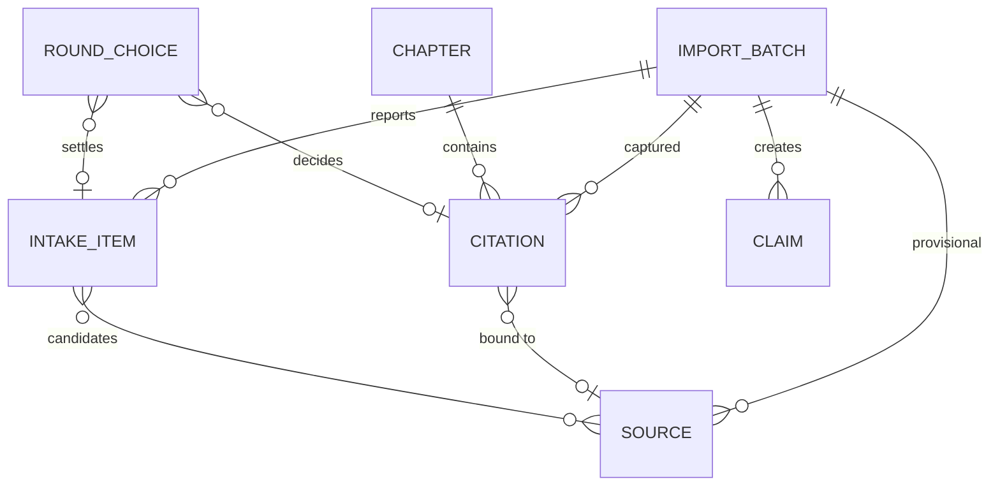
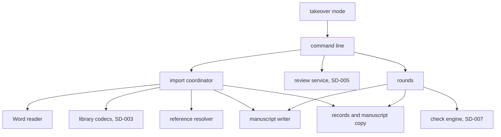

---
ddx:
  id: SD-015
  type: solution-design
  activity: design
  authoring:
    home: repo
  depends_on:
    - FEAT-015
    - stemma.architecture
    - stemma.data-design
    - stemma.concerns
    - stemma.adr-002
    - stemma.adr-009
    - CONTRACT-001
    - CONTRACT-002
    - CONTRACT-003
    - CONTRACT-004
    - CONTRACT-006
    - SD-001
    - SD-003
    - SD-005
    - SD-007
  schemas:
    - id: stemma.record
      version: "0"
      title: Stemma records
      path: docs/stemma/02-design/contracts/schemas/stemma-record.umf.json
      schemaFormat: umf
---

# Solution Design: Takeover of existing projects

**Feature**: [[FEAT-015]] | **Artifact**: `docs/stemma/02-design/solution-designs/SD-015-takeover-of-existing-projects.md`

## Scope

- Covers Word intake, the Stemma copy, the unverified graph, and resolution rounds (FR-71 to FR-73), then construct and methodology suggestions (FR-82).
- **Pilot (M1)**: everything except suggestions (**M2**). The pilot's basic PDF is SD-008.
- Depends on SD-003 (library codecs, source records), SD-005 (review service), SD-007 (checks, annotations), and the CONTRACT-006 reader and edits. SD-002 captures sources. A project must be initialized first, which the takeover mode does when needed (SD-001).
- CONTRACT-003 owns intake behavior and reports; CONTRACT-006 F owns takeover output and edits; CONTRACT-002 owns commands.

## Requirements Mapping

### Functional Requirements

| Requirement | Technical Capability | Component | Priority / step |
|---|---|---|---|
| INT-01, INT-03, INT-04, INT-07, INT-08 (FR-71) | Bounded read-only Word reader; staged import | Word reader, Import coordinator | P0 / M1 pilot |
| INT-02 (FR-71) | BibLaTeX, CSL-JSON, RIS intake | SD-003 codecs, Import coordinator | P0 / M1 pilot |
| INT-05, INT-06 (FR-71) | Support levels and nothing dropped silently | Intake report | P0 / M1 pilot |
| GRF-01 to GRF-07 (FR-72) | Records with origins; deterministic binding only | Graph builder, Reference resolver | P0 / M1 pilot |
| GRF-08 to GRF-10 (FR-72) | Unreviewed claims in effect, optional batch review, reference-list carry-forward | Graph builder, SD-005 review service | P0 / M1 pilot |
| RND-01 to RND-04, RND-06, RND-07, RND-09 (FR-73) | Computed worklist and atomic choices | Rounds | P0 / M1 pilot |
| RND-08 (FR-73) | Stemma copy and span edits | Manuscript writer | P0 / M1 pilot |
| SUG-01, SUG-02 (FR-82) | Suggestions as unreviewed records with passages | Takeover mode | P0 / M2 |

### NFR Impact on Architecture

| NFR | Requirement | Architectural Impact | Design Decision |
|---|---|---|---|
| Integrity | Originals unchanged | No write path to originals | Originals are opened read-only and not copied; their digests are recorded and compared after intake |
| Reliability | Same results across takeovers and resume | No saved session state | Deterministic reading and binding; worklist computed from records. Record IDs differ between runs, so comparison matches on origins and findings |
| Recovery accuracy | No uncertain footnote bound wrongly on seeded real files | Conservative binding | Bind only on one candidate under a named rule |
| Security | No execution, outside writes, or obeyed text | Untrusted parser boundary | Limits below; no external entities or fetches; writes limited to the project |
| Offline | No network | Local parsing | `takeover` uses no resolver |
| Performance (assumption) | 200 footnotes and 1,000 entries within 60 s | Single pass, indexed candidates | Measure on a stated machine |

## Solution Approaches

### Approach 1: Convert Word with an external converter, then parse the output
**Description**: Turn the file into Markdown or HTML with an existing converter.
**Pros**: Less format code; mature handling of common layout.
**Cons**: Embedded reference fields, revision marks, and unread content may be lost before Stemma can report them (unverified for any converter). A large external program adds install and license cost.
**Evaluation**: Rejected.

### Approach 2: Let a model read the document and build records
**Description**: The agent extracts references and claims directly.
**Pros**: Handles odd footnotes and languages.
**Cons**: Not repeatable, can invent data, and breaks the rule that only deterministic rules resolve without the author.
**Evaluation**: Rejected as the intake path. Model parses may come later only as saved unreviewed records (CONTRACT-003 F).

### Approach 3: Bounded reader of the Word package in Stemma
**Description**: Read body, notes, fields, and content controls directly, account for every text-bearing element, then bind by fixed rules.
**Pros**: Full control of omissions, fields, and limits.
**Cons**: Stemma owns a partial Word reader; real files will surprise it.
**Evaluation**: Selected. A package-free prototype read hand-built files only.

**Selected Approach**: Approach 3, with pinned archive and XML parsing libraries chosen in technical design.

**Architecture/ADR impact**: No change; `intake` owns Word and legacy formats.

## Domain Model

Shapes are CONTRACT-001. There is no round or session entity.

### Business Rules

**Intake**

- **BR-1501** — Atomic import: all records and chapter files are staged, validated as one graph, and committed by the journaled write of the Data Design, or none is. Nothing left by a failed run is an import.
- **BR-1502** — Accounting: every text-bearing part and element is converted, reported with position, or placed in an unconverted block. An element the reader does not know is reported, never skipped.
- **BR-1503** — Revision view: the reader takes the view with insertions applied and deletions removed (assumption), states it, and creates no citation from deleted text.
- **BR-1504** — Disagreement: embedded data, visible text, and library values are all kept. The citation shows each; no value is chosen silently.
- **BR-1505** — Duplicates: possible duplicate sources become intake items. Nothing merges.
- **BR-1506** — Partial data stays absent. Imported sources are candidates, carry no verification, and are reported as unchecked while they have no source file.

**Binding profile** (the profile name and version are written in the intake report)

- **BR-1507** — Embedded field: an item binds to a library entry on a unique equal identifier (DOI or ISBN) or, lacking one, unique equal folded title, first author family name, and year. Zero matches creates a provisional source from the field data; several go to the author.
- **BR-1508** — Full typed reference: it binds only when its folded title, first author family name, and year match exactly one entry.
- **BR-1509** — Short form: author family name and a short title that begins one earlier cited source's title, in document order, binds when exactly one qualifies.
- **BR-1510** — Ibid.: `ibid.` or `Ibid.` binds only when the immediately preceding note in document order holds exactly one citation, that citation is bound, and the note has no unread reference-like text. A stated locator is taken from this note; otherwise the locator stays absent (assumption).
- **BR-1511** — Everything else, including `a.a.O.`, `ebd.`, `op. cit.`, cross-note references, and any note the reader cannot classify, becomes an ambiguous or unclassified intake item with candidates where found. Model judgment never binds.

**Claims and quotations**

- **BR-1512** — Claims: each body or note sentence that carries a citation yields one claim, unreviewed and in effect, whose text is the sentence, with its origin, and a claim span in the copy (assumption). No confidence, reason, or evidence is invented, so each is reported incomplete and without support until those exist. A model may add rewordings or further claims, also unreviewed.
- **BR-1513** — A quotation is attributed only where CONTRACT-006 D attributes it. Others stay unattributed and are reported.

**Rounds**

- **BR-1514** — Worklist: open findings on citations, quotations, and listed entries from a current check, plus intake items without an applicable choice. It is recomputed on each call and is never required before other work.
- **BR-1515** — One choice, one write: the effect on records and manuscript is staged, rechecked on the staged graph, and committed together with its `round_choice` and recheck. An interrupted choice is completed or rolled back at the next command.
- **BR-1516** — Actions: `remove` takes the occurrence out of the text and retires its record. `repoint` binds it to a source already in the project, or corrects its locator. `replace` binds it to a source the author newly supplies in its place, recording both (assumption on the line between the last two). `bind` settles an intake item by binding it to one of its candidates; `close` settles one that needs no citation and changes no finding (CONTRACT-002 B).
- **BR-1517** — The command takes the author's action and target. It records no annotation, edits no result, and captures no source.
- **BR-1518** — Removal visibility: a claim left without a citation is reported by `takeover.removal` on every later check and build until it is cited again, rewritten, retired, or dismissed.
- **BR-1519** — Reruns: identical bytes write nothing unless the author passes `--again` (CONTRACT-002 B). A changed original becomes an `original_changed` item and is not applied. No rerun overwrites a choice or an edit in the Stemma copy; a rerun with `--again` follows the same rule (assumption).
- **BR-1520** — Reference list: every entry of a reference list or bibliography section found in the manuscript is bound by the BR-1507 and BR-1508 rules or becomes a provisional source with an intake item, and is added to `bibliography_include` (CONTRACT-003 F). The list is not copied into the chapter files. The report states the count or that no list was found; how a list is detected is a rule to test on real files.

BR numbers for this feature start at 1501 so that designs written in parallel cannot collide.

### Input limits

These starting caps meet CONTRACT-003 G. They are design assumptions to test against real files, are reported by `doctor`, and fail with `input_limit`.

| Limit | Cap |
|---|---|
| Word file size; total uncompressed size | 200 MiB; 1 GiB |
| One archive part; compression ratio per part over 10 MiB | 200 MiB; 200 to 1 |
| Archive entries | 10,000 |
| XML nesting depth; library JSON or brace depth | 256; 64 |
| One text value or library field | 1 MiB |
| One embedded reference field after decoding | 8 MiB |
| Library file size; entries | 100 MiB; 100,000 |

## System Decomposition

### Component: Word reader (`packages/intake`) — M1
- **Purpose**: Turn a Word package into a neutral document with positions, notes, fields, and omissions.
- **Responsibilities**: BR-1502, BR-1503; Zotero, Mendeley, and EndNote field decoders, each with its own support level; limits.
- **Requirements Addressed**: INT-01, INT-04, INT-06, INT-07, INT-08.
- **Interfaces**: Internal to `intake`; no Word shapes reach `core`.

### Component: Reference resolver (`packages/intake`) — M1
- **Purpose**: Classify notes and bind references by the binding profile.
- **Responsibilities**: BR-1504 to BR-1511; library candidates from SD-003 codecs.
- **Requirements Addressed**: GRF-04, GRF-05, GRF-06.
- **Owned by TDs**: US-101.

### Component: Graph builder and import coordinator (`packages/intake` using `core` ports) — M1
- **Purpose**: Create records, intake items, the report, and record the originals' digests.
- **Responsibilities**: BR-1501, BR-1512, BR-1513, BR-1519.
- **Requirements Addressed**: INT-02, INT-03, INT-05, GRF-01 to GRF-03, GRF-07, GRF-08.
- **Interfaces**: `takeover` and `import` (CONTRACT-002 B); outputs per CONTRACT-003 F.

### Component: Manuscript writer (`packages/manuscript`) — M1
- **Purpose**: Write chapter files and apply span edits.
- **Responsibilities**: Chapter division with its stated basis, escaping, markers, unconverted blocks. Output must parse under the same reader that checks use, or the import fails.
- **Requirements Addressed**: RND-08, INT-06.
- **Interfaces**: CONTRACT-006 C, E, F; `ManuscriptRepository` port.

### Component: Rounds (`packages/core`) — M1
- **Purpose**: List remaining work and apply choices.
- **Responsibilities**: BR-1514 to BR-1518; uses SD-007 engine for rechecks.
- **Requirements Addressed**: RND-01 to RND-04, RND-06, RND-07, RND-09.
- **Interfaces**: `rounds status`, `rounds choose`.
- **Owned by TDs**: US-102, US-103.

### Component: Takeover mode (`skills/stemma`) — M1; suggestions M2
- **Purpose**: Walk the author through intake findings, batches, and rounds.
- **Responsibilities**: Explain and suggest without choosing; ask about rights without waiting for an answer; send only needed excerpts. In M2, suggest constructs and methodology with manuscript passages.
- **Requirements Addressed**: RND-03, GRF-09, SUG-01, SUG-02.
- **Interfaces**: CONTRACT-004 B, C.

### Component Interactions

## Technology Rationale

| Layer | Choice | Why | Alternatives Rejected |
|---|---|---|---|
| Word reading | Stemma reader over pinned archive and XML libraries | Accounting and limits are requirements | External document converter; model reading |
| Reference binding | Fixed rules over library and prior citations | Repeatable; sends doubt to the author | Citation-parsing services and trained parsers: other runtimes, and research found weak footnote results |

## Traceability

| Requirement ID | Component | Design Element | Test Strategy |
|---|---|---|---|
| INT-01 | Word reader | BR-1502 | Files saved by named tools and versions; none tested yet |
| INT-02 | Coordinator | SD-003 codecs | Real exported libraries; malformed entry names its line |
| INT-03 | Coordinator | Read-only originals | Hash before and after takeover and rounds |
| INT-04 | Word reader | Field decoders | Real files per variant; undecodable field is listed |
| INT-05 | Intake report | `untested` label until real-file tests pass | Report test per variant |
| INT-06 | Word reader, writer | BR-1502 | Seeded text box, comment, unknown element, deleted text |
| INT-07 | Word reader | Limits; text as data | Hostile fixtures: path escape, expansion, XML entities, instruction text |
| INT-08 | Coordinator | BR-1501 | Corrupt, encrypted, and interrupted imports leave no records |
| GRF-01 to GRF-03 | Graph builder | Origins on every record | Fixture inventory against created records |
| GRF-04, GRF-05 | Reference resolver | BR-1507 to BR-1511 | Seeded footnote set with zero wrong bindings; two runs bind identically |
| GRF-06 | Graph builder | BR-1506 | Partial reference keeps absent fields |
| GRF-07 | SD-007 `source.held` | Candidate sources | Recovered reference is reported unchecked until it has a source file |
| GRF-08, GRF-09 | SD-005 review service | BR-1512 | Claims in effect at once; batch review with one edit and one retirement |
| GRF-10 | Graph builder | BR-1520 | Synthetic reference list with an uncited and an unbindable entry |
| RND-01 | Rounds | BR-1514 | Worklist equals seeded failures and items |
| RND-02 | Rounds | Computed state | Stop, reopen, compare results and worklist |
| RND-03 | Rounds, mode | BR-1516 | One test per action; hand-run transcript shows no unchosen change |
| RND-04, RND-06 | Rounds | BR-1515 | Interrupt at each write step; recheck includes dependants |
| RND-07 | Rounds | BR-1517 | No annotation or result written by a choice |
| RND-08 | Manuscript writer | Span edit | Bytes outside the span unchanged; stale file refused |
| RND-09 | Rounds, SD-007 | BR-1518 | Removal of a sole citation is reported and the build completes |
| SUG-01, SUG-02 | Takeover mode, SD-005 | Unreviewed records with origins | Saved model output: in effect, unreviewed, retirable |

### Experience Traceability

Agent turns are in [UF-015](../flows/UF-015-takeover-rounds/UF-015.md) and follow [DESIGN.md](../DESIGN.md); FEAT-015 user stories name the tasks.

### Gaps

- [ ] **Undetected references are never checked.** Author-date citations in body text, unrecognized short forms the reader misreads as prose, and unclassified notes stay as text. No check covers them. An unclassified note left unsettled is listed by `rounds status` and the intake report only. Intake items with no citation are not findings, so a book can be labelled checked clean while they remain; text the reader never recognized stays invisible. The intake report must state each count and limit.
- [ ] **Takeover starts with a long report.** Every extracted claim is unreviewed, incomplete, and unsupported at first. Grouping and clear next steps must keep the report usable; the pilot must measure it.
- [ ] How a reference list is detected in a Word file is untested.
- [ ] The producing tools and versions the pilot must cover are open (FEAT-015).

## Concern Alignment

- **Concerns used**: `security-owasp`, `citation-integrity`, `deterministic-checks`, `honest-assurance`, `hexagonal-architecture`, `plain-file-graph`, `rights-and-permissions`, `cross-platform`, `testing`.
- **Constraints honored**: Legacy values preserved; originals never written; tests use synthetic or openly licensed files, and real-tool files must meet that rule.
- **ADRs referenced**: ADR-002, ADR-009; ADR-007 for local and release-tag tests.
- **Departures**: None.

## Constraints & Assumptions

- **Constraints**: One writer at a time; atomic multi-file writes are unproven on three file systems. Takeover extracts claims without a model.
- **Assumptions**: The binding rules, claim-per-sentence rule, revision view, and caps may be wrong on real manuscripts. Wrong caps reject honest files or admit hostile ones.
- **Dependencies**: SD-002, SD-003, SD-005, SD-007; the CONTRACT-006 reader.

## Risks

| Risk | Prob | Impact | Mitigation |
|---|---|---|---|
| Real Word, Zotero, Mendeley, or EndNote files differ from fixtures | H | H | Get real saved files first; label each variant untested until passed |
| A rule binds a footnote to the wrong source | M | H | One-candidate rules; seeded set; show the rule used |
| German, author-date, or non-Latin notes go unrecognized | H | H | Report counts and limits; author review |
| Markup cannot carry the pilot chapter's structure | M | H | Unconverted blocks and lost-style report; revise CONTRACT-006 |
| Hundreds of incomplete and unsupported findings on extracted claims overwhelm the author | H | H | Group by cause; optional batch review; measure in the pilot |
| A finished book holds a claim left unsourced by a removal | M | H | Report on every check and build |
| Every recovered reference starts reported by `source.held` | H | M | Expected starting state; worklist groups by source |

The only evidence is a prototype on hand-built files on one macOS system, with fixtures and code from the same agent. It resolved 9 of 10 resolvable short forms with none wrong and missed German and author-date forms. Linux and Windows are untested.

## Schema Basis

Inspected through CONTRACT-001: UMF core 0.10.0 with `umf.ddd` 0.1.0; Stemma schema version 0, reused without local additions. No record has been validated against it.

The design consumes the `stemma.record` UMF document in `ddx.schemas` and adds no shape. Word and library formats stay native; intake and loss reports are CONTRACT-003 envelopes. Binding rules are outside UMF and need code and tests.
