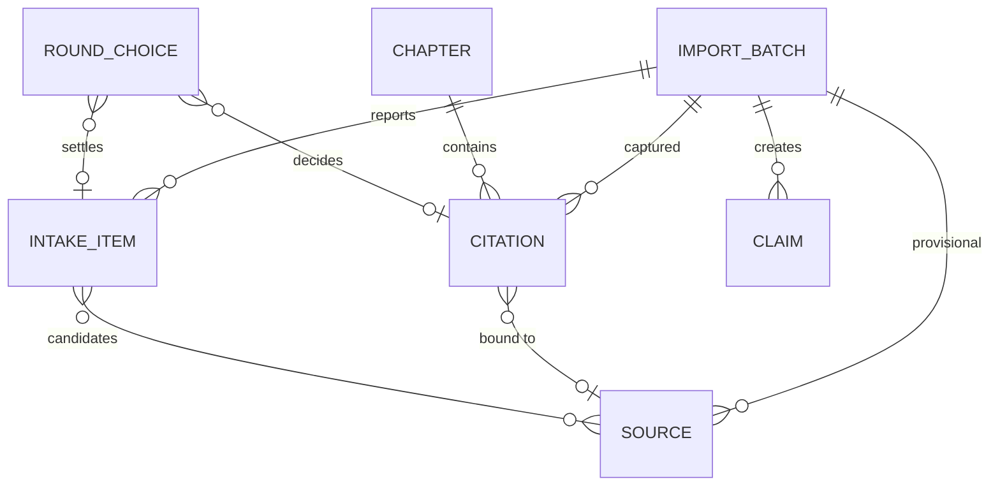
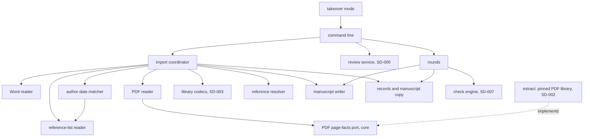

---
ddx:
  id: SD-015
  type: solution-design
  activity: design
  authoring:
    home: repo
  depends_on:
    - FEAT-015
    - stemma.architecture
    - stemma.data-design
    - stemma.concerns
    - stemma.adr-002
    - stemma.adr-009
    - CONTRACT-001
    - CONTRACT-002
    - CONTRACT-003
    - CONTRACT-004
    - CONTRACT-006
    - CONTRACT-007
    - SD-001
    - SD-002
    - SD-003
    - SD-005
    - SD-007
  schemas:
    - id: stemma.record
      version: "0"
      title: Stemma records
      path: docs/stemma/02-design/contracts/schemas/stemma-record.umf.json
      schemaFormat: umf
---

# Solution Design: Takeover of existing projects

**Feature**: [[FEAT-015]] | **Artifact**: `docs/stemma/02-design/solution-designs/SD-015-takeover-of-existing-projects.md`

## Scope

- Covers Word and PDF manuscript intake (FR-71, FR-95), the Stemma copy, the unverified graph, and resolution rounds (FR-71 to FR-73), reference lists and author-date linking (FR-92), the usable first report (FR-93), then construct and methodology suggestions (FR-82).
- **Pilot (M1)**: everything except suggestions (**M2**). The pilot's basic PDF is SD-008.
- Depends on SD-003 (library codecs, source records), SD-005 (review service), SD-007 (checks, annotations), and the CONTRACT-006 reader and edits. SD-002 captures sources. A project must be initialized first, which the takeover mode does when needed (SD-001).
- CONTRACT-003 owns intake behavior and reports; CONTRACT-006 F owns takeover output and edits; CONTRACT-002 owns commands.

## Build Order

Each of steps 1 to 6 depends on the ones before it. All are in the pilot. The PDF
reader steps P1 to P5 are below.

| Order | Step | Requirements | Design status |
|---|---|---|---|
| 1 | Word reader | FR-71 | Reading built (CONTRACT-003 F); embedded reference data detected, not decoded; no command uses it; no real saved file tested |
| 2 | Reference-list reader | FR-92 (ADC-01, ADC-02) | Built over a neutral document; some real entries go unread (CONTRACT-003, Proof Status) |
| 3 | Author-date recognition and linking | FR-92 (ADC-03 to ADC-08) | Built over a neutral document; some real citations are missed (CONTRACT-003, Proof Status) |
| 4 | Stemma copy and its reader | FR-35, FR-73 (CPY-01) | Reader built; nothing writes the copy |
| 5 | Checks that read the copy | FR-73, FR-92 (CPY-02) | `check` reads the copy (CONTRACT-002 C, "Reading the manuscript"); tested on invented text. No takeover writes a copy yet |
| 6 | Usable first report | FR-93 | Designed here; usability unmeasured |

### PDF reader build plan (FR-95)

Specified, not built. P1 to P4 need none of steps 4 to 6. Each step ends with its
tests passing on invented files and `./scripts/dev.sh check` passing.

| Step | Build | Done when |
|---|---|---|
| P1 | **Matcher marks.** Add `seams` and `hyphens` to a neutral paragraph and `unreadPages` and `unseparatedLists` to a neutral document; apply CONTRACT-003 I, "What the matcher does with the marks", in the list reader and matcher; add the reasons `uncertain_boundary`, `uncertain_hyphen`, `uncertain_layout`, `list_incomplete` | Hand-made neutral documents show each guard, with the split entry of US-117-AC3 not linked; every existing Word and matcher test passes unchanged; a property test shows that adding any mark to a document never adds a link |
| P2 | **PDF page facts.** Add the `core` port and implement it in `extract` over `readPdf`: for a manuscript, each page's lines and places, its state (invisible drawing, painted images or shapes), annotations, form values, link addresses, attachment names, layers, and image counts, read in a child process with a time stop. Move the CONTRACT-007 I layout rules the reader reuses into `core`. Extend `tests/pdf.ts` with annotations, invisible text, an image, and an attachment | Tests cover each page state and reported item; `pdf_unreadable` and `input_limit` cases; every source-conversion test gives byte-identical output |
| P3 | **Layout reader** in `intake`, a pure function of the port's page facts: removed lines, reading order, footnotes, paragraphs, headings, seams, hyphen marks, line places, account | US-117-AC1, AC2, AC4, AC5, AC7, AC8, AC9, AC12, AC14, AC17, AC18 at the reader and matcher level; the library's own piece count equals the account on every invented file |
| P4 | **List entries**: the separability rule, incomplete lists, unread pages | US-117-AC3, AC6, AC10; a seeded set with hanging, spaced, split, and run-on lists and a hand-made answer list links nothing wrong |
| P5 | **Takeover wiring**, after step 4 or with it: `takeover` accepts PDF; `ImportBatch.format` gains `pdf` in the record schema; intake items carry page places; the command line passes the `extract` port to `intake`; the file comparison of CONTRACT-003 I for both formats; the batch field for kept-hyphen words and, here or in step 5 if that comes later, the quotation rule of BR-1535 | US-117-AC1, AC10, AC11, AC13 to AC16 through the command |

After P4, run the developer report script on PDF manuscripts the author supplies,
privately; commit only counts and invented reproductions. Every producer stays
`untested` until openly licensed or invented-text files that it saved pass
(CONTRACT-003 A).

## Requirements Mapping

### Functional Requirements

| Requirement | Technical Capability | Component | Priority / step |
|---|---|---|---|
| PDF-01 to PDF-09 (FR-95) | Rule-based layout reading over the pinned PDF library, marks the matcher honors, stated limits | PDF reader, Author-date matcher | P0 / M1 pilot |
| INT-11 (FR-71, FR-95) | One file for each chapter | Import coordinator | P0 / M1 pilot |
| INT-12 (FR-71, FR-95) | A changed original is reported, not applied or added | Import coordinator | P0 / M1 pilot |
| PDF-10 (FR-95) | The batch keeps the words with a kept hyphen; quotation checks try both readings | Import coordinator, SD-007 engine | P0 / M1 pilot |
| INT-01, INT-03, INT-04, INT-07, INT-08 (FR-71) | Bounded read-only Word reader; staged import | Word reader, Import coordinator | P0 / M1 pilot |
| INT-02 (FR-71) | BibLaTeX, CSL-JSON, RIS intake | SD-003 codecs, Import coordinator | P0 / M1 pilot |
| INT-05, INT-06 (FR-71) | Support levels and nothing dropped silently | Intake report | P0 / M1 pilot |
| INT-09, INT-10 (FR-71) | Several files in one project; every comment reported | Word reader, Import coordinator | P0 / M1 pilot |
| ADC-01, ADC-02 (FR-92) | Reference lists read in two entry layouts, kept as found | Reference-list reader | P0 / M1 pilot |
| ADC-03 to ADC-08 (FR-92) | Rule-based recognition, one-match linking, full account | Author-date matcher | P0 / M1 pilot |
| CPY-01, CPY-02 (FR-73, FR-92) | Markers that keep the typed text; checks over the copy | Manuscript writer, SD-007 engine | P0 / M1 pilot |
| RPT-01 to RPT-03 (FR-93) | Grouped report; one choice for exact repeats | Intake report, SD-007 report, Rounds | P0 / M1 pilot |
| GRF-01 to GRF-07 (FR-72) | Records with origins; deterministic binding only | Graph builder, Reference resolver | P0 / M1 pilot |
| GRF-08 to GRF-10 (FR-72) | Unreviewed claims in effect, optional batch review, reference-list carry-forward | Graph builder, SD-005 review service | P0 / M1 pilot |
| RND-01 to RND-04, RND-06, RND-07, RND-09 (FR-73) | Computed worklist and atomic choices | Rounds | P0 / M1 pilot |
| RND-08 (FR-73) | Stemma copy and span edits | Manuscript writer | P0 / M1 pilot |
| SUG-01, SUG-02 (FR-82) | Suggestions as unreviewed records with passages | Takeover mode | P0 / M2 |

### NFR Impact on Architecture

| NFR | Requirement | Architectural Impact | Design Decision |
|---|---|---|---|
| Integrity | Originals unchanged | No write path to originals | Originals are opened read-only and not copied; their digests are recorded and compared after intake |
| Reliability | Same results across takeovers and resume | No saved session state | Deterministic reading and binding; worklist computed from records. Record IDs differ between runs, so comparison matches on origins and findings |
| Recovery accuracy | No uncertain footnote bound wrongly on seeded real files | Conservative binding | Bind only on one candidate under a named rule |
| Security | No execution, outside writes, or obeyed text | Untrusted parser boundary | Limits below; no external entities or fetches; writes limited to the project |
| Offline | No network | Local parsing | `takeover` uses no resolver |
| Performance (assumption) | 200 footnotes and 1,000 entries within 60 s | Single pass, indexed candidates | Measure on a stated machine |

## Solution Approaches

### Approach 1: Convert Word with an external converter, then parse the output
**Description**: Turn the file into Markdown or HTML with an existing converter.
**Pros**: Less format code; mature handling of common layout.
**Cons**: Embedded reference fields, revision marks, and unread content may be lost before Stemma can report them (unverified for any converter). A large external program adds install and license cost.
**Evaluation**: Rejected.

### Approach 2: Let a model read the document and build records
**Description**: The agent extracts references and claims directly.
**Pros**: Handles odd footnotes and languages.
**Cons**: Not repeatable, can invent data, and breaks the rule that only deterministic rules resolve without the author.
**Evaluation**: Rejected as the intake path. Model parses may come later only as saved unreviewed records (CONTRACT-003 F).

### Approach 3: Bounded reader of the Word package in Stemma
**Description**: Read body, notes, fields, and content controls directly, account for every text-bearing element, then bind by fixed rules.
**Pros**: Full control of omissions, fields, and limits.
**Cons**: Stemma owns a partial Word reader; real files will surprise it.
**Evaluation**: Selected. A package-free prototype read hand-built files only.

**Selected Approach**: Approach 3. The reader adds no library. It has its own
strict archive and XML readers, with the runtime's inflate and checksum. The
converters' readers (`packages/extract`) were not reused: their tag reader
accepts broken XML, so a truncated part would read as a whole one, and flattens
deep nesting without saying so; their archive reader keeps the last of two
entries with one name and has no entry-path or expansion-ratio check.

**Architecture/ADR impact**: `intake` owns Word and legacy formats, and now the
layout reading of PDF manuscripts. `extract` still owns the PDF format.
`intake` may not import another adapter or start a process, so `core` owns a
port for page facts (lines with their places, page states, annotations, and
other reported content) that `extract` implements, running the library in a
child process; the command line joins the two. No ADR changes.

### PDF manuscripts

| Approach | Finding | Decision |
|---|---|---|
| Use the source converter's output (`convertPdf`) as the manuscript | It is built for citing a source: it leaves paragraphs, tables, and reading order undetermined and keeps lines page by page. The reference-list reader needs one paragraph for each entry | Rejected as it stands; its rules are reused |
| Turn the PDF into Word with an external converter | It guesses structure and hides what it lost; another large program | Rejected |
| Read the structure tags some programs write into PDF | They could give paragraphs, headings, and tables. They are the producer's claim, many files have none, and no real file has been examined. On one invented untagged file the pinned library returned none | Deferred; look at real files first |
| A layout reader in `intake` over the pinned library, with marks the matcher honors | Repeatable; every doubt is visible; no new outside dependency | Selected |
| Recognition or a model reading page images | Not repeatable, can invent text | Rejected (FR-95) |

**Reuse.** `readPdf` (text, positions, sizes, limits, refusal of encrypted and
damaged files, download stamps) behind the port, and, from the converter's
structure rules, recurring heads, body text size, the raised-marker footnote
pairing, the heading size rule, and the two-column test. Those rules are pure
and move to `core`, which both adapters may use, so that neither copies them. The neutral document, reference-list
reader, matcher, report script, and `tests/pdf.ts` are extended, not copied.
New in Stemma: line joining, order doubt, page-number runs, the list
separability rule, page states, and annotation reading, all through the same
pinned library. On one invented file the library gave no sign in its text that
text was invisible, white, struck through, or on a switched-off layer, did not
return text placed off the page, and gave drawing modes, annotations, and
attachment names only through other calls.

## Domain Model

Shapes are CONTRACT-001. There is no round or session entity.

### Business Rules

**Intake**

- **BR-1501** — Atomic import: all records and chapter files are staged, validated as one graph, and committed by the journaled write of the Data Design, or none is. Nothing left by a failed run is an import.
- **BR-1502** — Accounting: every text-bearing part and element is converted, reported with position, or placed in an unconverted block. An element the reader does not know is reported, never skipped.
- **BR-1503** — Revision view: the reader takes the view with insertions applied and deletions removed (assumption), states it, and creates no citation from deleted text.
- **BR-1504** — Disagreement: embedded data, visible text, and library values are all kept. The citation shows each; no value is chosen silently.
- **BR-1505** — Duplicates: possible duplicate sources become intake items. Nothing merges.
- **BR-1506** — Partial data stays absent. Imported sources are candidates, carry no verification, and are reported as unchecked while they have no source file.

**Binding profile** (the profile name and version are written in the intake report)

- **BR-1507** — Embedded field: an item binds to a library entry on a unique equal identifier (DOI or ISBN) or, lacking one, unique equal folded title, first author family name, and year. Zero matches creates a provisional source from the field data; several go to the author.
- **BR-1508** — Full typed reference: it binds only when its folded title, first author family name, and year match exactly one entry.
- **BR-1509** — Short form: author family name and a short title that begins one earlier cited source's title, in document order, binds when exactly one qualifies.
- **BR-1510** — Ibid.: `ibid.` or `Ibid.` binds only when the immediately preceding note in document order holds exactly one citation, that citation is bound, and the note has no unread reference-like text. A stated locator is taken from this note; otherwise the locator stays absent (assumption).
- **BR-1511** — Everything else, including `a.a.O.`, `ebd.`, `op. cit.`, cross-note references, and any note the reader cannot classify, becomes an ambiguous or unclassified intake item with candidates where found. Model judgment never binds.

**Reference lists and author-date citations** (the profile is CONTRACT-003 H)

- **BR-1521** — List reading: every body paragraph of a detected list, other than a subheading, is an entry, read or unread, kept as found and carried forward by BR-1520. An entry whose authors cannot be read with certainty, a later family name of unknown length included, is unread, and one with a bracketed note is flagged. A list serves only the chapters of its own file.
- **BR-1522** — One match: an author-date citation links only when exactly one read entry in its chapter's list has the same authors, year, and suffix, and no unread entry could be the one meant. `et al.` forms and single-author forms never match each other's entries. A given name written in running text counts only where the entry types the same given name and no other entry could be meant by the family name alone. Other lists and libraries supply candidates only. This is an exception to BR-1511 for author-date forms: the matched thing is a list entry, and the source follows from that entry's own binding.
- **BR-1523** — Account: every bracketed year outside a list ends as linked, unresolved, or left unlinked with a reason. An unknown shape is left unlinked, never skipped. The intake check that the counts add up fails the import if they do not.
- **BR-1524** — Whole brackets: a parenthesis becomes markup only when every part is a citation form, so the writer never has to split the author's text. Otherwise it stays as typed and is listed.
- **BR-1525** — Following a binding: when the author binds a list entry to another source, its linked citations move with it in the same write.
- **BR-1526** — Exact repeats: open reference-entry items with identical `as_found` strings form a group, computed on each call. Intake merges none. One author choice may apply to the group, atomically, with a choice record for each item. A repeat added later is open until the author includes it.

**Claims and quotations**

- **BR-1512** — Claims: each body or note sentence that carries a citation yields one claim, unreviewed and in effect, whose text is the sentence, with its origin, and a claim span in the copy (assumption). No confidence, reason, or evidence is invented, so each is reported incomplete and without support until those exist. A model may add rewordings or further claims, also unreviewed.
- **BR-1513** — A quotation is attributed only where CONTRACT-006 D attributes it. Others stay unattributed and are reported.

**Rounds**

- **BR-1514** — Worklist: open findings on citations, quotations, and listed entries from a current check, plus intake items without an applicable choice, except `year_parenthesis` items, which are counted and listed on request. It is recomputed on each call and is never required before other work.
- **BR-1515** — One choice, one write: the effect on records and manuscript is staged, rechecked on the staged graph, and committed together with its `round_choice` and recheck. An interrupted choice is completed or rolled back at the next command.
- **BR-1516** — Actions: `remove` takes the occurrence out of the text and retires its record. `repoint` binds it to a source already in the project, or corrects its locator. `replace` binds it to a source the author newly supplies in its place, recording both (assumption on the line between the last two). `bind` settles an intake item by binding it to one of its candidates; `close` settles one that needs no citation and changes no finding. `restore_text` returns to plain text an occurrence that was wrongly read as a citation (CONTRACT-002 B).
- **BR-1517** — The command takes the author's action and target. It records no annotation, edits no result, and captures no source.
- **BR-1518** — Removal visibility: a claim left without a citation is reported by `takeover.removal` on every later check and build until it is cited again, rewritten, retired, or dismissed.
- **BR-1519** — Reruns: identical bytes write nothing unless the author passes `--again` (CONTRACT-002 B). A changed original, told apart as BR-1534 says, becomes an `original_changed` item and is not applied. No rerun overwrites a choice or an edit in the Stemma copy; a rerun with `--again` follows the same rule (assumption).
- **BR-1520** — Reference list: every entry of a reference list or bibliography section found in the manuscript is bound by the BR-1507 and BR-1508 rules or becomes a provisional source with an intake item, and is added to `bibliography_include` (CONTRACT-003 F). The list is not copied into the chapter files. The report states the count or that no list was found; lists are detected by CONTRACT-003 H, a rule to test on real files.

**PDF manuscripts** (the rules and numbers are CONTRACT-003 I)

- **BR-1527** — One path: a PDF reading yields the same neutral document and the same records, copy, report, and rounds as a Word reading. Only the reader and the marks differ.
- **BR-1528** — Structure by rule: the reader sets a role or a break only by a stated rule. It records what it could not determine and never assigns `table` or `caption`.
- **BR-1529** — Doubt only withholds: marks can make an entry unread, a bracket unlinked, or a citation unresolved. No mark creates or changes a link. A document without marks is matched exactly as before.
- **BR-1530** — Never choose a reading: where two readings of the text exist, as at a line-end hyphen, the text keeps what is printed, and a link or entry stands only if both readings agree.
- **BR-1531** — Whole lists or nothing: entries are taken from a PDF list only when its layout separates every one of them. Otherwise the lines are examined as text and the list links nothing.
- **BR-1532** — Unread pages: they are named, never recognized, and block links from any list they could affect.
- **BR-1533** — Said every time: the limits that no rule can detect are in every PDF report, not only when something looks wrong.
- **BR-1534** — Which file this is: the order of CONTRACT-003 I (same bytes, changed original, repeated text) applies to Word and PDF files in either order, before anything is staged. Only a changed original saves anything, its one item.
- **BR-1535** — Quotation readings: a PDF chapter's quotations are checked with and without each uncertain hyphen, and a result stands only if the readings agree (BR-1530). It ships with whichever of step 5 or P5 comes later; no version takes over a PDF and reads its copy without it.

BR numbers for this feature start at 1501 so that designs written in parallel cannot collide.

### Input limits

These starting caps meet CONTRACT-003 G. They are design assumptions to test against real files, are reported by `doctor`, and fail with `input_limit`.

| Limit | Cap |
|---|---|
| Word file size; total uncompressed size | 200 MiB; 1 GiB |
| One archive part; compression ratio per part over 10 MiB | 200 MiB; 200 to 1 |
| Archive entries | 10,000 |
| XML nesting depth; library JSON or brace depth | 256; 64 |
| One text value or library field | 1 MiB |
| One embedded reference field after decoding | 8 MiB |
| XML elements in one Word file; open fields inside one another | 3,000,000; 64 |
| Library file size; entries | 100 MiB; 100,000 |

For Word files: total uncompressed size is the sum of every entry's stated
size, and the ratio is an entry's size over its packed size, both checked for
every entry before any is expanded. The part cap and the ratio therefore apply
to parts the reader does not expand too. A text value is one run of XML text,
one attribute, or one paragraph's text. The 8 MiB cap, in place of the 1 MiB
one, applies to embedded data: a field's whole instruction, its stored data, a
content control's tag, and the drawing data Word keeps in `gfxdata`
attributes. The caps on elements and open fields bound memory (assumption).

For PDF files the caps are those of CONTRACT-003 I, "Limits and damage". They
are no more than the source converter's (SD-002) because a manuscript is
smaller than a library original (assumption). `readPdf` checks time only between
pages and caps text only after a page is read, so the `extract` port runs the library in a
child process that is stopped at the time limit. No memory cap or cap on expanded
page data is designed.

## System Decomposition

### Component: Word reader (`packages/intake`) — M1
- **Purpose**: Turn a Word package into a neutral document with positions, notes, fields, and omissions.
- **Responsibilities**: BR-1502, BR-1503; Zotero, Mendeley, and EndNote field decoders, each with its own support level; limits.
- **Requirements Addressed**: INT-01, INT-04, INT-06, INT-07, INT-08.
- **Interfaces**: Internal to `intake`; no Word shapes reach `core`.

### Component: PDF reader (`packages/intake`, with page facts from `packages/extract`) — M1
- **Purpose**: Turn a born-digital PDF into the neutral document with line places, marks, page states, reported items, and an account.
- **Responsibilities**: BR-1528, BR-1532, BR-1533, and the marks of BR-1529 to BR-1531.
- **Requirements Addressed**: PDF-01 to PDF-09, INT-06, INT-07, INT-08.
- **Interfaces**: Reads the `core` page-facts port, which `extract` implements; the port's shapes are Stemma's, not the library's. Source conversion's output does not change.
- **Owned by TDs**: US-117.

### Component: Reference resolver (`packages/intake`) — M1
- **Purpose**: Classify notes and bind references by the binding profile.
- **Responsibilities**: BR-1504 to BR-1511; library candidates from SD-003 codecs.
- **Requirements Addressed**: GRF-04, GRF-05, GRF-06.
- **Owned by TDs**: US-101.

### Component: Reference-list reader (`packages/intake`) — M1
- **Purpose**: Find each file's lists and read entries.
- **Responsibilities**: BR-1520, BR-1521.
- **Requirements Addressed**: ADC-01, ADC-02, GRF-10.
- **Owned by TDs**: US-113.

### Component: Author-date matcher (`packages/intake`) — M1
- **Purpose**: Find bracketed years, read citation forms, link or explain each.
- **Responsibilities**: BR-1522 to BR-1524. Pure functions over the reader's neutral document and the list entries, so that the profile can be tested without Word files.
- **Requirements Addressed**: ADC-03 to ADC-08.
- **Owned by TDs**: US-113.

### Component: Graph builder and import coordinator (`packages/intake` using `core` ports) — M1
- **Purpose**: Create records, intake items, the report, and record the originals' digests.
- **Responsibilities**: BR-1501, BR-1512, BR-1513, BR-1519, BR-1527, BR-1534; the words BR-1535 reads; the intake report's groups.
- **Requirements Addressed**: INT-02, INT-03, INT-05, INT-09, INT-10, INT-11, INT-12, GRF-01 to GRF-03, GRF-07, GRF-08, RPT-01, RPT-03.
- **Interfaces**: `takeover` and `import` (CONTRACT-002 B); outputs per CONTRACT-003 F.

### Component: Manuscript writer (`packages/manuscript`) — M1
- **Purpose**: Write chapter files and apply span edits.
- **Responsibilities**: Chapter division with its stated basis, escaping, markers, unconverted blocks. Output must parse under the same reader that checks use, or the import fails.
- **Requirements Addressed**: RND-08, INT-06, CPY-01.
- **Interfaces**: CONTRACT-006 C, E, F; `ManuscriptRepository` port.

### Component: Rounds (`packages/core`) — M1
- **Purpose**: List remaining work and apply choices.
- **Responsibilities**: BR-1514 to BR-1518, BR-1525, BR-1526; uses SD-007 engine for rechecks.
- **Requirements Addressed**: RND-01 to RND-04, RND-06, RND-07, RND-09, RPT-02.
- **Interfaces**: `rounds status`, `rounds choose`.
- **Owned by TDs**: US-102, US-103.

### Component: Takeover mode (`skills/stemma`) — M1; suggestions M2
- **Purpose**: Walk the author through intake findings, batches, and rounds.
- **Responsibilities**: Explain and suggest without choosing; ask about rights without waiting for an answer; send only needed excerpts. In M2, suggest constructs and methodology with manuscript passages.
- **Requirements Addressed**: RND-03, GRF-09, SUG-01, SUG-02.
- **Interfaces**: CONTRACT-004 B, C.

### Component Interactions

## Technology Rationale

| Layer | Choice | Why | Alternatives Rejected |
|---|---|---|---|
| Word reading | Stemma reader with its own strict archive and XML readers over the pinned runtime | Accounting, limits, and refusing damaged files are requirements | External document converter; model reading; the converters' forgiving tag reader |
| PDF reading | Stemma layout rules over the pinned `pdfjs-dist`, behind a `core` port that `packages/extract` implements | Same library and refusals as source conversion; every doubt can be marked | External PDF-to-Word or layout tools; recognition; model reading |
| Reference binding | Fixed rules over library and prior citations | Repeatable; sends doubt to the author | Citation-parsing services and trained parsers: other runtimes, and research found weak footnote results |

## Traceability

| Requirement ID | Component | Design Element | Test Strategy |
|---|---|---|---|
| INT-01 | Word reader | BR-1502 | Files saved by named tools and versions; none tested yet |
| INT-02 | Coordinator | SD-003 codecs | Real exported libraries; malformed entry names its line |
| INT-03 | Coordinator | Read-only originals | Hash before and after takeover and rounds |
| INT-04 | Word reader | Field decoders | Real files per variant; undecodable field is listed |
| INT-05 | Intake report | `untested` label until real-file tests pass | Report test per variant |
| INT-06 | Word reader, writer | BR-1502 | Seeded text box, comment, unknown element, deleted text |
| INT-07 | Word reader | Limits; text as data | Hostile fixtures: path escape, expansion, XML entities, instruction text |
| INT-08 | Coordinator | BR-1501 | Corrupt, encrypted, and interrupted imports leave no records |
| INT-09 | Coordinator | BR-1519 | Second file after a choice; the choice stands |
| INT-10 | Word reader | BR-1502 | Seeded comments all listed with text and position |
| INT-11 | Coordinator | BR-1534 | Invented Word and PDF of one text, in both orders, and with `--separate` (US-117-AC13) |
| INT-12 | Coordinator | BR-1519, BR-1534 | US-117-AC15 on invented Word and PDF files |
| PDF-10 | Coordinator, check engine | BR-1530, BR-1535 | US-117-AC16; Word quotation tests unchanged |
| PDF-01, PDF-09 | PDF reader, Coordinator | BR-1527 | US-117-AC1 |
| PDF-02, PDF-03 | PDF reader | BR-1528 | US-117-AC2, AC7, AC12 on invented files |
| PDF-04, PDF-05 | PDF reader, matcher, list reader | BR-1529 to BR-1531 | US-117-AC3 to AC6; added marks never add a link; Word tests unchanged |
| PDF-06, PDF-07 | PDF reader, Intake report | BR-1533 | US-117-AC8, AC9 |
| PDF-08 | PDF reader | BR-1532 | US-117-AC10 |
| ADC-01, ADC-02 | Reference-list reader | BR-1521 | Invented lists in both layouts, with an unread entry and a file with no list |
| ADC-03, ADC-04, ADC-07 | Author-date matcher | CONTRACT-003 H forms | One invented case per form, lead-in, locator, and date range |
| ADC-05, ADC-06 | Author-date matcher | BR-1522 | Hand-made answer list with solo and co-authored look-alikes, a missing entry, and an unread one: zero wrong links; two runs identical |
| ADC-08 | Author-date matcher | BR-1523, BR-1524 | Seeded count equals linked plus unresolved plus left unlinked |
| CPY-01 | Manuscript writer | CONTRACT-006 F | Round trip through the reader keeps items; records keep text and position |
| CPY-02 | SD-007 engine | CONTRACT-002 C | After takeover no listed check is unrun for want of a reader; a cited entry is not uncited |
| RPT-01, RPT-03 | Intake report, SD-007 report | CONTRACT-002 C | Grouped and flat views hold the same findings |
| RPT-02 | Rounds | BR-1525, BR-1526 | One choice over three repeats; an injected failure writes nothing |
| GRF-01 to GRF-03 | Graph builder | Origins on every record | Fixture inventory against created records |
| GRF-04, GRF-05 | Reference resolver | BR-1507 to BR-1511 | Seeded footnote set with zero wrong bindings; two runs bind identically |
| GRF-06 | Graph builder | BR-1506 | Partial reference keeps absent fields |
| GRF-07 | SD-007 `source.held` | Candidate sources | Recovered reference is reported unchecked until it has a source file |
| GRF-08, GRF-09 | SD-005 review service | BR-1512 | Claims in effect at once; batch review with one edit and one retirement |
| GRF-10 | Graph builder | BR-1520 | Synthetic reference list with an uncited and an unbindable entry |
| RND-01 | Rounds | BR-1514 | Worklist equals seeded failures and items |
| RND-02 | Rounds | Computed state | Stop, reopen, compare results and worklist |
| RND-03 | Rounds, mode | BR-1516 | One test per action; hand-run transcript shows no unchosen change |
| RND-04, RND-06 | Rounds | BR-1515 | Interrupt at each write step; recheck includes dependants |
| RND-07 | Rounds | BR-1517 | No annotation or result written by a choice |
| RND-08 | Manuscript writer | Span edit | Bytes outside the span unchanged; stale file refused |
| RND-09 | Rounds, SD-007 | BR-1518 | Removal of a sole citation is reported and the build completes |
| SUG-01, SUG-02 | Takeover mode, SD-005 | Unreviewed records with origins | Saved model output: in effect, unreviewed, retirable |

### Experience Traceability

Agent turns are in [UF-015](../flows/UF-015-takeover-rounds/UF-015.md) and follow [DESIGN.md](../DESIGN.md); FEAT-015 user stories name the tasks.

### Gaps

- [ ] **PDF reading is untested and partly blind.** No PDF reader is built and no real producer's manuscript has been examined. Tracked changes, hidden or struck text, tables, block quotations, and text off the page cannot be detected or recovered, so a report with nothing listed does not show that the reading is right. A running head that fewer than three pages repeat can stay in the text.
- [ ] **PDF may link little.** Page breaks, hyphens, other list layouts, and any unread page withhold links. How much a real chapter loses is unknown; measure it before loosening a rule.
- [ ] **Sentence places.** A taken-over sentence keeps its line places only if the import coordinator carries them into its origin; the origin's `document_position` form for PDF is page and line, to be fixed at P5.
- [ ] **Some references are never checked.** Author-date citations in brackets that hold a year are now accounted for (BR-1523): unresolved ones are open findings, but left-unlinked ones are only listed. Citations with no bracketed year, unrecognized short forms the reader misreads as prose, and unclassified notes stay as text with no listing or check beyond the notes. An unclassified note left unsettled is listed by `rounds status` and the intake report only. Intake items with no citation are not findings, so a book can be labelled checked clean while they remain; text the reader never recognized stays invisible. The intake report must state each count and limit.
- [ ] **Takeover starts with a long report.** Every extracted claim is unreviewed, incomplete, and unsupported at first. Grouping and clear next steps must keep the report usable; the pilot must measure it.
- [ ] List detection in Word files and the author-date profile have had only a limited trial through a developer script (CONTRACT-003, Proof Status), which has its own rough Word conversion. The Word reader does not feed the profile yet.
- [ ] The Word reader does not decode embedded reference data (INT-04). Each Zotero, Mendeley, EndNote, or other citation field is detected and returned raw, so INT-04 is not met.
- [ ] Citations in tables are listed, not read, until the markup can carry them (PRD open question).
- [ ] Whether check reports should count left-unlinked parentheses is open (PRD).
- [ ] The pilot PDF formats Chicago notes; a manuscript that cites in author-date form may need another style (PRD open question; SD-008).
- [ ] The producing tools and versions the pilot must cover are open (FEAT-015).

## Concern Alignment

- **Concerns used**: `security-owasp`, `citation-integrity`, `deterministic-checks`, `honest-assurance`, `hexagonal-architecture`, `plain-file-graph`, `rights-and-permissions`, `cross-platform`, `testing`.
- **Constraints honored**: Legacy values preserved; originals never written; tests use synthetic or openly licensed files, and real-tool files must meet that rule. Author-date tests copy real patterns with invented text; an author's chapters and their answer lists are never committed.
- **ADRs referenced**: ADR-002, ADR-009; ADR-007 for local and release-tag tests.
- **Departures**: None.

## Constraints & Assumptions

- **Constraints**: One writer at a time; atomic multi-file writes are unproven on three file systems. Takeover extracts claims without a model.
- **Assumptions**: The binding rules, claim-per-sentence rule, revision view, and caps may be wrong on real manuscripts. Wrong caps reject honest files or admit hostile ones.
- **Dependencies**: SD-002, SD-003, SD-005, SD-007; the CONTRACT-006 reader.

## Risks

| Risk | Prob | Impact | Mitigation |
|---|---|---|---|
| Real Word, Zotero, Mendeley, or EndNote files differ from fixtures | H | H | Get real saved files first; label each variant untested until passed |
| A rule binds a footnote to the wrong source | M | H | One-candidate rules; seeded set; show the rule used |
| A rule links an author-date citation to the wrong entry | M | H | One full match; unread entries block a link; hand-checked answer list |
| A PDF layout rule joins or divides text wrongly with no mark, and a citation links wrongly | M | H | Withhold links at every doubtful join; seeded answer list with zero wrong links; private runs before any support claim |
| PDF marks withhold so many links that the report is unusable | M | M | Count by reason; measure on real chapters; advise the Word file |
| A hostile PDF exhausts memory | M | M | Size, page, text, and time caps; child process; no memory cap yet |
| Real reference lists use layouts the reader cannot parse | H | H | Keep and list unread entries; citations that could name them stay unresolved; measure on pilot chapters |
| German, author-date, or non-Latin notes go unrecognized | H | H | Report counts and limits; author review |
| Markup cannot carry the pilot chapter's structure | M | H | Unconverted blocks and lost-style report; revise CONTRACT-006 |
| Hundreds of incomplete and unsupported findings on extracted claims overwhelm the author | H | H | Group by cause; optional batch review; measure in the pilot |
| A finished book holds a claim left unsourced by a removal | M | H | Report on every check and build |
| Every recovered reference starts reported by `source.held` | H | M | Expected starting state; worklist groups by source |

The only evidence is a prototype on hand-built files on one macOS system, with fixtures and code from the same agent. It resolved 9 of 10 resolvable short forms with none wrong and missed German and author-date forms. Linux and Windows are untested.

## Schema Basis

Inspected through CONTRACT-001: UMF core 0.10.0 with `umf.ddd` 0.1.0; Stemma schema version 0, reused without local additions. No record has been validated against it.

The design consumes the `stemma.record` UMF document in `ddx.schemas` and adds no shape. Word and library formats stay native; intake and loss reports are CONTRACT-003 envelopes. Binding rules are outside UMF and need code and tests.
